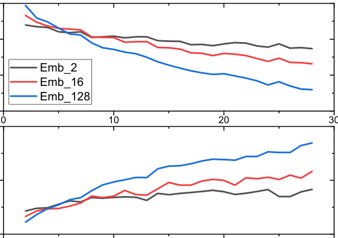
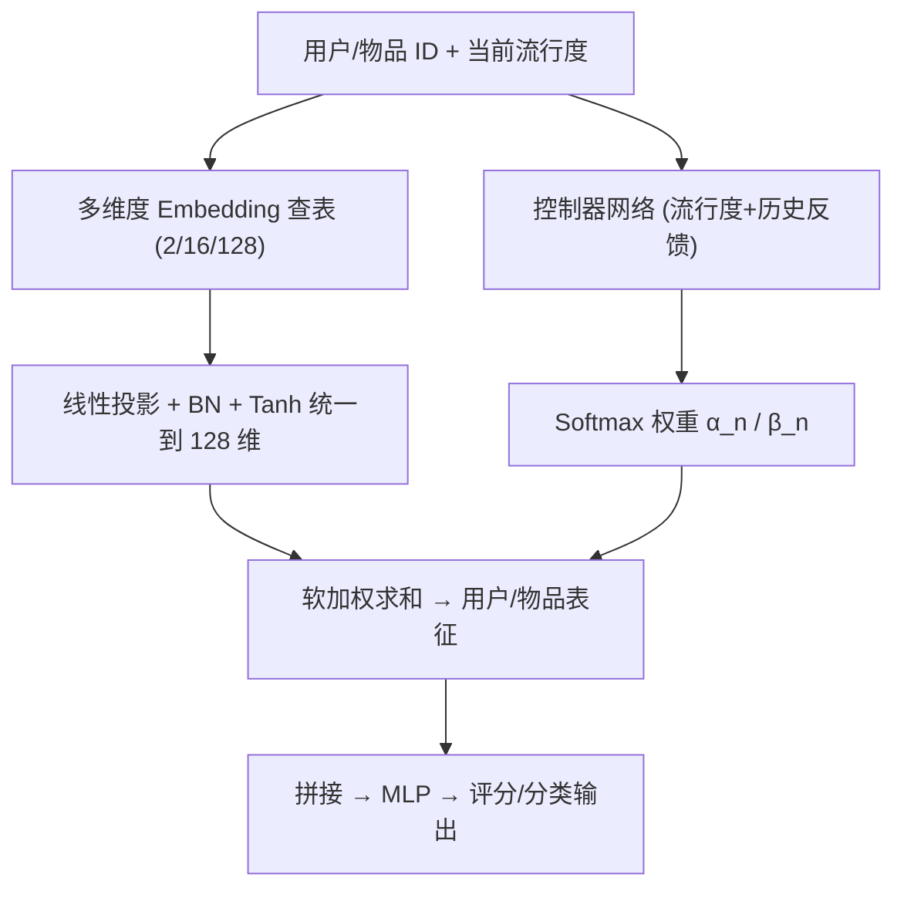
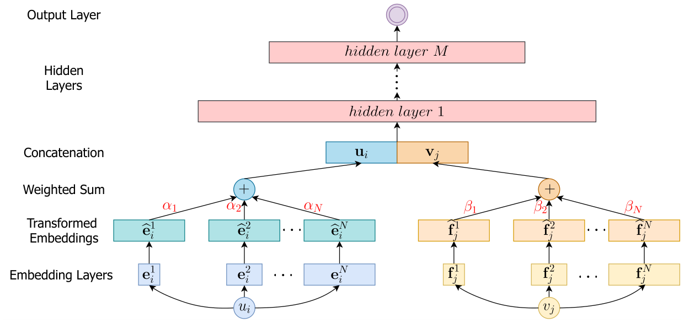

# AutoEmb: Automated Embedding Dimensionality Search in Streaming Recommendations (流式推荐中的自动化嵌入维度搜索)

- **会议/期刊**: ICDM 2021（arXiv 2020-02）
- **作者与机构**: Xiangyu Zhao、Jiliang Tang（Michigan State University）；Chong Wang、Ming Chen、Xudong Zheng、Xiaobing Liu（字节跳动）
- **推荐链路定位**: 召回 / Embedding 表征层（对精排同样适用）
- **研究方向**: 协同过滤与双塔召回 / 冷启动与长尾推荐
- **论文原文**: [https://arxiv.org/abs/2002.11252v2](https://arxiv.org/abs/2002.11252v2)
- **开源代码**: 暂未开源

## TL;DR (1分钟核心速览)

现有 DLRS 几乎都为全体用户/物品预定义**统一**的 embedding 维度 $d$，但流行度差异巨大时，"短向量利于冷启动、长向量利于热门项"这一矛盾无法用单一$d$化解。AutoEmb 把$N$ 个不同维度空间的 embedding 统一投影到同一维度后**软加权求和**，由以流行度为输入的控制器输出权重，并用 DARTS 式双层优化在流式数据上动态更新控制器。在 ML-20m / ML-latest / Netflix Prize 三个评分数据集上，相对同存储开销的 FSE 基线，MSE 相对下降 **2.01%–2.31%**，Accuracy 提升 **0.36%–0.79%**。

## Background & Motivation (背景与核心矛盾)

- **主流范式**: NCF / DeepFM 等 DLRS 以 `embedding 层 → MLP 隐层 → 输出层` 三段式为主，绝大多数研究集中改造隐层与输出层的网络结构，embedding 层长期被当作"统一固定维度的查表操作"。
- **前人局限 ①（容量-数据失配）**: 小维度参数量少、容量低，流行度小时可快速收敛，但无法编码丰富信息；大维度需大量交互才能训好，在长尾用户/物品上严重欠拟合。统一维度必然在两端之一吃亏。
- **前人局限 ②（静态假设）**: MDE / ME 等混合维度方法要求**预先知道**每个用户/物品的流行度并静态分配大维度给热门 ID；而工业流式系统中新用户/新物品持续涌入、流行度逐日漂移，静态分配不可用。
- **核心洞察 (Key Insight)**: MOVIELENS-20M 预实验（图 1）显示，当流行度 $ppl$ 从 1 增长到 100 时，Emb_2 先是优于 Emb_16/128，随后被反超且差距持续扩大——**最优维度是流行度的单调递增函数**，因此维度不应是超参，而应是随流行度动态生成的"逐样本决策"。
- **本文切入点**: 把维度选择从"人工超参"重构为"可微架构搜索"：控制器只看流行度与历史反馈即输出维度权重，整个框架端到端可反向传播。

<figure class="paper-figure" markdown="span">
  <figcaption>图 1：嵌入维度对推荐效果的影响。</figcaption>
</figure>

## Method (核心方法设计)

### 1. 整体框架 (Overall Architecture)

对每个用户（物品同构）先并行查表得到 $N=3$个不同维度的原始向量$\{\mathbf{e}^1_i,\dots,\mathbf{e}^N_i\}$（$d_n\in\{2,16,128\}$），经各自独立的线性层投影到统一维度$d_N=128$，再做 BatchNorm+Tanh 使其**量纲可比**；控制器接收"当前流行度 + 上轮所选维度及其对应损失"这 38 维上下文，经两层 FC 与 Softmax 输出权重$\{\alpha_n\}$；随后对 3 个投影向量做加权求和得到最终用户表征，与物品表征拼接后送入 MLP 输出预测。训练上采用 DARTS 式交替优化：控制器参数$\Theta$用验证集梯度更新、推荐模型参数$\mathbf{W}$ 用训练集梯度更新，在流式批次上以 "evaluate → train → evaluate" 循环推进。

<figure class="paper-figure" markdown="span">
  <figcaption>图 5：增强型 DLRS 架构。</figcaption>
</figure>

### 2. 关键设计拆解 (Key Designs)

1. **维度统一投影 + 软选择（解掉"隐层输入维度必须固定"的死结）**：原架构第一隐层输入维度写死，无法接收异构维度。作者用 $N$个线性层把各分支拉到同一空间：$\tilde{\mathbf{e}}^n_i=\mathbf{W}_n^{\top}\mathbf{e}^n_i+\mathbf{b}_n,\ \mathbf{W}_n\in\mathbb{R}^{d_n\times d_N}$，再做 BN+Tanh 消除不同分支的尺度差异；最终$\mathbf{u}_i=\frac{1}{N}\sum_{n=1}^{N}\alpha_n\tilde{\mathbf{e}}^n_i$。把硬选择（argmax）换成软加权，是让"维度"这一离散决策进入梯度图的关键一步；物理直觉是**用权重插值代替维度裁剪**，避免硬切换造成的表征断层。

2. **控制器网络（把维度搜索降维成权重回归）**：逐用户独立学权重不可行（长尾用户交互太少），故引入**跨用户共享**的控制器 $\pi_\Theta$，输入含显式流行度与上一轮 (维度, 损失) 反馈，输出$\alpha=\mathrm{Softmax}(\mathrm{FC}([\,ppl_i;\ \text{prev-}n;\ \text{prev-}loss\,]))$。显式喂入流行度使控制器能学到"$ppl\uparrow\Rightarrow$ 偏大维度"的先验，共享参数则让长尾用户从热门用户的海量交互中"借"到泛化能力。

3. **训练目标、负采样与推理开销**：形式化为双层优化 $\min_{\Theta}\mathcal{L}_{val}(\mathbf{W}^*(\Theta),\Theta)\ \text{s.t.}\ \mathbf{W}^*=\arg\min_{\mathbf{W}}\mathcal{L}_{train}(\mathbf{W},\Theta^*)$，并用一阶近似$\nabla_\Theta\mathcal{L}_{val}\approx\nabla_\Theta\mathcal{L}_{val}(\mathbf{W}-\xi\nabla_{\mathbf{W}}\mathcal{L}_{train},\Theta)$规避内层收敛开销。$\mathcal{L}$为逐样本点式损失（回归用 MSE、分类用 5 类交叉熵），**无负采样**（评分预测范式）。与 CV 版 DARTS 不同，本文**不做离散化导出**，因为流行度持续漂移，必须在线保留软权重。推理代价：每 ID 需额外跑 3 条线性投影 + 加权（权重只依赖流行度，可离线缓存），原始存储仍为$2+16+128=146$ 维，与 FSE 的 146 维持平，但中间 128 维投影向量带来额外显存。

## Experimental Setup & Evaluation Protocol (实验设置与评估协议)

- **数据集与预处理**: 无 `5-core` 过滤，保留全量评分；**剔除年龄、品类等全部上下文特征**，只留 user-id / item-id，以纯化"维度选择"这一变量。

| 数据集 | #Users | #Items | #Interactions | 密度 | 特征/场景说明 |
| :--- | :---: | :---: | :---: | :---: | :--- |
| Movielens-20m | 138,493 | 27,278 | 20,000,263 | 0.53% | 评分 1∼5，含大量长尾 |
| Movielens-latest | 283,228 | 58,098 | 27,753,444 | 0.17% | 用户数最多、极稀疏 |
| Netflix Prize | 480,189 | 17,770 | 100,480,507 | 1.18% | 物品数最少、单物品极热门 |

- **数据划分与防穿越**: 70% 交互用于离线参数估计（offline estimation），30% 用于在线学习（online inference），采用**流式批处理**而非 `Leave-One-Out`/比例划分：**没有预切分的固定验证集与测试集**，$\mathcal{L}_{val}$ 从"近期历史交互中采样一个 mini-batch"实时构造，评测指标在每批预测后即时记录并累计——"evaluate, train, evaluate, train…" 交替推进。
- **排名评测协议**: 本文**不做排序评测**，既非 `Full-Ranking` 也非 `Sampled Ranking`，而是**点式评分拟合**：回归任务先二值化评分为 $\{0,1\}$ 用 MSE + Acc(阈值 0.5)；分类任务视 1∼5 为 5 类用 CE + Acc。这是一处明显折价——无法反映 Top-K 列表质量。
- **对比基线与超参设置**: 仅 3 个基线（`FSE` 固定维度 146 $=2+16+128$以对齐存储；`SAM` 与本文同架构但控制器与模型在同一批数据上端到端共训；`DARTS` 为每用户/物品各学 3 个实值权重）。$N=3$，隐层 256→512、512→512，批大小 500，DLRS 学习率 0.01、控制器 0.001，均经交叉验证调参；结果以多次运行均值 ± 标准差报告。

## Key Experimental Results (实验关键数据)

### 1. 主实验对比 (Main Results)

| 数据集 / 任务 | 指标 | FSE | SAM | DARTS | AutoEmb | Improv. |
| :--- | :--- | :---: | :---: | :---: | :---: | :---: |
| ML-20m / 回归 | MSE | 0.1840 | 0.1819 | 0.1812 | **0.1803** | ↓2.01% |
| ML-20m / 回归 | Acc | 0.7211 | 0.7239 | 0.7245 | **0.7259** | ↑0.67% |
| ML-20m / 分类 | CE | 1.1464 | 1.1423 | 1.1416 | **1.1395** | ↓0.60% |
| ML-20m / 分类 | Acc | 0.4943 | 0.4958 | 0.4970 | **0.4982** | ↑0.79% |
| ML-latest / 回归 | MSE | 0.1809 | 0.1803 | 0.1797 | **0.1790** | ↓1.05% |
| ML-latest / 分类 | CE | 1.1257 | 1.1249 | 1.1242 | **1.1233** | ↓0.21% |
| ML-latest / 分类 | Acc | 0.5049 | 0.5062 | 0.5071 | **0.5079** | ↑0.59% |
| Netflix / 回归 | MSE | 0.1821 | 0.1812 | 0.1807 | **0.1779** | ↓2.31% |
| Netflix / 回归 | Acc | 0.7290 | 0.7302 | 0.7309 | **0.7316** | ↑0.36% |
| Netflix / 分类 | CE | 1.1102 | 1.1092 | 1.1085 | **1.1076** | ↓0.23% |
| Netflix / 分类 | Acc | 0.5096 | 0.5109 | 0.5119 | **0.5127** | ↑0.61% |

### 2. 消融实验 (Ablation Study)

原文未提供标准 `w/o` 消融表，但三个基线恰好构成逐级拆解（依次去掉"混合维度""AutoML 双层优化""控制器网络"），此处以其结果作组件归因：

| 变体 | 移除的组件 | Netflix MSE | ML-20m MSE | 归因 |
| :--- | :--- | :---: | :---: | :--- |
| FSE (d=146) | 混合维度 + 控制器 | 0.1821 | 0.1840 | 全部组件缺失 |
| SAM | 去掉 AutoML（验证集优化） | 0.1812 | 0.1819 | 控制器有价值但过拟合 |
| DARTS | 去掉控制器网络（改逐 ID 权重） | 0.1807 | 0.1812 | 权重无共享、无流行度先验 |
| AutoEmb | —— | **0.1779** | **0.1803** | 完整框架 |

### 3. 关键实验发现 (Key Findings)

1. **AutoML 双层优化是抗过拟合的核心，而非"有控制器就行"**：SAM 在离线训练早期（样本 $<5\times10^6$）是三者中最差的，随数据量增大才反超 FSE（图 8），说明在同一批训练数据上共训控制器会严重过拟合；AutoEmb 把控制器放到验证集上更新后，在**全训练周期**均领先，冷启动阶段优势最大。
2. **共享控制器 > 逐 ID 自由权重**：DARTS 为每个 ID 单独学 3 个实值权重，长尾 ID 因交互稀少导致权重训练不足；AutoEmb 的控制器跨 ID 共享参数并显式输入流行度，Netflix 上 MSE 由 0.1807 进一步降到 **0.1779**（相对 FSE 降 2.31%，也是三数据集中的最大增益）。
3. **权重分布确实学到了"流行度 → 维度"的单调映射**：图 7 显示低 $ppl$用户权重集中在 Emb_2，$ppl$升高后逐渐转移至 Emb_16/Emb_128；分流行度桶评测中，小$ppl$ 桶内 FSE 明显劣于 SAM/AutoEmb，验证了短向量对冷启预测的正向作用，也解释了 Netflix（物品极热门、长尾物品少）上绝对增益最大的现象。

## Highlights & Limitations (亮点、对比与审稿批判)

- **与代表作对比 (vs. Prior Work)**: 与 MDE/ME 类混合维度方法的本质差异在于**放弃"静态流行度预先分配"**，改为逐批动态生成权重，因而适配流式增删 ID 的场景；与标准 DARTS 的差异在于**不做离散架构导出**（流行度漂移使固定维度失效），并用共享控制器替代逐 ID 独立权重；与 SAM 的差异在于把控制器从训练损失搬到了验证损失上。
- **可迁移亮点**: ① "多维度分支 + 统一投影 + 软加权"是一套通用的特征容量自适应模板，可直接套用到多模态特征、多域特征或不同粒度序列编码器的融合权重上；② 把 Embedding 维度当超参搜索的范式，可迁移到"Embedding 表分片/量化位宽"的在线自适应选择，对存储受限的召回索引有直接价值。
- **审稿级局限批判**: ① **评测协议最弱**：无独立测试集、无 Top-K 排序指标（NDCG/HR@K），所有增益都在 $10^{-4}$量级（Acc 提升不足 0.8%），且未见显著性检验，难以排除噪声；② **收益与代价不成比例**：推理时为每个 ID 需跑 3 条线性投影 + BN + 加权，虽然权重可按流行度缓存，但中间 128 维投影向量显著抬高显存与在线延迟，论文对时延/吞吐零测量；③ 增益的物理上限被$N=3$与手工给定维度集合$\{2,16,128\}$锁死，维度候选集本身仍是人工先验；④ 公式 (7) 中额外乘上的$1/N$因子在$\sum_n\alpha_n=1$ 时属于冗余缩放，符号推导的严谨度有瑕疵。

## Rating (四维评分)

- **方法创新性 (Novelty)**: ⭐⭐⭐ （把 Embedding 维度从超参重构为可微逐样本决策，思路新颖，但核心优化器几乎是 DARTS 的直接搬运，缺少容量-流行度关系的理论/谱分析支撑）
- **评估协议与实验扎实度 (Protocol & Experiments)**: ⭐⭐ （三数据集双任务覆盖尚可且有 ± 标准差，但无独立测试集、无排序指标、无显著性检验，增益幅度极小）
- **写作与数学规范度 (Clarity & Rigor)**: ⭐⭐⭐ （投影-归一化-软选择三段式公式清晰，但控制器 38 维上下文的具体构成与 Eq.(7) 的 $1/N$ 缩放未交代清楚）
- **工业落地与复现价值 (Industrial & Practical Value)**: ⭐⭐⭐ （流式"evaluate-train"循环与字节跳动线上场景高度契合，存储开销与固定维度持平，但推理多分支计算未做成本评估，且无开源代码）

