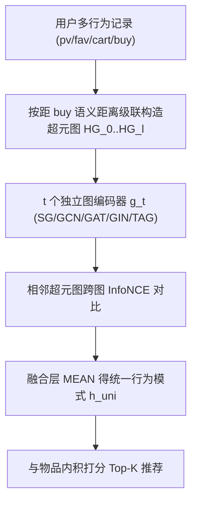
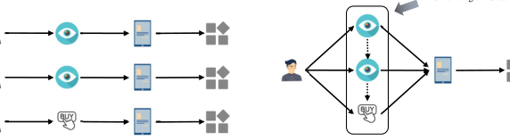
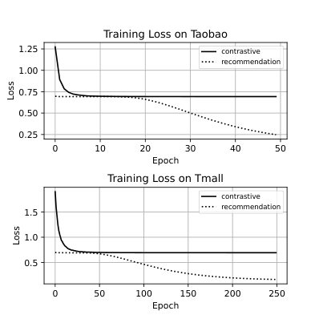

# Hyper Meta-Path Contrastive Learning for Multi-Behavior Recommendation (超元路径对比学习用于多行为推荐)

- **会议/期刊**: ICDM 2021 (Regular Paper)
- **作者与机构**: Haoran Yang, Hongxu Chen, Lin Li, Philip S. Yu, Guandong Xu (UTS / 武汉理工 / UIC)
- **推荐链路定位**: 召回（多行为用户表征 + 内积 Top-K 排序）
- **研究方向**: 自监督对比学习与交互去噪 / 图神经网络与知识图谱推荐
- **论文原文**: [https://arxiv.org/abs/2109.02859v1](https://arxiv.org/abs/2109.02859v1)
- **开源代码**: [https://github.com/Haoran-Young/HMG-CR](https://github.com/Haoran-Young/HMG-CR)

## TL;DR (1分钟核心速览)

多行为推荐的主流做法（边类型感知 GNN 聚合、多任务辅助监督）都假设"行为之间是简单固定融合或线性前置依赖"，无法刻画"直接买"与"反复浏览后买"这类顺序语义差异。本文提出 **超元路径 (hyper meta-path)** 把同一用户-物品间的多条元路径按时间序合成一张超元图，并将行为按"距 buy 的语义距离"级联增量构造出 $|\mathcal{R}|$ 张超元图；再用 **跨图 InfoNCE** 逐步对比相邻超元图，自适应地剥离出每一层新增行为模式，最后线性融合 + 内积打分。在 Taobao/Tmall（`5-core` + `Leave-One-Out`）上，Recall@5 相对最优基线提升 **24.50%/27.59%**，NDCG@5 提升 **33.82%/45.73%**。

## Background & Motivation (背景与核心矛盾)

- **主流范式**: 一是边类型感知 GNN（RGCN/GAT）在异构交互图上按行为类型加权聚合；二是多任务学习（NMTR/EHCF）把 pv/fav/cart 作为辅助任务，用级联监督做主任务 buy 预测。
- **前人局限 ①**: 元路径方法需在异构图中穷举或学习元路径方案，且一条条独立元路径**无法表达元路径之间的关系**——看到三条 `u→pv→i`、`u→fav→i`、`u→buy→i` 仍不知用户是"直接下单"还是"反复比价后下单"。
- **前人局限 ②**: 多任务方法硬假设"每种行为与前一行为强相关、表征在空间中相邻"，但用户常跳过 cart 直接 buy；GNN 聚合则被占比 85%+ 的 pv 语义淹没，边类型信息几乎被掩盖。
- **核心洞察 (Key Insight)**: 用户行为模式差异本质是**行为组合的结构差异**，应显式建模为"行为集合 + 时序"的超边，而非在固定算子里融合。
- **本文切入点**: 用超元图承载结构，用图对比学习**自适应地**从"复杂度递增的相邻超元图之差"中读出依赖关系，无需人为指定融合规则。

## Method (核心方法设计)

### 1. 整体框架 (Overall Architecture)

对每个用户 $u_j$，先按行为距 buy 的语义距离排序$\{r_{pv}, r_{fav}, r_{cart}, r_{buy}\}$，级联构造$|\mathcal{R}|$张超元图：第$t$张含$\{r_0,\dots,r_{t-2}, r_{buy}\}$，即复杂度逐层递增且 buy 恒在（第 1 张仅 buy）。每张超元图送入**独立但跨用户共享**的图编码器$g_t(\cdot)$得到$h_j^t$；随后在相邻两层之间做 InfoNCE 对比，把"新增行为"的信息从"已建模行为"中剥离；$|\mathcal{R}|$个行为模式向量经融合层得$h^{uni}_j$，与物品向量内积打分。训练目标为对比损失与 BPR 式推荐损失的加权和，端到端联合优化。

<figure class="paper-figure" markdown="span">
  <figcaption>图1. (a) 推荐系统中用户的元路径表示用户的不同行为。(b) 由前述元路径构造的超元路径表示用户在购买智能手机时的行为模式。</figcaption>
</figure>

### 2. 关键设计拆解 (Key Designs)

1. **超元路径 / 超元图构造（把"元路径之间的时序关系"变成结构）**：痛点是一条元路径只是无语义偏序的边序列。本文将同一对 $(u_j,i_q)$间的多条元路径按时间序打包成超边$\{(u_j,(r_a,r_b,\dots,r_c),i_q)\}$，使"浏览两次后购买"与"直接购买"在图结构上即不同；同一用户的全部超元图构成超元图集$\mathcal{HG}_j$，本质是对二部图的一次**语义增强（结构级数据增广）**，无需额外 side information。
2. **跨图 InfoNCE（用"层级差"代替图增广构造负样本）**：痛点在于图增广（边扰动/子图采样）会破坏推荐场景中的真实交互序列，制造伪噪声。本文令 $h_j^t=g_t(\mathcal{HG}_j^t)$，正对由**旧编码器编码新图**得到$\hat{h}_j^t=g_{t-1}(\mathcal{HG}_j^t)$，负对为$h_j^{t-1}=g_{t-1}(\mathcal{HG}_j^{t-1})$：

$$\mathcal{L}_{t-1,t}^{j}=-\ln\frac{\exp\!\big(d(h_j^t,\hat{h}_j^t)\big)}{\exp\!\big(d(h_j^t,\hat{h}_j^t)\big)+\exp\!\big(d(h_j^t,h_j^{t-1})\big)}$$

 直觉：同一张图被两个编码器读出的表征应一致（正），而"含更多行为的图"与"行为更少的图"必须被推开（负），推力大小恰好编码了新增行为的语义增量；同时该正对策略在两个异质图空间之间建立了隐式语义桥。
3. **训练目标、负采样与推理效率**：总损失 $\mathcal{L}=(1-\beta)\cdot\mathcal{L}_{contra}+\beta\cdot\mathcal{L}_{ave\_rec}$，其中$\mathcal{L}_{contra}=\frac{1}{n+1}\sum_j\sum_{t=1}^{l}\mathcal{L}_{t-1,t}^{j}$，$\mathcal{L}_{ave\_rec}$为按样本数归一化的负对数似然，**负样本为均匀采样**（未用 in-batch / hard negative）。推理时仅需用户侧$|\mathcal{R}|$ 次小型图编码 + 一次 MEAN 融合，物品向量内积，无额外解码开销。

## Experimental Setup & Evaluation Protocol (实验设置与评估协议)

- **数据集与预处理**: 沿用 `5-core`（用户/物品 buy 交互少于 5 条剔除），并额外过滤 Tmall 中 pv 过多的噪声用户：

| 数据集 | #Users | #Items | #Interactions | 稀疏度/密度 | 特征/场景说明 |
| :--- | :---: | :---: | :---: | :---: | :--- |
| Taobao | 48,946 | 1,500,839 | 9,068,030 | 密度 $1.23\times10^{-4}$ | pv 85.17% / fav 4.82% / cart 5.81% / buy 4.20%，四行为分布均衡 |
| Tmall | 9,368 | 302,722 | 1,639,220 | 密度 $5.78\times10^{-4}$ | pv 92.14% / fav 6.25% / cart **1.50%** / buy 6.37%，cart 极稀疏 |

- **数据划分与防穿越 (Splitting Strategy)**: `Leave-One-Out`（每用户最后一次 buy 作测试，前一次作验证）。
- **排名评测协议 (Ranking Protocol)**: 报 Recall@K 与 NDCG@K（$K=5,10$）；**原文未显式声明候选集为 Full-Ranking 还是采样排序、亦未给出测试负采样比**（仅训练阶段说明为采样负例），这是复现时需向作者确认的关键缺口。
- **对比基线与超参设置**: 三类基线——常规 GNN（GCN、GraphSAGE）、边类型感知 GNN（GAT、RGCN）、多行为 SOTA（NMTR、EHCF）；$d=16$、lr$=1e-4$、wd$=1e-6$、Taobao 用 3 层 TAG、Tmall 用 3 层 GIN；未报告显著性检验。

## Key Experimental Results (实验关键数据)

### 1. 主实验对比 (Main Results)

| Dataset | \multicolumn{4}{c}{Taobao} | \multicolumn{4}{c}{Tmall} |
| :--- | :---: | :---: | :---: | :---: | :---: | :---: | :---: | :---: |
| Metrics | R@5 | R@10 | N@5 | N@10 | R@5 | R@10 | N@5 | N@10 |
| GCN | 0.2577 | 0.3589 | 0.1842 | 0.2167 | 0.2544 | 0.3775 | 0.1763 | 0.2163 |
| GraphSAGE | 0.2751 | 0.3826 | 0.1965 | 0.2312 | 0.2588 | 0.3695 | 0.1813 | 0.2170 |
| GAT | 0.2782 | 0.3921 | 0.1972 | 0.2339 | 0.2561 | 0.3735 | 0.1777 | 0.2158 |
| RGCN | 0.2714 | 0.3767 | 0.1946 | 0.2285 | 0.2725 | 0.4144 | 0.1749 | 0.2215 |
| NMTR | 0.2215 | 0.3781 | 0.1513 | 0.2012 | 0.2780 | **0.4230** | 0.1798 | 0.2265 |
| EHCF | **0.2882** | **0.4166** | 0.1945 | **0.2359** | 0.2451 | 0.4115 | 0.1581 | 0.2113 |
| HMG-CR (GIN) | 0.3141 | 0.3627 | 0.2029 | 0.2191 | **0.3547** | 0.4313 | **0.2642** | **0.2891** |
| HMG-CR (TAG) | **0.3588** | **0.4464** | **0.2639** | **0.2926** | 0.2964 | **0.4350** | 0.1902 | 0.2359 |
| `Improv.` | +24.50% | +7.15% | +33.82% | +24.04% | +27.59% | +2.84% | +45.73% | +27.64% |

（加粗为该列最优值；`Improv.` 为原文所报相对最优基线提升。）

### 2. 消融实验 (Ablation Study)

| 组件消融 | Taobao R@5 | Taobao N@10 | Tmall R@5 | Tmall N@10 |
| :--- | :---: | :---: | :---: | :---: |
| GIN 单体（无超元图/对比） | 0.2682 | 0.2246 | 0.2817 | 0.2340 |
| TAG 单体（无超元图/对比） | 0.2784 | 0.2342 | 0.2845 | 0.2323 |
| HMG-CR (SG) | 0.3050 | 0.2608 | 0.2943 | 0.2321 |
| HMG-CR (GCN) | 0.3039 | 0.2613 | 0.2954 | 0.2324 |
| HMG-CR (GAT) | 0.3460 | 0.2746 | 0.3163 | 0.2604 |
| HMG-CR (GIN) | 0.3141 | 0.2191 | 0.3547 | 0.2891 |
| HMG-CR (TAG) | 0.3588 | 0.2926 | 0.2964 | 0.2359 |
| 融合层 = MEAN（GAT） | 0.3460 | 0.2746 | 0.3163 | 0.2604 |
| 融合层 = SUM | 0.3012 | 0.2580 | 0.2939 | 0.2343 |
| 融合层 = MLP | 0.3024 | 0.2579 | 0.2946 | 0.2336 |
| 融合层 = PNLF | 0.3046 | 0.2586 | 0.2944 | 0.2327 |

### 3. 关键实验发现 (Key Findings)

1. **增益来自超元图语义而非编码器容量**：最弱的 `HMG-CR(SG)`（0.3050/0.4329）已超过所有 GNN 与多行为基线，而同一编码器单体（GIN 0.2682、TAG 0.2784）明显落后，说明"级联超元图 + 跨图对比"贡献了主要增益（Taobao NDCG@5 从 0.1972 升至 0.2639，+33.82%）。
2. **Tmall 上 cart 的极度稀疏（1.50%）使对比信号退化**：cart 稀少导致第 2、3 张超元图近乎重合，模型无法最大化二者差异，因此 Tmall 最优配置换成 GIN（R@5 0.3547）而 TAG 只有 0.2964，且 Recall@10 相对提升仅 **+2.84%**（对比 Taobao +7.15%）；更值得注意的是 `HMG-CR(GIN)` 在 Taobao 的 R@10/N@10（0.3627/0.2191）反而**低于 GIN 单体**（0.3779/0.2246），说明对比项并非无代价增益，编码器-对比项匹配不良时会抵消。
3. **融合必须在对比学习的同一表征空间内完成**：MEAN 在 Taobao 达 0.3460，而带映射层的 MLP/PNLF 仅 0.3024/0.3046——非线性映射扰动了对比学习所建立的几何结构；同时 $\beta$存在明显最优区间（Taobao 0.4、Tmall 0.2），$\beta=0.1$时监督信号不足导致收敛慢且掉点，$\beta$ 过大则对比失效（图 4）。训练曲线（图 3）显示对比损失先降后稳定、推荐损失随后下降，两目标确实分工而非互相干扰。

<figure class="paper-figure" markdown="span">
  <figcaption>图3. HMG-CR 在两个数据集训练过程中的对比损失和推荐损失。</figcaption>
</figure>

## Highlights & Limitations (亮点、对比与审稿批判)

- **与代表作对比 (vs. Prior Work)**: 相比 RGCN/GAT 的"按边类型加权聚合"，本文不做聚合而是把行为类型升格为**图节点/超边结构 + 层级对比**，避免 pv 语义淹没；相比 NMTR/EHCF 的级联多任务，本文不假设"行为必须强关联前一行为"（可跳过 cart），依赖关系由对比损失数据驱动；相比 GCC/SGL 的图增广负例，本文用**相邻复杂度图**做负例，不扰动真实交互。
- **可迁移亮点**: ①"复杂度递增图序列 + 相邻图 InfoNCE"是一种免增广、免硬负采样的自监督信号构造范式，可迁移到多场景/多模态分层表征；②用旧编码器编码新图构造正对，可在两套异质图空间之间搭隐式语义桥，适合跨域对齐。
- **审稿级局限批判**: ①**评估协议不透明**——未说明测试候选集规模（Full-Ranking 或采样比）、无 HR 指标、无显著性检验，Recall@10 在 Tmall 上仅 +2.84% 的差距很可能落在方差内；②**工程开销与人工先验**——需为每用户构建 $|\mathcal{R}|$张超元图并维护$|\mathcal{R}|$ 个编码器，Taobao 近 5 万用户 × 4 图，用户级建图不可跨用户复用，行为排序规则（距 buy 的语义距离）为人工先验，行为种类扩展时级联深度与训练成本线性增长。

## Rating (四维评分)

- **方法创新性 (Novelty)**: ⭐⭐⭐⭐ （"超元路径"概念把元路径间时序关系显式结构化，配合免增广的跨图 InfoNCE，思路清晰且首次将图对比学习引入多行为推荐）
- **评估协议与实验扎实度 (Protocol & Experiments)**: ⭐⭐⭐ （两个大规模真实数据集 + 5 类编码器 + 4 类融合层消融较完整，但候选集/负采样比未交代、无显著性检验、Tmall 增益偏小）
- **写作与数学规范度 (Clarity & Rigor)**: ⭐⭐⭐ （框架与公式推导清晰，但超元图定义中索引 $\{r_0,\dots,r_{t-2},r_l\}$ 与文字描述的对应关系略显含混，对比损失未讨论温度系数）
- **工业落地与复现价值 (Industrial & Practical Value)**: ⭐⭐⭐⭐ （代码已开源、实现轻量、$d=16$ 与内积打分开销极低，但用户级多图构建与行为序先验需针对业务重设计，线上需改造为批量构图）

