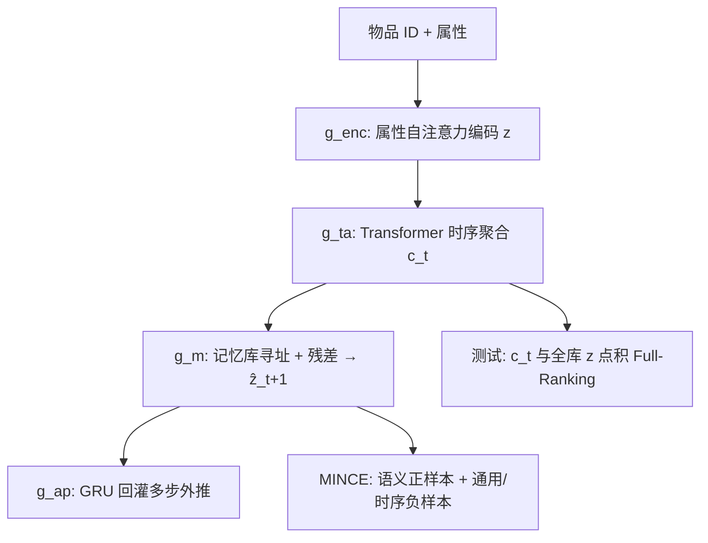
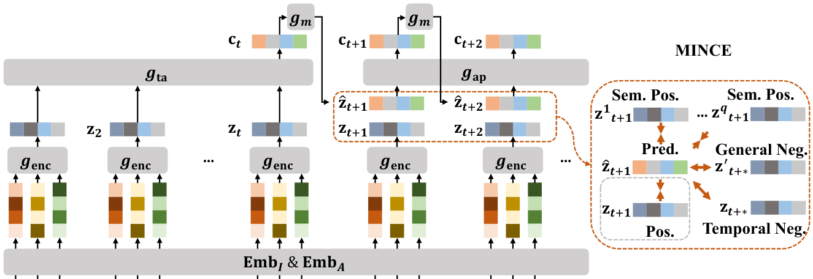

# Memory Augmented Multi-Instance Contrastive Predictive Coding for Sequential Recommendation (记忆增强的多实例对比预测编码序列推荐)

- **会议/期刊**: ICDM 2021
- **作者与机构**: Ruihong Qiu, Zi Huang, Hongzhi Yin（The University of Queensland）
- **推荐链路定位**: 端到端召回（序列编码 + 全库打分）
- **研究方向**: 序列与会话推荐 / 自监督对比学习
- **论文原文**: [https://arxiv.org/abs/2109.00368v3](https://arxiv.org/abs/2109.00368v3)
- **开源代码**: [https://github.com/aHuiWang/CIKM2020-S3Rec](https://github.com/aHuiWang/CIKM2020-S3Rec)（复用 S³Rec 评测代码与全库排序结果）

## TL;DR (1分钟核心速览)

现有序列推荐只用 next-item 单目标训练，且 GRU/Attention 天然偏向最近几次交互，导致**长期偏好捕捉不足**与**监督信号稀疏**。本文提出 MMInfoRec：以对比预测编码 (CPC) 为骨架，用**记忆库 + 残差**增强自回归预测以保存长期偏好，并在隐空间设计 **MINCE** 损失——同一物品经多次 Dropout 产生多个语义正样本，批内其他序列提供通用负样本、同序列历史物品提供时序难负样本。在 Beauty/Sports/Toys/Yelp 上采用 Leave-One-Out + **Full-Ranking** 协议，HR@5/NDCG@10 相对最优基线最高提升 35.1%/36.1%，Yelp 上 HR@5 提升 152.7%。

## Background & Motivation (背景与核心矛盾)

- **主流范式**: GRU4Rec/Caser/SASRec/HGN 以 next-item 交叉熵或 BPR 为唯一训练信号；BERT4Rec/S³Rec/CL4SRec 额外加入掩码物品、掩码属性、序列增广等自监督预训练任务。
- **前人局限 1（长期偏好）**: RNN 与因果 Attention 的归纳偏置把权重压在最近交互上，用户"一般兴趣"缺乏显式存储载体；MA-GNN/DMAN 虽引入记忆，但为图结构服务，未与预测式编码结合。
- **前人局限 2（监督稀疏）**: 掩码类 pretext 任务与推荐目标不同构，必须额外 finetune；且一个序列每步只提供 1 个正样本，mini-batch 内大量负样本未被充分利用。
- **核心洞察 (Key Insight)**: 若把 CPC 的"预测未来隐向量"直接作为训练任务，则 pretext 与推荐（排序正样本高于负样本）天然对齐，可免 finetune；同时 CPC 的隐空间天然支持"多正样本 + 批内负采样"的扩展。
- **本文切入点**: 记忆模块补长期偏好，多实例 NCE (MINCE) 补监督密度。

## Method (核心方法设计)

### 1. 整体框架 (Overall Architecture)

物品 ID 与属性分别查表得 $\boldsymbol{x}_n$与$\{\boldsymbol{a}_*\}$，属性编码器$g_{\text{enc}}$（Transformer 自注意力，物品 embedding attend 到其全部属性）融合为隐向量$\boldsymbol{z}=g_{\text{enc}}(\boldsymbol{x},\{\boldsymbol{a}_*\})$；时序聚合$g_{\text{ta}}$（另一 Transformer + 可学习位置编码）得到上下文$\boldsymbol{c}_t$；记忆模块$g_m$由$\boldsymbol{c}_t$预测下一步隐向量$\hat{\boldsymbol{z}}_{t+1}$；自回归预测$g_{\text{ap}}$（GRU）把预测结果回灌以多步外推。训练时在隐空间计算 MINCE；测试时用当前$\boldsymbol{c}_t$与全库物品隐向量$\boldsymbol{z}$ 点积排序，无需 finetune。

<figure class="paper-figure" markdown="span">
  <figcaption>图 2：MMInfoRec 概览。每个物品首先被编码为潜在特征。例如，序列中的物品 it 及其属性由编码器 genc 编码为潜在向量 zt。时间聚合模块 gta 可以是任意序列编码模型，如 GRU 或 Transformer。ct 是对时间步 t 之前序列编码的结果。在预测步 t + 1 中，基于记忆函数 gm 与 ct 得到的预测结果 ˆzt+1 会与真值潜在向量 zt+1 进行比较，后者基于物品 it+1 及其属性计算得到。该比较的度量是</figcaption>
</figure>

### 2. 关键设计拆解 (Key Designs)

1. **记忆增强的自回归预测（长期偏好载体）**：痛点在于 $\boldsymbol{c}_t$是整段历史的压缩，最近交互主导其方向。做法是维护$b$个槽位的记忆库$\boldsymbol{M}\in\mathbb{R}^{b\times d}$，用软寻址读取并按残差写回：
$\hat{\boldsymbol{z}}_{t+1}=\mathrm{Softmax}(\mathrm{MLP}(\boldsymbol{c}_t))\,\boldsymbol{M}+\boldsymbol{c}_t$
残差项保留原始预测、稳定梯度；消融显示去掉残差（FC-M）反而**劣于无记忆**，说明推荐场景的隐空间不像视觉特征空间那样可由记忆独立重建，必须"记忆只做增量修正"。

2. **MINCE：多实例噪声对比估计（监督增密）**：核心难点是序列推荐无法像 CV 那样定义"语义相似正样本"。作者用 $g_{\text{enc}}$内部 Dropout 的$q$个不同掩码对同一物品编码，得到$\mathcal{P}_i=\{\boldsymbol{z}_i^1,\dots,\boldsymbol{z}_i^q\}$作为语义正样本；负样本取批内$D-1$个其他序列物品（通用易负样本）与同序列非目标物品（时序难负样本，代表过时偏好），故$|\mathcal{N}_i|=q(D-1)$：
$\mathcal{L}_{\text{MINCE}}=-\sum_i\log\frac{\sum_{*\in\mathcal{P}_i}e^{\hat{\boldsymbol{z}}_i^{\top}\boldsymbol{z}_*/\tau}}{\sum_{*\in\mathcal{P}_i}e^{\hat{\boldsymbol{z}}_i^{\top}\boldsymbol{z}_*/\tau}+\sum_{*\in\mathcal{N}_i}e^{\hat{\boldsymbol{z}}_i^{\top}\boldsymbol{z}_*/\tau}}$
把分子从单项扩展为多项，等价于对互信息下界做更紧的多实例估计，避免"唯一正样本被误判为负"的标签噪声。

3. **训练目标与推理开销**：总损失即 $\mathcal{L}_{\text{MINCE}}$（无额外 BPR/CE 辅助项、无预训练-微调两阶段）；负样本**免采样**，全部来自 batch 内部。推理为一次前向 + 全库点积，与 SASRec 同级；多步外推仅在训练期使用。

## Experimental Setup & Evaluation Protocol (实验设置与评估协议)

- **数据集与预处理**（`5-core` 过滤，序列长度 <5 剔除，截断最近 50 次交互）：

| 数据集 | #Users | #Items | #Interactions | 稀疏度 | 特征/场景说明 |
| :--- | :---: | :---: | :---: | :---: | :--- |
| Beauty | 22,363 | 12,101 | 198,502 | 99.93% | 亚马逊美妆，细粒度类别+品牌属性 (1,221) |
| Sports | 35,598 | 18,357 | 296,337 | 99.95% | 亚马逊运动户外，2,277 属性 |
| Toys | 19,412 | 11,924 | 167,597 | 99.93% | 亚马逊玩具，1,027 属性 |
| Yelp | 30,431 | 20,033 | 316,354 | 99.95% | 本地商户，2019-01-01 后交易，类别为属性 |

- **数据划分与防穿越**: `Leave-One-Out`——每序列最后一项作测试、倒数第二项作验证，其余训练；严格按时间戳排序。
- **排名评测协议**: 无偏 `Full-Ranking`（对全 Item 集排序，明确弃用采样排序，引用 Krichene & Rendle 的采样度量有偏结论）；指标 HR@{5,10}、NDCG@{5,10}。
- **对比基线与超参**: 9 个基线（GRU4Rec/Caser/SASRec/BERT4Rec/HGN 为非特征法，GRU4RecF/SASRecF/FDSA/S³Rec 为特征法），$d=64$，batch=256，Adam，Transformer 层/头 ∈{1,2}，Dropout 0.5，$b\in\{5,\dots,256\}$，$\tau\in\{0.1,\dots,3\}$，报告 5 次运行均值±方差。

## Key Experimental Results (实验关键数据)

### 1. 主实验对比 (Main Results)

| 数据集-指标 | GRU4Rec | Caser | SASRec | BERT4Rec | HGN | SASRecF | FDSA | S³Rec | **MMInfoRec** | Improv. |
| :--- | :---: | :---: | :---: | :---: | :---: | :---: | :---: | :---: | :---: | :---: |
| Beauty HR@5 | 0.0164 | 0.0205 | 0.0387 | 0.0203 | 0.0325 | 0.0268 | 0.0267 | 0.0387 | **0.0523** | +35.14% |
| Beauty NDCG@5 | 0.0099 | 0.0131 | 0.0249 | 0.0124 | 0.0206 | 0.0171 | 0.0163 | 0.0244 | **0.0378** | +51.81% |
| Sports HR@5 | 0.0129 | 0.0116 | 0.0233 | 0.0115 | 0.0189 | 0.0163 | 0.0182 | 0.0251 | **0.0274** | +9.16% |
| Sports NDCG@5 | 0.0086 | 0.0072 | 0.0154 | 0.0075 | 0.0120 | 0.0107 | 0.0122 | 0.0161 | **0.0196** | +21.74% |
| Toys HR@5 | 0.0097 | 0.0166 | 0.0463 | 0.0116 | 0.0321 | 0.0289 | 0.0228 | 0.0443 | **0.0611** | +31.97% |
| Toys NDCG@5 | 0.0059 | 0.0107 | 0.0306 | 0.0071 | 0.0221 | 0.0194 | 0.0140 | 0.0294 | **0.0451** | +47.34% |
| Yelp HR@5 | 0.0152 | 0.0151 | 0.0162 | 0.0051 | 0.0186 | 0.0170 | 0.0158 | 0.0201 | **0.0508** | +152.74% |
| Yelp NDCG@5 | 0.0099 | 0.0096 | 0.0100 | 0.0033 | 0.0115 | 0.0110 | 0.0098 | 0.0123 | **0.0327** | +165.85% |

### 2. 消融实验 (Ablation Study)

| 变体 | Beauty HR@5 | Beauty NDCG@5 | Sports HR@5 | Toys HR@5 | Yelp HR@5 | Yelp NDCG@5 |
| :--- | :---: | :---: | :---: | :---: | :---: | :---: |
| CPC (骨架) | 0.0432 | 0.0310 | 0.0223 | 0.0549 | 0.0396 | 0.0221 |
| + $g_m$ | 0.0469 | 0.0346 | 0.0245 | 0.0586 | 0.0462 | 0.0283 |
| + MINCE | 0.0515 | 0.0364 | 0.0251 | 0.0587 | 0.0481 | 0.0304 |
| **MMInfoRec** | **0.0523** | **0.0378** | **0.0274** | **0.0611** | **0.0508** | **0.0327** |

### 3. 关键实验发现 (Key Findings)

1. **Yelp 上收益量级异常（HR@5 +152.7%）**：该数据集候选 20,033 项、序列均长 10.4 且以商户类别为属性，S³Rec 仅 0.0201，说明多实例对比 + 残差记忆在"属性语义强、交互极稀疏"的 LBS 场景收益最大；而 Sports（属性最多、序列最短 8.3）仅 +9.2%，属性数量并非收益主导因素。
2. **两组件互补且 MINCE 在 Beauty/Sports 更关键**：Beauty 上 MINCE 单独带来 +0.0083 HR@5，记忆单独仅 +0.0037；Toys/Yelp 两者贡献接近（0.0587 vs 0.0586），叠加后四数据集一致最优，说明记忆负责"表征容量"、MINCE 负责"梯度密度"，不可替代。
3. **记忆库高度稀疏、对 $b$不敏感**：Beauty 的 64 槽中仅 7 槽范数显著、Sports 的 10 槽中 6 槽有效，故$b$ 从 5 调到 256 性能几无波动；此外多步外推仅在 Toys 上以 2 步最优，其余数据集均以 1 步最佳。

## Highlights & Limitations (亮点、对比与审稿批判)

- **与代表作对比**: vs. S³Rec/BERT4Rec——它们用掩码重建作 pretext，与推荐目标存在语义鸿沟、必须 finetune；本文的 CPC 预测任务与排序目标同构，单阶段端到端。vs. MA-GNN/DMAN——记忆被用于图/注意力聚合，本文把记忆作为**自回归隐空间预测的残差修正项**，并给出记忆稀疏性可视化证据。vs. 普通 NCE/BPR——从单正样本单负样本升级为"多语义正样本 + 批内双类型负样本"。
- **可迁移亮点**: ① 用编码器内部 Dropout 生成"语义正样本"以在多实例 NCE 中替代昂贵增广，可直接迁移到任何 embedding 型编码器；② 同序列历史物品充当时序难负样本，是序列场景廉价且有效的硬负采样策略。
- **审稿级局限批判**: ① MINCE 的分母随 batch 内唯一物品数 $D$与正样本数$q$ 平方级增长，训练显存/算力开销未做量化对比；② 语义正样本仅靠 Dropout 扰动，扰动强度固定 0.5，缺少对其"语义一致性"的验证（如与 item 共现近邻的一致性分析）；③ 仅报告离线 Full-Ranking，无线上延迟与 A/B 结果，长序列截断 50 也可能掩盖长期偏好收益。

## Rating (四维评分)

- **方法创新性 (Novelty)**: ⭐⭐⭐⭐ （记忆残差式 CPC + Dropout 多实例正样本组合新颖，将互信息下界与推荐排序目标统一，但各组件均为已有技术的巧妙拼装）
- **评估协议与实验扎实度 (Protocol & Experiments)**: ⭐⭐⭐⭐ （四数据集 Full-Ranking 无偏评测、5 次运行方差与逐组件消融完整，缺显著性检验与线上验证）
- **写作与数学规范度 (Clarity & Rigor)**: ⭐⭐⭐⭐ （MINCE 推导与 NCE 退化关系清晰，符号统一；$\mathcal{L}$ 仅为单一损失，未给出复杂度分析小节）
- **工业落地与复现价值 (Industrial & Practical Value)**: ⭐⭐⭐⭐ （免 finetune 单阶段训练、推理与 SASRec 同级、负样本免采样，代码可基于 S³Rec 仓库复现，batch 内对比开销需关注）

