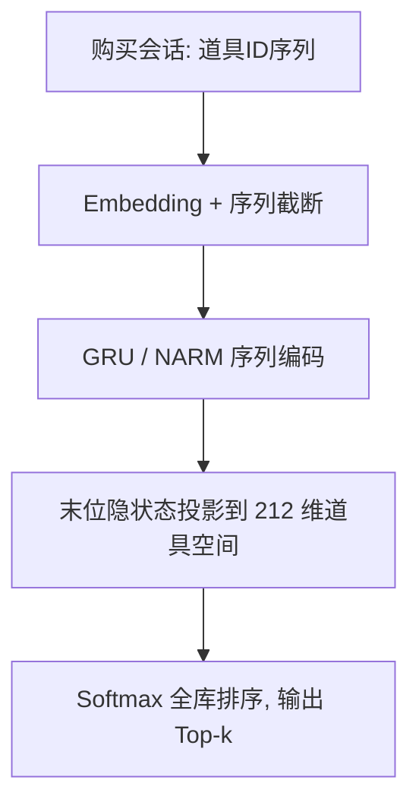

# Sequential Item Recommendation in the MOBA Game Dota 2 (MOBA 游戏 Dota 2 中的序列化道具推荐)

- **会议/期刊**: ICDM 2021
- **作者与机构**: Alexander Dallmann, Johannes Kohlmann, Daniel Zoller, Andreas Hotho（University of Würzburg, Data Science Chair）
- **推荐链路定位**: 召回（游戏内道具 Top-k 候选推荐）
- **研究方向**: 序列与会话推荐 / 数据集与基准评测
- **论文原文**: [论文原文链接](https://arxiv.org/abs/2201.08724v1)
- **开源代码**: [Clarity 回放解析器](https://github.com/skadistats/clarity)（论文训练代码暂未开源）

## TL;DR (1分钟核心速览)

Dota 2 道具购买是典型序列决策，但此前只有 2015 年的小规模 OpenDota 数据与集合式 LR 基线。本文发布 Dota-350k（34.8 万场比赛、348 万会话、212 个道具），按比赛开始时间 94/1/5 切分，在无偏全库排序下系统评测 8 个模型。GRU 最优，Rec@3=0.7363、NDCG@3=0.6307，较 LR 提升 27.2%/34.8%；Transformer 因小道具空间下 BPR 负采样失效而显著落后。

## Background & Motivation (背景与核心矛盾)

- **主流范式**: SIR 用 GRU/CNN/Transformer 建模用户时间序交互；Dota 2 侧仅有 Looi 等人的关联规则与逐道具 Logistic Regression（LR）。
- **前人局限**: 其一，OpenDota 采集自 2015 年 patch 6.83c–6.86c，英雄选取与道具购买时间已发生元环境漂移（Windranger 从第 1 掉到第 20，Ogre Magi 从第 40 升至第 1）；其二，集合式 LR/MLP 丢弃购买顺序，也无法建模消耗品的重复购买。
- **核心洞察 (Key Insight)**: 道具空间仅 212、会话却长达 43 次购买，属于“小物品空间 + 长序列 + 高重复”分布，这与电商/电影数据差异巨大，可能使负采样类 Transformer 目标失效。
- **本文切入点**: 构建大规模近期数据集 Dota-350k，统一评测统计基线、集合式模型与神经 SIR 模型，回答“顺序信息是否有效、哪种架构最适合游戏内购买”。

## Method (核心方法设计)

### 1. 整体框架 (Overall Architecture)

将一场比赛中某玩家的购买记录视为会话 $s^m_u=[s^m_{u,1},\dots,s^m_{u,l_s}]$，模型输入道具 ID 序列（Dota-350k 截断至 90，OpenDota 至 63，覆盖 99.5% 会话），经嵌入层送入 GRU 或 NARM 编码器，最后一个隐状态投影到 212 维道具空间并 softmax 打分；推理时取 Top-k。训练对 next-item 模型使用所有子序列增广，POP/SASRec/BERT4Rec 则对每个位置同时预测。评估统一采用 Rec@1/3 与 NDCG@1/3。

<figure class="paper-figure" markdown="span">
  ![图 1. Dota 2 情境下道具推荐流程概览。第一列表示玩家当前物品栏中的道具，右上角索引表示该道具的购买时间。第二列展示下一次实际购买，最后一列展示推荐系统的前 3 个预测。正确预测标记为绿色。道具表示受 Dota 2\[8\] 启发。](../../../../assets/papers/2201.08724v1/figure_1.png)<figcaption>图 1. Dota 2 情境下道具推荐流程概览。第一列表示玩家当前物品栏中的道具，右上角索引表示该道具的购买时间。第二列展示下一次实际购买，最后一列展示推荐系统的前 3 个预测。正确预测标记为绿色。道具表示受 Dota 2[8] 启发。</figcaption>
</figure>

### 2. 关键设计拆解 (Key Designs)

1. **Dota-350k 构建与按比赛切分（避免会话泄漏）**：痛点是同一场比赛 10 名玩家的会话高度相关，若按 session 随机切分会产生信息泄漏。本文只保留 Ranked All Pick（占当日 54.13%），剔除 17.70% 的 abandon 比赛、含不可购买道具的 24 场比赛，并去掉对局时长上下 2.5% 分位；按比赛开始时间取前 94%/1%/5%，保证验证集覆盖全部英雄与道具（道具购买频率 Kendall-Tau=98.30%，英雄选取=92.25%）。
2. **顺序编码器（GRU）**：痛点是 LR/MLP 把历史当无序集合，无法表达“先买鞋子再合成 ethereal blade”的依赖。GRU 递推 $\boldsymbol{h}_t=\mathrm{GRU}(\boldsymbol{e}_{s_t},\boldsymbol{h}_{t-1})$，以$\hat{\boldsymbol{y}}=\mathrm{softmax}(\boldsymbol{W}\boldsymbol{h}_{l_s}+\boldsymbol{b})$ 预测下一道具；NARM 额外用全局隐状态对局部隐状态做注意力加权，再双线性解码。其有效性来自显式保留购买先后与可重复购买。
3. **训练目标、负采样与推理开销**：GRU/NARM/MLP 用交叉熵 $\mathcal{L}_{\mathrm{CE}}=-\sum_{t=1}^{l_s-1}\log \hat{y}_t[s_{t+1}]$；SASRec 用 BPR$\mathcal{L}_{\mathrm{BPR}}=-\sum_t \log\sigma(\hat{s}_{t,pos}-\hat{s}_{t,neg})$。小道具空间下随机负例极易与真实高频道具重叠，BPR 梯度信号被稀释；全库 softmax 则无此问题。推理只需一次序列编码与 212 维打分，开销极低。

## Experimental Setup & Evaluation Protocol (实验设置与评估协议)

- **数据集与预处理**: 两数据集均做相同过滤（Ranked All Pick、去 abandon、$l_s\ge 2$、时长去尾）。Dota-350k 原始 590,799 场，处理后有 348,642 场、3,486,358 个会话，购买事件约 1.509 亿；OpenDota 原始 50,000 场，处理后有 39,921 场、399,185 个会话，购买事件约 1,405 万。

| 数据集 | #Sessions | #Items | #Interactions | 平均会话长度 | 切分/场景说明 |
| :--- | :---: | :---: | :---: | :---: | :--- |
| Dota-350k | 3,486,358 | 212 | ≈1.509 亿 | 43.27±13.89 | 按比赛开始时间 94:1:5；119 英雄、2020 年 patch 7.25c |
| OpenDota | 399,185 | 141 | ≈1.405 千万 | 35.20±9.58 | 按比赛开始时间 90:5:5；110 英雄、2015 年 patch 6.83c–6.86c |

- **数据划分与防穿越 (Splitting Strategy)**: 全局时间戳切分，且以 match 为单位划分，避免同一场比赛的多个 session 跨集合泄漏；验证集仅 1%，但覆盖全道具/英雄且分布与全集高度一致。
- **排名评测协议 (Ranking Protocol)**: 无偏 Full-Ranking，对全部 212/141 个道具排序，未采样负例；指标 Rec@k 与 NDCG@k，$k=1,3$，符合游戏内快速决策场景。
- **对比基线与超参设置**: 基线含 POP、Markov、LR；神经模型含 MLP、GRU、NARM、SASRec、BERT4Rec。每个模型随机搜索 30 组超参，按验证集 Rec@3 选最优；学习率固定 $10^{-3}$，early stopping patience=3，最大 25 epoch。原文未报告显著性检验。

## Key Experimental Results (实验关键数据)

### 1. 主实验对比 (Main Results)

| 模型 | Dota-350k Rec@3 | Dota-350k NDCG@3 | OpenDota Rec@3 | OpenDota NDCG@3 |
| :--- | :---: | :---: | :---: | :---: |
| POP | 0.2942 | 0.2194 | 0.3433 | 0.2983 |
| Markov | 0.5198 | 0.4275 | 0.5439 | 0.4440 |
| LR [7] | 0.5790 | 0.4678 | 0.6513 | 0.5299 |
| MLP | 0.6608 | 0.5447 | 0.7212 | 0.5968 |
| NARM | 0.6853 | 0.5808 | 0.7736 | 0.6596 |
| BERT4Rec | 0.6480 | 0.5492 | 0.7054 | 0.5935 |
| SASRec | 0.4118 | 0.2996 | 0.4466 | 0.3589 |
| **GRU** | **0.7363** | **0.6307** | **0.7833** | **0.6696** |
| Improv. vs LR | +27.2% | +34.8% | +20.3% | +26.4% |

### 2. 消融实验 (Ablation Study)

原文无标准“移除模块”消融，下表按模型输入/损失重组，用于分离“顺序信息”与“训练目标”的贡献（Dota-350k）。

| 对照设定 | 历史输入 | 顺序建模 | 训练损失 | Rec@3 | Δ vs LR |
| :--- | :--- | :---: | :--- | :---: | :---: |
| POP | 无 | 否 | — | 0.2942 | -49.2% |
| Markov | 最近 1 项 | 一阶 | CE | 0.5198 | -10.2% |
| LR | 全集集合 | 否 | 逐道具 LR | 0.5790 | 0 |
| MLP | 全集集合 | 否 | CE | 0.6608 | +14.1% |
| BERT4Rec | 全序列 | 双向 | Cloze CE | 0.6480 | +11.9% |
| SASRec | 全序列 | 单向 | BPR | 0.4118 | -28.9% |
| GRU | 全序列 | 单向 | CE | 0.7363 | +27.2% |

### 3. 关键实验发现 (Key Findings)

1. **顺序信息是主要增益来源**：已调参的集合式 MLP 达 0.6608，GRU 进一步升至 0.7363（+11.4%），说明收益并非来自模型容量，而是显式建模购买先后与重复购买。
2. **小道具空间下 BPR 负采样失效**：SASRec 仅 0.4118，甚至低于只用最近一项的 Markov（0.5198）；改用 Cloze CE 的 BERT4Rec 回升至 0.6480，验证了“212 个道具 + 高频消耗品”使随机负例区分度过低。
3. **元环境漂移显著拉低跨期性能**：同一 GRU 在 Dota-350k 比 OpenDota 低 4.70 个 Rec@3 点（0.7363 vs 0.7833），道具空间扩大 69%、Top-3 道具覆盖率由 33.75% 降至 28.75%；Sentry Ward 的高频购买时间从开局移至约 30 分钟，说明仅用道具 ID 难以吸收 patch 变化。

## Highlights & Limitations (亮点、对比与审稿批判)

- **与代表作对比 (vs. Prior Work)**: 相比 Looi 等人的集合式 LR，本文首次把神经 SIR 引入 Dota 2 并给出大规模基准；相比 SASRec/BERT4Rec 在电商数据上的强势，本文证明架构优势高度依赖数据分布，Transformer 并非万能。
- **可迁移亮点**: 按 match 分组切分可推广到任何“一次事件产生多个用户会话”的场景（如直播、团购）；小物品空间下优先用全库 softmax CE 而非 BPR，是实用的训练目标选择准则。
- **审稿级局限批判**: 其一，模型只用道具 ID，未利用回放中已有的英雄阵容、敌方出装、游戏时间与金钱等强上下文，推荐上限被明显压低；其二，缺少显著性检验与跨 patch 自适应机制，且 Transformer 的最大序列截断与搜索空间可能低估其潜力。

## Rating (四维评分)

- **方法创新性 (Novelty)**: ⭐⭐⭐ （以数据集与系统性实证为主，未提出新序列架构，但“小物品空间下 Transformer 失效”的发现具有反直觉价值）
- **评估协议与实验扎实度 (Protocol & Experiments)**: ⭐⭐⭐⭐ （全库排序、按比赛时间切分与防泄漏设计扎实，8 个模型覆盖完整；扣分在无显著性检验、无标准消融）
- **写作与数学规范度 (Clarity & Rigor)**: ⭐⭐⭐⭐ （问题定义、数据统计与超参搜索描述清晰，公式简洁；但对 BPR 失效仅给假设，缺少梯度/负例分布实证）
- **工业落地与复现价值 (Industrial & Practical Value)**: ⭐⭐⭐ （游戏内低延迟 Top-k 推荐可直接落地，数据解析器已开源；训练代码未开源，且缺少上下文特征限制了工业价值）

