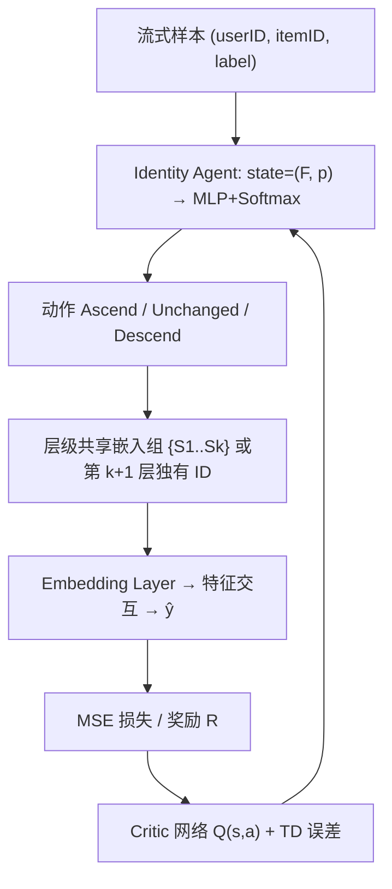
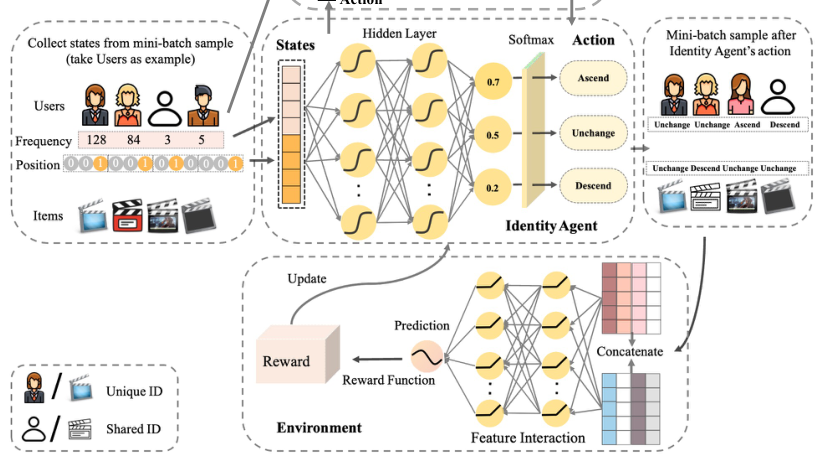

# AutoAssign+: Automatic Shared Embedding Assignment in Streaming Recommendation (流式推荐中的自动共享嵌入分配)

- **会议/期刊**: Knowledge and Information Systems (KAIS) 2023（ICDM 2022 前作 AutoAssign 的期刊扩展版）
- **作者与机构**: Ziru Liu, Kecheng Chen, Fengyi Song, Xiangyu Zhao (CityU HK)；Bo Chen, Huifeng Guo, Ruiming Tang (华为诺亚方舟实验室)
- **推荐链路定位**: 嵌入层插件（与推理层解耦，可挂载于召回双塔或精排 DNN 的 embedding lookup 之前）
- **研究方向**: 冷启动与长尾推荐 / 强化学习与动态探索推荐
- **论文原文**: [https://arxiv.org/abs/2308.06965v1](https://arxiv.org/abs/2308.06965v1)
- **开源代码**: [https://github.com/Applied-Machine-Learning-Lab/AutoAssign-Plus](https://github.com/Applied-Machine-Learning-Lab/AutoAssign-Plus)

## TL;DR (1分钟核心速览)

流式推荐中新用户/新物品及长尾 ID 的随机初始化既欠训练又不断膨胀嵌入表。AutoAssign+ 把"低频 ID 应当使用共享嵌入还是独有嵌入"建模为马尔可夫决策过程，由 Identity Agent（actor）在含 $k$ 个层级共享嵌入的候选组上输出 Ascend/Unchanged/Descend 三种动作，并用 Critic 网络的 TD 误差反传优化策略。在三个数据集上按全局时间戳 80/20 流式划分、pointwise 二分类评估，Accuracy 相对 Origin 平均 +3.85%，Netflix AUC 由 0.7640 升至 0.8093（+5.93%），嵌入层参数下降 20–31%。

## Background & Motivation (背景与核心矛盾)

- **主流范式**: 深度推荐遵循 "Embedding & Feature Interaction" 范式；工业界处理低频 ID 的惯用手法是 Low-Frequency Filter (LFF)——设固定频次阈值 $\tau$，低于阈值的 ID 一律映射到同一个共享嵌入。
- **前人局限一（阈值僵化）**: $\tau$ 依赖专家经验或昂贵网格搜索，而不同 ID 域（user/item）的频率分布在时空上持续漂移，固定阈值必然次优；且单一共享嵌入把所有低频 ID 压成同一点，造成严重偏差。
- **前人局限二（初始化副作用）**: MetaEmb / MWUF 等元学习方案靠辅助特征（社交图、图像）或全体嵌入均值来初始化新 ID，既依赖 ID-only 场景下拿不到的侧信息，又会通过全局参数污染高频 ID 的嵌入。
- **核心洞察 (Key Insight)**: 前作 AutoAssign 的 agent 只依据「输入频次 + 当前位置」生成候选嵌入，**完全看不到推荐模型自身的预测表现**，策略与最终目标脱耦；因此需要引入一个 critic 来评估"这次分配究竟让模型变好还是变坏"。
- **本文切入点**: 用层级共享嵌入组 + 可升可降的位置回退机制替代固定阈值，用 actor-critic 让"分配决策"直接对齐预测损失的下降。

## Method (核心方法设计)

### 1. 整体框架 (Overall Architecture)

数据以 (userID, itemID, label) 流式到达。每个 ID 携带状态 $(\text{F}(\cdot), p)$，Identity Agent 输出三动作之一，把该 ID 重定向到层级共享嵌入组$\{S_1,\dots,S_k\}$的某一层，或提升到第$k+1$层的独有 ID。重定向后的 ID 经 embedding lookup、特征交互层得到$\hat{y}$，与真值算 MSE。同时 Critic 网络以 (user-item 特征, 动作, reward) 估计 Q 值并算 TD 误差，先训 critic 至收敛、再用 Q 值梯度更新 agent，最后用调整后的样本更新推荐模型，三者交替迭代。

<figure class="paper-figure" markdown="span">
  <figcaption>图 2：提出的整体框架包含一个 Identity Agent，用于在嵌入层之前为用户和物品分配共享 ID。</figcaption>
</figure>

### 2. 关键设计拆解 (Key Designs)

1. **层级共享嵌入组与位置回退（替代固定阈值）**：痛点是把所有低频 ID 塞进一个共享点导致偏差。做法是把共享嵌入做成有序的 $k$层缓冲（实测 user 侧$k=1$、item 侧$k=2$），动作空间为升/不变/降：频次累积则从$p_i$升到$p_{i+1}$，热度衰退则降回低层。核心转移规则为
   $p_i \leftarrow \begin{cases} p_i+1, & a=\text{Ascend}\\ p_i, & a=\text{Unchanged}\\ p_i-1, & a=\text{Descend}\end{cases}$当$p_i$越过$k$进入$k+1$时获得独有 ID，并用最后一层共享嵌入$\boldsymbol{e}_{s_k}$ 初始化——共享嵌入已被大量低频 ID 训练得足够"泛化"，是天然的 warm start；反向降级则回收参数、并让长期不活跃后重新活跃的 ID 复活。直觉上这相当于给 embedding table 加了一层"可回滚的缓存层级"。
2. **Critic 网络与损失差奖励（把决策对齐到模型收益）**：前作 agent 的决策缺少反馈信号。本文定义奖励为当前预测损失相对过去 $T=30$ 天平均损失的下降量
   $R_u=\frac{1}{T}\sum_{t=1}^{T}L_t^{u}-L,\qquad R_i=\frac{1}{T}\sum_{t=1}^{T}L_t^{i}-L$用滑动窗口而非单点损失是为了抑制流式数据的噪声抖动。Critic 采用 shared-bottom 结构同时编码 user-item 特征与动作，$Q(s,a;\phi)=R+\gamma Q(s',a';\phi)$（$\gamma=0.95$），并配 target network 软更新$\tilde{\phi}=\beta\tilde{\phi}+(1-\beta)\phi$（$\beta=0.2$）以缓解 actor-critic 不收敛问题。
3. **训练目标、更新次序与推理开销**：推荐模型侧为 pointwise 二分类 MSE $\mathcal{L}=\frac{1}{N}\sum_j(y_j-\hat{y}_j)^2$，**无需负采样**（二分类而非 pairwise 排序）。更新次序严格为 critic（TD 误差）→ agent（$J(\Omega)=-\frac{1}{b}\sum_k Q'(s,\Omega(a|s))$梯度，收敛后改用 Monte-Carlo 策略梯度$\nabla_\Omega F\approx\frac{1}{N}\sum_i R(a|s)\nabla\log\Omega(a|s)$）→ 推荐模型。推理阶段 agent 只做一次 O(1) 的 ID 表映射重定向，**不进入前向计算图**，线上延迟增量可忽略；代价在训练侧，总耗时为 Origin 的约 3.4 倍。

## Experimental Setup & Evaluation Protocol (实验设置与评估协议)

- **数据集与预处理**: 不做 `5-core` 过滤，保留全部长尾以暴露冷启动；评分 >3 记为正例，≤3 记为负例。

| 数据集 | #Users | #Items | #Interactions | 稀疏度/密度 | 特征/场景说明 |
| :--- | :---: | :---: | :---: | :---: | :--- |
| MovieLens Latest | 280,000 | 58,000 | 27,000,000 | 0.16% | 极稀疏，最贴近冷启动压力测试 |
| MovieLens 25M | 162,000 | 62,000 | 25,000,000 | 0.25% | 稳定基准，含百万级 tag |
| Netflix Prize | 480,000 | 17,000 | 100,000,000 | 1.22% | 1998-10 至 2005-12，长时序漂移最强 |

- **数据划分与防穿越 (Splitting Strategy)**: **全局时间戳切分**——按时间排序后取前 80% 训练、后 20% 测试，且只跑 **1 个 epoch**、不打乱、测试期继续在线更新模型，模拟真实流式不可回溯场景。
- **排名评测协议 (Ranking Protocol)**: **非 ranking 协议**。采用 pointwise 二分类指标 MSE / Accuracy / AUC，未做 Full-Ranking 也未做 Sampled Ranking，这是本文评估的关键局限（见末节）。
- **对比基线与超参设置**: 基线为 Origin（不做任何过滤）、LFF-Grid（$\tau\in[5,200]$步长 10）、LFF-Random（$\tau\in[5,20]$随机搜索最优组合）、AutoAssign（无 critic 版本）。嵌入维度$d=128$，特征交互两层 512 + LeakyReLU，agent 单隐层 512、频次嵌入 32，Adam（agent 1e-4 / 推荐模型 1e-3），batch 500，显著性$p<0.05$。

## Key Experimental Results (实验关键数据)

### 1. 主实验对比 (Main Results)

| 数据集 | 模型 | MSE↓ | Accuracy↑ | AUC↑ | 训练耗时(min) | Improv.(Acc) |
| :--- | :--- | :---: | :---: | :---: | :---: | :---: |
| ML-25M | Origin | 0.2155 | 0.6578 | 0.7105 | 10 | — |
| ML-25M | LFF-Grid | 0.2079 | 0.6747 | 0.7314 | 110 | 2.56% |
| ML-25M | LFF-Random | 0.2074 | 0.6754 | 0.7322 | 231 | 2.67% |
| ML-25M | AutoAssign | 0.2052 | 0.6792 | 0.7364 | 18 | 3.25% |
| ML-25M | **AutoAssign+** | **0.2046** | **0.6817** | **0.7386** | 39 | **3.63%** |
| ML-Latest | Origin | 0.2157 | 0.6567 | 0.7108 | 12 | — |
| ML-Latest | LFF-Random | 0.2073 | 0.6756 | 0.7328 | 294 | 2.87% |
| ML-Latest | AutoAssign | 0.2050 | 0.6802 | 0.7377 | 20 | 3.56% |
| ML-Latest | **AutoAssign+** | **0.2040** | **0.6821** | **0.7422** | 41 | **3.87%** |
| Netflix | Origin | 0.1914 | 0.7062 | 0.7640 | 26 | — |
| Netflix | LFF-Random | 0.1818 | 0.7235 | 0.7883 | 588 | 2.45% |
| Netflix | AutoAssign | 0.1792 | 0.7293 | 0.7946 | 45 | 3.27% |
| Netflix | **AutoAssign+** | **0.1756** | **0.7349** | **0.8093** | 87 | **4.06%** |

### 2. 消融实验 (Ablation Study)

（MovieLens Latest，均基于 AutoAssign 骨架拆解）

| 变体 | MSE↓ | Accuracy↑ | Improv. |
| :--- | :---: | :---: | :---: |
| Origin | 0.2155 | 0.6578 | — |
| AutoAssign (No Descend) | 0.2059 | 0.6785 | 3.15% |
| AutoAssign (Single SE) | 0.2056 | 0.6793 | 3.26% |
| AutoAssign (Single SE + No Descend) | 0.2082 | 0.6732 | 2.34% |
| AutoAssign | 0.2052 | 0.6801 | 3.40% |
| **AutoAssign+ (完整)** | **0.2047** | **0.6819** | **3.66%** |

嵌入层参数削减：ML-Latest 用户侧 35.84M→25.55M（−28.7%）、电影侧 −43.9%，合计 **−31.3%**；ML-25M 合计 **−23.1%**。

### 3. 关键实验发现 (Key Findings)

1. **数据越稠密、时序越长，动态回收的收益越大**：Accuracy 相对提升从 ML-25M 的 3.63% 升至 Netflix 的 4.06%，AUC 绝对提升从 0.028 扩到 0.045——Netflix 跨 7 年、密度 1.22%，"活跃→沉寂→复活"的 ID 回退场景最丰富，正对应 Descend 动作的价值。
2. **层级组与 Descend 是耦合的必要条件，缺一即退化到 LFF 水平**：单去 Descend（3.15%）或单去层级组（3.26%）仍优于 LFF（≈2.67%），但两者同时去掉跌至 2.34%，**低于 LFF**——说明单向 + 单共享嵌入的 agent 会做出与固定阈值同样武断的判定，二者必须同时存在。
3. **critic 的边际贡献稳定但幅度有限**：AutoAssign→AutoAssign+ 在三个数据集上 Accuracy 分别 +0.25/+0.19/+0.56 个百分点（AUC +0.22/+0.45/+1.47），是"锦上添花"而非"从 0 到 1"；真正的增益来自层级共享嵌入机制本身（Origin→AutoAssign 已占 3.2~3.3%）。同时 AutoAssign+ 训练 39 min，仅为 LFF-Grid 的 1/3、LFF-Random 的 1/6，把"人工调阈值"的搜索成本彻底省掉。

## Highlights & Limitations (亮点、对比与审稿批判)

- **与代表作对比**: 相比 LFF，本文把"固定阈值 + 单一共享嵌入"换成"可学习阈值 + 层级共享嵌入 + 可回退"，无需专家调参且能捕捉分布漂移；相比 MetaEmb/MWUF，它不依赖任何辅助侧信息，也不通过全局参数污染高频 ID；相比前作 AutoAssign，它用 critic 把分配策略显式对齐到推荐损失，而非仅凭频次启发式。
- **可迁移亮点**: (i) "层级共享嵌入 + 位置回退"是一套模型无关的 embedding table 参数回收器，可直接加在双塔召回或精排 DNN 的 lookup 之前做在线显存治理；(ii) 用「当前损失 − 过去 $T$ 步损失滑动均值」作为 reward 的塑形技巧，可复用到任何需要把训练信号转成 RL 奖励的推荐场景。
- **审稿级局限批判**: (i) **评估协议偏弱**——只报 MSE/Accuracy/AUC，没有 Full-Ranking 的 Recall@K/NDCG@K，冷启动结论在真实排序链路上尚未验证；(ii) **训练开销与超参敏感**——训练耗时约 Origin 的 3.4 倍，且 $T=30$、$\gamma=0.95$、$\beta=0.2$ 三个超参未做敏感性分析，critic 需先收敛才更新 agent，在高速流式场景下可能跟不上数据流速；(iii) 单 epoch、不打乱的流式设置使结果无法与常规多次迭代训练的强基线（如 SASRec/LightGCN）横向比较；(iv) 作者自承动作语义不透明、可解释性差。

## Rating (四维评分)

- **方法创新性 (Novelty)**: ⭐⭐⭐⭐ （把"低频 ID 分配"显式建模为带可回退动作的 MDP 并用 critic 闭环，视角新颖；但相对前作 AutoAssign 的核心增量主要是 critic，属稳健的增量式创新）
- **评估协议与实验扎实度 (Protocol & Experiments)**: ⭐⭐⭐ （三数据集 + 时间戳流式切分 + $p<0.05$ 显著性 + 消融与参数统计完整，但缺失 ranking 指标与强序列基线，"冷启动"结论的说服力被削弱）
- **写作与数学规范度 (Clarity & Rigor)**: ⭐⭐⭐ （MDP 三要素与更新次序交代清楚、算法伪代码完整，但公式编号与符号存在笔误（如式 16 的 $F(\Omega)$定义含糊、$\mathcal{I}$ 未定义即用于梯度式），部分超参设置描述前后不一致）
- **工业落地与复现价值 (Industrial & Practical Value)**: ⭐⭐⭐⭐ （代码已开源、框架与推理层解耦即插即用、20–31% 嵌入表显存节省与 3.4× 训练开销对工业流式系统是可接受的权衡，落地路径清晰）

