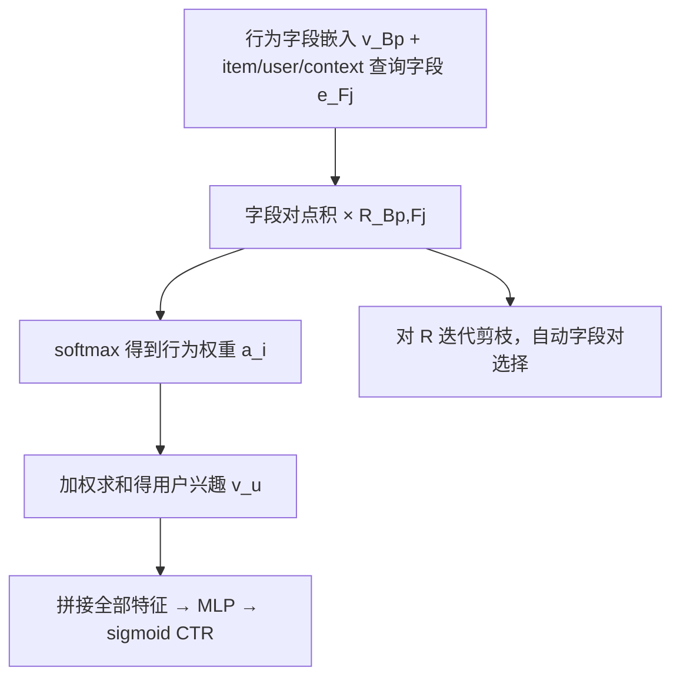
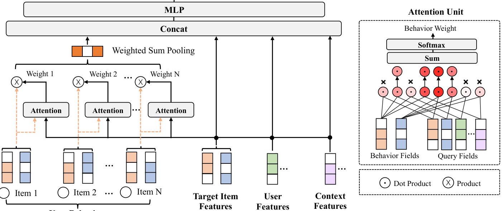

# AutoAttention: Automatic Field Pair Selection for Attention in User Behavior Modeling (面向用户行为建模的自动字段对选择注意力)

- **会议/期刊**: ICDM 2022
- **作者与机构**: Zuowu Zheng, Xiaofeng Gao, Junwei Pan, Qi Luo, Guihai Chen, Dapeng Liu, Jie Jiang；上海交通大学、腾讯、山东大学
- **推荐链路定位**: 精排
- **研究方向**: CTR/CVR 预估与特征交叉 / 序列与会话推荐
- **论文原文**: [https://arxiv.org/abs/2210.15154v1](https://arxiv.org/abs/2210.15154v1)
- **开源代码**: [https://github.com/waydrow/AutoAttention](https://github.com/waydrow/AutoAttention)

## TL;DR (1分钟核心速览)

DIN 类行为注意力仅用人工选择的目标物品字段作 query，忽略用户/上下文字段，且 MLP 注意力开销高。AutoAttention 将全部 item/user/context 字段纳入 query，为每个行为字段-查询字段对学习强度权重，并用迭代剪枝自动移除噪声字段对。在 Alibaba 与腾讯生产日志按时间切分、user-weighted AUC 评估下，相对 Sum Pooling 提升 2.19%/3.58%，推理复杂度仅 $O(PMK)$。

## Background & Motivation (背景与核心矛盾)

- **主流范式**: CTR 精排普遍采用 Embedding+MLP；用户兴趣由历史行为 sum/mean pooling 或 DIN/DIEN/DSIN 的注意力加权池化得到。
- **前人局限**: DIN 类方法只从目标物品侧人工选若干字段作 query，用户人口属性与上下文字段被忽略；若直接纳入全部字段，又会引入大量无关字段对噪声，且 MLP 注意力计算昂贵。
- **核心洞察 (Key Insight)**: 行为字段与查询字段之间的交互强度并非同质，可用可学习字段对权重刻画；低强度字段对多为噪声，可通过剪枝自动识别并删除。
- **本文切入点**: 全字段查询 + 字段对加权点积注意力 + 迭代幅度剪枝，实现自动字段对选择与轻量推理。

## Method (核心方法设计)

### 1. 整体框架 (Overall Architecture)

输入由用户行为、目标物品、用户特征与上下文特征四部分组成。每个行为由多个行为字段嵌入求和表示；所有 item/user/context 字段作为 query，与行为字段逐对做点积并乘以字段对强度 $R_{B_p,F_j}$，经 softmax 得到各行为权重，加权求和为兴趣向量$v_u$；再与全部特征嵌入拼接送入 MLP，输出点击概率。训练中预热若干 epoch 后，按当前稀疏率剪除$R$ 中幅度最小的字段对，逐步提高稀疏率，最终以稀疏模型在线推理。

<figure class="paper-figure" markdown="span">
  <figcaption>图2：所提出的 AutoAttention 的架构。输入特征包括四部分：用户行为、目标物品、用户和上下文。我们使用注意力函数计算每个行为的权重，其细节在 Attention Unit 中描述。它为行为字段与查询字段之间的每个字段对分配一个可学习权重，查询字段由所有物品/用户/上下文字段组成。通过在这些权重上进行剪枝来实现自动字段对选择。所有行为根据注意力权重求和，然后与所有其他特征嵌入一起输入 MLP。</figcaption>
</figure>

### 2. 关键设计拆解 (Key Designs)

1. **字段对加权注意力 (Field-Pair Weighted Attention)**：针对“全字段 query 会引入噪声”的矛盾，不再用 MLP 统一打分，而是显式建模每个行为字段 $B_p$与查询字段$F_j$的交互强度$R_{B_p,F_j}$，注意力权重为
$a_i=\sigma\left(b+\sum_{p=1}^{P}\sum_{j=1}^{M}\langle\mathbf{v}_{B_p},\mathbf{e}_{F_j}\rangle R_{B_p,F_j}\right)$。
直觉是：相关字段对（如品类-品类、品牌-品牌）保留高权重，无关对可被压到零；点积形式避免 MLP 的高开销。

2. **自动字段对选择 (Automatic Field Pair Selection)**：仅学习 $R$仍可能保留噪声。作者沿用 DeepLight 式迭代剪枝：先 warm-up 训练稳定$R$，再按稀疏率$S$剪除幅度最小的字段对，并逐步增大$S$。Alibaba/Tencent 最优$S$ 分别为 0.6/0.8。该过程等价于让模型自动学习“哪些字段对值得交互”，减少人工字段选择偏差。

3. **训练目标、负采样与推理效率**：最终预测为
$\hat{y}=\mathrm{sigmoid}(\mathrm{MLP}([\mathbf{v}_u,\mathbf{e}_{F_1},...,\mathbf{e}_{F_M}]))$，
损失为带 L2 的交叉熵：
$\mathcal{L}(\Theta)=-\frac{1}{N}\sum_{i=1}^{N}\left[y_i\log\hat{y}_i+(1-y_i)\log(1-\hat{y}_i)\right]+\lambda\|\Theta\|_2^2$。
CTR 点式训练，无需负采样。每行为复杂度 $O(PMK)$，剪枝后$O(S\%PMK)$；仅引入$PM+1$ 个字段对参数，Alibaba 设置下为 31 个，远少于 DIN 的 81.9 万参数。

## Experimental Setup & Evaluation Protocol (实验设置与评估协议)

- **数据集与预处理**: 使用公开 Alibaba Display Ad CTR 与腾讯生产 CTR 日志；行为长度截断为最近 50 次，且只取目标物品之前的点击行为以防穿越。未做 5-core 过滤。

| 数据集 | #Users | #Items | #Interactions (Train/Test) | 正样本率 | 特征/场景说明 |
| :--- | :---: | :---: | :---: | :---: | :--- |
| Alibaba | 未报告 | 512,431 | 5,544,213 / 660,694 | 5.147% | 淘宝展示广告，15 字段，165.8 万特征 |
| Tencent | 未报告 | 388,195 | 6,666,928 / 1,125,130 | 14.167% | 腾讯广告，15 字段，103.0 万特征 |

- **数据划分与防穿越**: 全局时间切分；Alibaba 前 7 天训练、次日测试；Tencent 2021-09-05 至 09-10 训练、09-11 测试。
- **排名评测协议**: 非全库候选排序，按曝光日志计算 user-weighted AUC；无负采样排序，无采样正负比。
- **对比基线与超参设置**: 对比 Sum Pooling、DIN、DIEN、DSIN、GRU4Rec、SASRec、BERT4Rec、BST、CFI。Embedding 维度 $K=64$，行为长度$H=50$，MLP 隐层 200/80/1，Adagrad 学习率 0.01，batch 4096/16384；5 次重复报告 mean±std，未给$p$ 值显著性检验。

## Key Experimental Results (实验关键数据)

### 1. 主实验对比 (Main Results)

| 模型 | Alibaba AUC | Tencent AUC | Alibaba Impv. | Tencent Impv. |
| :--- | :---: | :---: | :---: | :---: |
| Sum Pooling | 0.6024 | 0.7125 | - | - |
| DIN | 0.6055 | 0.7173 | 0.515% | 0.674% |
| DIEN | 0.6069 | 0.7236 | 0.747% | 1.558% |
| DSIN | 0.6094 | 0.7285 | 1.162% | 2.246% |
| SASRec | 0.6043 | 0.7144 | 0.315% | 0.267% |
| BERT4Rec | 0.6049 | 0.7152 | 0.415% | 0.379% |
| BST | 0.6050 | 0.7160 | 0.432% | 0.491% |
| CFI | 0.6115 | 0.7349 | 1.511% | 3.144% |
| **AutoAttention** | **0.6156** | **0.7380** | **2.191%** | **3.579%** |

### 2. 消融实验 (Ablation Study)

| 变体 | Alibaba AUC | Tencent AUC | 说明 |
| :--- | :---: | :---: | :--- |
| DSIN+ | 0.6115 | 0.7314 | 全字段但沿用 MLP/会话注意力 |
| DotProduct | 0.6108 | 0.7312 | 全字段点积注意力，无字段对权重 |
| AutoAttention-w/oP | 0.6134 | 0.7369 | 全字段 + 字段对权重，不剪枝 |
| CFI | 0.6115 | 0.7349 | 人工对应字段对交互 |
| AutoAttention- | 0.6124 | 0.7366 | 仅保留 top-$P$ 字段对 |
| **AutoAttention** | **0.6156** | **0.7380** | 全字段 + 自动剪枝选择 |

### 3. 关键实验发现 (Key Findings)

- AutoAttention 相比最强基线 CFI 仍提升 0.67%/0.42% 相对 AUC；相比 Sum Pooling 提升 2.191%/3.579%，说明全字段查询与字段对选择共同有效。
- 消融显示“纳入全字段”本身有收益：AutoAttention-w/oP 已达 0.6134/0.7369，但剪枝到 $S=0.6/0.8$ 又带来 0.36%/0.15% 相对提升；稀疏率过高则快速掉点，说明剪枝需保留关键字段对。
- 字段对可视化发现 AutoAttention 选中了 CFI/专家规则忽略的上下文与用户字段对，如 (scenario_id, cate_id)、(user_grade, ad_id)；对应字段对并不总排最高，自动选择比人工对应假设更稳健。

## Highlights & Limitations (亮点、对比与审稿批判)

- **与代表作对比 (vs. Prior Work)**: DIN/DIEN/DSIN 用人工 item 字段 + MLP 注意力；CFI 只交互“对应字段对”；AutoAttention 将全部 item/user/context 字段纳入 query，用字段对权重与剪枝同时解决“字段覆盖不足”和“全字段噪声”两个矛盾。
- **可迁移亮点**: 字段对加权点积注意力可替换 DIEN/DSIN 的注意力单元；幅度剪枝做字段对选择可迁移到其他高维特征交叉精排模型，兼顾稀疏化与推理加速。
- **审稿级局限批判**: 剪枝稀疏率 $S$ 需按数据集调参，训练需多轮剪枝，工程上增加训练复杂度；评估仅用曝光日志 AUC，缺少校准、线上 A/B 与显著性检验，且字段数仅 15，超大规模字段场景的可扩展性仍待验证。

## Rating (四维评分)

- **方法创新性 (Novelty)**: ⭐⭐⭐⭐ （字段对权重+剪枝选择在行为注意力中是清晰增量，但本质仍是加权点积+幅度剪枝）
- **评估协议与实验扎实度 (Protocol & Experiments)**: ⭐⭐⭐⭐ （公开+生产双数据集、5 次重复、消融与字段对可视化较完整；但仅 AUC、无显著性检验与线上 A/B）
- **写作与数学规范度 (Clarity & Rigor)**: ⭐⭐⭐⭐ （公式简洁、复杂度与参数量对比清楚；剪枝算法细节和超参敏感性分析略简）
- **工业落地与复现价值 (Industrial & Practical Value)**: ⭐⭐⭐⭐⭐ （开源代码，字段对参数仅 31 个、每行为 FLOPs 千级，可直接作为精排注意力模块替换，落地价值高）

