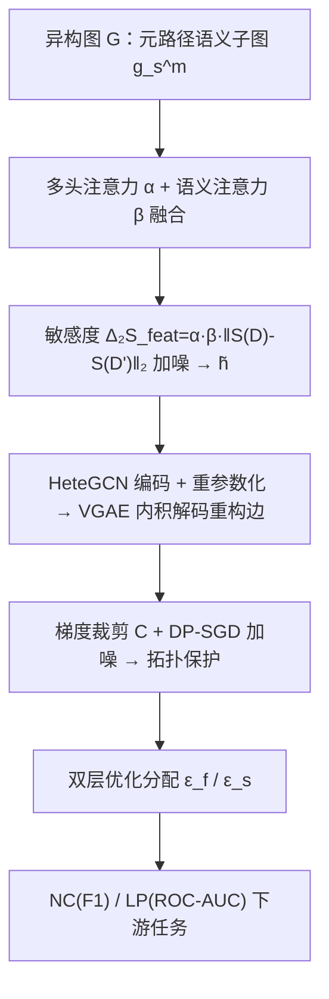
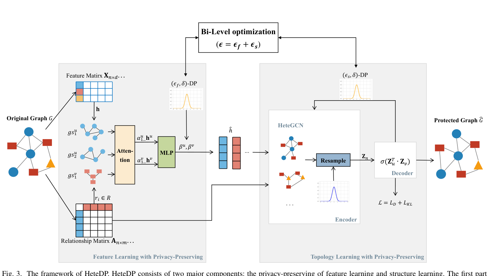

# Heterogeneous Graph Neural Network for Privacy-Preserving Recommendation (面向隐私保护的异构图神经网络推荐)

- **会议/期刊**: ICDM 2022
- **作者与机构**: Yuecen Wei, Xingcheng Fu, Qingyun Sun, Hao Peng, Jia Wu, Jinyan Wang, Xianxian Li（广西师范大学、北京航空航天大学、麦考瑞大学）
- **推荐链路定位**: 召回（异构图用户/物品表征学习 + 链接预测式召回打分）
- **研究方向**: 去偏公平、可信隐私与工业架构 / 图神经网络与知识图谱推荐
- **论文原文**: [https://arxiv.org/abs/2210.00538v2](https://arxiv.org/abs/2210.00538v2)
- **开源代码**: [https://github.com/AixWinnie/HeteDP](https://github.com/AixWinnie/HeteDP)

## TL;DR (1分钟核心速览)

同构图上的差分隐私只保护同类型节点与边，而真实推荐系统把用户、物品、店铺、字段等融合为异构图，跨类型高阶邻居与拓扑属性（度、四边形计数）仍可被反推购买行为。本文提出 HeteDP：特征端按「邻居注意力 × 语义注意力」自适应标定高斯噪声敏感度，拓扑端用 HeteGCN-VGAE + DP-SGD 梯度裁剪加噪重构边，并用双层优化分配全局预算 $\epsilon=\epsilon_f+\epsilon_s$。在 ACM/DBLP/Amazon/IMDB 四库、节点分类（F1）与链接预测（ROC-AUC）双任务上，LP 相对 RGCN 分别提升 37.2%（DBLP）、10.4%（IMDB），代价是 ACM/DBLP 的 NC 在$\epsilon\le0.1$ 时崩塌。

## Background & Motivation (背景与核心矛盾)

- **主流范式**: 推荐侧用 HGNN（RGCN / HGT / HetGNN / HGConv / Metapath2vec）在由社交关系与物品侧信息拼成的异构信息网络（HIN）上聚合多类型邻居，提升表征与预测能力。
- **前人局限**: (1) 图隐私工作（DPGGAN、GERAI 等）沿用同构图的边扰动 / 节点属性扰动，只覆盖**同类型**节点关系，异构图里跨类型元路径携带的语义依赖完全没护住；(2) 攻击者可拿同拓扑结构的公开图做背景知识比对，仅凭度数与四边形等**拓扑属性**即可定位"用户 A–商户 B"的购买边。
- **核心洞察 (Key Insight)**: 非 IID 图数据使基于 IID 假设的朴素 DP 失效；隐私泄露同时发生在**特征层**与**拓扑层**，且两层对噪声的容忍度不同——噪声尺度必须随节点在图中的"语义重要性"（邻居影响 $\alpha$、元路径语义权重$\beta$）变化，而非全局统一加噪。
- **本文切入点**: 把异构图的推荐学习转化为"带语义约束的链接预测"，在特征与拓扑两个阶段分别注入 DP 噪声，再把"预算怎么分"表述为双层优化。

<figure class="paper-figure" markdown="span">
  ![图 1. 从同构图到异构图的隐私风险示例。变化（1）表示同构图上节点的通用隐私保护措施。变化（2）表明，由于考虑了更多节点类型，前一种方法对异构图的保护效果较差（例如，使用第三方账号登录）\[11\]–\[14\]，或来自多个实体的语义级信息\[1\], \[15\], \[16\]。这样，这些工作总是将社交网络数据与用户和物品的其他辅助信息融合为统一的异构图，以提升模型](../../../../assets/papers/2210.00538v2/figure_1.png)<figcaption>图 1. 从同构图到异构图的隐私风险示例。变化（1）表示同构图上节点的通用隐私保护措施。变化（2）表明，由于考虑了更多节点类型，前一种方法对异构图的保护效果较差（例如，使用第三方账号登录）[11]–[14]，或来自多个实体的语义级信息[1], [15], [16]。这样，这些工作总是将社交网络数据与用户和物品的其他辅助信息融合为统一的异构图，以提升模型</figcaption>
</figure>

## Method (核心方法设计)

### 1. 整体框架 (Overall Architecture)

输入异构图 $G=(V,E,\phi,\psi)$，先按元路径拆成若干语义子图$g_s^m$；第一阶段在子图上做多头注意力聚合（层内$\alpha_u^{(m)}$）与语义级注意力融合（跨元路径$\beta_m$），得到节点表征$z_u$后按$\alpha\beta$加权的敏感度注入高斯噪声，输出扰动特征$\tilde{h}$；第二阶段把$\tilde{h}$送入 HeteGCN 编码的变分图自编码器（VGAE），内积解码器重构多关系边，反向传播时先做$L_2$梯度裁剪再注入高斯噪声（DP-SGD），即完成拓扑保护。两阶段共享全局预算$\epsilon=\epsilon_f+\epsilon_s$，由双层优化在外层调$\epsilon_s$、内层调$\epsilon_f$ 以求隐私–效用折中。推理时直接用重构器给出的边概率作为召回打分。

<figure class="paper-figure" markdown="span">
  <figcaption>图 3. HeteDP 的框架。HeteDP 由两个主要部分组成：特征学习与结构学习的隐私保护。第一部分保护节点属性，第二部分保护图拓扑。两部分受全局隐私预算约束，使对模型的扰动处于合理范围内，并追求最优准确率。</figcaption>
</figure>

### 2. 关键设计拆解 (Key Designs)

1. **语义–邻居双注意力敏感度自适应加噪**：痛点是对全图统一加噪要么毁效用、要么护不住重要节点。本文把第 $l$层注意力$\alpha_u^{(m)}$与语义权重$\beta_m=\mathrm{Softmax}(W_m)$乘积作为敏感度缩放因子，得到$\Delta_2 S_{feat}=\max_{D,D'}\alpha_u^m\beta_m\|S(D)-S(D')\|_2$，并注入$\tilde{h}=z_u+\lambda\cdot\mathcal{N}\big(0,\sigma_{\epsilon_f}^2(\Delta_2 S_{feat})^2 I\big)$。直觉：语义上"信息量越大"的节点被加更多噪声，正好对冲攻击者从高阶语义反推偏好的路径；低影响节点少加噪以保住整体效用。

2. **异构 VGAE 上的 DP-SGD 拓扑保护**：单纯扰动边会让攻击者改用拓扑属性推断，因此改在**梯度**上加噪。编码器按关系子图聚合 $\tilde{h}_u^{(l+1)}=\sigma\big(\sum_{v\in N(u)}\zeta w^l\tilde{h}_v^l\big)$，解码器用$\sigma(z_u^\top z_v)$重构边，每 batch 先裁剪再注入噪声：$\tilde{g}=\frac{1}{|B|}\big(\sum_{i\in B}g_i^R/\max(1,\|g_i^R\|_2/C)+\mathcal{N}(0,\sigma_{\epsilon_s}^2C^2I)\big)$，其中裁剪阈值$C$即拓扑侧敏感度$\Delta_2 S_{topo}=C$。直觉：把"边是否暴露"转化为"模型梯度是否可被反演"，同时用裁剪把单条边的贡献封顶，天然满足边级 DP。

3. **训练目标与双层预算分配**：总损失 $\mathcal{L}=\mathcal{L}_D^{r}-\sum_{i\in\langle u,v\rangle}\mathrm{KL}\big(q_i\|p(Z_i)\big)$，其中$\mathcal{L}_D^{r}=-\log\sigma(q_{u,v})-k\cdot\mathbb{E}_{v'\sim P_n(v)}\log\sigma(-p_{u,v'})$，负采样为均匀采样$k=5$、batch 2048。外层问题为$\min_{x\in\epsilon_s}T(x,y)\ \text{s.t.}\ y\in\arg\min_{y\in\epsilon_f}f(x,y)$；由组合定理，两阶段串联满足$(\epsilon_f+\epsilon_s,\delta)$-DP。推理侧仅需一次前向内积打分，无额外在线开销，但双层搜索需多轮重训。

## Experimental Setup & Evaluation Protocol (实验设置与评估协议)

- **数据集与预处理**: 四个公开异构图，无 5-core 过滤，按论文给定的元路径覆盖全部边类型：

| 数据集 | #用户侧节点 | #物品/内容节点 | #边（主要关系） | 场景说明 |
| :--- | :---: | :---: | :---: | :--- |
| ACM | author 17,351 | paper 4,025 / field 72 | 13,407 (paper-author) + 4,025 (paper-field) | 文献异构网络，NC 预测 paper，LP 预测 paper-author |
| DBLP | author 4,025 | paper 14,328 / conf 20 / term 7,723 | 19,645 + 14,328 + 85,810 | 稠密 term 边，噪声最敏感 |
| Amazon | user 6,170 | item 2,753 / view 3,857 / category 22 | 195,791 + 5,694 + 5,508 | 电商异构行为图 |
| IMDB | movie 4,278 | actor 5,257 / director 2,081 | 12,828 + 4,278 | 关系型影视网络 |

- **数据划分与防穿越**: 沿用 VGAE (Kipf & Welling) 的**边比例划分**（train/val/test 边分离），验证集用于早停与隐私预算选择；NC 采用无监督设定，仅用边做训练信号。
- **排名评测协议**: 未使用 top-N 全库排序，而是**链接预测的 Sampled 二分类协议**——每条正边配 $k=5$ 个均匀负采样对，报告 ROC-AUC；NC 报告 F1。严格说这不等价于 `Full-Ranking`，是本文评估的最大口径折扣。
- **对比基线与超参**: HGConv、HGT、Metapath2vec、RGCN、HetGNN 五类 SOTA（均无隐私保护，即效用上界参照）；特征侧 lr=0.005、隐层 64、$K=8$头、$\lambda=0.01$、dropout 0.8；拓扑侧 lr=0.001、隐层 32、$|B|=2048$、$k=5$；$\epsilon$扫描 0.01–1，$\delta=10^{-5}$，epoch 100。未报告显著性检验。

## Key Experimental Results (实验关键数据)

### 1. 主实验对比 (Main Results)

| 方法 | ACM NC | ACM LP | DBLP NC | DBLP LP | Amazon NC | Amazon LP | IMDB NC | IMDB LP |
| :--- | :---: | :---: | :---: | :---: | :---: | :---: | :---: | :---: |
| HGConv | **88.89** | 82.15 | 93.40 | 57.00 | 92.17 | 63.43 | 63.43 | 64.00 |
| HGT | 88.85 | 79.68 | **93.42** | 53.32 | 94.40 | 65.77 | **63.63** | 55.52 |
| Metapath2vec | 73.69 | – | 92.80 | 44.58 | 78.33 | 88.86 | 48.81 | 67.69 |
| RGCN | 82.67 | 63.28 | 87.70 | 58.10 | 94.50 | 65.03 | 61.30 | 74.32 |
| HetGNN | 82.82 | **89.99** | 90.43 | 55.73 | 70.61 | 72.37 | 54.78 | 59.24 |
| HeteDP (no DP) | 87.50 | 85.44 | 87.33 | **79.72** | **97.82** | **72.52** | 53.07 | **82.07** |
| HeteDP ($\epsilon=1$) | 80.33 | 77.39 | 39.81 | 73.94 | 97.67 | 72.24 | 48.50 | 75.57 |
| **Improv.% (no DP vs 次优)** | −1.6% | −5.1% | −6.5% | **+37.2%** | **+3.5%** | +0.2% | −16.6% | **+10.4%** |

（注：DBLP/Amazon/IMDB 的 LP 大幅领先主要来自 HeteGCN-VGAE 重构范式本身；隐私代价在 $\epsilon=1$ 时被压缩到 Amazon 仅 −0.15pt(NC)/−0.28pt(LP)，但 DBLP NC 崩塌至 39.81。）

### 2. 消融实验 (Ablation Study)

隐私预算扫描即本文的组件级消融（去掉 DP 视作"无噪声上界"，单独开一侧视作"单侧保护"）：

| 配置 | ACM LP | DBLP LP | Amazon LP | IMDB LP | 结论 |
| :--- | :---: | :---: | :---: | :---: | :--- |
| 无 DP（上界） | 85.44 | 79.72 | 72.52 | 82.07 | 效用天花板 |
| $\epsilon=0.01$（仅特征可至$\epsilon_f$，双保护） | 71.92 | 62.83 | 60.20 | 74.37 | 强隐私，ACM/Amazon 掉点最重 |
| $\epsilon=0.1$ | 72.15 | 68.84 | 64.65 | 75.06 | 预算翻 10 倍收益有限 |
| $\epsilon=1$（完整 HeteDP） | 77.39 | 73.94 | 72.24 | 75.57 | 逼近无噪上界 |

（图 4 的单侧消融显示：仅特征扰动 / 仅拓扑扰动 / 双重扰动三条曲线均收敛，且**拓扑扰动导致的 AUC 下降始终大于特征扰动**；图 6 显示双层优化分配在三个库上均优于"均分预算"。）

### 3. 关键实验发现 (Key Findings)

1. **隐私–效用代价高度依赖图的稠密度**：Amazon（195,791 条 user-item 边）在 $\epsilon=1$ 下 NC 只从 97.82 降到 97.67（−0.15pt）、LP 从 72.52 降到 72.24（−0.28pt），而 DBLP 因 85,810 条 term 边参与语义注意力，NC 从 87.33 直接崩到 39.81——语义级噪声在稠密元路径上被逐层放大。
2. **$\epsilon$的边际收益在 ACM 上最明显、在 IMDB 上几乎失效**：ACM LP 从$\epsilon=0.01$的 71.92 升到$\epsilon=1$ 的 77.39（+5.5pt，作者表述近 8%），而 IMDB 仅 74.37→75.57（+1.2pt），作者归因于 IMDB 图结构"脆弱"，一旦被扰动即便放宽预算也无法恢复可学习信号。
3. **任务异质性显著**：HeteDP 在 LP（边级、直接对应推荐召回）上稳定优于所有 HGNN 基线（DBLP +37.2%、IMDB +10.4%），但在 NC 上全面落后 HGT/HGConv（ACM 87.50 vs 88.89、IMDB 53.07 vs 63.63），说明其语义注意力融合对节点级判别不占优，优势集中在结构重构任务。

## Highlights & Limitations (亮点、对比与审稿批判)

- **与代表作对比 (vs. Prior Work)**: 相对 DPGGAN / GERAI 这类同构或单类型图上的 DP 工作，本文首次把"跨类型高阶邻居 + 元路径语义"纳入敏感度定义；相对 HetGNN/HGT/RGCN 这些仅追求表征力的 HGNN，本文在几乎不牺牲 LP 效用的前提下补上了特征与拓扑双通道的 DP 保障，并用双层预算分配替代"一律均分"。
- **可迁移亮点**: (1) 把 DP 噪声尺度绑定到注意力权重 $\alpha\beta$做**重要性感知加噪**，可平移到任何带注意力的图召回模型（LightGCN+Attention、KGAT 等）；(2) 用可调裁剪阈值$C$ 充当"拓扑敏感度旋钮"，在工业侧便于按业务合规等级在线调档。
- **审稿级局限批判**: (1) **隐私评估仅有代理指标**——全文用 AUC 下降代替真实攻击，未做属性推断/成员推断攻击实验，也未与 DPGGAN、GERAI 画隐私–效用曲线，"抗攻击"主张缺硬证据；(2) **评测口径与"推荐"主张错位**——只报 NC/LP 的 F1 与 Sampled ROC-AUC，没有 Recall@K/NDCG 的全库排序结果，$k=5$负采样下的 AUC 与线上召回的排序质量不能直接对齐；(3) 强隐私区（$\epsilon\le0.1$）ACM 67.33、DBLP 30.13 的 NC 结果已无实用价值，双层优化又需多轮重训，工程代价偏高。

## Rating (四维评分)

- **方法创新性 (Novelty)**: ⭐⭐⭐⭐ （首次把异构图的特征层与拓扑层隐私泄露统一建模，注意力加权的敏感度自适应与双层预算分配是实打实的增量，但 DP-SGD + VGAE 骨架属组合式创新）
- **评估协议与实验扎实度 (Protocol & Experiments)**: ⭐⭐⭐ （四库双任务 + 预算扫描 + 单侧消融较完整，但缺真实攻击实验、缺 DP 基线对比、缺显著性检验，且 LP 用 5 负采样而非全库排序）
- **写作与数学规范度 (Clarity & Rigor)**: ⭐⭐⭐ （式 (14)(22) 与两个 DP 组合定理表述清晰，但双层优化的外层求解过程仅靠实验图示、缺算法收敛性说明，部分符号与图表坐标可读性差）
- **工业落地与复现价值 (Industrial & Practical Value)**: ⭐⭐⭐ （代码开源、推理无额外开销、裁剪阈值可作合规旋钮；但强隐私档掉点严重、双层调参需重训，直接上线需再做一次全库排序验证）

