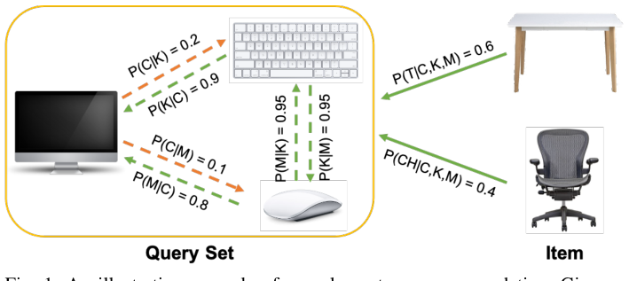
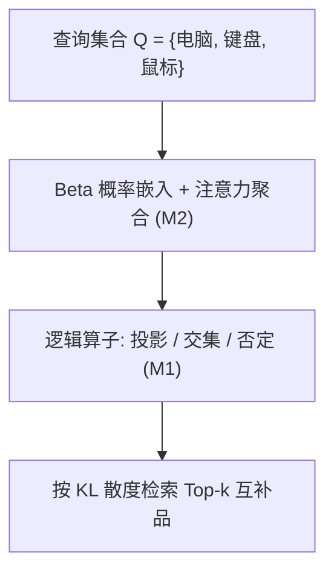
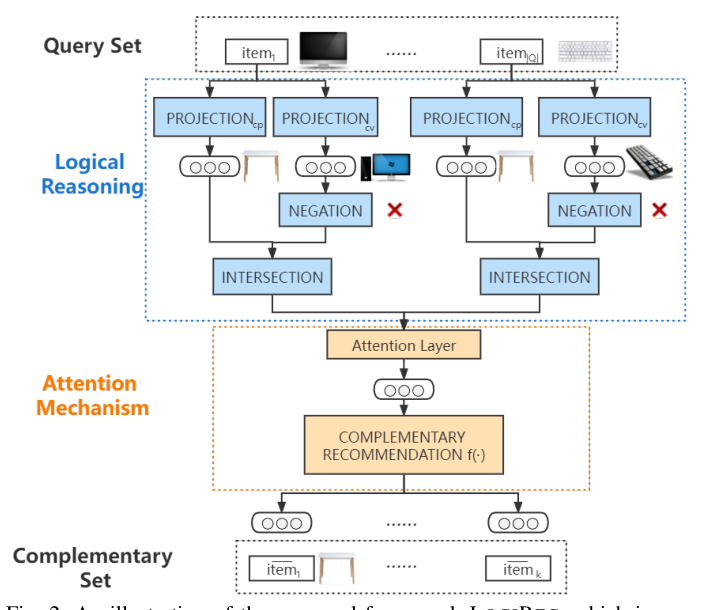

# Towards High-Order Complementary Recommendation via Logical Reasoning Network (基于逻辑推理网络的高阶互补推荐)

- **会议/期刊**: ICDM 2022
- **作者与机构**: Longfeng Wu, Dawei Zhou (Virginia Tech)；Yao Zhou (Instacart Inc.)
- **推荐链路定位**: 召回（互补品 item-to-item 召回）
- **研究方向**: 图神经网络与知识图谱推荐 / 冷启动与长尾推荐
- **论文原文**: [论文原文链接](https://arxiv.org/abs/2212.04966v1)
- **开源代码**: [开源代码仓库链接](https://github.com/wulongfeng/LogiRec)

## TL;DR (1分钟核心速览)

电商“搭配购买”召回的核心是**非对称性**（$P(\text{键盘}|\text{电脑})\gg P(\text{电脑}|\text{键盘})$）与**高阶性**（给定电脑+键盘+鼠标，应推“办公桌”而非“椅子”），而 CF/MF/LightGCN 均基于对称度量且只处理单品查询。本文 LogiRec 将物品表示为 Beta 概率分布，用可微的投影/否定/交集逻辑算子替代人工剪枝学习有向映射，并以注意力聚合查询集合。在 6 个 Amazon 类目、70/20/10 随机划分、Hit@3/NDCG@3/MRR 协议下，Digital Music 低阶 Hit@3 由 0.222 提升至 0.567。

## Background & Motivation (背景与核心矛盾)

- **主流范式**: 互补推荐（CR）依赖共购/共视（co-purchase / co-view）构建商品图，用 item-based CF、矩阵分解或 LightGCN 学物品向量，再以内积/余弦找搭配品；P-Companion 等引入类目或场景辅助信息。
- **前人局限**: 其一，余弦与欧氏距离对称，无法区分 $A\to B$与$B\to A$；共视数据本身又代表“可替代”语义，与共购混在一起形成标签噪声。其二，所有模型只做单品查询，无法处理集合查询的高阶意图，且 LightGCN 类方法依赖全量 user-item 图，在十万级类目上直接 OOM。
- **核心洞察 (Key Insight)**: 共购关系天然是**有向且不可逆**的一阶逻辑变换，而 Beta 分布族对投影/交集/否定三类算子封闭，且 KL 散度本身非对称，二者结合可同时解决非对称性与不确定性（如 "apple" 语义歧义）。
- **本文切入点**: 用可学习逻辑算子替代“共购减共视”的人工剪枝，把 CR 统一为“查询嵌入 $\to$逻辑变换$\to$ KL 最近邻检索”的端到端概率推理。

<figure class="paper-figure" markdown="span">
  <figcaption>图1：互补推荐示例。给定一组查询物品计算机(C)、键盘(K)、鼠标(M)，它们之间存在低阶互补关系（虚线箭头）；系统推荐具有高分 P(T|C,K,M) 的商品桌(T)，它是对查询集合的良好高阶互补（实线箭头），而非另一商品椅(CH)。</figcaption>
</figure>

## Method (核心方法设计)

### 1. 整体框架 (Overall Architecture)

输入为商品图 $\mathcal{G}=(\mathcal{I},\mathcal{E}_{cp}\cup\mathcal{E}_{cv})$与查询集合$Q$。每个物品$i$被编码为$d$个独立 Beta 分布（$2d$个参数$\alpha_i,\beta_i$）。M1（逻辑推理模块）用投影算子把查询嵌入映射到目标空间，并以否定、交集组合剔除共视噪声，实现有向的非对称映射；M2（注意力模块）对$Q$内各物品的 Beta 参数做 softmax 加权求和，得到集合级嵌入；最后由 MLP 输出预测分布，与真实互补品的 Beta 嵌入计算 KL 散度，训练时用负采样 + margin 损失，推理时按 KL 最小检索 Top-$k$。

<figure class="paper-figure" markdown="span">
  <figcaption>图2：所提出框架 LOGIREC 的示意图，该框架由用于非对称推荐的逻辑推理模块（M1）和用于高阶 CR 的注意力机制（M2）组成。</figcaption>
</figure>

### 2. 关键设计拆解 (Key Designs)

1. **Beta 概率嵌入 + 非对称 KL 度量**：对称内积无法表达方向性。将物品表示为 $\mathrm{Beta}(\alpha_i,\beta_i)$，映射由 MLP 学习$f(\theta_{Q})=\theta_{i}$，匹配度用$D_{KL}\big(\theta_{i}\,\|\,\hat{\theta}_{i}\big)$度量——KL 天然不满足对称性，直接编码了$P(i|q)\neq P(q|i)$；Beta 的方差还刻画了语义歧义带来的不确定性。
2. **可微逻辑算子替代人工剪枝**：作者指出 $E_{cp}\cap E_{cv}$中的共视重叠是标签噪声，理想标签是$E_{cp}-E_{cv}$。本文不改数据而改算子：否定算子取$\alpha_{q}=1/\alpha_{i},\ \beta_{q}=1/\beta_{i}$表达“排除共视项”，交集算子以$\alpha_{i}=\sum_{j}w_{j}\alpha_{q_{j}},\ \beta_{i}=\sum_{j}w_{j}\beta_{q_{j}}$（$w_j$ 为 softmax 权重）实现多条件合取，使剪枝在嵌入空间端到端可学。
3. **高阶注意力与负采样训练**：单查询时 $|Q|=1$，注意力退化为恒等映射，故需专门训练高阶分支。集合表示取$w_{j}=\mathrm{softmax}\big(\theta_{j}\big)$、$\alpha_{Q}=\sum_{j=1}^{|Q|}w_{j}\alpha_{j}$，让模型自动判别“哪个查询物更能揭示意图”。总损失为带 margin$\gamma$ 的负采样 KL 排序损失：
$$\mathcal{L}=-\log\sigma\big(\gamma-D_{KL}(\theta_{i}\|\hat{\theta})\big)-\sum_{j=1}^{m}\tfrac{1}{m}\log\sigma\big(D_{KL}(\theta_{i'_{j}}\|\hat{\theta})-\gamma\big)$$
其中 $m=128$为均匀负样本数、$\gamma=60$、嵌入维度$k=400$；训练仅需物品对，**无需 user-item 图**，这正是其在十万级类目上不 OOM 的原因。推理为对全库逐一算 KL，复杂度$O(|\mathcal{I}|d)$，难以直接上 ANN 索引。

## Experimental Setup & Evaluation Protocol (实验设置与评估协议)

- **数据集与预处理**: Amazon 六个一级类目，边由共购/共视共现构造，未做 k-core 过滤。

| 数据集 | #Items | $\lvert E_{cp}\rvert$|$\lvert E_{cv}\rvert$ | 密度 |
| :--- | :---: | :---: | :---: | :---: |
| Gift Cards | 3.9K | 20.9K | 33.4K | 3.56e-3 |
| Digital Music | 91.4K | 94.6K | 98.1K | 2.31e-5 |
| Amazon Fashion | 421.5K | 272.4K | 316.9K | 3.32e-6 |
| Video Games | 116.4K | 773.5K | 763.5K | 1.13e-4 |
| Pet Supplies | 324.5K | 981.3K | 2.03M | 2.86e-5 |
| Office Products | 657.8K | 2.42M | 1.85M | 9.87e-6 |

- **数据划分与防穿越 (Splitting Strategy)**: 三元组 $(h,r,t)$按$70\%/20\%/10\%$**随机比例划分**，非时间切分。高阶样本由规则合成：若$i_1\to i_3$、$i_2\to i_3$且$i_2\to i_1$，则生成$(i_1,i_2)\to i_3$。
- **排名评测协议 (Ranking Protocol)**: 报告 Hit@3 / NDCG@3 / MRR；论文未披露候选集规模与评测负采样方式（未声明 Full-Ranking），属协议透明度缺口。
- **对比基线与超参设置**: CF、MF、LightGCN、Knowledge-Aware（序列+评论上下文）；变体 LogiRec-Low / High / Hybrid。$k=400$、$m=128$、$\gamma=60$，未做显著性检验。

## Key Experimental Results (实验关键数据)

### 1. 主实验对比 (Main Results)

低阶互补推荐（单品查询）：

| 方法 | Gift Cards (H/N/M) | Digital Music (H/N/M) | Amazon Fashion (H/N/M) |
| :--- | :---: | :---: | :---: |
| CF | 0.009/0.005/0.024 | 0.096/0.061/0.074 | 0.062/0.035/0.032 |
| MF | 0.011/0.006/0.024 | 0.075/0.060/0.064 | 0.016/0.012/0.013 |
| Knowledge-Aware | 0.009/0.004/0.025 | 0.075/0.053/0.062 | 0.039/0.023/0.024 |
| LightGCN | 0.119/0.047/0.074 | 0.222/0.213/0.222 | OOME |
| **LogiRec-Hybrid** | **0.155/0.110/0.149** | **0.567/0.484/0.493** | **0.278/0.226/0.245** |
| Improv. (vs best) | +30.3%/+134%/+101% | +155%/+127%/+122% | +348%/+546%/+666% |

高阶互补推荐（集合查询）：

| 方法 | Gift Cards | Digital Music | Amazon Fashion |
| :--- | :---: | :---: | :---: |
| CF | 0.029/0.015/0.052 | 0.086/0.047/0.088 | 0.080/0.042/0.058 |
| Knowledge-Aware | 0.042/0.024/0.061 | 0.097/0.067/0.091 | 0.027/0.020/0.031 |
| LightGCN | 0.054/0.037/0.079 | 0.067/0.046/0.053 | OOME |
| LogiRec-Low | 0.060/0.045/0.068 | 0.335/0.260/0.291 | 0.047/0.035/0.047 |
| **LogiRec-Hybrid** | **0.256/0.184/0.241** | **0.641/0.485/0.495** | 0.470/0.353/0.387 |

### 2. 消融实验 (Ablation Study)

| 设置 | 场景 | Low | High | Hybrid |
| :--- | :--- | :---: | :---: | :---: |
| Gift Cards | 低阶 Hit@3 | 0.121 | 0.027 | **0.155** |
| Digital Music | 低阶 Hit@3 | 0.550 | 0.160 | **0.567** |
| Amazon Fashion | 低阶 Hit@3 | 0.182 | 0.116 | **0.278** |
| Gift Cards | 高阶 Hit@3 | 0.060 | 0.192 | **0.256** |
| Digital Music | 高阶 Hit@3 | 0.335 | 0.566 | **0.641** |
| Pet Supplies | 高阶 Hit@3 | 0.007 | 0.060 | **0.099** |

### 3. 关键实验发现 (Key Findings)

1. **非对称性是主要增益源**：CF/MF/LightGCN 在图3 的“非对称度-性能”平面上被判定为对称，且位于左下方；LogiRec 位于右上角。Gift Cards 上仅 M1（LogiRec-Low）就把 Hit@3 从 LightGCN 的 0.119 抬到 0.121、MRR 从 0.074 抬到 0.129，说明 KL + 有向算子对方向性建模有效，而不仅是模型容量。
2. **集合级注意力是高阶场景的决定因素**：Digital Music 高阶 Hit@3 从 Low 的 0.335 升至 High 的 0.566（+69%），再经联合训练到 0.641；而高阶分支在低阶场景几乎失效（Video Games / Pet Supplies / Office 三项 Hit@3 均仅 0.001），因 $|Q|=1$ 时注意力退化为恒等。
3. **去 user-item 图带来可扩展性红利**：LightGCN 在 Fashion/Video Games/Pet/Office 四个数据集全部 OOM，而仅用物品对监督的 LogiRec 在 657.8K 物品的 Office Products 上仍可训练，并将高阶 Hit@3 从 CF 的 0.032 提升到 0.038、NDCG@3 从 0.017 提升到 0.027。

## Highlights & Limitations (亮点、对比与审稿批判)

- **与代表作对比 (vs. Prior Work)**: 相比 P-Companion（需类目层级辅助信息，仅低阶）和 Knowledge-Aware（需用户评论/购买序列，低阶、对称双嵌入），LogiRec 仅用共购/共视对即可端到端训练并支持集合查询；相比 BetaE（用于 KG 逻辑查询），本文把逻辑算子从“查询推理”迁移为“互补映射”，并用 Intersection/Negation 显式承担数据去噪职责。
- **可迁移亮点**: 其一，用 KL 距离替代内积作为召回打分，可零成本为任意双塔引入方向性（如“因 A 而买 B”场景）；其二，把数据清洗规则（共购减共视）改写为可微算子，是处理标签噪声的通用范式。
- **审稿级局限批判**: 其一，评测协议未交代候选集构造与是否 Full-Ranking，指标绝对值普遍低于 0.3，且无显著性检验，说服力受限；其二，高阶标签由确定性规则合成而非真实会话，存在规则依赖的标签噪声；其三，推理需对全库算 KL，无 ANN 支持，且缺少与 P-Companion 这一最直接竞品的实验对比。

## Rating (四维评分)

- **方法创新性 (Novelty)**: ⭐⭐⭐⭐ （将 BetaE 逻辑算子重构为互补映射，以 KL 的非对称性 + 可微剪枝统一低/高阶 CR，思路简洁且有物理直觉）
- **评估协议与实验扎实度 (Protocol & Experiments)**: ⭐⭐⭐ （六类目覆盖稀疏度梯度、双场景三指标较完整，但候选集协议不透明、无显著性检验、缺关键竞品对比）
- **写作与数学规范度 (Clarity & Rigor)**: ⭐⭐⭐⭐ （算子定义与损失式清晰，6 页短文信息密度高；否定算子 $\alpha=1/\alpha'$ 的推导与除零风险未讨论）
- **工业落地与复现价值 (Industrial & Practical Value)**: ⭐⭐⭐⭐ （代码开源、只需物品对无需用户图、可扩展至 65 万物品类目，但全库 KL 检索需自建量化/近似索引方能上线）

