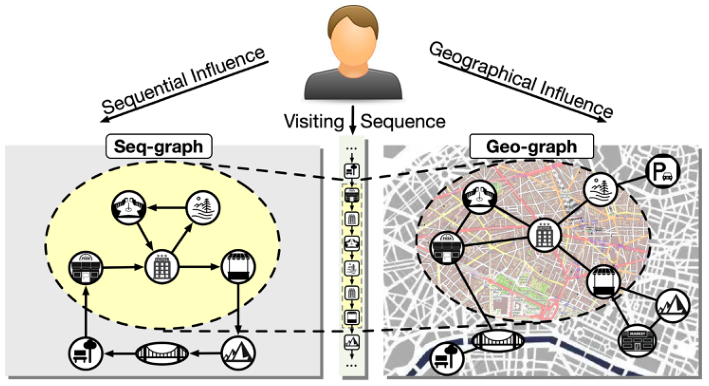
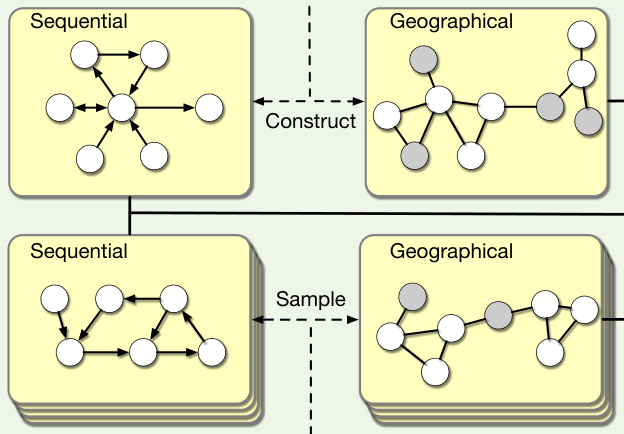
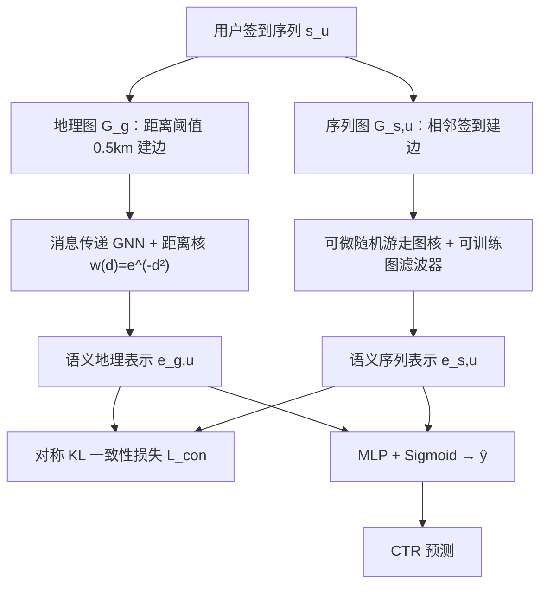

# Kernel-based Substructure Exploration for Next POI Recommendation (基于核子结构探索的下一兴趣点推荐)

- **会议/期刊**: IEEE ICDM 2022
- **作者与机构**: Wei Ju, Yifang Qin, Ziyue Qiao, Xiao Luo, Yifan Wang, Yanjie Fu, Ming Zhang（北京大学 / 香港科技大学(广州) / 中佛罗里达大学）
- **推荐链路定位**: 精排（下一 POI 的 CTR 预估）
- **研究方向**: 时空轨迹与 POI 本地生活推荐 / 图神经网络与知识图谱推荐
- **论文原文**: [https://arxiv.org/abs/2210.03969v1](https://arxiv.org/abs/2210.03969v1)
- **开源代码**: [https://github.com/Fang6ang/KBGNN](https://github.com/Fang6ang/KBGNN)

## TL;DR (1分钟核心速览)

现有下一 POI 推荐几乎都在 RNN/Attention 上做序列建模，既无法显式刻画 POI 之间**拓扑地理邻近性**，也抓不住用户轨迹中反复出现的**高阶序列子结构**（如地图上的“三角形/四边形”常规路线）。本文提出 KBGNN：地理图上做带距离衰减核的消息传递，序列图上用**可微随机游走图核 + 可训练图滤波器**抽取高阶子结构，再用 KL 分布一致性学习让两模块互为监督。在 Foursquare Tokyo/NYC 上，AUC 分别比最优基线提升 3.3%/4.5%，Logloss 下降 23%/24%。

## Background & Motivation (背景与核心矛盾)

- **主流范式**: DeepMove/LSTPM/GeoIE 等以 RNN、geo-dilated LSTM 或注意力为主干，把地理信息当作附加的空间特征拼进序列编码器。
- **前人局限 ①**: 地理位置只按物理距离或相邻关系硬编码为特征，无法刻画 POI 网络中**多跳拓扑地理影响**（距离衰减在网络上的传播）。
- **前人局限 ②**: RNN 的隐状态只表达“路径依赖”，难以显式对齐用户轨迹中的**高阶子图模式**（轨迹本身构成 loop / 多边形 routine），而这类子结构恰是个性化偏好的强信号。
- **核心洞察 (Key Insight)**: 一次观测到的签到同时被“历史序列邻居”和“附近 POI”驱动（图 1），两者是**互补而非替代**关系；因此应当建两张图、用两种异构算子分别编码，再对齐语义空间。
- **本文切入点**: 双图双模块 + 软一致性蒸馏，把拓扑地理与高阶序列子结构协同进同一个 CTR 预测器。

<figure class="paper-figure" markdown="span">
  <figcaption>图1. 用户签到行为背后地理和序列影响的示意图。一次观测到的POI访问同时受用户历史序列和附近POI的影响。</figcaption>
</figure>

## Method (核心方法设计)

### 1. 整体框架 (Overall Architecture)

输入用户 $u$的签到序列$s_u$，同时构建两张图：地理图$G_g$（POI 物理距离小于$\Delta_d=0.5$km 建边，边权为公里距离）与用户感知序列图$G_{s,u}$（相邻签到建边）。地理模块用消息传递 GNN 编码$G_g$，经多头自注意力聚合得到语义地理表示$e_{g,u}$；序列模块用图核网络将$G_{s,u}$与一组可训练图滤波器做随机游走核比对，展平后得到语义序列表示$e_{s,u}$。两模块除共享监督的 CTR 损失外，还在记忆库锚点序列上计算相似度分布并用对称 KL 对齐（$e_{g,u}\leftrightarrow e_{s,u}$），最后拼接目标 POI 表示$h_t$ 送入两层 MLP + Sigmoid 输出点击概率。

<figure class="paper-figure" markdown="span">
  <figcaption>图2. 所提出的KBGNN框架示意图。A）地理图和序列图的构建；B）地理模块和序列模块分别编码两个对应图并生成语义表示；C）计算Lcon以促进两个模块之间的一致性；D）预测层结合两个语义表示和目标POI嵌入ht进行CTR预测。</figcaption>
</figure>

### 2. 关键设计拆解 (Key Designs)

1. **距离核消息传递的地理模块（把物理距离变成传播衰减）**：痛点是把地理当静态特征无法多跳传播。本文在 GCN 归一化边上再乘一个高斯型距离核：$m_{j\leftarrow i}^{(l)}=\frac{1}{\sqrt{|\mathcal{N}_i||\mathcal{N}_j|}}w(d_{ij})\mathbf{W}^{(l)}h_i^{(l-1)}$，其中$w(d_{ij})=e^{-d_{ij}^{2}}$。直觉：距离越远信息流越被抑制，于是 2–3 跳邻域自然形成“商圈级”语义团簇，而非全城平摊。

2. **可微随机游走图核的序列模块（用图滤波器当“子结构探测器”）**：痛点在于 RNN 隐状态无法显式表达循环 routine。本文把 $G_{s,u}$与$N$个带可训练邻接矩阵$A_i\in\mathbb{R}^{n_i\times n_i}$的图滤波器$G'_i$做直积图上的$p$步游走核：$k^{(p)}(G,G')=\mathbf{e}^{\top}A_{\times}^{p}\mathbf{e}$，构造$H_{ij}=k^{(j-1)}(G_{s,u},G'_i)$后展平得$e_{s,u}$。直觉：公共游走计数等价于“子图模式匹配次数”，滤波器即学到的 prototypical routine（实验可视化出五边形、星形结构）。

3. **训练目标、负采样与推理开销**：分布一致性用温度 0.5 的余弦相似度 $\Phi(\cdot,\cdot)=\exp(\cos(\cdot,\cdot)/\tau)$构造$p_{g,u}^{m}=\frac{\Phi(e_{g,u},e_{g,u_m})}{\sum_{m'}\Phi(e_{g,u},e_{g,u_{m'}})}$，损失$\mathcal{L}_{con}=\frac{1}{|\mathcal{U}|}\sum_{u}\frac{1}{2}\left[D(p_{s,u}\|p_{g,u})+D(p_{g,u}\|p_{s,u})\right]$；总目标$\mathcal{L}=\mathcal{L}_{rec}+\beta\mathcal{L}_{con}$，$\beta=0.01$，$\mathcal{L}_{rec}$ 为 BCE。锚点序列由队列式 memory bank 维护（仅存最近若干迭代的锚点），避免为全量序列同时编码；在线推理只需前向双模块 + MLP，无需负采样与全库排序。

## Experimental Setup & Evaluation Protocol (实验设置与评估协议)

- **数据集与预处理**:

| 数据集 | #Users | #Items(POI) | #Interactions | 稀疏度/密度 | 特征/场景说明 |
| :--- | :---: | :---: | :---: | :---: | :--- |
| Foursquare Tokyo | 2,293 | 61,858 | 573,703 | 密度 ≈ 0.40% | 平均序列长 250.2，经纬度 + 时间戳 |
| Foursquare NYC | 1,083 | 38,333 | 227,428 | 密度 ≈ 0.55% | 平均序列长 210.0，同上 |

- **数据划分与防穿越 (Splitting Strategy)**: 严格按时间戳排序，**每个用户最后一条签到留作评估集**（Leave-Last-Out），其余为训练集；评估集等分为 test / validation 两份，属时间序切分，无未来信息泄漏。
- **排名评测协议 (Ranking Protocol)**: 本文并非 Full-Ranking 排序，而是 **location-based CTR 二分类**：对给定 $(u,v_t)$ 预测点击概率，用 **AUC ↑ 与 Logloss ↓** 评价；论文未报告采样负例比例，属于“目标 POI 正样本 + 隐式负样本”的 CTR 框架，这一点弱于全库排序评估的严格性。
- **对比基线与超参设置**: 三类基线——序列 CTR（DIN、DIEN）、GNN 推荐（SR-GNN、NGCF、LightGCN）、POI 专用（GeoIE、LSTPM、GSTN）。所有模型隐层维度统一 $d=64$，KBGNN 取$\beta=0.01$、$\Delta_d=0.5$ km、GNN 2 层、游走 3–4 步；结果为 3 次随机初始化的均值。

## Key Experimental Results (实验关键数据)

### 1. 主实验对比 (Main Results)

| Model | Tokyo AUC↑ | Tokyo Logloss↓ | NYC AUC↑ | NYC Logloss↓ |
| :--- | :---: | :---: | :---: | :---: |
| DIN | 0.8623 | 0.4174 | 0.8015 | 0.5203 |
| DIEN | 0.8643 | 0.4544 | 0.8062 | 0.5582 |
| SR-GNN | 0.8867 | 0.4481 | 0.8491 | 0.5262 |
| NGCF | 0.8899 | 0.4436 | 0.8461 | 0.4788 |
| LightGCN | 0.8998 | 0.4348 | 0.8729 | 0.4815 |
| GeoIE | 0.9083 | 0.4203 | 0.8769 | 0.4810 |
| LSTPM | 0.8745 | 0.4374 | 0.8568 | 0.4821 |
| GSTN | 0.8906 | 0.4312 | 0.8521 | 0.5323 |
| **KBGNN (Ours)** | **0.9387** | **0.3147** | **0.9189** | **0.3620** |
| **Improv.%** | **+3.35%** | **−25.1%** | **+4.79%** | **−24.8%** |

（Improv. 相对最强基线 GeoIE；Logloss 相对最优基线计算。）

### 2. 消融实验 (Ablation Study)

| 变体 | Tokyo AUC | NYC AUC | 结论 |
| :--- | :---: | :---: | :--- |
| w/o Seq-graph（去序列模块与 $\mathcal{L}_{con}$） | 明显下降（约 0.92 量级） | 明显下降（约 0.89 量级） | 高阶序列子结构有独立贡献 |
| w/o Geo-graph（去地理模块与 $\mathcal{L}_{con}$） | 降幅更大（约 0.90 量级） | 降幅更大（约 0.87 量级） | 地理拓扑是主导因素 |
| $\mathcal{L}_{con}$ 换 InfoNCE | 低于完整模型 | 低于完整模型 | 硬对齐不如软分布对齐 |
| $\mathcal{L}_{con}$ 换 MSE | 低于完整模型 | 低于完整模型 | 表征级回归丢结构信息 |
| w/o $\mathcal{L}_{con}$ | 最低 | 最低 | 双模块知识通信不可或缺 |
| **KBGNN 完整** | **0.9387** | **0.9189** | — |

（消融精确数值原文仅以柱状图 Fig. 4 / Fig. 7 给出，上表为按图读出的量级与趋势。）

### 3. 关键实验发现 (Key Findings)

1. **地理模块贡献 > 序列模块**：移除地理图的性能跌幅始终大于移除序列图，说明“下一站去哪”首先被空间可达性约束；这与冷启动实验中地理类方法（GeoIE、LSTPM、KBGNN）在 20%–40% 稀疏训练集上优势更明显相互印证。
2. **软一致性优于硬对比**：把 $\mathcal{L}_{con}$换成 InfoNCE/MSE 均掉点，而完全不使用一致性损失降幅最大，表明两模块嵌入空间本就异构，用 KL 对齐“相似度分布”而非对齐“向量本身”才是正确的蒸馏粒度；$\beta$扫描显示$10^{-2}$附近最优，$\beta>10^{-1}$ 会压过监督信号。
3. **超参存在明显拐点**：GNN 层数从 0（退化为纯注意力）增至 2 时 AUC 上升、3 层开始过平滑回落；随机游走步数在 3–4 步最优，过长游走引入噪声子结构，说明“高阶”并非越高越好。

## Highlights & Limitations (亮点、对比与审稿批判)

- **与代表作对比 (vs. Prior Work)**: 相比 LSTPM 用 geo-dilated LSTM 隐式吸收空间信息，KBGNN 首次把地理影响做成**图上的多跳衰减传播**；相比 LightGCN 只做协同二部图传播，它额外引入**图核**这一非参数子结构匹配算子；相比同样建图的 GSTN，其差异在于用一致性学习而非单一监督同时驱动两张图。
- **可迁移亮点**: (i) 用 $e^{-d^2}$ 距离核调制 GCN 边权，可低成本移植到任何带坐标的推荐（本地生活、外卖、打车）；(ii) “双视图相似度分布 KL 对齐”比 InfoNCE 更容忍异构嵌入空间，适合召回/精排双塔或内容/协同双路融合场景。
- **审稿级局限批判**: (i) 图核需对每个用户序列与 $N$个滤波器做直积图游走核，$N\times(P{+}1)$ 次核计算 + 序列图逐用户构建，在线/大规模场景开销与可扩展性存疑；(ii) 评估仅为 AUC/Logloss 的 CTR 二分类，**未做全库排序或负采样比例敏感性分析**，也未与近年基于时空 Transformer / 自监督序列推荐的强基线比较，结论的普适性有待加强。

## Rating (四维评分)

- **方法创新性 (Novelty)**: ⭐⭐⭐⭐ （首次将可微随机游走图核用于用户序列子结构挖掘，并以软分布一致性耦合地理/序列双图，机制新颖且有可视化支撑）
- **评估协议与实验扎实度 (Protocol & Experiments)**: ⭐⭐⭐ （双城市数据集 + 冷启动分折 + 消融/超参/案例齐备，但仅 CTR 指标、无全库排序与显著性检验，消融数值仅在图中）
- **写作与数学规范度 (Clarity & Rigor)**: ⭐⭐⭐⭐ （双模块公式链条清晰、图核定义严谨，但对负采样与图核复杂度缺显式分析）
- **工业落地与复现价值 (Industrial & Practical Value)**: ⭐⭐⭐⭐ （代码已开源、维度 64、2 层 GNN 轻量；但逐用户建图与图核计算在亿级 POI 上的工程改造成本需评估）

