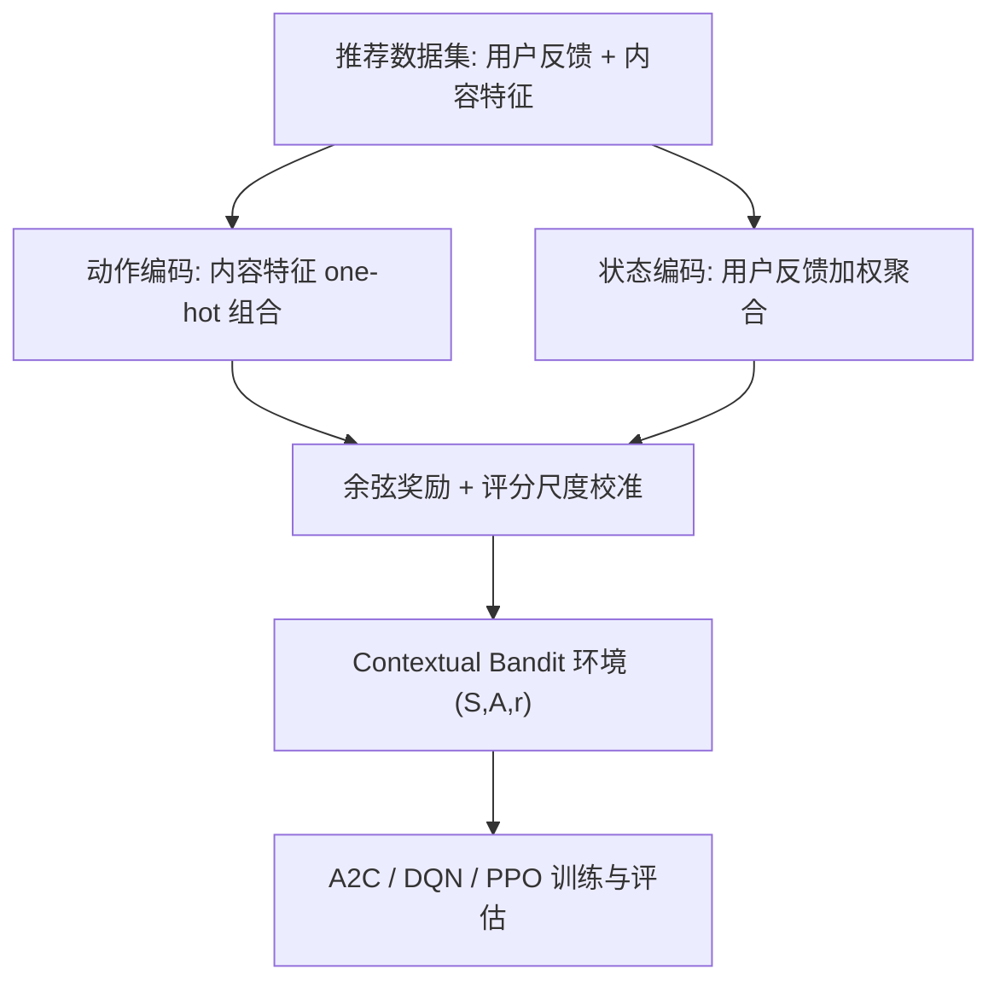
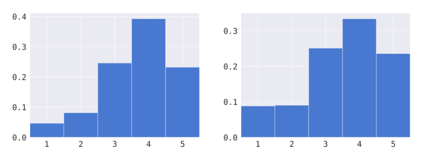

# Simulated Contextual Bandits for Personalization Tasks from Recommendation Datasets (从推荐数据集构建面向个性化任务的模拟上下文赌博机)

- **会议/期刊**: IEEE ICDM 2022
- **作者与机构**: Anton Dereventsov (Lirio AI Research), Anton Bibin (Skoltech Agro)
- **推荐链路定位**: 端到端策略学习与仿真环境构建
- **研究方向**: 强化学习与动态探索推荐
- **论文原文**: [https://arxiv.org/abs/2210.10631v2](https://arxiv.org/abs/2210.10631v2)
- **开源代码**: [https://github.com/Ansebi/WAIN22_sim_env](https://github.com/Ansebi/WAIN22_sim_env)（RL 智能体基于 Stable-Baselines3）

## TL;DR (1分钟核心速览)

本文不提出新的推荐排序模型，而是解决个性化任务缺少公开、可复现交互环境的问题：把推荐数据集的用户反馈向量与内容特征 one-hot 重参数化为上下文赌博机的状态/动作，以余弦相似度构造奖励，生成可训练环境。MovieLens 25M 与 IMDb 上，A2C/DQN/PPO 的训练回报曲线验证环境可学习，生成评分分布贴近原数据；但未报告 NDCG/HR 等排序指标。

## Background & Motivation (背景与核心矛盾)

- **主流范式**: 推荐系统依赖历史交互做矩阵分解或神经协同过滤；个性化任务则强调利用用户特征直接学习偏好，常见于电商、媒体、医疗等场景。
- **前人局限**: 真实个性化数据往往私有且含敏感信息，难以公开；已有仿真器如 RecSim、RecoGym 多针对特定应用手工建模，复用成本高。推荐数据集虽有内容元数据和用户反馈，却不是标准 bandit 交互格式。
- **核心洞察 (Key Insight)**: 用户对内容的反馈可按内容特征聚合为“偏好状态”，内容特征本身可编码为“动作”，两者余弦相似度可近似用户对动作的偏好强度。
- **本文切入点**: 将任意推荐数据集 $(X,Y)$重参数化为上下文赌博机$(S,A,r)$，用真实内容特征和反馈分布构造可配置的个性化仿真环境。

## Method (核心方法设计)

### 1. 整体框架 (Overall Architecture)

输入为推荐数据集的用户反馈与内容特征。内容侧用特征 one-hot 组合成动作向量；用户侧用其对内容的历史反馈加权聚合内容特征，形成状态向量；奖励由状态与动作的余弦相似度计算，并缩放到原数据评分尺度。生成的环境可直接接入 A2C/DQN/PPO 等 RL 智能体训练与评估。整个流程不训练推荐模型，而是提供交互式 benchmark。

### 2. 关键设计拆解 (Key Designs)

1. **动作与状态的重参数化**：传统推荐数据以 user-item 交互矩阵存储，不能直接作为 bandit 输入。本文令内容特征集为 $T$，动作编码为$a=\sum_{j=1}^{|T|}\delta(y,t_j)e(t_j)\in\mathbb{R}^{|T|}$；用户状态由其反馈加权内容特征得到$s=\sum_{i=1}^{|Y|}f(x,y_i)a_i\in\mathbb{R}^{|T|}$，其中$f(x,y)\in[-1,1]$，缺失反馈置 0。这样状态与动作共享特征空间，余弦相似度具有“偏好匹配”的直觉。

2. **奖励函数与评分尺度校准**：若直接用余弦相似度，奖励范围与原评分分布不一致。本文先取 $r(s,a)=\alpha\frac{\langle s,a\rangle}{\|s\|\|a\|}$，再按数据集做离散化校准。MovieLens 使用$r(s,a)=\mathrm{clip}\{\frac12\lceil2+10\frac{\langle s,a\rangle}{\|s\|\|a\|}\rceil,0.5,5.0\}$；IMDb 使用$r(s,a)=\lceil10(\frac12+\frac{\langle s,a\rangle}{2\|s\|\|a\|})^{0.5}\rceil$。校准后奖励取值分别对齐 5 星与 10 星评分，生成分布更接近原数据。

3. **训练目标、负采样与推理效率**：本文没有自定义推荐损失，A2C/DQN/PPO 各自优化其策略/值函数目标；不存在传统负采样，动作空间被截断为 100 个热门内容，训练时智能体与模拟环境交互采样。推理/评估时对 100 个候选动作逐一打分，开销为 $O(|A|)$，适合小动作空间 benchmark，但不适合大规模全库召回。

## Experimental Setup & Evaluation Protocol (实验设置与评估协议)

- **数据集与预处理**: MovieLens 25M 使用 18 类 genre 编码，保留至少评分 20 部的用户；环境取 10,000 名最活跃用户与 100 部最热门电影。IMDb 使用 27 类 genre，取 10,000 部评论最多电影；因无个体评分，合成 10,000 名用户，每人 50 条非零评分。

| 数据集 | #Users | #Items | #Interactions | 稀疏度/密度 | 特征/场景说明 |
| :--- | :---: | :---: | :---: | :---: | :--- |
| MovieLens 25M | 162,000 | 62,000 | 25,000,000 | 约 0.249% | 18 类电影 genre；环境用 10k 活跃用户、100 部热门电影 |
| IMDb | 10,000（合成） | 10,000 | 500,000（合成） | 约 0.5% | 27 类 genre；每用户 50 条非零评分，动作取 100 部热门电影 |

MovieLens 的原始评分与生成环境奖励分布对齐情况见图 1。  
<figure class="paper-figure" markdown="span">
  <figcaption>图 1. 电影评分分布：MovieLens 25M 数据集（左）与生成的上下文赌博机环境（右）。</figcaption>
</figure>

- **数据划分与防穿越 (Splitting Strategy)**: 无 `Leave-One-Out`、比例划分或时间戳切分；直接用全量数据构造环境，属于“环境生成”而非监督学习评估，因此不存在传统 train/test 穿越检验。
- **排名评测协议 (Ranking Protocol)**: 不适用。本文不做 `Full-Ranking` 或 `Sampled Ranking`，也不报告 NDCG/HR/MRR；评估方式是奖励分布匹配与 RL 训练回报曲线。
- **对比基线与超参设置**: 仅用 A2C、DQN、PPO 三个 RL 智能体作可行性验证，不是推荐 SOTA 对比；统一 2 层 32 节点策略网络，Adam 学习率 $10^{-4}$，其余用默认超参；无显著性检验。

## Key Experimental Results (实验关键数据)

### 1. 主实验对比 (Main Results)

原文未提供传统推荐主实验表，也未报告相对提升 `Improv.%`；下表按图 1–4 与正文汇总，不虚构数值。

| 环境 | 状态/动作 | 智能体 | 原文证据 | 观察 |
| :--- | :--- | :--- | :--- | :--- |
| MovieLens 25M | $S\subset\mathbb{R}^{18}$，10k 用户；$A\subset\mathbb{R}^{18}$，100 部电影 | A2C / DQN / PPO | 图 1、图 2 | 生成奖励分布接近原始 5 星分布；训练回报曲线显示环境可学习 |
| IMDb | $S\subset\mathbb{R}^{27}$，10k 合成用户；$A\subset\mathbb{R}^{27}$，100 部电影 | A2C / DQN / PPO | 图 3、图 4 | 生成奖励分布接近原始 10 星分布；训练回报曲线显示环境可学习 |

### 2. 消融实验 (Ablation Study)

原文未做组件消融，以下仅列出可提取的替代性检查，不能视为严格消融。

| 检查项 | 原文结果 | 说明 |
| :--- | :--- | :--- |
| 奖励校准 vs. 原始余弦 | 未报告 | 正文仅说明校准后分布接近原数据 |
| 特征编码/动作规模变化 | 未报告 | 作者承认可配置，但未系统实验 |
| IMDb 合成用户反馈 | 可运行 | 用 50 条非零评分模拟用户，验证无个体评分时的可行性 |

### 3. 关键实验发现 (Key Findings)

1. **分布级保真有效**：MovieLens 生成奖励对齐 5 星离散取值，IMDb 对齐 10 星取值，图 1/3 显示整体分布与原始数据相似，说明“余弦 + 缩放/取整”能保留评分尺度；但这只是分布匹配，不代表个体偏好被真实还原。
2. **环境可提供学习信号**：A2C/DQN/PPO 在两类环境上的训练回报曲线随交互步数上升（图 2/4），证明状态-动作表征不是随机噪声；作者明确智能体仅作示意，不能据此给算法排名。
3. **缺失用户反馈可被模拟**：IMDb 没有个体评分，本文用 10k 合成用户、每人 50 条非零评分构造连续状态，仍能生成可训练环境；代价是用户偏好为合成，环境真实性受限于模拟规则。

## Highlights & Limitations (亮点、对比与审稿批判)

- **与代表作对比 (vs. Prior Work)**: 相比 RecSim/RecoGym 需要手工设计用户行为模型，本文直接复用推荐数据集的内容特征与反馈，构造成本低；相比矩阵分解/神经 CF，它不追求排序精度，而是提供策略学习环境；相比普通 bandit benchmark，它使用真实内容元数据，动作语义更强。
- **可迁移亮点**: “内容特征 one-hot 组合为动作、用户反馈加权聚合为状态”可迁移到新闻、短视频、电商等带标签内容的 bandit 仿真；“奖励缩放到原评分尺度”可缓解仿真奖励与真实反馈分布错位。
- **审稿级局限批判**: 第一，状态/动作仅用 genre 等低维特征，信息损失大，且动作截断为 100 个热门内容会引入流行度偏差；第二，评估缺少标准排序指标、数据划分、消融与显著性检验，IMDb 用户还是合成的，环境保真度与结论外推性有限。

## Rating (四维评分)

- **方法创新性 (Novelty)**: ⭐⭐⭐ （思路简单但实用，把推荐数据重参数化为 bandit 环境，有 benchmark 价值，非算法级创新）
- **评估协议与实验扎实度 (Protocol & Experiments)**: ⭐⭐ （无标准推荐指标、无划分/消融/显著性检验，仅分布图和训练曲线）
- **写作与数学规范度 (Clarity & Rigor)**: ⭐⭐⭐⭐ （公式与构造流程清晰，符号简洁；但复杂度与保真度分析较浅）
- **工业落地与复现价值 (Industrial & Practical Value)**: ⭐⭐⭐ （代码与流程易复现，适合小动作空间策略验证；大规模动作空间与真实用户建模仍需扩展）

