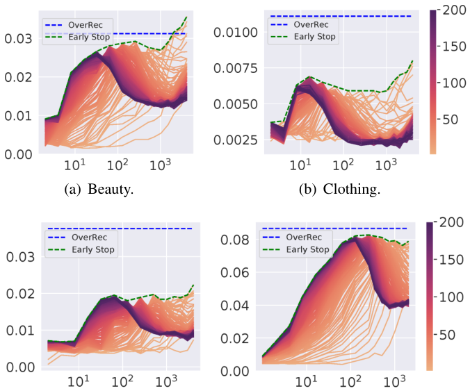
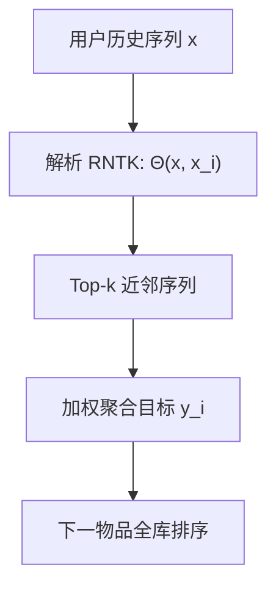
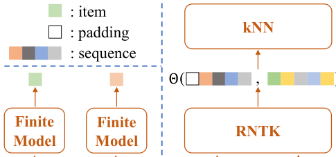

# Beyond Double Ascent via Recurrent Neural Tangent Kernel in Sequential Recommendation (超越双上升：序列推荐中的循环神经切线核)

- **会议/期刊**: ICDM 2022
- **作者与机构**: Ruihong Qiu, Zi Huang, Hongzhi Yin；The University of Queensland
- **推荐链路定位**: 召回 / 序列下一物品预测（免训练近邻检索）
- **研究方向**: 序列与会话推荐 / 核方法与无限宽网络
- **论文原文**: [论文原文链接](https://arxiv.org/abs/2209.03735v2)
- **开源代码**: [开源代码仓库链接](https://github.com/RuihongQiu/OverRec)

## TL;DR (1分钟核心速览)

针对序列推荐中增大模型宽度时出现的“性能升—降—再升”双上升现象，本文用解析循环神经切线核 RNTK 度量用户序列相似度，并以免训练加权 kNN 预测下一物品，理论上等价于无限宽 RNN；在四个全库排序基准上，MRR@10 全面超过 SASRec，Beauty/Toys 的 NDCG@10 分别提升 11.03%/0.53%。

## Background & Motivation (背景与核心矛盾)

- **主流范式**: GRU4Rec、SASRec、BERT4Rec 等以有限宽度 RNN/Attention 编码历史序列，再经训练后的分类层做 next-item 预测。
- **前人局限**: 大模型通常先过拟合，需早停或缩小隐藏维度；同时受 GPU 显存限制，无法被动放大到无限宽来验证结构极限。
- **核心洞察 (Key Insight)**: 宽度从 2 增至 4096 时，测试 NDCG 先升、后降、再升；“过拟合是暂时的”，更大宽度可能逼近该结构的渐近上限。
- **本文切入点**: 不物理构建超大 RNN，而是解析推导其 RNTK，用核相似度 + kNN 直接获得无限宽 RNN 的编码能力。

<figure class="paper-figure" markdown="span">
  <figcaption>图 1：在四个数据集上的双上升现象。X 轴为模型宽度，范围为 2 到 4096。Y 轴为 NDCG@10。色条表示训练轮次，从 1 到 200。横坐标相同的点来自同一模型。蓝色虚线表示 OverRec 的性能。绿色虚线表示每个模型的最高性能。(1) 由绿色虚线可见，随着模型规模增大，测试性能先上升、后下降、最后再次上升，这被称为双上升。(2) OverRec 的性能可以接近无限宽 RNN。</figcaption>
</figure>
图1：四个数据集上的双上升现象；OverRec 不需训练即可接近无限宽 RNN 的性能。

## Method (核心方法设计)

### 1. 整体框架 (Overall Architecture)

OverRec 将用户历史序列视为 one-hot 序列输入，不训练显式编码器；对查询序列 $x$与训练序列$x_i$解析计算 RNTK$\Theta(x,x_i)$，将其作为语义相似度，检索 top-$k$近邻序列，再用近邻的目标物品$y_i$ 加权聚合得到下一物品排序。整个流程无梯度更新、无负采样，核心开销在序列对核计算与 kNN 检索。

<figure class="paper-figure" markdown="span">
  <figcaption>图 3：一般有限模型与 OverRec 的比较。左侧，一般有限模型为序列构建有限编码器。右侧，OverRec 使用 RNTK，Θ，度量序列之间的相似度，随后使用 kNN 分类器。</figcaption>
</figure>
图3：OverRec 以 RNTK 作为序列相似度，再接 kNN 完成推荐，无需构建有限宽编码器。

### 2. 关键设计拆解 (Key Designs)

1. **RNTK 作为无限宽 RNN 的序列相似度**：有限 RNN 的宽度上限导致性能受硬件约束；RNTK 由前向 NNGP 核 $\Sigma$与反向梯度核$\Pi$ 递推得到，描述无限宽 RNN 的训练演化：
   $\Theta^{(L,T,T')}(x,x')=\sum_{l=1}^{L}\sum_{t=1}^{T}\left(\Pi^{(l,t,t+\tau)}\odot\Sigma^{(l,t,t+\tau)}\right)+K(x,x')$其中$\tau=T'-T$，$\odot$ 为逐元素乘。其物理直觉是：核直接度量序列在无限宽 RNN 隐空间中的语义相似度，避免训练超大模型。
2. **绑定输入输出嵌入下的理论合法性**：推荐系统通常令输入嵌入与输出分类权重绑定，即 $V=U^{(1),\top}$，而既有 RNTK 推导假设二者不绑定。本文提出 Embedding Independence Assumption，证明在大于一层或序列长度大于 1 时，绑定与不绑定 RNTK 等价，即$\Theta_{\text{tied}}=\Theta_{\text{untied}}$，从而让 RNTK 可安全用于推荐。
3. **零填充修正与免训练 kNN 预测**：直接对变长序列补零会使 $\sigma_b$与激活导数项产生虚假核值；本文令$h^{(l,0)}=0$、$\sigma_b=0$，并在 padding 位置强制$V_\phi[K]=V_\phi'[K]=0$。预测采用加权 kNN：
   $\hat{y}=\frac{\sum_{i=1}^{k}\Theta(x,x_i)y_i}{\sum_{i=1}^{k}\Theta(x,x_i)}$由于 RNTK 可解析计算，模型无需训练、无需负采样；但推理需对查询与候选序列逐一算核，复杂度约为$O(NLT^2)$，且未使用 ANN 加速。

## Experimental Setup & Evaluation Protocol (实验设置与评估协议)

- **数据集与预处理**: 采用 Amazon Beauty/Clothing/Toys 与 MovieLens-1M，沿用 5-core 过滤，全部交互视为隐式反馈，序列最大长度 50。

| 数据集 | #Users | #Items | #Interactions | 稀疏度/密度 | 特征/场景说明 |
| :--- | :---: | :---: | :---: | :---: | :--- |
| Beauty | 22,363 | 12,101 | 198,502 | 99.93% 稀疏 | 亚马逊美妆，短序列 |
| Clothing | 39,387 | 23,033 | 278,677 | 99.97% 稀疏 | 服装鞋饰，短序列 |
| Toys | 19,413 | 11,925 | 167,597 | 99.93% 稀疏 | 玩具游戏，短序列 |
| ML-1M | 6,041 | 3,417 | 999,611 | 95.16% 稀疏 | 电影，长序列 |

- **数据划分与防穿越 (Splitting Strategy)**: 沿用 SASRec/BERT4Rec 系列的 Leave-One-Out 协议，每用户末位交互测试、倒数第二位验证；原文未展开随机种子细节。
- **排名评测协议 (Ranking Protocol)**: 采用无偏 Full-Ranking，在全部未交互物品上排序，报告 MRR@5/10 与 NDCG@5/10；不是采样排序。
- **对比基线与超参设置**: 对比 BPR-MF、Item-kNN、GRU4Rec、SASRec、BERT4Rec、SkNN、STAN 及 NNGP-RNN 变体；OverRec 方差 $\sigma_W,\sigma_U,\sigma_V\in\{0.3,0.5,0.8,1.0,1.2,\sqrt{2}\}$，$k$与评测 top-$k$对齐；未报告$p$ 值，OverRec 为确定性算法，无标准差。

## Key Experimental Results (实验关键数据)

### 1. 主实验对比 (Main Results)

下表保留 NDCG@10 主指标（原文同时报告 MRR@10，OverRec 在四个数据集上均优于 SASRec）：

| Model | Beauty | Clothing | Toys | ML-1M |
| :--- | ---: | ---: | ---: | ---: |
| BPR-MF | 0.0053 | 0.0069 | 0.0067 | 0.0079 |
| Item-kNN | 0.0051 | 0.0062 | 0.0058 | 0.0069 |
| GRU4Rec | 0.0142 | 0.0083 | 0.0084 | 0.0671 |
| SASRec | 0.0281 | **0.0124** | 0.0374 | **0.0910** |
| BERT4Rec | 0.0268 | 0.0102 | 0.0358 | 0.0619 |
| SkNN | 0.0145 | 0.0080 | 0.0181 | 0.0094 |
| STAN | 0.0185 | 0.0057 | 0.0212 | 0.0466 |
| NNGP-RNN | 0.0304 | 0.0106 | 0.0366 | 0.0863 |
| **OverRec** | **0.0312** | 0.0111 | **0.0376** | 0.0866 |
| Improv. vs 最强基线 | +11.03% | -10.48% | +0.53% | -4.84% |

### 2. 消融实验 (Ablation Study)

近似组件消融（结合表 II 与图 5；替换 RNTK/预测函数）：

| 变体 | 相似度 + 预测 | Beauty | Clothing | Toys | ML-1M |
| :--- | :--- | ---: | ---: | ---: | ---: |
| **OverRec** | RNTK + Weighted Y | **0.0312** | **0.0111** | **0.0376** | **0.0866** |
| w/o RNTK | NNGP-RNN + Weighted Y | 0.0304 | 0.0106 | 0.0366 | 0.0863 |
| w/o 语义核 | SkNN 共现 + Equal Item | 0.0145 | 0.0080 | 0.0181 | 0.0094 |
| w/o 序列语义 | STAN 时间加权 + Weighted Item | 0.0185 | 0.0057 | 0.0212 | 0.0466 |

### 3. 关键实验发现 (Key Findings)

1. OverRec 的 MRR@10 在四个数据集上均超 SASRec，相对提升为 +11.74%/+1.25%/+3.18%/+9.43%；但 NDCG@10 在 Clothing、ML-1M 分别下降 10.48%/4.84%，说明 kNN 加权预测偏向“首位命中”，深度排序仍受限于无学习预测层。
2. RNTK 相对 NNGP-RNN 的 NDCG@10 增益为 +0.0008/+0.0005/+0.0010/+0.0003，证明训练演化核优于仅初始化核；这与双上升中“更大宽度可继续受益”一致。
3. 宽度 2→4096 的有限 RNN 出现明显双上升，OverRec 可逼近最大有限 RNN；但 $\sigma_W=\sqrt{2}$ 时 OverRec 常失效而 NNGP 仍稳定，显示 RNTK 对初始化方差较敏感。

## Highlights & Limitations (亮点、对比与审稿批判)

- **与代表作对比 (vs. Prior Work)**: 相比 GRU4Rec 等有限 RNN，OverRec 不训练即模拟无限宽极限；相比 SASRec/BERT4Rec 的 Attention 训练范式，它以核方法绕开大模型资源瓶颈；相比 SkNN/STAN 的共现相似度，RNTK 提供隐空间语义核。
- **可迁移亮点**: 零填充核修正（$\sigma_b=0$、padding 位置核置零）可迁移到其他序列核方法；绑定嵌入等价性证明可用于推荐场景的 NTK 理论适配。
- **审稿级局限批判**: 其一，kNN 无训练预测层，NDCG@10 在部分数据上落后 SASRec，且全库排序需成对核计算，难以扩展到百万级序列；其二，性能上限仍由 RNN 结构决定，未覆盖更强的 Attention 编码器，且缺少显著性检验与更细的稀疏/长尾分桶分析。

## Rating (四维评分)

- **方法创新性 (Novelty)**: ⭐⭐⭐⭐ （双上升现象与 RNTK+kNN 的免训练路线新颖，绑定嵌入等价性有理论价值）
- **评估协议与实验扎实度 (Protocol & Experiments)**: ⭐⭐⭐ （四数据集全库排序较扎实，但缺少显著性检验，NDCG 结果并非全面领先）
- **写作与数学规范度 (Clarity & Rigor)**: ⭐⭐⭐⭐ （RNTK 递推、零填充修正与定理证明清晰，符号稍密）
- **工业落地与复现价值 (Industrial & Practical Value)**: ⭐⭐⭐ （开源且免训练有吸引力，但成对核计算与 kNN 检索的工程开销限制大规模部署）

