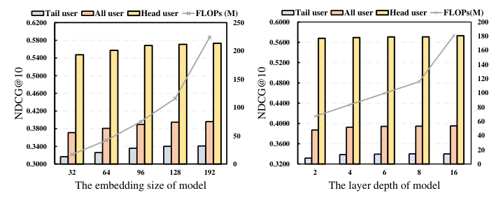
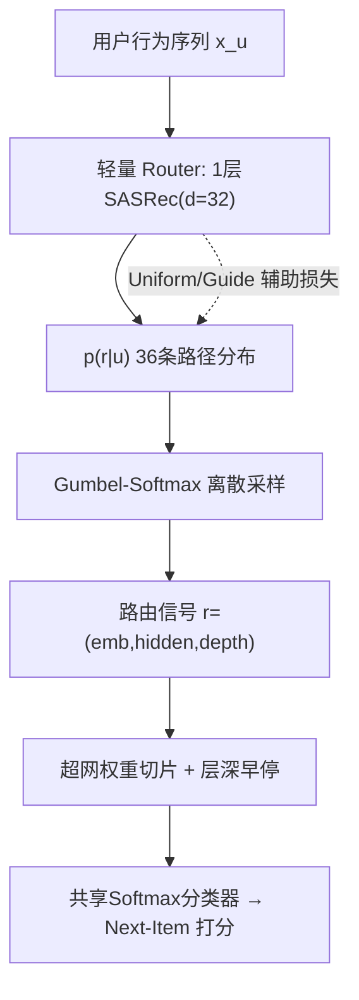
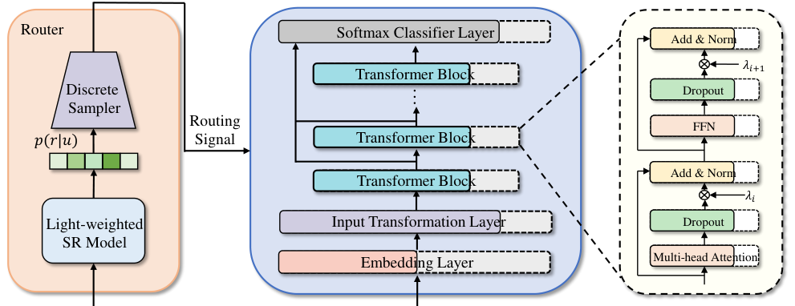

# One Person, One Model—Learning Compound Router for Sequential Recommendation (一人一模型：面向序列推荐的复合路由器学习)

- **会议/期刊**: IEEE ICDM 2022 (Long Paper)
- **作者与机构**: Zhiding Liu, Mingyue Cheng, Zhi Li, Qi Liu, Enhong Chen（中国科学技术大学 MIRA Lab / 认知智能国家重点实验室；清华大学深圳国际研究生院）
- **推荐链路定位**: 精排（序列召回打分骨干的效率化推理）
- **研究方向**: 序列与会话推荐 / 工业级高效架构
- **论文原文**: [https://arxiv.org/abs/2211.02824v2](https://arxiv.org/abs/2211.02824v2)
- **开源代码**: [https://github.com/icantnamemyself/CANet](https://github.com/icantnamemyself/CANet)

## TL;DR (1分钟核心速览)

本文针对"一人一模型"痛点：序列推荐（SR）普遍靠加大嵌入维度与层深换取精度，但全体用户共享同一巨型网络造成大量冗余算力。CANet 用一层轻量路由器，为每条输入序列在 `嵌入尺寸 × 隐藏尺寸 × 层深` 的 36 个候选子网中做复合路由，并以权重切片把全部子网塞进一个超网（零额外存储）。在 Last.FM20/50、RESS 三个数据集、`Leave-One-Out` + 全库 Full-Ranking 协议下，FLOPs 降低 53.8%~65.1%，NDCG@10 仅相对下降 1.3%~1.7%，且与同算力的 SASRec-small 相比精度全面更优。

## Background & Motivation (背景与核心矛盾)

- **主流范式**: 深序推荐（SASRec/NextItNet/BERT4Rec）遵循 one-model-fits-all，堆层深与宽度提精度；效率侧则走知识蒸馏压缩、嵌入维度搜索（AutoDim）、单维层跳过（SkipRec）三条路。
- **前人局限**: ① 蒸馏/矩阵分解得到的是**固定**轻模型，无法随输入变化；② AutoDim、SkipRec 只做**单维**自适应（仅嵌入维或仅层深），而实验显示宽度与深度对不同用户贡献异质，单维搜索必然次优。
- **核心洞察 (Key Insight)**: 作者用 SASRec 做受控实验发现：最大模型比最窄模型 NDCG 高 6.7%，但 FLOPs 涨 13.21 倍；比最浅模型高 2.1%，FLOPs 涨 2.69 倍。而**只对热门物品感兴趣的用户（head users）用小模型已足够**，长尾用户才从大模型获益（+8.1% vs +2.7%）。
- **本文切入点**: 把"选多大网络"建模为一个输入相关的**可微离散路由**问题，在复合参数空间中一次搜索，且用权重切片保证存储不膨胀。

<figure class="paper-figure" markdown="span">
  <figcaption>图 2. 在 Last.FM20 上测试时，SASRec 的宽度和深度对不同用户推荐性能与计算成本的影响</figcaption>
</figure>

## Method (核心方法设计)

### 1. 整体框架 (Overall Architecture)

CANet = 轻量 Router + SASRec 骨干超网。Router 用 1 层、嵌入 32 维的 SASRec 提取序列特征，输出 36 条路径（嵌入∈{64,96,128} × 隐藏∈{64,96,128} × 层深∈{2,4,6,8}）上的分布 $p(r|u)$，经 Gumbel-Softmax 采样得到离散路由信号。骨干是以 8 层 Transformer、最大嵌入 128 维构成的**单一超网**，按路由信号对线性层做权重切片、对层深做早停（所有块共享同一个 Softmax 分类器以省参数）。训练时路由与骨干端到端联合优化（主损失 + Uniform + Guide 两个辅助损失），推理时每个用户只跑自己那条子路径，实测算力下降一半以上。

<figure class="paper-figure" markdown="span">
  <figcaption>图 3. CANet 框架与权重切片方案示意图。主干网络的嵌入维度、隐藏维度和层深度根据输入用户行为自适应调整。</figcaption>
</figure>

### 2. 关键设计拆解 (Key Designs)

1. **复合路由空间 + 权重切片共享 (Compound Space & Weight Slicing)**：解决"子网多则存储爆炸"。把参数视为序列并强制子模型从首索引取前缀，任意子网可由超网切片索引得到：$f_2(x)=W[:k_2,:k_1]x+b[:k_2]$，LayerNorm 同理取$W[:k],b[:k]$。直觉是嵌套子网共享同一套参数，路由空间可任意扩大而显存不增，且天然支持"仅搜层深"或"仅搜嵌入维"以对齐 SkipRec/AutoDim。
2. **Gumbel-Softmax 可微路由 (Differentiable Routing)**：解决 $\arg\max$不可导且忽略概率语义。加噪采样$R_u=\arg\max_i(\log p_i^u+g_i)$，$g_i=-\log(-\log a),\,a\sim \mathrm{Uniform}(0,1)$；再用温度$\tau=1$的松弛反向传播$\alpha_i^u=\exp((\log p_i^u+g_i)/\tau)\big/\sum_j\exp((\log p_j^u+g_j)/\tau)$。前向硬选、反向软梯度的 straight-through 形式让路由与骨干同步收敛，免去两阶段训练的偏差。
3. **防坍缩与先验引导的双辅助损失 + 推理开销**：超网训练易"赢者通吃"——某子网先收敛→被路由偏爱→更快收敛→路由退化为静态。故加均匀软目标 $\mathcal{L}_{Uni}=\mathrm{CE}(p(r|u),\mathbf{p}_{uni})$保证各子网都吃到监督信号；再加$\mathcal{L}_{Guide}$，用最小子网对每条训练序列算 Recall@k，把用户划为 easy/hard，分别构造峰值在最小/最大参数处的指数分布软标签，对$p(\text{emb}|u),p(\text{hidden}|u),p(\text{layer}|u)$三个边缘分布做 CE。总目标$\mathcal{L}=\mathcal{L}_{SR}+\lambda_1\mathcal{L}_{Uni}+\lambda_2\mathcal{L}_{Guide}$（$\lambda_1=\lambda_2=0.01$）。训练免负采样（全库 softmax + 交叉熵）；推理仅需一次 Router 前向（1 层、32 维，可忽略）+ 切片骨干，单条序列最高节省约 2 倍算力。

## Experimental Setup & Evaluation Protocol (实验设置与评估协议)

- **数据集与预处理**: 过滤交互数少于 5 的用户（类 `5-core`）；Last.FM 系列按会话切分（最后两次交互间隔 > 2 小时则丢弃），RESS 取 2019 年 10 月购买事件、随机采样 50 万用户、序列前补零至长度 20。

| 数据集 | #Users/序列 | #Items | #Interactions | 序列长度 | 场景说明 |
| :--- | :---: | :---: | :---: | :---: | :--- |
| Last.FM20 | 534,892 | 199,013 | 10,699,640 | 20 | 音乐收听会话 |
| Last.FM50 | 213,283 | 198,802 | 10,664,150 | 50 | 长会话音乐 |
| RESS | 500,000 | 112,705 | 4,418,277 | 20 | 多品类电商购买 |

- **数据划分与防穿越 (Splitting Strategy)**: `Leave-One-Out`——每条序列最后 1 个物品作测试、倒数第 2 个作验证，其余训练；严格按时间顺序，无未来信息泄漏。
- **排名评测协议 (Ranking Protocol)**: 无偏 `Full-Ranking`（对全部 19.9 万 / 11.3 万物品打分排序，明确拒绝 sampled negatives），指标 NDCG@10/20 与 Recall@10/20（LOO 下等价 HR@N）；效率指标为单条序列推理 FLOPs（OpCounter 统计），动态框架取所有输入的平均值。
- **对比基线与超参设置**: FPMC（BPR 训练）、GRU4Rec（2 层）、SASRec-full / SASRec-small、NextItNet（8 块，膨胀率 {1,4}）、SkipRec（深度搜索上限 8）、AutoDim（嵌入搜索 {64,96,128}）；所有模型嵌入维度统一 128，Adam，lr=0.001，batch 分别 64/32/128；SkipRec 与 AutoDim 均搭建在同等规模 SASRec 骨干上以保证公平。Guide 损失的 $k$ 在三个数据集上取 5/5/10。

## Key Experimental Results (实验关键数据)

### 1. 主实验对比 (Main Results)

| 模型 | 动态 | Last.FM20 NDCG@10 | Last.FM20 Recall@10 | Last.FM50 NDCG@10 | Last.FM50 Recall@10 | RESS NDCG@10 | RESS Recall@10 |
| :--- | :---: | :---: | :---: | :---: | :---: | :---: | :---: |
| FPMC | ✗ | 0.3655 | 0.4345 | 0.3675 | 0.4472 | 0.1284 | 0.2385 |
| GRU4Rec | ✗ | 0.3887 | 0.4496 | 0.4090 | 0.4697 | 0.1507 | 0.2760 |
| NextItNet | ✗ | 0.3863 | 0.4473 | 0.4089 | 0.4703 | **0.1669** | **0.2979** |
| SASRec-full | ✗ | **0.3948** | **0.4648** | **0.4114** | **0.4804** | 0.1666 | **0.3000** |
| SASRec-small | ✗ | 0.3856 | 0.4571 | 0.4010 | 0.4681 | 0.1628 | 0.2944 |
| SkipRec | ✓ | 0.3940 | 0.4657 | 0.4118 | 0.4806 | 0.1643 | 0.2966 |
| AutoDim | ✓ | 0.3926 | 0.4610 | 0.4084 | 0.4750 | 0.1649 | 0.2974 |
| **CANet** | ✓ | 0.3898 | 0.4587 | 0.4045 | 0.4706 | 0.1637 | 0.2948 |

推理算力（FLOPs, M）：

| 模型 | Last.FM20 | Last.FM50 | RESS |
| :--- | :---: | :---: | :---: |
| SASRec-full | 115.21 | 211.56 | 93.12 |
| SkipRec | 104.53 | 197.16 | 84.93 |
| SASRec-small | 56.58 | 68.15 | 45.11 |
| **CANet** | **53.23** | **73.93** | **37.35** |
| 相对 SASRec-full 降幅 | 53.80% | 65.05% | 59.89% |

### 2. 消融实验 (Ablation Study)

原文以图 5 呈现（未给表格数值），此处按趋势归纳：

| 变体 | 移除组件 | 路由是否坍缩 | NDCG@10 趋势 | FLOPs 趋势 |
| :--- | :--- | :---: | :--- | :--- |
| CANet | — | 否 | 最高 | 最低区间 |
| CANet-u | Uniform 损失 | **是**（输出固定 1~2 条路径） | 明显下降 | 偏低但不可控 |
| CANet-g | Guide 损失 | 否 | 小幅下降 | 相近或略低 |
| CANet-ug | 两者皆去 | **是** | 下降最多 | 节省但精度不可用 |

### 3. 关键实验发现 (Key Findings)

1. **复合空间显著优于单维自适应**：SkipRec 只搜层深，FLOPs 仍达 104.5M（Last.FM20），几乎没省算力；CANet 复合路由压到 53.2M，约为其 1/2，且精度仅差 0.0042 NDCG。这说明"层深"并非冗余主源，宽度才是。
2. **与同算力模型相比是"净赚"**：CANet 与 SASRec-small 算力相近（53.2M vs 56.6M），但 NDCG@10 在三个数据集上全面领先（0.3898 vs 0.3856；0.4045 vs 0.4010；0.1637 vs 0.1628），证明收益来自"按需分配"而非单纯"缩小模型"。
3. **路由结果可解释且体现长尾偏好**：在 RESS 上仅 0.34% 序列被路由到 2 层，主流走 4/6 层；多数输入"嵌入 128 维 + 隐藏 64 维"——即大嵌入保信息、小隐层做非线性足够；而长尾用户被分配更深、更大嵌入但**更小隐藏维**的子网，既增强容量又抑制长尾过拟合。

## Highlights & Limitations (亮点、对比与审稿批判)

- **与代表作对比 (vs. Prior Work)**: 相对 SkipRec（单维层跳过）与 AutoDim（仅嵌入维搜索），本文首次在**复合参数空间**做输入相关路由，并保持单超网存储；相对知识蒸馏类方法，CANet 是"逐样本动态"而非"全局静态"，且可叠加在蒸馏之上（作者明言二者不冲突）。
- **可迁移亮点**: ① 权重切片 + 早停超网把"动态架构"落到零存储成本，可直接迁移到 CTR 精排的多层 DCN/Transformer；② 用最小子网的 Recall@k 划分 easy/hard 用户并转为软标签，是一种廉价、无需人工标注的先验注入范式，可复用到多任务/多场景门控网络。
- **审稿级局限批判**: ① 只报 FLOPs 未报**实际延迟**：不同用户走不同子网，batch 内需 gather/scatter 与掩码计算，真实吞吐收益可能远小于理论 FLOPs（尤其线上高并发批推理）；② 精度并非"无损"——三个数据集 NDCG 均下降 1.3%~1.7%，且全面低于 SASRec-full 与 SkipRec，对精度敏感场景说服力不足；③ 路由随机采样导致服务端结果非确定，A/B 实验复现困难；Guide 损失的 $k$ 与"长尾用户按 top 20% 物品划分"均依赖数据集特性，跨域迁移需重调。

## Rating (四维评分)

- **方法创新性 (Novelty)**: ⭐⭐⭐⭐ （把动态网络/超网思想首次系统落到 SR 的复合路由，"一人一模型"提法清晰，但权重切片与 Gumbel-Softmax 均为成熟组件的组合创新）
- **评估协议与实验扎实度 (Protocol & Experiments)**: ⭐⭐⭐⭐ （LOO + 全库 Full-Ranking 拒绝采样负例，三数据集 + 算力指标齐备；扣分在消融仅有曲线无表格数值、缺方差与显著性检验）
- **写作与数学规范度 (Clarity & Rigor)**: ⭐⭐⭐⭐ （路由/损失公式定义干净、符号一致，切片与早停的算子描述具体；但对路由器自身开销与训练成本缺少复杂度分析）
- **工业落地与复现价值 (Industrial & Practical Value)**: ⭐⭐⭐⭐ （代码开源、单超网零额外存储、无负采样训练即可部署；实际加速比与动态 batch 工程代价仍待线上验证）

