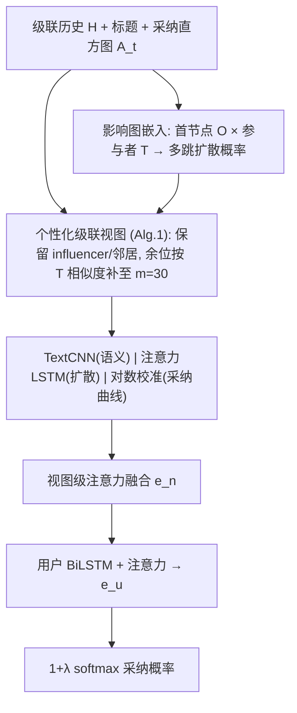

# IGNiteR: News Recommendation in Microblogging Applications (Extended Version)（面向微博客应用的扩散与影响力感知新闻推荐）

- **会议/期刊**: ICDM 2022（arXiv 2210.01942, extended version）
- **作者与机构**: Yuting Feng, Bogdan Cautis（CNRS LISN, Université Paris-Saclay / IPAL Singapore）
- **推荐链路定位**: 精排（候选新闻打分）
- **研究方向**: 社交与群组推荐 / 序列推荐
- **论文原文**: [https://arxiv.org/abs/2210.01942v1](https://arxiv.org/abs/2210.01942v1)
- **开源代码**: [https://github.com/goldenretriever-5423/IGNiteR](https://github.com/goldenretriever-5423/IGNiteR)（含 Weibo 数据处理全流程）

## TL;DR (1分钟核心速览)

在 Twitter/Weibo 这类微博客平台上，新闻靠"转发级联"传播，用户是否采纳同时取决于**语义、谁转发了它、它有多热/多新**；而 DKN/NAML/FIM 等主流新闻推荐只建模标题语义与点击历史，把推荐场景（扩散过程）整个丢掉。IGNiteR 先用历史级联训练 influencer/reposter 两套节点嵌入，再为每个目标用户裁剪出 $m=30$ 的个性化级联视图，以 TextCNN + 注意力 LSTM + 对数校准采纳曲线三视图加权融合成新闻向量，配合 BiLSTM 用户编码器打分。在两个真实数据集、1 正 10 负采样排序协议下 AUC 达 74.57 / 72.71，NDCG@10 相对最强基线提升 2.29% / 3.19%。

## Background & Motivation (背景与核心矛盾)

- **主流范式**: 神经新闻推荐（DKN/DAN/NAML/NAML-BERT/LSTUR/FIM）以预训练词向量或 PLM 编码标题，用 CNN/注意力/空洞卷积聚合用户历史，核心是"语义 + 用户画像"的匹配。
- **前人局限一**: 这些模型**设计上与场景无关**，把社交平台上的新闻当成新闻门户的新闻，完全忽略"信息如何沿网络扩散到该用户"这一决定采纳的关键信号（口碑带来的曝光与可信度）。
- **前人局限二**: 社交感知推荐（DICER 等）虽建 user-user 图，但用的是**关注关系或共点相似度**，无法刻画"谁真正影响了谁"的方向性影响力；而现实扩散路径常常不沿关注拓扑传播。
- **核心洞察 (Key Insight)**: 级联本身是一份免费的监督信号——首节点 $v_0$ 是影响源，按时间顺序加入的转发者是"被影响者"，可用多跳扩散概率反过来学习用户的影响力/易感性嵌入。
- **本文切入点**: 把新闻表示拆成**语义视图 + 扩散视图 + 采纳曲线视图**三通道，用视图级注意力让模型自己决定"说什么 / 谁转发 / 多热"各占多少权重。

## Method (核心方法设计)

### 1. 整体框架 (Overall Architecture)

输入由三部分组成：关注图 $G=(V,E)$、级联历史$\mathcal{H}$（含时间戳的转发序列）、新闻原始描述$\varphi_t=(s_x,V_t,A_t)$（标题、截至$t$的参与者序列、按小时统计的采纳直方图）。离线阶段用级联训练影响图节点嵌入；在线阶段先按目标用户$i$把长级联裁剪成定长$m=30$的个性化视图$V_t^i$，再分别经 TextCNN（语义）、注意力 LSTM（节点序列）、对数校准（采纳曲线）得到三向量，宏观注意力融合为新闻表示$\boldsymbol{e}_n$；用户侧用 BiLSTM + 注意力聚合其采纳历史得$\boldsymbol{e}_u$，最终以$1+\lambda$ 类 softmax 输出采纳概率，交叉熵训练。

### 2. 关键设计拆解 (Key Designs)

1. **级联驱动的影响图节点嵌入（把"谁影响谁"压进向量）**：痛点在于常规 GNN 用户嵌入只编码兴趣或关注拓扑，不含扩散方向性。本文令级联发起者嵌入矩阵 $\boldsymbol{O}\in\mathbb{R}^{I\times g}$、参与者嵌入$\boldsymbol{T}\in\mathbb{R}^{|V|\times g}$，以$z_{j,0}=\boldsymbol{O}_0^{\top}\boldsymbol{T}_j+b_j$作多跳扩散打分，并对**全库节点**做 softmax：$\hat{y}_j=\frac{e^{z_{j,0}}}{\sum_{v_0'}e^{z_{j,0'}}}$，最小化$-\log\hat{y}_j$。训练时按$p(v_j|x)=\frac{(t_j-t_0)^{-1}}{\sum_i(t_i-t_0)^{-1}}$降采样参与者——响应越快越可能真被影响，这既提速又降噪。直觉：内积即"$v_0$能否把信息推到$v_j$"，由此得到可迁移的影响力/易感性表示。
2. **个性化级联视图 + 三视图注意力新闻编码器**：级联最长可达 31009 个节点，对目标用户 $i$大部分是噪声。Alg.1 先保留 influencer 与$G$中一跳邻居，若不足$m$则按$\boldsymbol{v}_i^{\top}\boldsymbol{v}_j$相似度补足，得到$V_t^i$。三视图分别为：TextCNN 多滤波器 max-pool 得$\boldsymbol{e}_s$；注意力 LSTM 聚合节点序列$\boldsymbol{e}_v=\sum_j\alpha_j\boldsymbol{h}_j$；采纳曲线经$a'_i=f(a_i)(t_d-t_0)^{-1}$（$f$为二次对数缩放）抑制爆款长尾。最终$\boldsymbol{e}_n=\alpha_s\boldsymbol{e}_s+\alpha_v\boldsymbol{e}_v+\alpha_a\boldsymbol{e}_a$，权重由$\boldsymbol{q}_s^{\top}\tanh(\boldsymbol{W}_s\boldsymbol{e}_s+\boldsymbol{b}_s)$ 三路 softmax 得到。之所以有效：不同用户对"谁说、多热、说什么"的敏感度迥异，视图权重可从历史中间接学出。
3. **时间敏感用户编码与训练目标**：用户历史是双向兴趣演化，故用 BiLSTM 保留早期主题（不同于单向扩散链），再对 $2s$个隐状态做注意力池化得$\boldsymbol{e}_u=\sum_j\alpha_j^{B}\boldsymbol{h}_j^{B}$。训练按真实曝光形态构造$1+\lambda$（$\lambda=4$）印象，损失$\mathcal{L}=-\sum_{i=1}^{s}\log\frac{\exp(\hat{y}^{+})}{\exp(\hat{y}^{+})+\sum_{k=1}^{\lambda}\exp(\hat{y}^{-}_{k})}$，$\hat{y}$ 为新闻与用户表示内积；**无额外负采样器、无 hard negative**，推理仅需一次前向，但每个候选新闻都要实时裁剪级联并跑 LSTM，是在线主要开销。

## Experimental Setup & Evaluation Protocol (实验设置与评估协议)

- **数据集与预处理**: Twitter 数据经 API 自采，Weibo 为公开数据集；以 **3 个月窗口**切分行为（同一长期用户会被拆成多个"窗口用户"），过滤后统计如下：

| 数据集 | #Users | #Items(News) | #Interactions(转发) | 稀疏度/密度 | 特征/场景说明 |
| :--- | :---: | :---: | :---: | :---: | :--- |
| Twitter | 248,195 | 441,632 | 4,999,535 | 密度约 $4.6\times10^{-5}$ | 标题均长 6.94 词，级联中位长 2.74、最长 124 |
| Weibo | 692,833 | 13,153 | 31,211,347 | 密度约 $3.4\times10^{-3}$ | 标题均长 7.26 词，级联中位长 23、最长 31,009 |

- **数据划分与防穿越 (Splitting Strategy)**: **全局时间戳切分**（timeline split），约 85% 训练 / 15% 测试，训练集内再取 10% 作验证；候选新闻的级联视图严格截断到采纳时刻 $t$ 之前，避免未来转发信息泄漏。
- **排名评测协议 (Ranking Protocol)**: **Sampled Ranking，非 Full-Ranking**——每个测试印象最多 1 正 + 10 负（负样本为同窗口内该用户未转发的随机新闻）；指标 AUC、MRR、NDCG@5、NDCG@10，每组实验独立重复 5 次，报告 0.95 置信区间均值。对比用户限定为历史 ≥20 次采纳的活跃用户。
- **对比基线与超参设置**: 通用 CTR 组（LibFM / DeepWide / DeepFM / DCN）、新闻推荐组（DKN / DAN / GERL / NAML / NAML-BERT / LSTUR / FIM）、社交感知组（DICER，用平均标题向量替换其 ID 嵌入）。节点嵌入维度 $g=50$（Weibo）/ 100（Twitter），词向量 300 / 100，CNN 120 滤波器、窗长 3，LSTM 128 单元，注意力单元 200，级联视图$m=30$，训练负例比$\lambda=4$。

## Key Experimental Results (实验关键数据)

### 1. 主实验对比 (Main Results)

| 模型 | Weibo AUC | Weibo MRR | Weibo N@5 | Weibo N@10 | Twitter AUC | Twitter MRR | Twitter N@5 | Twitter N@10 |
| :--- | :---: | :---: | :---: | :---: | :---: | :---: | :---: | :---: |
| LibFM | 65.01 | 13.47 | 60.79 | 61.34 | 65.50 | 10.25 | 59.78 | 61.45 |
| DCN | 67.12 | 17.78 | 64.67 | 66.34 | 68.89 | 11.73 | 63.97 | 66.02 |
| DKN | 68.03 | 18.01 | 65.25 | 66.98 | 69.17 | 11.96 | 65.02 | 67.08 |
| DAN | 68.79 | 18.27 | 65.45 | 67.49 | 69.72 | 12.05 | 65.35 | 67.18 |
| GERL | 69.90 | 18.42 | 66.35 | 68.37 | 70.21 | 12.32 | 65.62 | 67.74 |
| LSTUR | 71.02 | 19.00 | 66.95 | 68.57 | 70.15 | 12.61 | 66.54 | 68.57 |
| DICER | 69.35 | 17.92 | 66.54 | 68.16 | 70.18 | 12.28 | 65.63 | 67.75 |
| NAML-BERT | 71.74 | 19.44 | 67.15 | 69.01 | **71.05** | **13.52** | 67.20 | 69.80 |
| FIM | **72.69** | **19.87** | **67.56** | **69.52** | 70.68 | 13.02 | 67.01 | 69.65 |
| **IGNiteR** | **74.57** | **21.57** | **69.23** | **71.11** | **72.71** | **13.83** | **69.75** | **72.03** |
| **Improv.%** | +2.59% | +8.55% | +2.47% | +2.29% | +2.34% | +2.29% | +3.79% | +3.19% |

（加粗为该列最优；`Improv.%` 相对最强基线：Weibo 为 FIM，Twitter AUC/NDCG 为 NAML-BERT、MRR 为 NAML-BERT。）

### 2. 消融实验 (Ablation Study)

| 变体 | Weibo AUC | Weibo MRR | Weibo N@10 | Twitter AUC | Twitter MRR | Twitter N@10 |
| :--- | :---: | :---: | :---: | :---: | :---: | :---: |
| w/o 采纳曲线 `IGNiteR-A_t` | 73.34 | 21.03 | 70.56 | 71.93 | 13.31 | 71.74 |
| w/o 扩散序列 `IGNiteR-V_t` | 72.98 | 20.23 | 70.07 | 71.59 | 13.07 | 70.93 |
| **IGNiteR (full)** | **74.57** | **21.57** | **71.11** | **72.71** | **13.83** | **72.03** |

### 3. 关键实验发现 (Key Findings)

1. **扩散视图是最大边际贡献者**：去掉节点序列 $V_t$ 后 Weibo MRR 从 21.57 掉到 20.23（-1.34），而去掉采纳曲线只掉到 21.03（-0.54），说明"谁转发了这条新闻"比"它现在有多热"更具判别力；视图注意力统计（15000 用户、31440 条新闻）也显示扩散权重 > 采纳曲线 > 语义，**语义在微博客场景反而是最弱信号**。
2. **高活用户上优势被放大**：按历史长度 >5/>10/>15/>20 分组时，低活组（>5）NAML/NAML-BERT 略胜，但随着活跃度上升 NAML 与 GERL 的 NDCG@10 急剧下滑，IGNiteR 曲线平缓且在所有分组最优；MRR 随历史变长整体下滑（正样本更难排到头部），但 IGNiteR 始终领先——长历史带来的信息增益需要 LSTM/级联建模能力才能兑现。
3. **通用 CTR 与社交模型都不足以替代扩散建模**：LibFM 垫底（Weibo AUC 65.01），DCN 在 CTR 面板最好（67.12）说明高阶交叉有效；DICER 用关注图也能到 69.35，反证社交信号的价値，但仍落后 IGNiteR 约 5.2 个 AUC 点，说明关键在于**级联推导的行为驱动影响力**而非静态关注拓扑。注意力热力图（图 6）进一步显示三类用户分别关注级联前中段（追热点）、仅前段（跟随大 V）、以及均匀分散（小圈子共识）。

## Highlights & Limitations (亮点、对比与审稿批判)

- **与代表作对比 (vs. Prior Work)**: 相较 NAML/FIM 类纯语义模型，IGNiteR 多出的不是网络结构而是**监督信号来源**（级联→影响力嵌入）；相较 DICER 等社交推荐，它用行为级联替代关注边，捕捉跨拓扑的隐性影响；相较影响最大化工作（如基于级联的节点表示学习），它把"扩散概率"改造成推荐侧的用户/新闻表示，而非选种子集。
- **可迁移亮点**: ①用"首节点–参与者 + 时间倒数降采样"把任意传播日志转成节点嵌入，可直接迁移到转发预测、POI 传播、内容冷启动；②视图级注意力（$\alpha_s,\alpha_v,\alpha_a$）是一种轻量的多源信号自适应加权范式，可复用到多模态/多场景融合。
- **审稿级局限批判**: ①评测为**采样排序（1 正 10 负）**且限制在 ≥20 次采纳的活跃用户，AUC 绝对值偏高，缺乏 Full-Ranking 与冷启动/低活用户结论；②语义侧仍停留在标题 + 静态 GloVe/word2vec，未与 PLM（NAML-BERT 已证明更强）结合，AUC 增益仅 ~2% 属温和；③在线需为每个候选新闻实时裁剪级联并跑 LSTM，且依赖可观测的关注图与转发链——Twitter 上中位级联仅 2.74，长链优势在稀疏扩散平台会被削弱；④3 个月窗口切分把同一用户拆成多个虚拟用户，评估口径与线上真实留存场景存在偏差。

## Rating (四维评分)

- **方法创新性 (Novelty)**: ⭐⭐⭐⭐ （把级联多跳扩散概率作为新闻推荐的监督信号，并用个性化视图裁剪解决长链噪声，思路新颖但组件本身均为成熟模块的组合）
- **评估协议与实验扎实度 (Protocol & Experiments)**: ⭐⭐⭐ （双数据集 + 11 个基线 + 5 次重复置信区间较完整，但采样排序、活跃用户过滤与缺少 Full-Ranking/冷启动评估削弱说服力）
- **写作与数学规范度 (Clarity & Rigor)**: ⭐⭐⭐⭐ （三视图分解与 Alg.1 描述清晰、符号一致，但对级联视图在线构建的复杂度与超参 $m$ 敏感性缺乏量化分析）
- **工业落地与复现价值 (Industrial & Practical Value)**: ⭐⭐⭐ （代码与 Weibo 数据处理管线开源，利于复现；但依赖完整转发日志与实时级联裁剪，在线延迟与冷启动场景落地成本较高）

