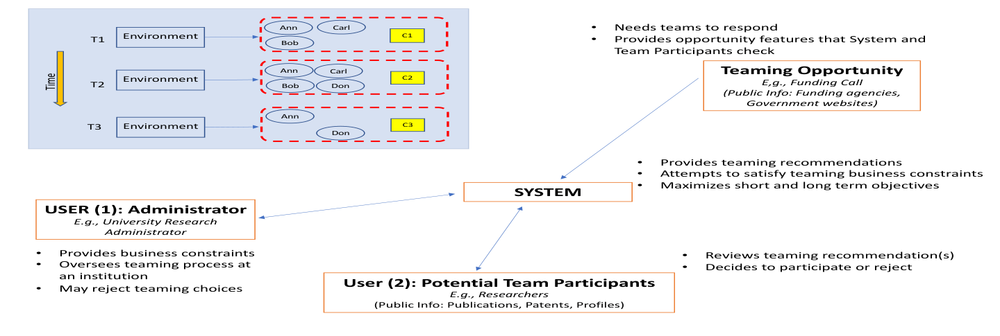
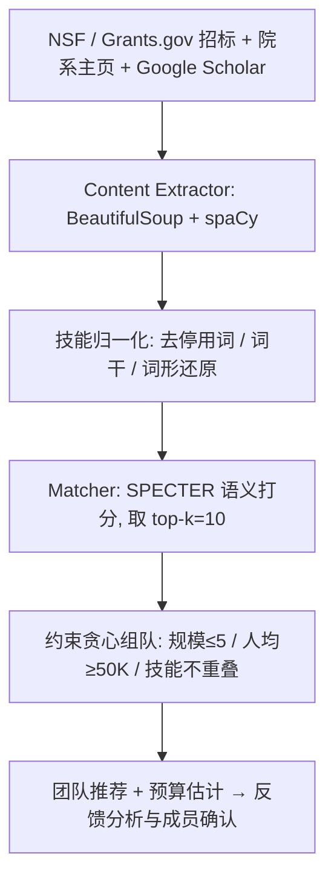
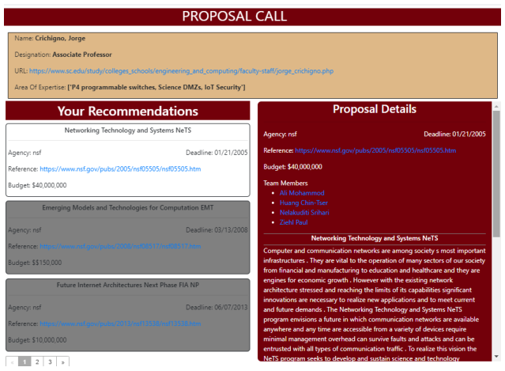

# ULTRA: A Data-driven Approach for Recommending Team Formation in Response to Proposal Calls (面向招标征集的科研团队组建推荐)

- **会议/期刊**: IEEE ICDM Workshop on AI for Nudging and Personalization (WAIN) 2022
- **作者与机构**: Biplav Srivastava, Tarmo Koppel, Sai Teja Paladi, Siva Likitha Valluru, Rohit Sharma, Owen Bond（University of South Carolina / Tallinn University of Technology）
- **推荐链路定位**: 召回（需求—供给匹配）+ 列表级组队打包（grouping）
- **研究方向**: 社交与群组推荐 / 冷启动与长尾（新增学者扶持）
- **论文原文**: [论文原文链接](https://arxiv.org/abs/2201.05646v2)
- **开源代码**: [thefuzz（模糊匹配基线）](https://github.com/seatgeek/thefuzz)；SPECTER 见 [allenai/specter](https://github.com/allenai/specter)，系统本体暂未开源

## TL;DR (1分钟核心速览)

针对科研团队应标时"招标需求—学者技能"表述异构、商业工具（Pivot/Scry）仅做关键词提醒而不组队的两大痛点，ULTRA 用 BeautifulSoup+spaCy 抽取 NSF 招标与学者画像并做 NLP 归一化，以 SPECTER 文档向量做语义匹配召回 top-10 标的，再按"团队规模 ≤5、人均 ≥$50K、技能不重叠"三条硬约束贪心组队。7 位学者的 70 条匹配中 65 条获评 Likert ≥7（92.9%），历史中标命中率 54.5%。

## Background & Motivation (背景与核心矛盾)

- **主流范式**: 团队组建长期由 Hedonic Games、遗传算法/多目标优化（如板球队选人）与启发式 top-$k$ 剪枝主导；工业侧则以 Pivot、Scry 等关键词订阅式基金提醒为主。
- **前人局限**: (1) 招标摘要里的术语（如 "cybertraining"、"neuromorphic computing"）与学者主页自述技能往往字面不重合，纯字符串模糊匹配会系统性漏召；(2) 商业系统只解决"proposal→faculty"的单点推送，不解决"哪些人拼成一个可提交的团队"，更无法编码预算与技能冗余等机构侧业务约束。
- **核心洞察 (Key Insight)**: 需求（RFP）、供给（学者画像）、历史中标结果三类数据在 NSF/Grants.gov 与院系主页上完全公开，足以支撑一个"匹配 + 组队"两阶段解耦框架；把约束从黑箱优化器里拎出来显式表达，还能反事实地解释"为什么换掉某成员"。
- **本文切入点**: 将 TeamingForFunding 形式化为 matching（技能相关性）+ grouping（约束满足）两阶段问题，用语义嵌入替代关键词，用可解释贪心替代不可解释的全局搜索。

<figure class="paper-figure" markdown="span">
  <figcaption>图 2. 团队组建设置，用户可担任管理员或潜在团队成员。可信团队是指所有利益相关者都确信，已根据征集需求从可用成员中选出了合适成员，以面向未来未知的成功。</figcaption>
</figure>

## Method (核心方法设计)

### 1. 整体框架 (Overall Architecture)

系统从 NSF 检索页与 Grants.gov 抓取招标 HTML，用 BeautifulSoup 解析、spaCy 抽取标题/摘要/截止日期/预算字段；同时从学院主页拉取教师列表，用职称启发式筛出 research role，再交叉 Google Scholar 确认身份并抓取研究兴趣关键词，经去停用词、词干化、词形还原归一化为技能向量。Matcher 对每条招标与每位学者计算语义相关度并按用户维度取 top-$k$（$k=10$）；Team Recommender 以该打分为排序依据，在团队规模、人均预算、技能互不重叠三条约束下贪心成团，输出"招标 + 成员 + 预算估计"；Feedback Analyzer 回收接受/拒绝信号，Team Reco Manager 负责通知成员确认并协助最终提交。

### 2. 关键设计拆解 (Key Designs)

1. **语义匹配替代字面匹配（Matcher）**：字符串模糊匹配在"语义相关但字面不同"时失效（AICS 招标与 AI/智慧城市技能画像仅得 51/100）。本文改用预训练 SPECTER 把招标摘要 $D_r$与学者技能串$P_u$编码为文档向量后取余弦：$s(u,r)=\cos\big(\boldsymbol{e}(P_u),\boldsymbol{e}(D_r)\big)$。SPECTER 以引用图为文档级相关性的预训练信号，故即使术语未共现，同领域论文语境仍能拉近向量；同一例子上得分升至 79，与人类判断更一致。

2. **约束贪心组队（Team Recommender）**：把组队写成带约束的 top-$k$子集选择，避免 NP-hard 的全局组合搜索：$T_r^{*}=\arg\max_{T\subseteq\mathcal{C}_r}\sum_{u\in T}s(u,r)\ \ \text{s.t.}\ |T|\le K,\ \text{budget}(T)\ge 50\text{K}\cdot|T|,\ \forall u,v\in T:\ \text{Skill}(u)\setminus\text{Skill}(v)\neq\varnothing$。按匹配分降序填充、逐条检查约束，使每一步拒绝都可由"违反哪条约束"直接解释，天然支持向管理员展示反事实理由。

3. **训练目标、负采样与推理效率**：全流程**无监督、零微调、无负采样**——匹配侧直接复用 SPECTER 的预训练权重，组队侧无参数，损失函数不存在（这也是其可快速上线的原因）。推理开销集中在一次性离线抽取（1,797 条招标可批量处理）与在线 embedding 点积检索，单用户生成 10 条候选取 top-$K$的复杂度为$O(|\mathcal{C}_r|\log K)$，可在普通 Web 后端实时完成。

<figure class="paper-figure" markdown="span">
  <figcaption>图 1. ULTRA 的团队参与者视图，展示针对选定提案的团队推荐（用户视图）。</figcaption>
</figure>

## Experimental Setup & Evaluation Protocol (实验设置与评估协议)

- **数据集与预处理**: 自建并计划公开的数据集，源自 NSF 检索页与院系主页；技能字段经 spacy 分词 + 停用词/词干/词形还原归一化，无研究信息的学者直接剔除。

| 数据集 | #Users | #Items | #Interactions | 稀疏度/密度 | 特征/场景说明 |
| :--- | :---: | :---: | :---: | :---: | :--- |
| NSF RFP 语料 | 240（205 有研究信息，83 经 GS 确认） | 1,797 条招标 | 70 条人工评分的匹配 | 极稀疏（每用户仅 10 条候选） | 标题/摘要/截止日期/预算四字段，工程学院单院系 |
| 历史中标记录 | 同上 | 未报告（仅 NSF） | 10 条/人 top 命中判定 | — | 用于"中标命中率"回溯检验 |

- **数据划分与防穿越 (Splitting Strategy)**: 无训练/测试划分（模型零训练）；评估采用**回溯式（retrospective）**设计——只用已截止的历史招标与其已公布中标结果，学者画像取评估时点的公开快照，因此不存在未来信息泄漏，但也无法模拟"新招标出现时的实时性"。
- **排名评测协议 (Ranking Protocol)**: 非标准 IR 协议。匹配侧对每用户输出 top-10（截断的 Sampled Ranking，非全库 Full-Ranking），由用户本人或专家组用 Likert 1–10 打分；组队侧无排序指标，仅做定性案例展示（表 II 给出 5 人团队及其 76–84 分匹配分）。
- **对比基线与超参设置**: 匹配侧对比 `fuzzy`（thefuzz 近似字符串匹配）与 `SPECTER` 嵌入匹配；组队侧与 Pivot（关键词告警）、Scry（proposal-faculty 匹配，不做组队）做功能层面定性对比。超参：$k=10$、团队规模上限 5（预算允许可放宽）、人均 ≥$50K、技能至少一项不重叠。

## Key Experimental Results (实验关键数据)

### 1. 主实验对比 (Main Results)

原文未给出标准 IR 表格，下表整合其可获得的全部定量证据（用户研究 + 抽取质量 + 中标回溯）：

| 方法/组件 | 示例匹配分（AICS，0–100） | top-10 中 ≥7 分比例 | 历史中标命中率 | 备注 |
| :--- | :---: | :---: | :---: | :--- |
| 内容抽取 (CE) | — | — | — | 标题 99.1% / 预算 96.2% / 截止日期 90.4% |
| fuzzy 字面匹配 | 51 | — | — | 视为弱基线 |
| **SPECTER 语义匹配** | **79** | **65/70 = 92.9%** | **54.5%** | 最终采用 |
| Pivot / Scry | — | — | — | 仅关键词提醒 / 不做组队（定性） |

### 2. 消融实验 (Ablation Study)

原文为系统演示论文，**未提供标准逐组件消融**；下表按可得证据重组，缺失项如实标注：

| 配置 | ≥7 分命中 | 中标命中率 | 变化说明 |
| :--- | :---: | :---: | :--- |
| Full ULTRA (CE + SPECTER + 约束贪心) | 65/70 (92.9%) | 54.5% | 完整管线 |
| w/o 语义匹配（退化为 fuzzy） | —（未报告） | —（未报告） | 仅示例级证据 51 vs 79 |
| w/o 约束组队（纯 top-$k$ 打分） | —（未报告） | —（未报告） | 无定量对比，仅案例 |
| w/o 技能归一化 | —（未报告） | —（未报告） | 无定量对比 |

### 3. 关键实验发现 (Key Findings)

1. **语义鸿沟是首要瓶颈，且收益可量化**：同一 AICS 招标上 fuzzy 只有 51 分而 SPECTER 给 79 分，且 7 位学者的盲评整体偏好高分 embedding 结果，说明"术语不共现"造成的漏召比排序噪声更致命。
2. **抽取质量决定约束可执行性**：预算字段 96.2%、截止日期 90.4% 的抽取成功率直接决定 $\ge$50K/人 的约束能否落地；截止日期最差（90.4%）恰对应多子轨道招标的解析失败，是后续必须补的工程缺口。
3. **相关性≠中标**：92.9%（65/70）的技能相关性评分与仅 54.5% 的历史中标命中率之间存在近 40 个百分点的落差，说明预算规模、评审偏好、成员历史合作关系等非技能因素未被建模，纯技能匹配只是必要非充分条件。

## Highlights & Limitations (亮点、对比与审稿批判)

- **与代表作对比 (vs. Prior Work)**: 相较 Hedonic Games 类工作只关心成员内部效用、AAMAS 的 $k$-robust 团队只做鲁棒性剪枝，本文显式引入"机构管理员"这一非参与型利益相关者与预算约束；相较 WSDM'16 的 CrowdRec（众筹场景概率生成式群组推荐），本文不做概率建模而走"抽取-匹配-约束"的轻量可解释路线；相较 Pivot/Scry，本文第一次把输出从"提醒"推进到"可提交的团队"。
- **可迁移亮点**: (1) 用文档级预训练嵌入（SPECTER 式引用感知编码）替代关键词订阅，可直接迁移到任何"需求文本 vs 供给画像"的匹配场景（招聘、专家检索、商家—活动撮合）；(2) 把业务约束写成硬约束 + 贪心填充，使拒绝理由可反事实解释，便于冷启动期建立用户信任。
- **审稿级局限批判**: (1) **评估极弱**——仅 7 位用户、70 条样本、主观 Likert，无 Recall@k / nDCG 等标准指标，也无显著性检验，54.5% 的"中标命中"更是把技能匹配与复杂评审过程混为一谈；(2) **方法学贡献有限**——匹配是现成 SPECTER 的零样本调用，组队是无学习的贪心启发式，未处理原文自己承认的 NP-hard 组合性质，也完全忽略成员间历史合作网络与社交同质性（这正是群组推荐的核心信号），且数据仅覆盖单一大学工程学院，跨学科泛化存疑。

## Rating (四维评分)

- **方法创新性 (Novelty)**: ⭐⭐ （问题定义"TeamingForFunding"有价值，但技术栈是 SPECTER + 约束贪心的现成组合，无新算子或理论学习）
- **评估协议与实验扎实度 (Protocol & Experiments)**: ⭐⭐ （7 用户 70 样本的主观打分，无标准 IR 指标、无消融、无显著性检验，仅示例级基线对比）
- **写作与数学规范度 (Clarity & Rigor)**: ⭐⭐⭐ （系统架构与数据抽取流程叙述清楚、案例完整，但形式化仅停留在文字约束层面，无复杂度分析）
- **工业落地与复现价值 (Industrial & Practical Value)**: ⭐⭐⭐ （端到端原型 + 公开数据集 + 明确约束接口，易于在高校科研管理部门部署；但代码仅放出模糊匹配基线，系统本体未开源）

