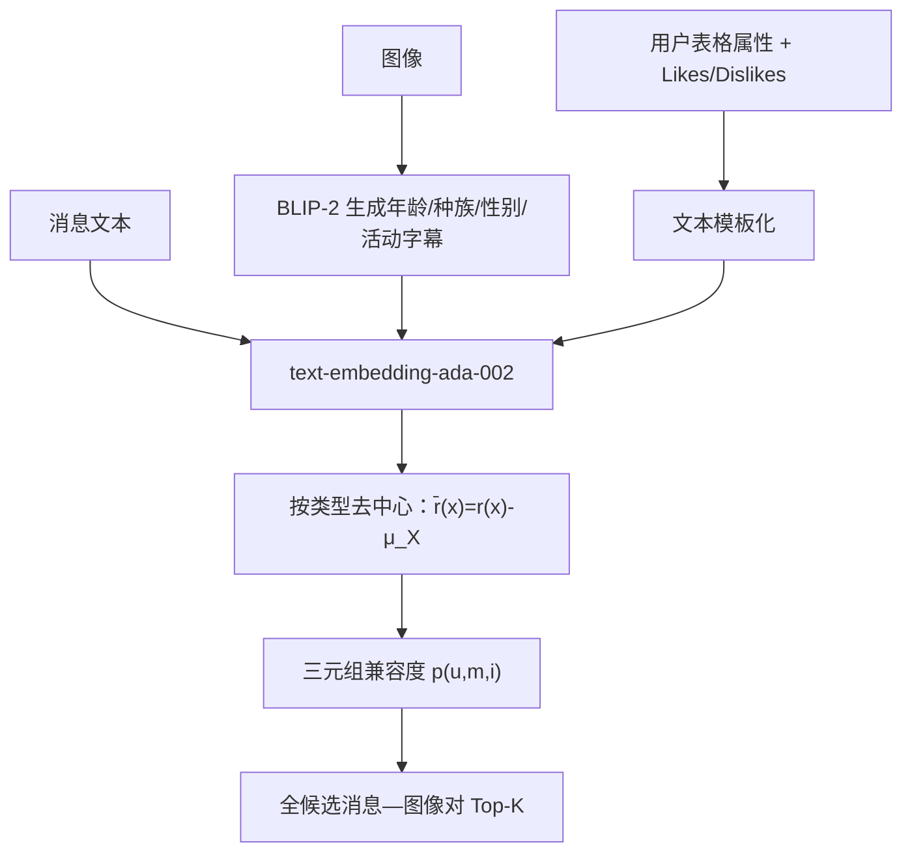

# Zero-Shot Recommendations with Pre-Trained Large Language Models for Multimodal Nudging（预训练大语言模型驱动的多模态助推零样本推荐）

- **会议/期刊**: ICDM 2023
- **作者与机构**: Rachel M. Harrison、Anton Dereventsov（Lirio, LLC），Anton Bibin（Skoltech Agro）
- **推荐链路定位**: 召回/内容匹配（零样本候选生成与排序）
- **研究方向**: 冷启动与长尾推荐 / LLM推荐 / 多模态推荐
- **论文原文**: [论文原文链接](https://arxiv.org/abs/2309.01026v2)
- **开源代码**: [paxnea/LLM-multimodal-nudging](https://github.com/paxnea/LLM-multimodal-nudging)

## TL;DR (1分钟核心速览)

针对多模态内容可任意组合、目录动态变化且无法为每类模态训练编码器的冷启动痛点，本文将用户表格、消息文本和图像字幕统一为文本，用 text-embedding-ada-002 的1536维语义向量做类型中心化与三元组兼容度打分，完全零样本。合成屏幕时间助推场景对20用户、40消息、50图像的全候选Top-5评估中，83%推荐合适、8%不合适，但无基线与真实用户验证。

## Background & Motivation (背景与核心矛盾)

- **主流范式**: 多模态推荐通常为每个模态训练编码器或融合网络，依赖用户—物品交互，且默认内容目录相对固定。
- **前人局限**: 内容可任意消息配任意图像，且消息/图像可随时增删，训练式方法需重训；异构模态语义鸿沟导致跨模态匹配困难。
- **核心洞察 (Key Insight)**: LLM 语义空间可将不同模态的文本描述映射到同一空间；直接内积会受“输入类型聚簇”偏置影响，按类型中心化可保留内容间相对语义差异。
- **本文切入点**: 不做任何学习，走“模态文本化 → LLM嵌入 → 类型中心化 → 兼容度相似度Top-K”的零样本链路。

## Method (核心方法设计)

### 1. 整体框架 (Overall Architecture)

用户由人口统计句子与 liked/disliked 活动加权向量表示；消息直接嵌入；图像先由 BLIP-2 生成“性别/年龄/种族/活动”字幕再嵌入。所有向量在 $d=1536$单位球上按类型去中心，随后对每个$(u,m,i)$用三项内积加权得偏好分，枚举$40\times50=2000$ 个消息—图像对取 Top-K；新增内容只需重新文本化与嵌入，无需训练。

### 2. 关键设计拆解 (Key Designs)

1. **多模态文本化与统一嵌入**：异构模态无法直接比较，且为每类模态训练编码器成本高。做法是 $r(m)=emb(m)$，$r(i)=emb(caption(i))$，用户$r(u)=emb(demo(u))+w_l\sum_{a\in L}emb(a)-w_d\sum_{a\in D}emb(a)$；直觉是用自然语言作公共接口，以预训练语义先验替代按模态学习编码器。
2. **按输入类型中心化 (Centering)**：ada-002 输出位于单位球，不同输入类型各自聚簇，直接内积会被类型偏移主导。公式为 $\bar r(x)=r(x)-\frac{1}{|X|}\sum_{x'\in X}r(x')$；它去掉类型公共偏移、保留内容相对差异，可视为一种极简协同过滤式重定位。
3. **三元组兼容度打分与零样本Top-K**：$p(u,m,i)=w_{mi}\langle\bar r(m),\bar r(i)\rangle+w_{um}\langle\bar r(u),\bar r(m)\rangle+w_{ui}\langle\bar r(u),\bar r(i)\rangle$，同时约束图文一致、用户—消息兴趣一致、用户—图像人口统计匹配。训练目标：无监督、无训练、无负采样；推理枚举全部消息—图像对，复杂度$O(|M||I|)$，原文单用户仅2000对，大规模需ANN或分块剪枝。

## Experimental Setup & Evaluation Protocol (实验设置与评估协议)

- **数据集与预处理**: 合成屏幕时间助推环境；用户由 GPT-4 生成，消息由 GPT-3.5 生成，图像取自 Pexels 并由 BLIP-2（flan-t5-xxl）生成字幕。

| 数据集 | #Users | #Items | #Interactions | 稀疏度/密度 | 特征/场景说明 |
| :--- | :---: | :---: | :---: | :---: | :--- |
| Synthetic Nudging | 20 | 40消息 + 50图像 | 100条评估（20×Top-5） | 非交互数据，N/A | 用户表格+likes/dislikes；图文可任意组合，共2000对/用户 |

- **数据划分与防穿越 (Splitting Strategy)**: 无训练、无划分、无防穿越需求，属于完全零样本评估。
- **排名评测协议 (Ranking Protocol)**: 对每个用户全候选 `Full-Ranking` 2000个消息—图像对，取Top-5；再用规则判断：图文一致且满足“消息匹配至少一个like”或“图像匹配至少两个人口统计属性”为合适；图文不一致或消息涉及dislike为不合适。
- **对比基线与超参设置**: 原文未设置 BPR、LightGCN 或多模态基线，也无显著性检验；嵌入维度 $d=1536$，$w_l=w_d=0.2$，三项打分权重均为1。

## Key Experimental Results (实验关键数据)

### 1. 主实验对比 (Main Results)

原文未报告任何学习式或启发式基线，因此无法给出 `Improv.%`；表1仅汇总其规则评估结果。

| 方法 | 候选空间/用户 | Top-K | 完全合适 | 不合适 | 部分/未明确 |
| :--- | :---: | :---: | :---: | :---: | :---: |
| Zero-shot LLM multimodal nudging | 2,000对 | 5 | **83%** | 8% | 9%（按100条推算） |

### 2. 消融实验 (Ablation Study)

原文没有定量消融，仅用图4展示中心化前后PCA分布，故表2是“缺失组件审计”，不应解读为性能增益。

| 组件/设置 | 原文是否报告 | 可读出的作用 |
| :--- | :---: | :--- |
| 类型中心化 | 仅PCA图，无指标 | 缓解消息/图像/用户嵌入按类型聚簇 |
| 用户偏好加权 $w_l=w_d=0.2$ | 固定值，未做敏感性 | 控制likes/dislikes对用户向量的偏移 |
| 三项兼容度权重 | 固定为1，未比较 | 未验证图文、用户—消息、用户—图像项各自贡献 |

### 3. 关键实验发现 (Key Findings)

- 在20用户×Top-5=100条推荐中83条完全合适、仅8条不合适，说明“文本化+LLM语义相似度”在零训练条件下可完成初步多模态冷启动匹配。
- 用户画像采用加likes减dislikes，并与图文一致性、人口统计匹配联合打分，是83%合适率的可解释来源；但无逐项消融，归因强度有限。
- 候选空间仅2000对/用户，且无基线、无显著性检验、无真实A/B；83%只能视为可行性证据，不能证明优于传统多模态推荐。

## Highlights & Limitations (亮点、对比与审稿批判)

- **与代表作对比 (vs. Prior Work)**: 传统多模态推荐需训练模态编码器与融合层并依赖交互，本文把模态转为文本并用LLM嵌入，免训练且支持动态目录；与LLM零样本排序器不同，它不靠prompt生成排序，而靠语义向量相似度。
- **可迁移亮点**: 图像字幕模板显式注入人口统计与活动信息；按输入类型中心化可低成本缓解LLM嵌入的“类型聚簇”偏置；用户向量“加likes减dislikes”便于快速个性化。
- **审稿级局限批判**: 实验为20用户合成数据、规则化人工评估，无基线/无消融/无显著性，结论外部效度弱；推理需枚举 $|M||I|$ 且新图像要过BLIP-2字幕与嵌入，大规模目录的延迟与成本未评估，默认LLM参数也使复现性受限。

## Rating (四维评分)

- **方法创新性 (Novelty)**: ⭐⭐⭐ （将多模态推荐简化为“文本化+LLM嵌入+中心化相似度”，机制朴素但零样本冷启动思路清晰）
- **评估协议与实验扎实度 (Protocol & Experiments)**: ⭐⭐ （仅合成小数据与规则评估，无基线、无定量消融、无显著性检验）
- **写作与数学规范度 (Clarity & Rigor)**: ⭐⭐⭐⭐ （方法链路、公式与权重含义清楚，但启发式假设和偏差讨论较简）
- **工业落地与复现价值 (Industrial & Practical Value)**: ⭐⭐⭐ （代码与数据生成流程开放，易快速试跑；全组合打分和字幕生成成本限制大规模部署）

