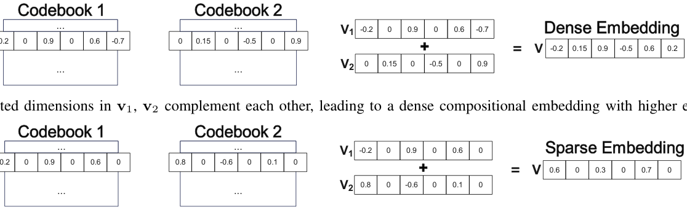
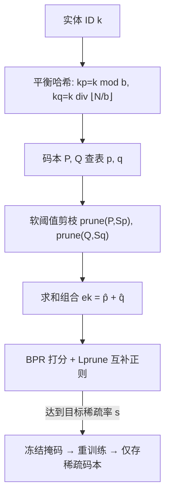
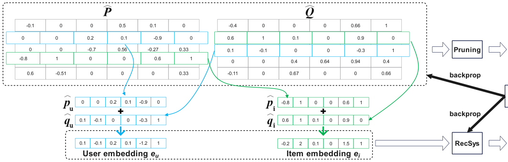

# Learning Compact Compositional Embeddings via Regularized Pruning for Recommendation (基于正则化剪枝的紧凑组合嵌入推荐)

- **会议/期刊**: ICDM 2023
- **作者与机构**: Xurong Liang, Tong Chen, Hongzhi Yin (The University of Queensland); Quoc Viet Hung Nguyen (Griffith University); Jianxin Li (Deakin University)
- **推荐链路定位**: 召回（嵌入表征层，模型无关的嵌入表压缩框架）
- **研究方向**: 协同过滤与双塔召回 / 工业级轻量化架构
- **论文原文**: [https://arxiv.org/abs/2309.03518v2](https://arxiv.org/abs/2309.03518v2)
- **开源代码**: [https://github.com/xurong-liang/CERP](https://github.com/xurong-liang/CERP)

## TL;DR (1分钟核心速览)

隐因子推荐的参数几乎全在嵌入表（Amazon 评论数据 2100 万用户 + 935 万商品 ×128 维 ≈ 31.2 GB）。本文提出 CERP：每个实体由两个小码本（各 $b$行）经**平衡哈希**取址后求和构成，再用**可学习逐元素软阈值**对两码本联合剪枝，并加**互补性正则项**$\mathcal{L}_{prune}$ 强制二者被剪的位置错开。在 Gowalla/Yelp2020 × MLP/LightGCN 双骨干、90%/95%/99% 三档稀疏预算下，N@10/R@10 全面超越 PEP、QR、OptEmbed 等；99% 稀疏时相对最优基线最高提升 **82.3%**（Yelp-LightGCN N@10）。

## Background & Motivation (背景与核心矛盾)

- **主流范式**: 轻量化推荐分两派——① 动态维度分配（ESAPN/AutoEmb/OptEmbed 的 NAS 式搜索、PEP 的 L1 剪枝）压缩每实体可用维度；② 哈希组合嵌入（QR、DHE）用码本共享压低嵌入**行数**。
- **前人局限**: 搜索/剪枝派仍保留"一实体一向量"映射，不许跨实体共享参数；而嵌入表大小由**实体数**而非维度主导，故为满足预算只能把平均维度压到 1.28 这种极端值，信息损失惨重。哈希派在紧预算下码本行数 $b$ 变小，单条 meta-embedding 被上千实体复用，哈希碰撞使多个实体共享同一嵌入，判别性崩塌。
- **核心洞察 (Key Insight)**: 两类方法失效方向正交——一个牺牲"维度密度"，一个牺牲"实体唯一性"。剪枝若从**本就只有 $b$行的码本**上做起，则每行只需剪掉少量参数即可达标，从而把省下的预算换成**更大的$b$**，同时获得稠密嵌入与低碰撞。
- **本文切入点**: 联合二者——先组合、再剪枝，并额外约束两码本的剪枝掩码互补，避免"稀疏叠加成更稀疏"。

<figure class="paper-figure" markdown="span">
  <figcaption>图 1：v1 与 v2 之间互补行为影响的图示。</figcaption>
</figure>

## Method (核心方法设计)

### 1. 整体框架 (Overall Architecture)

实体 ID $k$经固定平衡哈希映射为两码本下标$(k_p,k_q)$，取$\mathbf{P}[k_p]$与$\mathbf{Q}[k_q]$求和得组合嵌入；训练时嵌入不是直接查表，而是先经软阈值算子$\text{prune}(\cdot,\mathbf{S})$得到稀疏码本$\hat{\mathbf{P}},\hat{\mathbf{Q}}$，再组合作答。推荐损失与剪枝正则项联合反向传播，当两码本非零元素数达到目标稀疏率$s$ 时停止联合训练，冻结掩码进入**重训练阶段**，最终仅存储稀疏码本。

<figure class="paper-figure" markdown="span">
  <figcaption>图 2：CERP 主要组件与优化过程概览。</figcaption>
</figure>

### 2. 关键设计拆解 (Key Designs)

1. **平衡哈希组合嵌入（解碰撞而非仅省参数）**：痛点是不平衡的商-余哈希会让商表桶数过小、元嵌入被过度复用。CERP 令两码本桶数相同 $b$，用纯算术映射$k_p = k \boldsymbol{o}d b,\; k_q = k \div \lfloor (|U|+|I|)/b \rfloor$，保证每个下标恰好出现$\lceil N/b \rceil$次，$b^2 \ge N$即可无碰撞覆盖全部实体；组合算子选**求和**而非逐元素积/拼接，因剪枝后求和仍能保持较稠密的输出。$\mathbf{e}_k = \mathbf{p} + \mathbf{q}$。

2. **软阈值联合剪枝（把 L0 约束变为可微掩码）**：目标是 $\min \mathcal{L}\ \text{s.t.}\ \|\mathbf{P}\|_0+\|\mathbf{Q}\|_0 \le t$，NP-hard。借鉴 STR，用可学习逐元素阈值矩阵$\mathbf{S}_p$ 重参数化：
   $\hat{\mathbf{P}} = \text{sign}(\mathbf{P}) \odot \text{ReLU}(|\mathbf{P}| - \sigma(\mathbf{S}_p))$，
   阈值大则置零，$\text{sign}(\cdot)$还原保留下来的正负号以保表达力，梯度走 subgradient 且仅对非零项回传。逐维（而非从$\{16,32,64,128\}$ 里选）决策粒度更细。

3. **互补剪枝正则 + $\gamma$指数衰减 + 推理开销**：若$\mathbf{p},\mathbf{q}$各剪掉一半却**重叠**，则$\mathbf{e}_k$有效维只剩$d/2$。理想目标为$\arg\min -\sum_{k_p}\sum_{k_q}\|\hat{\mathbf{P}}[k_p]+\hat{\mathbf{Q}}[k_q]\|_0$，$b^2$ 组合不可算，故用批内实例级松弛：
   $\mathcal{L}_{prune} = -\sum_{k\in\mathcal{B}} \|\tanh(\eta\,\mathbf{e}_k)\|_2^2,\ \eta=10^3$，
   重缩放 $\tanh$使$\|\cdot\|_2^2$近似计数非零维，从而奖励两码本掩码错位。总损失$\mathcal{L}=\mathcal{L}_{BPR}+\gamma\mathcal{L}_{prune}$，$\gamma$ 每轮减半（早期保信息、后期提速）；负采样沿用 BPR 的 1 正 1 负随机采样，推理时零值被稀疏矩阵格式跳过，几乎无额外延迟。

## Experimental Setup & Evaluation Protocol (实验设置与评估协议)

- **数据集与预处理**: 采用 LightGCN / HGCF 官方仓库版本，未做 5-core 再过滤。

| 数据集 | #Users | #Items | #Interactions | 密度 | 场景 |
| :--- | :---: | :---: | :---: | :---: | :--- |
| Gowalla | 29,858 | 40,981 | 1,027,370 | 0.084% | LBSN 签到 |
| Yelp2020 | 71,135 | 45,063 | 1,782,999 | 0.056% | 商户评论 |

- **数据划分与防穿越**: 随机 `比例划分` —— 80% 训练、20% 测试，再从训练集抽 10% 作验证集；非时间戳切分。
- **排名评测协议**: 每个用户-正例交互采样 **5 个负例**，报告 NDCG@10 与 Recall@10（采样排序，非 Full-Ranking 全库排序；论文未给出全库排序结果）。
- **对比基线与超参**: 基线分三类——维度搜索（ESAPN、AutoEmb、OptEmbed）、剪枝（PEP、UD 统一维度）、哈希组合（QR、DHE）。嵌入维度 $d=128$，桶数$b=5000$（Gowalla）/$8000$（Yelp2020），$\eta=100$，Adam，学习率$\{10^{-2},10^{-3},10^{-4}\}$，MLP 隐藏层 3 层、LightGCN 4 层消息传递；目标稀疏率$s\in\{90\%,95\%,99\%\}$。

## Key Experimental Results (实验关键数据)

### 1. 主实验对比 (Main Results) — $s=90\%$（N@10 / R@10）

| 方法 | Avg Dim | Gowalla-MLP | Gowalla-LightGCN | Yelp-MLP | Yelp-LightGCN |
| :--- | :---: | :---: | :---: | :---: | :---: |
| UD | 12 | 0.0265 / 0.0266 | 0.0875 / 0.0797 | 0.0049 / 0.0052 | 0.0211 / 0.0251 |
| ESAPN | 15.5 | 0.0045 / 0.0051 | 0.0282 / 0.0292 | 0.0035 / 0.0040 | 0.0064 / 0.0078 |
| AutoEmb | 13 | 0.0013 / 0.0012 | 0.0275 / 0.0275 | 0.0003 / 0.0003 | 0.0073 / 0.0090 |
| OptEmbed | ~12.8–15.4 | 0.0276 / 0.0276 | 0.0373 / 0.0369 | 0.0055 / 0.0068 | 0.0084 / 0.0089 |
| DHE | 12 | 0.0081 / 0.0069 | 0.0046 / 0.0050 | 0.0017 / 0.0023 | 0.0013 / 0.0016 |
| PEP | 12.79 | 0.0251 / 0.0252 | 0.0685 / 0.0607 | 0.0036 / 0.0046 | 0.0157 / 0.0186 |
| QR | 128 | 0.0288 / 0.0273 | 0.0776 / 0.0724 | 0.0054 / 0.0062 | 0.0193 / 0.0225 |
| **CERP** | **124.3 / 125.4 / 122.9 / 125.8** | **0.0312 / 0.0288** | **0.0965 / 0.0926** | **0.0061 / 0.0067** | **0.0230 / 0.0267** |
| Improv. | — | +8.3% / +5.7% | +10.3% / +16.2% | +12.7% / +8.0% | +9.0% / +6.4% |

**极端预算 $s=99\%$（N@10）**: Gowalla-MLP PEP 0.0264 / QR 0.0222 / UD 0.0273 / **CERP 0.0298**；Gowalla-LightGCN PEP 0.0423 / QR 0.0575 / **CERP 0.0831 (+44.5%)**；Yelp-MLP **CERP 0.0061**（PEP 0.0052、QR 0.0058）；Yelp-LightGCN PEP 0.0042 / QR 0.0071 / UD 0.0092 / **CERP 0.0167 (+82.3%)**。此时 CERP 平均维 **18.3**，PEP 已塌缩到 **1.28**，QR 仍是 128 但性能落后。

### 2. 消融实验 (Ablation Study) — $s=99\%$, N@10（平均维 / 非零重叠率）

| 变体 | Gowalla-MLP | Gowalla-LightGCN | Yelp-MLP | Yelp-LightGCN |
| :--- | :---: | :---: | :---: | :---: |
| Default (全组件) | 0.0298 (18.30 / 0.43%) | **0.0831** (17.99 / 0.76%) | 0.0061 (18.66 / 0.32%) | **0.0167** (18.61 / 0.41%) |
| w/o $\mathcal{L}_{prune}$ | 0.0287 (17.10 / 1.26%) | 0.0646 (17.24 / 1.33%) | 0.0058 (16.27 / 2.00%) | 0.0069 (15.39 / 2.76%) |
| w/o $\gamma$ 衰减 | 稀疏率卡在 94.94% | 卡在 93.86% | 卡在 97.43% | 卡在 97.00% |
| 不平衡码本桶数 | 0.0280 (128 / 7.01%) | 0.0572 (128 / 7.04%) | 0.0058 (128 / 7.21%) | 0.0145 (128 / 7.25%) |

### 3. 关键实验发现 (Key Findings)

1. **互补正则是紧预算下的命门，且对图骨干尤其关键**：去掉 $\mathcal{L}_{prune}$后两码本非零重叠率从 0.41% 升到 2.76%（$s=99\%$ Yelp-LightGCN），可用维度从 18.6 掉到 15.4，N@10 由 0.0167 暴跌 58.7% 至 0.0069；而在 MLP 上仅降 5%，说明图卷积对嵌入稀疏度更敏感。
2. **"组合 + 剪枝"的协同远大于任一单用**：同样 90% 预算下 CERP 保留 124 维平均密度并超过 QR（128 维全密）10.3%，而纯剪枝 PEP 在 99% 时被压到 1.28 维、N@10 仅 CERP 的一半；不平衡桶数方案即使允许 128 维也因 7% 高重叠率而落后，证实"唯一性"与"稠密度"需同时满足。
3. **$\gamma$ 衰减是达成极紧预算的必要条件**：不衰减时 Gowalla 两骨干剪枝停滞在 93.86%–94.94%，根本无法到达 95%/99% 目标，说明正则强度需随稀疏化推进而退火，否则正则项会阻碍剪枝收敛。

## Highlights & Limitations (亮点、对比与审稿批判)

- **与代表作对比**: vs. **PEP**（全表 L1 剪枝）本文从 $b$ 行小码本剪起，同预算下保留 18 维而非 1.28 维；vs. **QR**（商-余不平衡哈希）本文改用等桶平衡哈希，把非零重叠率从 ~7% 降到 <1%；vs. **OptEmbed**（剪枝 + NAS 搜索）本文无需 RL 搜索，训练成本低且能精确命中任意稀疏率（OptEmbed 只能逼近 90%）。
- **可迁移亮点**: ①"先在共享码本上剪枝、再把省下的参数换更大桶数"这一预算换算思路可直接用于任何大规模 ID 特征嵌入层（CTR、序列推荐）；②重缩放 $\tanh$作为可微$\ell_0$计数器，可替代不可微$\text{sign}$ 用于任何掩码互补/覆盖类正则。
- **审稿级局限批判**: ① 评测只报告每正例 5 负的采样排序，未给 Full-Ranking 全库结果，且 N@10 绝对值偏低（0.006 量级），与主流量级不可直接横比；② 桶数 $b$、$\gamma$初值、软阈值初始化均需逐数据集调参（图 4 显示 LightGCN 对$\gamma$ 初值明显敏感），且剪枝-重训练两阶段流程与稀疏矩阵存储的端侧实测延迟/能耗完全缺失。

## Rating (四维评分)

- **方法创新性 (Novelty)**: ⭐⭐⭐⭐ （"组合嵌入 + 联合剪枝 + 互补正则"三者耦合形成真正的预算换算闭环，问题诊断（维度稀疏 vs 哈希碰撞）清晰）
- **评估协议与实验扎实度 (Protocol & Experiments)**: ⭐⭐⭐ （双数据集 × 双骨干 × 三档预算覆盖充分、消融完整，但仅采样排序、无全库排序与显著性检验）
- **写作与数学规范度 (Clarity & Rigor)**: ⭐⭐⭐⭐ （软阈值重参数化与 $\tanh$ 计数的 toy example 解释到位，梯度推导与稀疏率定义完整）
- **工业落地与复现价值 (Industrial & Practical Value)**: ⭐⭐⭐⭐ （代码开源、模型无关可插拔任意隐因子骨干，零值可由稀疏格式跳过；但两阶段训练流程与端侧实测仍待补）

