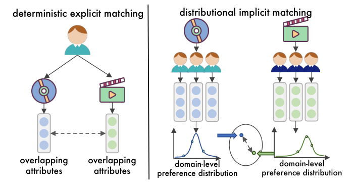
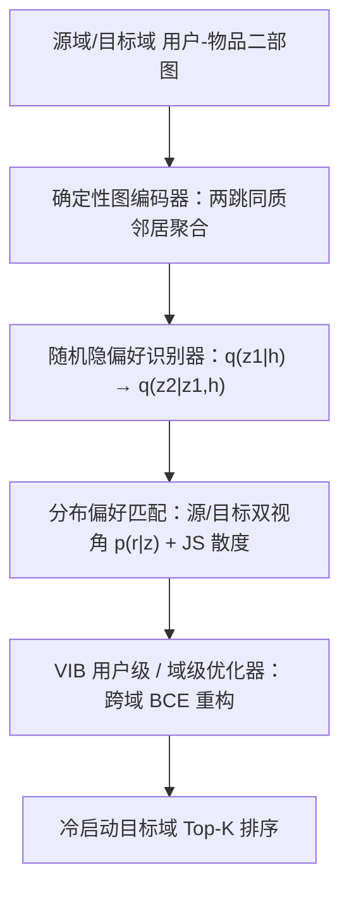
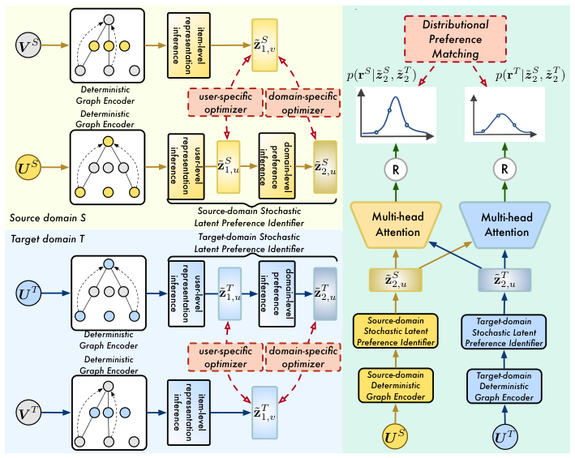

# Distributional Domain-Invariant Preference Matching for Cross-Domain Recommendation (面向跨域推荐的分布域不变偏好匹配)

- **会议/期刊**: ICDM 2023（9 页正文，5 图）
- **作者与机构**: Jing Du\*, Zesheng Ye\*（共同一作）, Bin Guo, Zhiwen Yu, Lina Yao† — UNSW、西北工业大学、CSIRO Data61
- **推荐链路定位**: 召回（冷启动跨域用户表征与 Top-K 检索）
- **研究方向**: 跨域与多场景推荐 / 冷启动推荐
- **论文原文**: [https://arxiv.org/abs/2309.01343v1](https://arxiv.org/abs/2309.01343v1)
- **开源代码**: 暂未开源

## TL;DR (1分钟核心速览)

跨域推荐（NOCDR）中两个域既无重叠用户也无重叠物品时，现有方法要么依赖评论/标签等辅助信息，要么在采样个体之间做**确定性显式表征对齐**，个体采样偏差会让模型抓不住群体共性偏好。本文把域内偏好建模为连续先验分布，用分层变分后验（用户级 $q(z_1|\tilde{h})$→ 域级$q(z_2|z_1,\tilde{h})$）逐级逼近，再把源/目标两个视角下"域不变偏好"的预测分布用对称 JS 散度对齐，形成分布隐式匹配；辅以两个 VIB 优化器保证表征的紧致性与跨域泛化。在 Amazon 八类构成的 4 组冷启动 NOCDR 任务上，**全库排序 Full-Ranking** 协议下 MRR、NDCG@10 相对最优基线 CRDIB 提升 **21.6%–34.9%**。

## Background & Motivation (背景与核心矛盾)

- **主流范式**: CDR 分 OCDR（有重叠用户/物品，靠 Embedding-and-Mapping 或元网络 PTUPCDR 学习个性化桥接函数）与 NOCDR（无重叠，靠评论/标签/社交行为等辅助信息做替代性对齐，或把评分模式压进 codebook 做簇级显式映射）。
- **前人局限**: ① 所有替代方案都要向用户/物品索取额外数据（reviews、tags、rating patterns），在**只有 user-item 交互**的最严苛 NOCDR 场景直接失效；② 对齐本质是"采样个体间的确定性显式匹配"，只能刻画个体差异，采样偏差使其无法纳入偏好的**连续性与群体普适性**。
- **核心洞察 (Key Insight)**: 推荐面向大众，不同域的用户行为虽零散，但背后应共享一条稳定的潜在偏好分布 $p(z)$。若把用户表征视为该分布的 i.i.d. 观测，则跨域迁移就退化为"两个域对该隐不变偏好的解释是否一致"——这是分布层面的问题，而非个体配对问题。
- **本文切入点**: 用分布隐式匹配替代显式个体匹配，以随机用户组的 Monte-Carlo 采样自然降低采样偏差。

<figure class="paper-figure" markdown="span">
  <figcaption>图 1：确定性显式匹配（左）与我们的分布式隐式匹配（右）之间的区别。</figcaption>
</figure>

## Method (核心方法设计)

### 1. 整体框架 (Overall Architecture)

DPMCDR 是一个双向对称的跨域生成模型。先在源域 $G^S$与目标域$G^T$上各跑一个**确定性图编码器**，从交互二部图中得到用户/物品的确定性表征$\tilde{h}$；随后**随机隐偏好识别器**以两层级联高斯后验把$\tilde{h}$抽象为用户级隐表征$\tilde{z}_1$与域级偏好$\tilde{z}_2$；**分布偏好匹配**用不同的查询顺序生成源视角与目标视角下的域不变偏好预测分布$p(r^S|\tilde{z}^S_2,\tilde{z}^T_2)$与$p(r^T|\cdot)$，并在共享潜空间用 JS 散度对齐；最后两类 VIB 优化器分别约束$\tilde{z}_1$与$\tilde{z}_2$ 成为预测跨域交互的极小充分统计量。推理时直接取目标域新用户的表征做全库内积打分。

<figure class="paper-figure" markdown="span">
  <figcaption>图 2：DPMCDR 的框架，包含作为前向模块的确定性图编码器和随机潜在偏好识别器，而后向信息由用户特定优化器、域特定优化器和分布偏好匹配传递。</figcaption>
</figure>

### 2. 关键设计拆解 (Key Designs)

1. **两跳同质图编码器（Homogeneous-Hop Aggregation）**：交互二部图上相邻的只有异质节点，直接套一层 GCN 会把人-物异质信息混进来。本文只让用户连用户、物品连物品，通过 $A\top$ 二次折返实现两跳聚合：

$$\tilde{U}^{(1)} = A\,\Phi^{(0)}\!\left(A^{\top} U W_u\right) W'_u,\quad \tilde{V}^{(1)} = A^{\top}\,\Phi^{(0)}\!\left(A V W_v\right) W'_v$$

   直觉是：$A^{\top}U$先按"共同物品"把用户加权求和，$A$再折返回来，等价于在同质用户图上做一跳传播，避免异质噪声污染表征；高阶层用$(\tilde{E}^{(k-1)}\|\tilde{E}^{(k-2)})$ 拼接缓解过平滑。

2. **分层随机隐偏好识别器（Stochastic Latent Preference Identifier）**：个体表征是采样结果、不足以代表群体。作者设 $p(z) = \prod_{l}p(z_l|z_{<l})$、取$L=2$ 层，用摊销推断（MLP 出均值/方差）逐级近似：

$$q(z_1|\tilde{h}) = \mathcal{N}(\boldsymbol{\mu}_1,\mathrm{diag}(\boldsymbol{\Sigma}_1)),\quad \tilde{z}_1 = \boldsymbol{\mu}_1 + \boldsymbol{\Sigma}_1 \odot \boldsymbol{\epsilon}_1$$

$$q(z_2|z_1,\tilde{h}) = \mathcal{N}(\boldsymbol{\mu}_2,\mathrm{diag}(\boldsymbol{\Sigma}_2)),\quad \tilde{z}_2 = \boldsymbol{\mu}_2 + \boldsymbol{\Sigma}_2 \odot \boldsymbol{\epsilon}_2$$

   第二层的 $\tilde{z}_2\in\mathbb{R}^{N\times d}$才是"域级偏好"，由$N$ 个随机用户的**整组表征**参数化——这正是消除个体采样偏差的关键算子。

3. **分布偏好匹配 + VIB 双向优化**：把 $(\tilde{z}^S_2\|\tilde{z}^T_2)$与反向拼接分别线性映射后过 multi-head self-attention，得到源驱动/目标驱动的$\dot{r}^S,\dot{r}^T$，再各自参数化为高斯$p(r^S|\tilde{z}^S_2,\tilde{z}^T_2)$、$p(r^T|\tilde{z}^S_2,\tilde{z}^T_2)$。匹配损失取对称 JS（即双向 KL）：

$$\mathcal{L}_m = \tfrac{1}{2}\Big[D_{KL}\big(p(r^S|\tilde{z}^S_2,\tilde{z}^T_2)\,\|\,p(r^T|\tilde{z}^S_2,\tilde{z}^T_2)\big) + D_{KL}\big(p(r^T|\cdot)\,\|\,p(r^S|\cdot)\big)\Big]$$

   对称形式保证 S→T 与 T→S 双向可迁移；因为对齐的是**分布**而非个体，个体的采样噪声在对 $N$ 个用户的期望中被平均掉。

4. **训练目标、负采样与推理效率**：用户级优化器 $\mathcal{L}^S_u$在 VIB 约束下最大化$\tilde{z}_{1,u},\tilde{z}_{1,v}$与$A^S$的互信息、同时用 KL 上界压缩其对初始 embedding 的依赖；域级优化器$\mathcal{L}_d$把$\tilde{z}^S_2$与**目标域**交互$A^T$的互信息也纳入（对角拼接矩阵$A^{ST}$），强制域级偏好跨域可预测。总损失为$\mathcal{L} = \mathcal{L}_m + \mathcal{L}_d + \mathcal{L}^S_u + \mathcal{L}^T_u$，$g(\cdot,\cdot)$取内积 + BCE，**全库成对 BCE 训练、无需负采样**。复杂度$O\big(k(|S|^2+|T|^2)+6N+|V^S|+|V^T|+2hk^2d^2\big)$，随机采样项与$N$ 线性、可 GPU 并行。

## Experimental Setup & Evaluation Protocol (实验设置与评估协议)

- **数据集与预处理**: Amazon Review 8 个品类，两两配对成 4 组跨域场景。过滤：物品交互 $<10$、用户交互$<5$ 均剔除；训练仅用非重叠用户。

| 数据集 | #Users | #Items | #Interactions | #非重叠用户 | 测试新用户 | 平均序列长 |
| :--- | :---: | :---: | :---: | :---: | :---: | :---: |
| Cellphone | 27,519 | 9,481 | 156,581 | 11,182 | 2,049 | 14.02 |
| Electronic | 107,984 | 40,460 | 795,799 | 100,127 | 2,042 | 7.95 |
| Cloth | 41,829 | 17,943 | 180,545 | 33,972 | 990 | 5.31 |
| Sport | 27,328 | 12,656 | 160,482 | 19,471 | 981 | 8.24 |
| Game | 25,025 | 12,319 | 144,305 | 23,288 | 226 | 6.20 |
| Video | 19,457 | 8,751 | 145,798 | 17,720 | 217 | 8.23 |
| Music | 50,841 | 43,858 | 685,138 | 35,760 | 1,893 | 19.16 |
| Movie | 87,875 | 38,643 | 1,119,358 | 72,794 | 1,885 | 15.38 |

- **数据划分与防穿越**: 冷启动划分——按 20% 划出验证/测试用户，其余（非重叠）用户用于训练；测试用户的真值交互**只用于评估**，不参与训练。
- **排名评测协议**: 无偏 `Full-Ranking`（目标域全库未交互物品排序），指标 MRR、HR@{10,20,30}、NDCG@{10,20,30}；5 个随机种子取均值 ± 标准差，配对 t-test 检验（$p<0.05$，表中标 `*`）。
- **对比基线与超参**: 单域 MF / Caser / IDNP；跨域 CMF / EMCDR-MF / EMCDR-NGCF / PTUPCDR / DisenCDR / CRDIB（共 9 个）。GCN 层数 $k=3$，dropout$0.3$，$d\in\{16,32,64,128\}$，warm-up epoch$\in\{10,\dots,50\}$，$\beta\in\{0.5,\dots,3\}$，采样组规模$N\in\{64,\dots,1024\}$，batch 1024，Adam lr$10^{-3}$，最多 70 epoch 收敛。

## Key Experimental Results (实验关键数据)

### 1. 主实验对比 (Main Results)

以 Cellphone→Electronic 与 Game→Video 两组场景为例（数值为百分数 %，加粗为最优）：

| 方法 | Electronic MRR | NDCG@10 | NDCG@30 | HR@10 | HR@30 | Video MRR | NDCG@10 | NDCG@30 | HR@10 | HR@30 |
| :--- | :---: | :---: | :---: | :---: | :---: | :---: | :---: | :---: | :---: | :---: |
| MF | 1.67 | 1.31 | 2.60 | 3.39 | 4.43 | 2.53 | 1.98 | 2.86 | 2.13 | 4.81 |
| Caser | 1.32 | 1.67 | 2.29 | 1.30 | 3.14 | 2.05 | 1.62 | 2.72 | 2.16 | 3.68 |
| CMF | 1.70 | 1.13 | 1.57 | 2.34 | 5.21 | 3.28 | 2.82 | 4.78 | 3.21 | 6.28 |
| EMCDR-NGCF | 3.14 | 3.20 | 5.05 | 5.09 | 12.11 | 1.90 | 1.62 | 2.64 | 3.65 | 8.59 |
| PTUPCDR | 5.94 | 6.47 | 9.30 | 11.30 | 14.95 | 2.32 | 2.07 | 3.95 | 4.86 | 8.69 |
| DisenCDR | 6.88 | 7.06 | 8.72 | 11.12 | 18.15 | 2.15 | 1.91 | 3.20 | 5.12 | 9.54 |
| CRDIB | 8.48 | 9.65 | 13.05 | 17.19 | 31.61 | 4.20 | 4.37 | 6.65 | 7.57 | 17.30 |
| **DPMCDR\*** | **10.31** | **11.51** | **15.01** | **20.20** | **35.08** | **5.11** | **5.56** | **7.93** | **10.72** | **21.07** |
| **Improv.%** | *21.58* | *19.27* | *15.02* | *17.51* | *10.98* | *21.67* | *27.23* | *19.25* | *41.61* | *21.79* |

另两组：Cloth-Sport 上 MRR 提升 **18.57%** / **6.73%**，Music-Movie 上 MRR 提升 **25.90%** / **28.27%**，四个场景 28 个指标**全部最优**。

### 2. 消融实验 (Ablation Study)

Game-Video 场景（图 4）的四级递进变体：

| 变体 | 图编码器 | 用户级 $q(z_1)$+ 用户优化器 | 域级$q(z_2)$ + 分布匹配 | VIB 域级优化器 | 相对表现 |
| :--- | :---: | :---: | :---: | :---: | :--- |
| (A) | ✓ | ✗ | ✗ | ✗ | NDCG@30 ≈ 6.32 / HR@30 ≈ 17.96，已超除 CRDIB 外所有 CDR 基线 |
| (B) | ✓ | ✓ | ✗ | ✗ | 明显优于 (A) |
| (C) | ✓ | ✓ | ✓ | ✗ | **全部变体中最差**，无预测目标时域级偏好无法被合理导出 |
| (D) | ✓ | ✓ | ✓ | 仅用户级 | 显著优于 (C)，但仍不及完整模型 |
| **完整** | ✓ | ✓ | ✓ | ✓ | **所有指标最优** |

### 3. 关键实验发现 (Key Findings)

1. **分布匹配是主要增益源，而非更强编码器**：仅保留图编码器的 (A) 变体 NDCG@30 已达 6.32、HR@30 已达 17.96，优于除 CRDIB 外所有跨域基线；而移除 VIB 域级优化器的 (C) 反而成为全场最差——说明"先建分布、再谈对齐"的顺序不可颠倒，没有交互监督锚定的域级偏好只是噪声。
2. **OCDR 场景同样不掉队**：在 15% 用户重叠的部分重叠设定（表 III）下，DPMCDR 未使用任何重叠信息却仍超过专门为 OCDR 设计的 CRDIB 与 DisenCDR，Cellphone-Electronic 的 MRR 分别提升 **7.03% / 13.68%**，Sport 提升 **19.61%**，说明分布隐式匹配不是"退而求其次"的替代品。
3. **与 VIB 系基线同源但更强**：同为信息瓶颈路线，CRDIB 在 Electronic 上 HR@30 为 31.61，DPMCDR 达 35.08；差距主要来自把 VIB 从"节点级表征"扩展到"域级分布"，即 $\mathcal{L}_d$ 中的跨域重构项——这让域级偏好本身具备跨域可预测性，而不仅是压缩性。

## Highlights & Limitations (亮点、对比与审稿批判)

- **与代表作对比 (vs. Prior Work)**: 相比 PTUPCDR（元网络生成个体桥接函数，必须有重叠用户）与 DisenCDR/CDRIB（依赖解耦表征 + 互信息过滤，本质仍是节点级显式对齐），本文把对齐单元从"节点"上移到"分布"；相比依赖 reviews/tags 的 NOCDR 方法（如属性对齐），本文只要求交互矩阵，适用面更宽。
- **可迁移亮点**: ① 两跳同质聚合 $A\Phi(A^\top UW)W'$ 是一行代码即可移植的二部图异质噪声抑制技巧；② "warm-up 后再接入分布匹配损失"的训练调度（图 5 显示无 warm-up 时匹配项会伤害性能）对所有多阶段对齐类模型都适用。
- **审稿级局限批判**: ① 复杂度含 $O(k(|S|^2+|T|^2))$项，Electronic（10 万用户）级别的域上训练开销不可忽视，论文未给实际 wall-clock 对比；② 域级分布假设为对角高斯且需阅读全量交互才能参数化，"新用户零交互"的 strictly cold-start 场景实际仍依赖其所属域的群体分布，个体层面收益未单独分桶验证；③ 超参$\beta$与$N$在不同场景最优值差异明显（Cloth-Sport 最优$\beta=2.5$，Cellphone-Electronic 反被该值拖累），跨域泛化到多域（>2）时负迁移风险论文仅列为 future work。

## Rating (四维评分)

- **方法创新性 (Novelty)**: ⭐⭐⭐⭐ （把跨域对齐从确定性个体匹配重构为域级分布的 JS 对齐，分层变分 + 双向对称 KL 的组合在 NOCDR 中属首次，动机链条清晰）
- **评估协议与实验扎实度 (Protocol & Experiments)**: ⭐⭐⭐⭐ （8 个 Amazon 品类、4 组场景、28 个指标全胜，Full-Ranking + 5 seed + t-test 规范；扣分在于未给出按稀疏度/新用户的分桶细粒度分析）
- **写作与数学规范度 (Clarity & Rigor)**: ⭐⭐⭐⭐ （图模型、VIB 上下界推导完整，式 (8)(12) 的变分近似交代清楚；但部分符号在正文与图中不一致，消融图未标具体数值）
- **工业落地与复现价值 (Industrial & Practical Value)**: ⭐⭐⭐ （无需辅助信息、可双向单次训练是工程优势，但 $|S|^2$ 复杂度与全库 BCE 训练对超大规模域不友好，且未开源代码）

