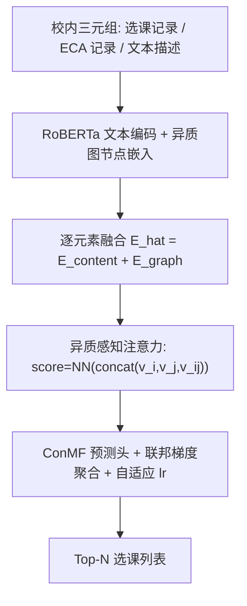

# Heterogeneity-aware Cross-school Electives Recommendation: a Hybrid Federated Approach (异构感知的跨校选修课推荐：一种混合联邦方法)

- **会议/期刊**: 2023 IEEE International Conference on Data Mining Workshops (ICDMW)
- **作者与机构**: Chengyi Ju, Jiannong Cao, Yu Yang, Zhen-Qun Yang, Ho Man Lee（香港理工大学计算机系 / RIAIoT）
- **推荐链路定位**: 召回（Top-N 选课列表生成）
- **研究方向**: 去偏公平、可信隐私与工业架构 / 图神经网络与知识图谱推荐
- **论文原文**: [https://arxiv.org/abs/2402.12202v1](https://arxiv.org/abs/2402.12202v1)
- **开源代码**: 暂未开源

## TL;DR (1分钟核心速览)

本文针对香港中小学跨校选课场景中「数据不能出校（隐私）」与「单校交互极稀疏 + 各校学制/评分体系异构」的双重矛盾，提出 HFRec：每校在本地构建 student–course–activity 异质图，用 RoBERTa 编码课程/课外活动（ECA）文本做内容特征，图侧用「节点 + 边（关系类型）」拼接打分的异质注意力聚合，再以约束矩阵分解（ConMF）作预测头、按各校样本量缩放本地学习率做联邦聚合。在 MOOC 划分为 5 校的数据与 WebSAMS 真实 5 校数据上，采用 1 正 + 99 负采样排序协议，HR@10 相对 FedGNN 提升 23.5% / 15.9%，NDCG@10 提升 15.5% / 30.1%。

## Background & Motivation (背景与核心矛盾)

- **主流范式**: 教育推荐多用 CF / 内容过滤 / MF；跨机构场景引入联邦学习（FCF、FedMF、FedGNN）做隐私保护下的协同训练。
- **前人局限**: ① FCF/FedMF 只在一阶 user–item 交互上做分解，无法建模「同课程 / 同社团」这类高阶同质关系，且各校数据量悬殊（D5 仅 2815 条 ECA vs D4 的 15265 条）导致本地训练进度严重不同步；② FedGNN 虽建模高阶关系，但把异质关系（选课 vs 参加活动）同构处理，抹平了跨校语义差异，在小校冷启动上退化。
- **核心洞察 (Key Insight)**: 高校间「不可共享的是学生记录，可共享的是模型梯度」；而校内的异构性恰恰可以由图结构本身刻画——学生—课程—活动三类节点天然构成稠密补全稀疏交互的桥梁。
- **本文切入点**: 用「校内异质图内容+上下文融合」解决稀疏，用「联邦 + 自适应本地学习率」解决隐私与体量异构。

## Method (核心方法设计)

### 1. 整体框架 (Overall Architecture)

每个学校 $u$作为一个 client：先把课程名与 ECA 描述经 RoBERTa 取 last-layer 逐维 max 池化得句向量，再经 ReLU 稠密层降维得内容嵌入$E_c, E_l$；同时把该校学生、课程、活动建成三节点三关系（$r_{u,c}$,$r_{s,a}$,$r_{c,l}$）的本地异质图，图嵌入与内容嵌入逐元素相加得融合表示；融合表示送入带边嵌入的异质注意力层（+ FFN、LayerNorm、残差）得到学生/课程向量；最后接 ConMF 头算分。服务器每轮随机抽部分学校上传梯度、聚合成$g_u$ 回传，各校以按数据量缩放的学习率更新，直至收敛。

### 2. 关键设计拆解 (Key Designs)

1. **边感知的异质注意力（Heterogeneity-aware Attention）**：痛点在于标准 self-attention 只用节点对相似度，无法区分「同学同课」与「同学同社团」这两种语义完全不同的关系。本文在打分函数中显式注入边嵌入 $v_l$：$score(v_i,v_j)=\mathrm{NN}\big(\mathrm{concat}(v_i, v_j, v_l)\big)$，再 softmax 归一化后加权聚合$\hat{E}'_{ij}=\sum_j \alpha_{ij}\hat{E}_{ij}$。直觉：关系类型成为可学习的「关系偏置」，使同一学生在课程维度与活动维度获得不同的邻居影响权重，从而把 ECA 的稠密信号定向灌入稀疏的选课维度。
2. **约束矩阵分解 ConMF（抑制选课率偏置）**：痛点在于各校选课率（SR）极不均衡，高 SR 课程被反复训练而过拟合、低 SR 课程欠拟合。本文在标准 MSE 之外加一项「向课程均分收缩」的约束项：$\mathcal{L}=\|R-E_s^{\top}E_c\|_F^2+\beta\,\|r-\sigma E_s^{\top}E_c\|_F^2+\gamma(\|E_s\|_F^2+\|E_c\|_F^2)$，其中$r$为课程均分向量、$\sigma$为全$1/m$ 的转移向量。直觉：相当于给热门课的先验均值加锚，压低流行度带来的分数膨胀。
3. **自适应本地学习率与训练/推理开销**：$lr_u = lr_{global}\cdot n_u/N$，样本量大的学校步长更大、小校步长更小以防本地过拟合，缓解 client drift。训练用 SGD，$d=100$、$h=12$、dropout 0.2、$e=3$；推理只需本地前向 + 内积打分，图上无跨校边，通信量仅为梯度（与 FedGNN 同阶），额外成本主要来自 RoBERTa 离线编码（可预计算缓存）。

## Experimental Setup & Evaluation Protocol (实验设置与评估协议)

- **数据集与预处理**: 真实数据为 WebSAMS 五个 Hong Kong 学校（D1–D5，2016–2022 共六年）；MOOC（MOOCCube）按规模随机切为 5 份模拟五校。**未做 k-core 过滤**。

| 数据集 | #Students | #Courses | #ECA Records | 说明 |
| :--- | :---: | :---: | :---: | :--- |
| D1 | 662 | 450 | 4852 | ECA 类别 144 |
| D2 | 570 | 738 | 9564 | ECA 类别 472（最异质） |
| D3 | 1139 | 504 | 10233 | ECA 类别 144 |
| D4 | 1522 | 477 | 15265 | 规模最大 |
| D5 | 785 | 463 | 2815 | 最稀疏小校 |
| MOOC | 48640 活动 | 706 | 319948 选课 / 682753 看视频 | 内容特征=视频字幕与观看时间 |

- **数据划分与防穿越**: 全局时间戳切分，2016–2020 训练、2020–2022 测试；训练集内每条序列取最高评分课程为目标、其余为历史行为。
- **排名评测协议**: `Sampled Ranking`，测试时每条正样本配 **99 个随机负样本**（1:99），计算 HR@1/5/10/20、NDCG@5/10/20、MRR、AUC；训练期负样本由随机替换目标课程生成（Uniform 负采样）。
- **对比基线与超参**: FCF、FedMF、FedGNN 三条联邦隐私保护基线；$d=100$、$h=12$、epoch=3、dropout=0.2、SGD。**未报告显著性检验**。

## Key Experimental Results (实验关键数据)

### 1. 主实验对比 (Main Results)

| 数据集 | 方法 | HR@5 | HR@10 | HR@20 | NDCG@10 | MRR | AUC |
| :--- | :--- | :---: | :---: | :---: | :---: | :---: | :---: |
| MOOC | FCF | 0.361 | 0.571 | 0.767 | 0.449 | 0.342 | 0.619 |
| MOOC | FedMF | 0.378 | 0.572 | 0.770 | 0.458 | 0.366 | 0.618 |
| MOOC | FedGNN | 0.433 | 0.613 | 0.838 | 0.502 | 0.457 | 0.745 |
| MOOC | **HFRec** | **0.486** | **0.757** | **0.911** | **0.580** | **0.537** | **0.815** |
| | *Improv.* | *+12.2%* | *+23.5%* | *+8.7%* | *+15.5%* | *+17.5%* | *+9.4%* |
| DMP | FCF | 0.359 | 0.589 | 0.749 | 0.449 | 0.338 | 0.659 |
| DMP | FedMF | 0.376 | 0.587 | 0.738 | 0.458 | 0.325 | 0.671 |
| DMP | FedGNN | 0.426 | 0.679 | 0.821 | 0.502 | 0.518 | 0.789 |
| DMP | **HFRec** | **0.606** | **0.787** | **0.881** | **0.653** | **0.611** | **0.841** |
| | *Improv.* | *+42.3%* | *+15.9%* | *+7.3%* | *+30.1%* | *+18.0%* | *+6.6%* |

### 2. 消融实验 (Ablation Study)

**原文未提供任何组件消融表**（无 `w/o attention`、`w/o fused embedding`、`w/o ConMF`、`w/o adaptive lr` 对照），仅给出超参敏感性与单例 case study。下表为可提取的最接近证据：

| 变量 | 搜索范围 | 观察结果 |
| :--- | :--- | :--- |
| 嵌入维度 $d$| 50–200 | 对性能敏感，$d\approx100$ 为最优折中 |
| 注意力头数 $h$| 4–16 |$h\approx12$ 达峰，继续增大收益饱和 |
| Case study (s1, student 4188) | Top-5 | 推荐课在第 4 学年成绩优异，定性佐证兴趣对齐 |

### 3. 关键实验发现 (Key Findings)

1. **联邦侧的增益主要来自「高阶关系」而非「联邦本身」**：FedMF→FedGNN（同为联邦、仅多加图）在 DMP 上把 NDCG@10 从 0.458 抬到 0.502，而 HFRec 再抬到 0.653（+30.1%），说明单纯联邦聚合无法补偿一阶交互的信息缺口，异质图才是主要增量来源。
2. **真实小校数据上收益更大，验证了对稀疏+异构的针对性**：MOOC（数据切分均匀、各校分布同构）HR@5 仅 +12.2%，而真实五校 HR@5 达 +42.3%、NDCG@10 达 +30.1%，与「各校 SR/评分体系差异大 → ConMF + 自适应 lr 生效」的动机一致。
3. **HR@20 与 AUC 的相对提升明显低于 HR@5/@10（+7%~9% vs +12%~42%）**：说明该方法主要优化头部排序精度，对长尾尾部召回改善有限；这也与 1:99 采样协议下负样本过于容易（AUC 普遍 0.8+）有关，绝对数值存在乐观偏差。

## Highlights & Limitations (亮点、对比与审稿批判)

- **与代表作对比 (vs. Prior Work)**: 相比 FCF/FedMF（仅一阶 MF + 同态联邦），HFRec 把「关系类型」显式写进注意力打分，并保留本地异质图不共享；相比 FedGNN（异质关系同构处理），本文的边嵌入使 $r_{u,c}$与$r_{s,a}$ 获得不同权重，且 ConMF 的均值收缩项是针对选课率偏置的显式去偏设计，这是 FedGNN 缺失的。与 KGAT/GraphRec 等集中式异质图模型相比，本质差别是不做跨校全局图、把「全局」退化为梯度聚合。
- **可迁移亮点**: ① 把「边类型嵌入拼入 attention score」是一种极低成本的异质图改造，可直接迁移到多行为电商（点击/加购/收藏）推荐；② 按 client 样本量线性缩放本地 lr 的 trick 可与 FedAvg/SCAFFOLD 组合，用于任何体量长尾的多方联邦场景。
- **审稿级局限批判**: ① **实验证据链薄弱**：仅 3 条基线、无消融、无显著性检验、无 Full-Ranking 无偏评估，主结论的说服力高度依赖 1:99 采样；② **隐私论述不完备**：只做梯度层面联邦，未评估梯度反演/成员推断（作者亦在结论中承认），异构图表征与 RoBERTa 编码的通信开销、以及新校冷启动接入时的图结构对齐问题均未讨论。

## Rating (四维评分)

- **方法创新性 (Novelty)**: ⭐⭐⭐ （边感知注意力 + ConMF 均值收缩 + 数据量自适应 lr 的组合有工程巧思，但每个模块均为已有算子的轻量改造，缺少理论或谱分析支撑）
- **评估协议与实验扎实度 (Protocol & Experiments)**: ⭐⭐ （仅 3 基线、1:99 采样排序、无消融与显著性检验，真实数据集也未报告规模与稀疏度外的分布统计）
- **写作与数学规范度 (Clarity & Rigor)**: ⭐⭐⭐ （ConMF 与注意力公式定义清楚，但公式编号与符号存在重复/笔误，异质图定义冗长却未给出消息传递的完整算子推导）
- **工业落地与复现价值 (Industrial & Practical Value)**: ⭐⭐⭐ （无需共享原始数据的多机构选课场景落地价值高、改造代价低，但无开源代码且 RoBERTa 本地编码与联邦通信开销缺少量化）

