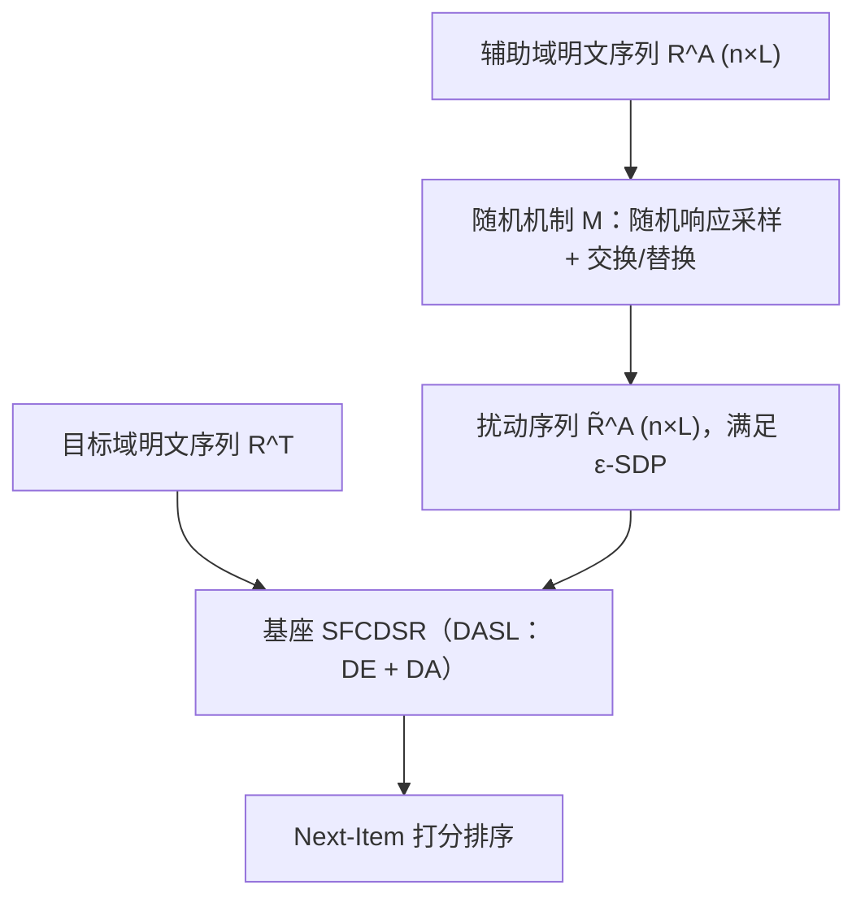

# Privacy-Preserving Cross-Domain Sequential Recommendation (隐私保护跨域序列推荐)

- **会议/期刊**: ICDM 2023
- **作者与机构**: Zhaohao Lin, Weike Pan, Zhong Ming（深圳大学计算机与软件学院；广东省人工智能与数字经济实验室）
- **推荐链路定位**: 召回（跨域知识迁移前的数据发布层）
- **研究方向**: 去偏公平、可信隐私与工业架构 / 跨域与多场景推荐
- **论文原文**: [https://arxiv.org/abs/2401.15369v1](https://arxiv.org/abs/2401.15369v1)
- **开源代码**: [https://github.com/LachlanLin/PriCDSR](https://github.com/LachlanLin/PriCDSR)

## TL;DR (1分钟核心速览)

现有跨域序列推荐（CDSR）默认各域数据"公开可见"，在 GDPR 下非法。本文提出 PriCDSR：先定义**序列差分隐私 SDP**（邻近数据集既允许改一个物品 ID，也允许交换同一用户序列中两个位置），再设计满足 SDP 的随机机制 $\mathcal{M}$，对辅助域序列矩阵**一次性加噪**，产出与原始数据同形状的扰动矩阵；目标域可直接套用**任意 SFCDSR 基座模型零改造**训练。在 Amazon 三域六个域对上，$\epsilon=10$ 时扰动版在全部六个域对仍优于单域基线 DASL-single（HR@10 最高 +22.8%），其中两个域对甚至超过明文跨域版 DASL（CD←Book HR@10 +7.1%）。

## Background & Motivation (背景与核心矛盾)

- **主流范式**: CDSR（如 DASL、C²DSR、PSJNet）用双注意力/正交映射把辅助域序列知识迁到目标域，缓解冷启动与稀疏；隐私方向则仅有面向**评分矩阵**（PriCDR、PPGenCDR）或**联邦场景**（FedCDR）的方案。
- **前人局限 (1)**: PriCDR 的 JLT/SJLT 只能作用于无时序的评分矩阵，天然无法保护"顺序"这一隐私（POI 场景中 $A\to B$与$B\to A$ 语义截然不同）。
- **前人局限 (2)**: 序列隐私的 CLDP 只保护长度与内容，TLDP 只保护顺序且仅允许用**本序列内**物品替换，二者均非推荐系统语境，且都只覆盖"ID 或顺序"其中一个维度。
- **核心洞察 (Key Insight)**: "扰动 ID 会顺带打乱顺序"只是副作用，无法给出理论保证；必须把**顺序敏感性**直接写进邻近数据集定义，才能同时覆盖两类隐私。
- **本文切入点**: 用一次性的数据层加噪（而非模型层加噪）把隐私保护与模型设计解耦，从而保持对基座模型的非侵入性。

## Method (核心方法设计)

### 1. 整体框架 (Overall Architecture)

PriCDSR 是**两阶段数据层方案**：阶段一对齐固定长度 $L$（截断保留末$L$项、前部补 0、只留用户-物品首次交互）得到辅助域序列矩阵$R^A\in\mathbb{N}^{n\times L}$，用机制$\mathcal{M}$逐元素扰动生成$\tilde R^A$并传至目标域；阶段二目标域以明文$R^T$与$\tilde R^A$共同训练任意 SFCDSR（原文用 DASL 作基座，其 DE 正交映射 + DA 双注意力模块本身不作任何修改）。因$\tilde R^A$与$R^A$形状一致（$n\times L$），加噪对下游"透明"，可平滑扩展至一目标域 + 多辅助域。

### 2. 关键设计拆解 (Key Designs)

1. **序列差分隐私 SDP（把"顺序"写进邻近性定义）**: 痛点是用例值扰动无法定理化保护顺序。定义 2 规定 $R,R'$邻近当且仅当 **(a)** 仅有一个元素$(u_0,\ell_0)$值不同，或 **(b)** 同一用户的两位置$\ell_1<\ell_2$ 元素互换；定义 3 要求
$\frac{\Pr[\mathcal{M}(R)=A]}{\Pr[\mathcal{M}(R')=A]}\le\exp(\epsilon),\ \forall A\in \mathrm{Range}(\mathcal{M})$
其中 (a) 体现对 ID 的敏感、(b) 体现对顺序的敏感。这样任何证明都必须同时对交换操作给出界，比"先扰动再乱序"这类无法证明的启发式更可靠。

2. **随机机制 $\mathcal{M}$（受限随机响应 + 交换/替换双操作）**: 直接 RR 有两个问题：会采到序列内已出现的 ID（违反"序列内不重复"约束）、且不处理顺序。机制在位置$(u,\ell)$用前缀$P_{u,\ell}=\{\tilde R_{u,1},\dots,\tilde R_{u,\ell-1}\}$ 约束采样分布：
$\Pr[i\mid P_{u,\ell},R_{u,\ell}]=\begin{cases}\frac{\exp(\epsilon)}{\exp(\epsilon)+m-|P_{u,\ell}\setminus\{0\}|}, & i=R_{u,\ell}\\ \frac{1}{\exp(\epsilon)+m-|P_{u,\ell}\setminus\{0\}|}, & i\neq R_{u,\ell},\ i\notin P_{u,\ell}\setminus\{0\}\\ 0, & i\in P_{u,\ell}\setminus\{0\}\end{cases}$采样后：若采到的$i$出现在**后续子序列**中，则与当前位置**交换**（等价于改变顺序）；否则**替换**（等价于插入/删除/换 ID）。分母扣除前缀已用 ID，使"合法候选池"随位置收缩，从而在交换分支上仍能维持$\exp(\epsilon)$ 的比值界。

3. **训练目标、隐私与推理开销**: PriCDSR 不改损失——目标域沿用 DASL 的单类反馈 BPR 式二分类交叉熵（原文将其 BCE 改为正样本 + 负采样），仅把辅助域输入换成 $\tilde R^A$。**隐私只加噪一次**，故$\epsilon$可取得较大（$\epsilon\in\{1,2,5,10,20,50\}$），不像逐迭代加噪的 DP-SGD 会随轮数累积预算；机制复杂度$O(n\times L)$（借助哈希表把"是否存在于后续子序列"的查询降到$O(1)$，额外$O(L)$ 空间）。推理阶段无任何加密/噪声开销，与普通 DASL 完全一致。

## Experimental Setup & Evaluation Protocol (实验设置与评估协议)

- **数据集与预处理**: Amazon 三子集，按 MGCL 协议处理——有评论/加购即正反馈、**5-core 过滤**、仅保留在三个域**均有交互**的用户（对齐 10,929 用户）：

| 数据集 | #Users | #Items | #Interactions(Avg. Seqlen) | 稀疏度/密度 | 特征/场景说明 |
| :--- | :---: | :---: | :---: | :---: | :--- |
| Movie | 10,929 | 59,513 | 42.11 | 极高稀疏 | 影视，目标/辅助域皆可 |
| CD | 10,929 | 91,169 | 31.50 | 极高稀疏 | 音乐唱片 |
| Book | 10,929 | 236,049 | 55.60 | 极高稀疏 | 图书，物品数最多 |

- **数据划分与防穿越**: `Leave-One-Out`（每用户最后一条测试、倒数第二条验证、其余训练）；时间戳决定序列顺序且**丢弃重复 user-item 对**（保留首次），避免未来交互泄漏。
- **排名评测协议**: `Sampled Ranking` —— 每用户按**流行度采样 100 个未交互负样本**与正样本共同排序，报告 HR@{5,10}、NDCG@{5,10}；三次运行取均值与标准差。
- **对比基线与超参设置**: DASL-single（去掉 DE/DA，仅目标域）、DASL（明文双域）、PriCDSR-DASL（$\epsilon=10$）。嵌入维度$d=128$、注意力记忆窗口 10、dropout 0.5、Adam、lr$=10^{-3}$、batch$=128$、1000 epochs，超参在验证集 NDCG@10 上搜索后固定给扰动版复用。**说明：作者刻意未引入 SASRec 等其他单域模型与其他 CDSR 基线**，理由是只考察"加噪相对基座模型的精度折损"，这也构成本文评估面的主要短板。

## Key Experimental Results (实验关键数据)

### 1. 主实验对比 (Main Results)

六个域对、$\epsilon=10$、$d=128$ 下的 HR/NDCG（加粗为该域对最优）：

| 域对 (目标←辅助) | 模型 | HR@5 | HR@10 | NDCG@5 | NDCG@10 |
| :--- | :--- | :---: | :---: | :---: | :---: |
| Movie←Book | DASL-single | 0.1754 | 0.2701 | 0.1164 | 0.1468 |
| | DASL | **0.1903** | **0.2860** | **0.1269** | **0.1578** |
| | PriCDSR-DASL | 0.1791 | 0.2755 | 0.1174 | 0.1484 |
| Movie←CD | DASL-single | 0.1763 | 0.2686 | 0.1170 | 0.1467 |
| | DASL | **0.1942** | **0.2858** | **0.1286** | **0.1580** |
| | PriCDSR-DASL | 0.1823 | 0.2750 | 0.1202 | 0.1500 |
| Book←Movie | DASL-single | 0.1759 | 0.2681 | 0.1171 | 0.1466 |
| | DASL | 0.1860 | 0.2788 | **0.1235** | **0.1533** |
| | PriCDSR-DASL | 0.1839 | **0.2821** | 0.1211 | 0.1527 |
| Book←CD | DASL-single | 0.1759 | 0.2685 | 0.1160 | 0.1459 |
| | DASL | 0.1830 | **0.2803** | **0.1216** | **0.1529** |
| | PriCDSR-DASL | **0.1832** | 0.2802 | 0.1210 | 0.1520 |
| CD←Movie | DASL-single | 0.1833 | 0.2824 | 0.1225 | 0.1542 |
| | DASL | 0.1991 | 0.2990 | 0.1322 | 0.1642 |
| | PriCDSR-DASL | **0.2025** | **0.3084** | **0.1348** | **0.1688** |
| CD←Book | DASL-single | 0.1615 | 0.2488 | 0.1066 | 0.1346 |
| | DASL | 0.1875 | 0.2851 | 0.1239 | 0.1552 |
| | PriCDSR-DASL | **0.2052** | **0.3054** | **0.1381** | **0.1703** |

相对提升：PriCDSR-DASL vs DASL-single 为 HR@10 **+22.8%**（CD←Book, 0.2488→0.3054）、+2.4%（Movie←CD）；vs DASL 为 HR@10 **+7.1%**、NDCG@10 **+9.7%**（CD←Book），而 Movie←Book 上 HR@10 **−3.7%**（0.2860→0.2755）。

### 2. 消融与隐私预算敏感性

| 配置 | 作用 | Movie←Book NDCG@10 | CD←Book NDCG@10 |
| :--- | :--- | :---: | :---: |
| DASL-single（w/o 辅助域） | 单域对照 | 0.1468 | 0.1346 |
| DASL（w/o 机制 $\mathcal{M}$） | 明文跨域上界 | 0.1578 | 0.1552 |
| PriCDSR-DASL $\epsilon=1$ | 强隐私 | 0.1426 | 0.1659 |
| PriCDSR-DASL $\epsilon=5$ | 中隐私 | 0.1453 | 0.1566 |
| PriCDSR-DASL $\epsilon=10$ | 默认 | 0.1484 | **0.1703** |
| PriCDSR-DASL $\epsilon=20$ | 弱隐私 | **0.1587** | 0.1602 |
| PriCDSR-DASL $\epsilon=50$ | 近明文 | 0.1548 | 0.1532 |

### 3. 关键实验发现 (Key Findings)

1. **加噪没有吃掉跨域增益**：六个域对中 PriCDSR-DASL **全部**优于 DASL-single，说明 $\tilde R^A$ 仍携带可被 DE/DA 抽取的域间共享信号；噪声的代价小于"引入辅助域"本身的收益——这正是本文最核心的定量结论。
2. **噪声兼具"伪样本正则"效应**：$\epsilon$并非单调影响性能。Movie←Book 在$\epsilon=20$达到峰值 NDCG@10$0.1587$，**反超明文 DASL 的$0.1578$**；CD←Book 在$\epsilon=10$峰值$0.1703$（明文$0.1552$）。作者将此归因于机制随机产生的"插入/删除"破坏了原序列共现模式，等价于难负样本与数据增广。
3. **目标域数据形态决定噪声敏感度**：Movie/Book 为目标域时普遍轻微掉点（最高 −3.7% HR@10），而 CD 为目标域时显著受益（+7.1%）。合理推断是 Book 物品空间达 236k、序列更长（55.6），辅助域信号的边际价值高但扰动对长序列的破坏也更重——原文只作定性讨论，未给出按序列长度/物品频次分桶的验证，属可补强点。

## Highlights & Limitations (亮点、对比与审稿批判)

- **与代表作对比**: 相比 PriCDR（JLT/SJLT 作用于**评分矩阵**，无时序语义）与 PPGenCDR（GAN 生成器迁移偏好，无形式化隐私界），本文首次把**顺序敏感性**纳入 DP 邻近性定义，并给出 $\epsilon$-SDP 的四分支完整证明（Case 1 值变异 × Case 2 位置交换，各自细分 4 子情形，交换分支可回退到值变异分支并复合界）。相比 CLDP（仅长度+内容）与 TLDP（仅顺序、替换池受限），本文的候选池是**全物品集减前缀**，表达力更强。
- **可迁移亮点**: ①"扰动后保持矩阵形状"的非侵入式设计，可直接搬到实体的多源数据交换/联邦数据出域合规层；②前缀哈希表把"采样 ID 是否在后续子序列"降到 $O(1)$，使$O(nL)$的整表扰动在工业规模下可离线批量执行；③一次性加噪使$\epsilon$ 不随训练轮次累加，便于合规口径统一申报。
- **审稿级局限批判**: ①**评估面窄且无显著性检验**：仅 3 个模型、6 个域对、100 负采样排序，缺少 SASRec/C²DSR/PriCDR 等横向对比与 $p$值检验，无法判断 CD←Book 上 +7.1% 是否超越方差（标准差已达 ±0.0061）；②**机制保障范围受限**：仅适用 SFCDSR，无法覆盖用时间戳合并双域的 MFCDSR（时间戳本身未保护）；且对补零位置同样加噪（为满足 SDP 所必需）引入额外冗余噪声，未讨论$\epsilon$的序列级/用户级组合定理与多辅助域下的预算叠加；③$\epsilon=10\sim20$ 在隐私界偏宽松，缺少与"随机打乱 + 值扰动"这一启发式的经验对照，难以量化定理化带来的额外效用损失。

## Rating (四维评分)

- **方法创新性 (Novelty)**: ⭐⭐⭐⭐ （首次将顺序交换写入 DP 邻近性并给出可证机制，问题定义本身即贡献；算子层面仍是 RR 的受限改造）
- **评估协议与实验扎实度 (Protocol & Experiments)**: ⭐⭐⭐ （Leave-One-Out + 100 负采样协议规范，但基线仅 3 个、缺显著性检验与稀疏/长尾分桶分析）
- **写作与数学规范度 (Clarity & Rigor)**: ⭐⭐⭐⭐ （SDP 定义与 Theorem 1 的四情形分类证明清晰完整，复杂度分析到位；符号 $m$、$P_{u,\ell}\setminus\{0\}$ 略嫌拥挤）
- **工业落地与复现价值 (Industrial & Practical Value)**: ⭐⭐⭐⭐ （代码与脚本已开源，$O(nL)$一次性离线加噪、零改造基座模型，工程成本极低；但仅限 SFCDSR 架构且$\epsilon$ 偏大限制合规叙事）

