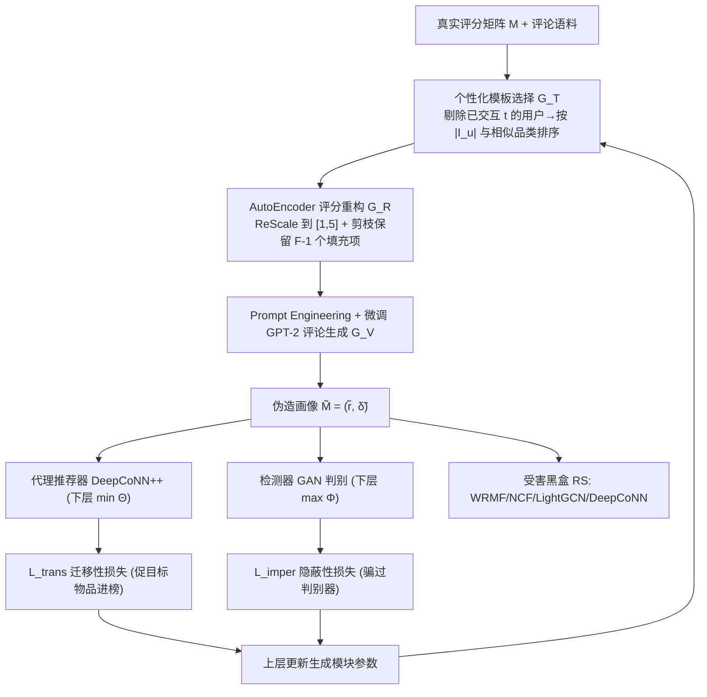
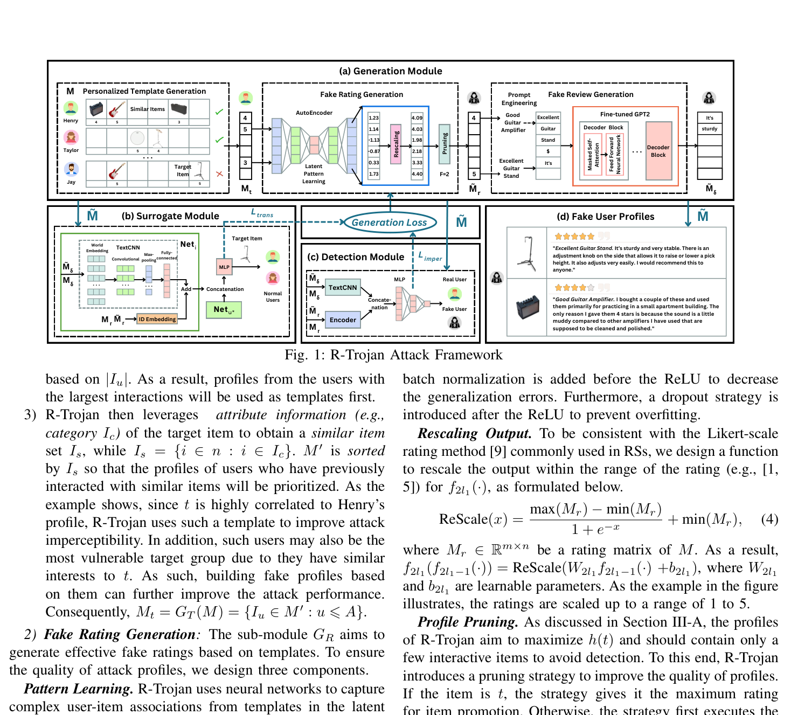

# Review-Incorporated Model-Agnostic Profile Injection Attacks on Recommender Systems (融合评论文本的模型无关画像注入攻击)

- **会议/期刊**: ICDM 2023
- **作者与机构**: Shiyi Yang, Lina Yao, Chen Wang, Xiwei Xu, Liming Zhu (Data61/CSIRO, UNSW, Macquarie University)
- **推荐链路定位**: 数据层——训练期投毒（Profile Injection / Shilling Attack），非召回/精排模块
- **研究方向**: 去偏公平、可信隐私与工业架构（推荐系统鲁棒性与安全） / 多模态推荐（评论文本融合）
- **论文原文**: [https://arxiv.org/abs/2402.09023v1](https://arxiv.org/abs/2402.09023v1)
- **开源代码**: 暂未开源（文中仅引用 HuggingFace Transformers 作为 GPT-2 依赖）

## TL;DR (1分钟核心速览)

现有投毒攻击只能生成纯数值评分画像，在深度推荐器上迁移性差、且极易被伪造画像检测器识别。本文提出 R-Trojan：把商品评论文本作为新的攻击载体，用「个性化模板选择 + AutoEncoder 评分重构 + 微调 GPT-2 评论生成」的生产模块，与「DeepCoNN++ 代理推荐器」和「GAN 判别器」构成双层优化博弈。在 3 个真实数据集、5 个受害推荐器、9 个 SOTA 基线对比下，黑盒 WRMF 上 HR@10 达 0.5530（+15.1%），LightGCN 上最高 +53.8%，且 t-SNE 上伪造画像与真实画像分布高度重叠。

## Background & Motivation (背景与核心矛盾)

- **主流范式**: 投毒攻击从启发式（Random、Bandwagon）演进到 GAN 生成式（DCGAN、AUSH、RecUP、Leg-UP、TrialAttack），用生成器伪造用户画像注入训练集以抬高/压低目标物品曝光。
- **前人局限**: ① 传统启发式与算法特定攻击（PGA 针对矩阵分解）在 NCF/LightGCN 等深度模型上增益近乎消失；② 纯评分画像缺乏语义，检测器仅凭共现模式即可识别，隐蔽性差；③ 追求攻击力而忽略不可见性，实际影响时长受限。
- **核心洞察 (Key Insight)**: 评论比 Likert 评分携带更丰富的用户偏好语义，且评论天然解释了评分理由；**评论型推荐系统（DeepCoNN 类）对伪造评论画像存在未探索的新攻击面**。
- **本文切入点**: 将文本评论纳入画像生成变量，使伪造画像在「评分 + 语义」双通道上与真实画像同分布，从而同时获得跨模型迁移性和检测器逃逸能力。

## Method (核心方法设计)

### 1. 整体框架 (Overall Architecture)

R-Trojan 将攻击建模为**双层优化**：下层用受害者训练集 $\mathbf{M}$与伪造画像$\tilde{\mathbf{M}}$拼接得到的$\mathbf{M}^*$，训练代理推荐器参数$\Theta=\arg\min_\Theta\mathcal{L}_{RS}(\mathbf{M}^*)$与检测器参数$\Phi=\arg\max_\Phi\mathcal{L}_{DE}(\mathbf{M}^*)$；上层固定二者，仅优化$\tilde{\mathbf{M}}$ 以最大化迁移性并最小化可检测性：

$$\min_{\tilde{\mathbf{M}}}\ \lambda\mathcal{L}_{trans}(d_{\mathbf{M}\Theta})+(1-\lambda)\mathcal{L}_{imper}(d_{\tilde{\mathbf{M}}\Phi})$$

生成模块内部为三级流水线：模板选择 $\mathbf{M}_t=G_T(\mathbf{M})$→ 评分重构$\tilde{\mathbf{M}}_r=G_R(\mathbf{M}_t)$→ 评论生成$\tilde{\mathbf{M}}_\delta=G_V(G_R(G_T(\mathbf{M})))$，其中评论生成以「情感 + 商品名」为提示驱动微调后的 GPT-2。

<figure class="paper-figure" markdown="span">
  <figcaption>图1：R-Trojan攻击框架</figcaption>
</figure>

### 2. 关键设计拆解 (Key Designs)

1. **个性化模板选择（Personalized Template Generation）**：随机采样模板会抽出与目标物品 $t$毫无兴趣关联的用户（如给「吉他架」选鼓手画像），一眼可疑。R-Trojan 三步筛选：先剔除已与$t$交互的用户（避免直接泄露），再按交互丰富度$|I_u|$降序，最后按目标物品品类$I_c$的相似物品集$I_s$优先，即$\mathbf{M}_t=G_T(\mathbf{M})=\{I_u\in\mathbf{M}':u\le A\}$。直觉：与$t$兴趣同质的真实用户既是「最难被检测」的伪装来源，也是最容易被$t$ 攻陷的目标群体，一举两得。

2. **评分重构与剪枝（ReScale + Profile Pruning）**：AutoEncoder 输出无界，用类 Sigmoid 拉伸对齐评分量纲 $\mathrm{ReScale}(x)=\frac{\max(\mathbf{M}_r)-\min(\mathbf{M}_r)}{1+e^{-x}}+\min(\mathbf{M}_r)$；剪枝算子给目标物品置最高分，其余物品按重构误差$|d_{\tilde{u}i}-e_{\tilde{u}i}|$保留最小的$F-1$个，其余置零：$\mathrm{Pruning}(d_{\tilde{u}i})=\max(\mathbf{M}_r)$若$i=t$，否则$f_o(d_{\tilde{u}i})\odot f_m(|d_{\tilde{u}i}-e_{\tilde{u}i}|)$。这既保持真实用户的行为模式（含「挑剔用户」的多样性），又维持伪造画像的稀疏性，避免密集画像触发异常检测。

3. **迁移性与隐蔽性损失、训练与推理成本**：$\mathcal{L}_{trans}=\log(\sum_{u\in U_t}\sum_{i\in\hat{I}_u}e^{c(r_{ui}-r_{ut})}+1)$（当$t\notin\hat{I}_u$时，最小化$t$与已推荐物品的预测分差；若已进榜则取常数$C$），$\mathcal{L}_{imper}=\frac{1}{A}\sum_{\tilde{u}\in\tilde{m}}\log(1-DE_\Phi(\tilde{\mathbf{M}}_{\tilde{u}}))$；代理模块用评论文本特征 + ID 嵌入拼接$o_i=\mathrm{TextCNN}_{\theta_1}(\delta_i)+q_i$以缓解少评论冷启问题。下层用 BCE 损失（隐式 Top-K 场景），负采样 1:4，Adam、$\lambda=0.5$；推理只需一次前向生成$A$ 个画像，**无需访问任何受害模型参数或梯度**。

## Experimental Setup & Evaluation Protocol (实验设置与评估协议)

- **数据集与预处理**: 三个真实数据集，未做 `5-core` 过滤，稀疏度 98.57%–99.62%；每条评论用 300 维预训练词向量编码。

| 数据集 | #Users | #Items | #Reviews | 稀疏度 | 特征/场景说明 |
| :--- | :---: | :---: | :---: | :---: | :--- |
| Amazon Musical Instruments | 1,429 | 900 | 10,261 | 99.20% | 乐器垂类，评测集 |
| Amazon Automotive | 2,928 | 1,835 | 20,473 | 99.62% | 汽车配件垂类，最稀疏 |
| Yelp | 1,599 | 1,318 | 30,120 | 98.57% | 本地生活，随机子采样 |

- **数据划分与防穿越 (Splitting Strategy)**: `Leave-One-Out`，每个用户最后一条交互为测试集，剩余按 9:1 划分训练/验证。
- **排名评测协议 (Ranking Protocol)**: `Full-Ranking`（对全体未交互物品打分排序），报告 HR@10 与 NDCG@10；伪造画像评分在注入前被二值化以适配隐式 Top-K 任务，但隐蔽性评估保留原始显式评分。
- **对比基线与超参设置**: 9 个基线（Random、Bandwagon、PGA、DCGAN、AUSH、DLA、RecUP、Leg-UP、TrialAttack）；受害模型含 3 个纯评分黑盒（WRMF、NCF、LightGCN）+ 2 个评论型（DeepCoNN、DeepCoNN++，兼作黑盒/白盒）。默认攻击规模 $A=3\%$用户数，$F$取数据集的平均用户交互数；$l_1=l_2=3$、检测器 2 层、$d_2=d_3=50$、$\lambda=0.5$、dropout 0.5、batch 256、lr 1e-3、20 epochs。

## Key Experimental Results (实验关键数据)

### 1. 主实验对比 (Main Results)

黑盒设置下 HR@10（$A=3\%$；`Improv.` 相对最强基线）：

| 受害 RS | 数据集 | Random | PGA | DCGAN | AUSH | DLA | Leg-UP | TrialAttack | **R-Trojan** | Improv. |
| :--- | :--- | :---: | :---: | :---: | :---: | :---: | :---: | :---: | :---: | :---: |
| WRMF | Musical | 0.2649 | 0.3904 | 0.3599 | 0.3781 | 0.4383 | 0.4681 | 0.4804 | **0.5530** | +15.1% |
| WRMF | Automotive | 0.1137 | 0.1563 | 0.1695 | 0.1698 | 0.2094 | 0.2305 | 0.2284 | **0.2693** | +16.8% |
| WRMF | Yelp | 0.0939 | 0.1082 | 0.1017 | 0.1231 | 0.1276 | 0.1360 | 0.1464 | **0.1852** | +26.5% |
| NCF | Musical | 0.1495 | 0.1633 | 0.1807 | 0.2068 | 0.2525 | 0.2438 | 0.2714 | **0.3382** | +24.6% |
| NCF | Automotive | 0.1043 | 0.1192 | 0.1383 | 0.1650 | 0.1962 | 0.2038 | 0.2187 | **0.2679** | +22.5% |
| NCF | Yelp | 0.0784 | 0.0848 | 0.0965 | 0.0991 | 0.1159 | 0.1328 | 0.1250 | **0.1729** | +30.2% |
| LightGCN | Musical | 0.0602 | 0.0893 | 0.0972 | 0.1110 | 0.1509 | 0.1437 | 0.1357 | **0.1858** | +23.1% |
| LightGCN | Automotive | 0.0340 | 0.0589 | 0.0433 | 0.0634 | 0.1102 | 0.1088 | 0.1009 | **0.1536** | +39.4% |
| LightGCN | Yelp | 0.0136 | 0.0246 | 0.0317 | 0.0415 | 0.0602 | 0.0544 | 0.0512 | **0.0926** | +53.8% |

NDCG@10 同向领先，增益幅度更大：WRMF/Musical 0.2418→**0.3617**（+49.6%），NCF/Yelp 0.0851→**0.1162**（+36.5%），LightGCN/Yelp 0.0359→**0.0560**（+56.0%），说明本文不只把目标物品挤出榜单边缘，而是显著推高其排名位置。

### 2. 消融实验 (Ablation Study)

**说明：原文未提供组件级消融表**（无 `w/o review`、`w/o template` 等受控实验），这是本文最明显的实验短板。下面用同源基线做「代理消融」推算，第 3 行起论文完全缺失：

| 消融代理配置 | WRMF/Musical | WRMF/Automotive | LightGCN/Yelp | 解读 |
| :--- | :---: | :---: | :---: | :--- |
| 完整 R-Trojan | **0.5530** | **0.2693** | **0.0926** | — |
| w/o 评论文本（≈ Leg-UP，同代理+GAN 但纯评分） | 0.4681 (−15.4%) | 0.2305 (−14.4%) | 0.0544 (−41.3%) | 文本模态是单一最大增益源 |
| w/o 个性化模板（≈ TrialAttack，随机模板+代理） | 0.4804 (−13.1%) | 0.2284 (−15.2%) | 0.0512 (−44.7%) | 模板排序贡献与文本模态相当 |
| w/o 检测模块（$\lambda=1$，仅$\mathcal{L}_{trans}$） | 未报告 | 未报告 | 未报告 | 隐蔽性—攻击力的 trade-off 曲线缺失 |
| w/o 代理模块（$A$ 有限下直接攻击） | 未报告 | 未报告 | 未报告 | 与 DLA/AUSH 的对照缺失 |

### 3. 关键实验发现 (Key Findings)

1. **文本模态的增益随受害模型深度递增**：同为「GAN + 代理」框架，Leg-UP → R-Trojan 在 WRMF/Musical 上 HR@10 提升 15.4%，而在 LightGCN/Yelp 上提升 41.3%。原因在于图卷积的邻域聚合让伪造用户的高连接度填充项经 2 跳传播放大，语义一致的评论画像使伪造节点更「融进」正常邻域结构。
2. **代理模型比生成器架构更决定攻击上限**：带代理的 DLA/Leg-UP/TrialAttack 全面优于无代理的 AUSH/RecUP（LightGCN/Automotive：0.1102/0.1088/0.1009 vs 0.0634/0.0735），而专为矩阵分解设计的 PGA 在深度模型上退化到接近 Random（0.0589 vs 0.0340），证实「算法特定毒化 = 零迁移」。
3. **攻击规模呈单调正相关但边际递减**：图 2 显示 $A$ 从 0.5% 增至 3% 时 HR@10 持续上升（白盒 DeepCoNN++ 上曲线最陡），说明评论型推荐器在训练阶段对伪造语义注入几乎无免疫，但论文未给出 3% 以上是否饱和的结论。

## Highlights & Limitations (亮点、对比与审稿批判)

- **与代表作对比 (vs. Prior Work)**: 相比 **Leg-UP**（GAN + 代理模型，但画像仅含评分），本文引入评论文本与个性化模板，在同等 $A$/$F$ 预算下获两位数增益；相比 **TrialAttack**（代理驱动迁移），本文额外加入检测器做 minimax 博弈以换取隐蔽性；相比 **PGA**（针对 MF 定制的梯度毒化），本文完全黑盒，不依赖受害模型结构。
- **可迁移亮点**: ①「按交互丰富度 + 同品类相似度」排序选模板的策略，可直接迁移到推荐系统的**真实用户画像数据增强**与**高质量负样本构造**；② TextCNN 评论特征 + ID 嵌入相加的 `o_i = TextCNN(δ_i) + q_i` 融合，是冷启动/少评论场景下轻量多模态融合的实用范式。
- **审稿级局限批判**: ① **无组件消融**，文本模态、模板策略、检测器的边际贡献无法解耦，结论只能靠跨论文对比推断；② **隐蔽性评估仅靠 t-SNE 定性**，未与工业常用伪造画像检测器（共现异常、图密度异常、评分-评论情感不一致检测）对抗，而本文生成评论由「评分→情感词」硬映射驱动，恰是情感一致性检测的强特征，实战中很可能被轻易识破；③ 生成阶段需微调 GPT-2 并逐画像生成，**攻击时间/算力成本完全未量化**，与「limited resources」的动机自相矛盾；④ $F$、$\lambda$、攻击规模仅单点或单曲线，缺乏敏感性分析；⑤ 作为安全研究未提出任何防御缓解方案。

## Rating (四维评分)

- **方法创新性 (Novelty)**: ⭐⭐⭐⭐ （首次将评论文本作为投毒画像的生成载体，把攻击重构成双层优化 + 三模块 Transformer-GAN，攻击面挖掘有新意但生成器本身为成熟组件拼接）
- **评估协议与实验扎实度 (Protocol & Experiments)**: ⭐⭐⭐ （9 基线 × 5 受害模型 × 3 数据集的黑盒 Full-Ranking 设置较扎实，但缺组件消融、缺统计显著性检验、缺真实检测器对抗）
- **写作与数学规范度 (Clarity & Rigor)**: ⭐⭐⭐ （双层优化与三损失符号统一，但式 (5) 剪枝与式 (13) 分段损失的记号不够严谨，$U_t$、$\hat{I}_u$与$C$ 的作用边界交代模糊）
- **工业落地与复现价值 (Industrial & Practical Value)**: ⭐⭐ （未开源；依赖 GPT-2 微调与逐画像生成，攻击成本高且需大量真实评论语料；其价值主要在防御侧——提示平台需上线「评分-评论情感一致性」与「评论语义邻域异常」双重检测）

