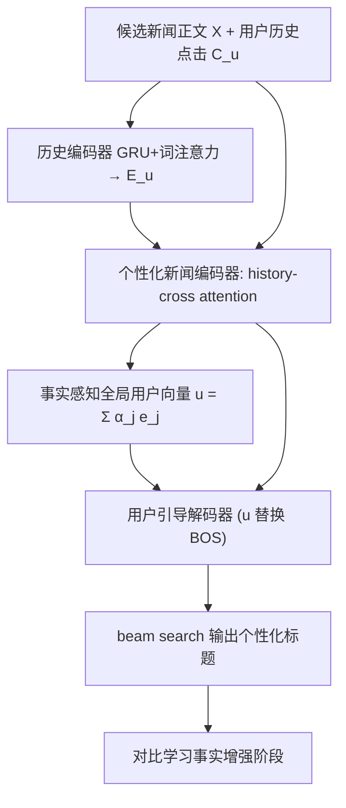
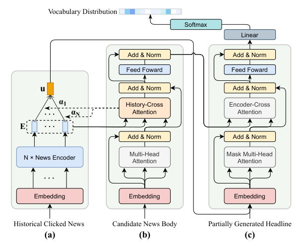

# Fact-Preserved Personalized News Headline Generation (事实保真的个性化新闻标题生成)

- **会议/期刊**: IEEE ICDM 2023 (Short Paper, pp. 1493–1498)
- **作者与机构**: Zhao Yang, Junhong Lian, Xiang Ao — 中科院计算所智能信息处理重点实验室 / 国科大 / 中科院苏州智能计算技术研究院
- **推荐链路定位**: 端到端生成式（曝光侧标题生成，服务于新闻推荐的理由/标题展示）
- **研究方向**: 生成式推荐与离散语义 ID（交叉：LLM/预训练语言模型推荐）
- **论文原文**: [https://arxiv.org/abs/2501.11828v1](https://arxiv.org/abs/2501.11828v1)
- **开源代码**: 暂未开源（仅使用 HuggingFace `facebook/bart-base` 预训练权重）

## TL;DR (1分钟核心速览)

个性化新闻标题生成把用户兴趣向量塞进 encoder-decoder，但强个性化会把历史点击里的人物/事件"写进"候选新闻标题，破坏事实一致性（如把 Justin Rose 的战绩写成 Tiger Woods 的）。FPG 提出"事实感知个性化"：用候选新闻与历史点击的相似度反向加权，只让**语义相关**的历史兴趣参与编码与全局用户向量构造，并额外加入对比学习阶段（正例=高事实准确标题，负例=规则注入事实错误）压制幻觉。在 PENS 基准上，FPG-GRU 取得 ROUGE-1 27.33 / ROUGE-2 10.51 / FactCC 89.26，相对 BART 底座分别提升 4.0% / 6.4% / 3.0%，且未牺牲个性化。

## Background & Motivation (背景与核心矛盾)

- **主流范式**: 内容侧标题生成用 BART/PGN 等 encoder-decoder 做摘要式生成；个性化侧（PENS）在编码器中注入用户 interest embedding，让同一篇新闻对不同用户产出不同标题。
- **前人局限**: 其一，全局用户向量是"固定"的，与当前候选新闻无关，当历史点击与候选新闻不对齐时会把无关事实注入解码器，产生事实漂移；其二，PENS-NAML 类模型 PC 指标很高（3.93）但 FactCC 仅 50.16，说明**个性化分数是靠牺牲忠实度换来的**。
- **核心洞察 (Key Insight)**: 个性化与事实一致性并非零和——真正该被"个性化"的是候选新闻中**与用户历史语义相关的那部分事实**，其余事实应被中性保留；同理，用户表征也应由与候选新闻相关的历史子集加权生成。
- **本文切入点**: 把"候选-历史相似度"同时用作编码器的跨注意力键值和解码器 BOS 位置的用户向量，再用对比学习把"事实正确"当作可优化的属性。

## Method (核心方法设计)

### 1. 整体框架 (Overall Architecture)

FPG 以 BART-base（6 层 encoder/decoder、$d_e=768$、12 头）为骨干，三模块串联：(a) 历史编码器用 GRU + 词级注意力把$N$条点击标题压成新闻级兴趣矩阵$E_u=[e_1,\dots,e_N]$；(b) 个性化新闻编码器在候选新闻正文的自注意力之外插入一层 **history-cross attention**，以正文为 Query、$E_u$为 Key/Value，使正文表征吸收相关历史语义，得到$X^{enc}_p$；(c) 用户引导解码器复用同一层的注意力权重$\alpha_j$构造事实感知全局用户向量$u$，并**直接替换 `[BOS]` token**，让每个解码步都能感知用户，无需改输入格式。训练分四阶段：MLE 预训练 → 冻结 BART 训历史编码器 → 全参数联合 MLE → 对比学习事实增强。

<figure class="paper-figure" markdown="span">
  <figcaption>图2. FPG的框架。新闻编码器和解码器中均包含N层Transformer模块。(a)为历史编码器，(b)为个性化新闻编码器，(c)为用户引导解码器。</figcaption>
</figure>

### 2. 关键设计拆解 (Key Designs)

**设计一：事实感知的 history-cross attention**——痛点：固定用户向量与候选新闻无关。做法是在正文与 $E_u$之间做一次跨注意力，$X_p=\mathrm{Softmax}(Q_h^{\top}K_h/\sqrt{d_e})V_h$，其中$Q_h=X^{\top}H_Q$、$K_h=V_h=E_u^{\top}H_{K/V}$。直觉：只有当历史新闻的语义与正文某片段（如"Tiger Woods""Pebble Beach"）相近时，注意力才会把该历史信息注入，冷门无关的点击被自动抑制。

**设计二：BOS 即用户向量**——痛点：另加个性化 gate 需额外参数并改动解码输入。FPG 直接把 $u=\sum_{j=1}^{N}\alpha_j e_j$作为序列首个位置嵌入，$\alpha_j$ 复用第一层 history-cross attention 的注意力分数。这样用户信息在**每一步解码**都参与 masked self-attention，而权重由候选新闻动态决定，避免"固定用户画像"污染。

**设计三：对比学习事实增强**——痛点：MLE 只优化词级似然而不惩罚"读起来通顺但事实错误"的输出。构造 $\mathcal{D}^*=\{X,C,Y^+,Y^-\}$，正例为事实准确度高的原标题，负例用规则注入实体/数字/关系错误，损失$\mathcal{L}_{CLL}=-\mathbb{E}\log P(y^+|x,c)-\mathbb{E}\log(1-P(y^-|x,c))$；总目标即$\mathcal{L}=\mathcal{L}_{NLL}+\mathcal{L}_{CLL}$（分阶段而非同时优化）。负例构造是"免采样"的规则式难负例，训练仅 1 个 epoch、学习率$1e^{-7}$，推理开销与 BART 完全一致（beam=3）。

## Experimental Setup & Evaluation Protocol (实验设置与评估协议)

- **数据集与预处理**: PENS 基准（Microsoft News 真实点击 + 人工标注个性化标题）。训练采用**距离监督**：用原始标题作为新点击新闻的近似标签；并限制同一新闻最多被 $l=5$个用户点击（记$\mathcal{D}_5$），避免模型只学"大众化新闻"。

| 数据集 | #Users | #Items(news) | #Interactions | 稀疏度/密度 | 特征/场景说明 |
| :--- | :---: | :---: | :---: | :---: | :--- |
| 语料 C（预训练，剔除候选用文） | — | 99,598 | — | — | 仅新闻正文，防泄漏 |
| $\mathcal{D}_5$（训练） | 31,152 | 10,651 | 38,134 | 极稀疏 | 每新闻≤5 用户 |
| $\mathcal{D}^*$（对比学习） | 5,875 | 6,346 | 6,346 | 1:1 正负例 | 规则注入事实错误 |
| $\mathcal{D}_T$（测试） | 103 | 3,840 | 20,599 | — | 每人 50 条兴趣新闻 + 200 篇待拟标题新闻 |

- **数据划分与防穿越 (Splitting Strategy)**: **给定的用户级划分 + 冷启动式构造**——测试集 103 位标注者构建独立 clickstream；预训练语料显式剔除训练/测试候选新闻，防止标题"抄原文"。
- **排名评测协议 (Ranking Protocol)**: 非检索式排序，采用生成式三轨指标：个性化 $\mathrm{PC}(max)=\max_{c\in C_u}\mathrm{sim}(c,y)$与$\mathrm{PC}(avg)$（与历史点击标题的余弦相似度均值/最大值）；事实一致性 FactCC（弱监督 BERT 判别器）；覆盖度 ROUGE-1/2/L F1（beam=3 解码）。
- **对比基线与超参设置**: 8 个基线，涵盖非个性化（PGN、PG+Transformer、Transformer、BART）与个性化（PENS-NPA / EBNR / NRMS / NAML）；$d_e=768$、$N=6$、AdamW（$\beta_1=0.9,\beta_2=0.99$），四阶段学习率$3e^{-5}/1e^{-4}/3e^{-5}/1e^{-7}$，单卡 V100。未报告显著性检验。

## Key Experimental Results (实验关键数据)

### 1. 主实验对比 (Main Results)

| 方法 | PC(avg) | PC(max) | FactCC | ROUGE-1 | ROUGE-2 | ROUGE-L |
| :--- | :---: | :---: | :---: | :---: | :---: | :---: |
| PGN | 2.71 | 16.20 | 65.08 | 19.86 | 4.76 | 18.83 |
| PG+Transformer | 2.66 | 16.99 | 53.26 | 20.64 | 4.03 | 18.62 |
| Transformer | 2.70 | 16.36 | 61.61 | 19.54 | 4.72 | 16.36 |
| BART | 2.72 | 17.13 | 86.67 | 26.27 | 9.88 | 22.85 |
| PENS-NRMS | 3.52 | 21.66 | 50.73 | 21.35 | 4.22 | 19.18 |
| PENS-NAML | **3.93** | **22.73** | 50.16 | 22.81 | 4.90 | 19.65 |
| FPG-SA | 2.89 | 17.20 | 89.20 | 27.13 | 10.39 | 23.09 |
| FPG-CNN | 2.88 | 17.20 | 89.29 | 27.20 | 10.41 | 23.15 |
| **FPG-GRU** | 2.88 | 17.27 | **89.26** | **27.33** | **10.51** | **23.30** |
| **Improv. vs BART** | +5.9% | +0.8% | +3.0% | +4.0% | +6.4% | +2.0% |

### 2. 消融实验 (Ablation Study)

原文未提供严格的 `w/o` 组件消融，仅给出历史编码器替换变体与底座对照，据此归纳：

| 配置 | PC(avg) | FactCC | ROUGE-1 | ROUGE-2 | 说明 |
| :--- | :---: | :---: | :---: | :---: | :--- |
| BART（无个性化/无对比学习） | 2.72 | 86.67 | 26.27 | 9.88 | 事实强、个性化弱 |
| FPG-SA（自注意力替 GRU） | 2.89 | 89.20 | 27.13 | 10.39 | 与 GRU 差 ≤0.2 |
| FPG-CNN（CNN 替 GRU） | 2.88 | 89.29 | 27.20 | 10.41 | 同上 |
| FPG-GRU（完整） | 2.88 | 89.26 | 27.33 | 10.51 | 序列建模略优 |

### 3. 关键实验发现 (Key Findings)

1. **事实一致性是可"免费"提升的**：FPG 三个变体 FactCC 均在 89.2 以上，比 BART 高 2.6 个点、比所有 PENS 个性化基线高 **+39 点**（50.16→89.26），说明"用候选-历史相似度筛历史"与"对比学习负例"确实压制了实体级幻觉，且 ROUGE-1 同步上涨而非掉点。
2. **历史编码器的结构不敏感**：FPG-CNN/SA/GRU 的 FactCC 差 0.09、ROUGE-1 差 0.20，说明收益主要来自 cross-attention 与对比学习，而非序列编码器的选择，工程上可自由替换。
3. **PC 指标存在"指标陷阱"**：PENS-NAML 的 PC(avg) 3.93 显著高于 FPG 2.88，但 FactCC 仅 50.16——绝对值上所有模型的余弦相似度都低于 4/100，说明生成标题与历史点击标题几乎无字面重叠，PC 更像是"是否泄漏历史实体"的代理指标，而非真正的个性化度量。

## Highlights & Limitations (亮点、对比与审稿批判)

- **与代表作对比 (vs. Prior Work)**: 与 PENS（NAML/NRMS 注入固定用户向量）相比，FPG 的用户表征是**候选条件化**的；与 BART/PGN 等纯内容摘要相比，FPG 在几乎不损失 ROUGE 的前提下补齐了个性化通道；与 CLIFF / QA-based 事实增强（Nan et al., ACL'21）相比，其对比学习负例来自规则扰动而非 QA 反事实，成本更低但覆盖面受限。
- **可迁移亮点**: ①"用一个跨注意力层的注意力权重同时充当编码器门控与解码器 BOS 条件"，可零参数增量地移植到任意条件生成推荐（商品描述/推荐理由生成）；②"推理用底座、训练加对比阶段"的分阶段范式，线上零额外延迟。
- **审稿级局限批判**: ①**评测缺口**：测试集仅 103 位标注者、候选-历史相似度绝对值极低，且缺乏人工评分的个性化/忠实度一致性检验（如 Cohen's κ），"tradeoff 已达成"的结论证据偏弱；②**方法缺口**：无正式 `w/o` 消融隔离对比学习与 cross-attention 的贡献，FactCC 训练数据与评测模型同源（BERT 系弱监督判别器）存在自我强化风险；③当候选新闻与全部历史均不相关时，$\alpha_j$ 退化为近似均匀权重，文中亦承认此为失效场景。

## Rating (四维评分)

- **方法创新性 (Novelty)**: ⭐⭐⭐⭐ （"相似度门控 + BOS 即用户向量"设计轻巧且直击个性化-忠实度矛盾，但跨注意力与对比学习均为已有组件的组合创新）
- **评估协议与实验扎实度 (Protocol & Experiments)**: ⭐⭐⭐ （三轨指标设计有想法，但测试用户仅 103 人、无显著性检验、无组件级消融，且未做人工评估）
- **写作与数学规范度 (Clarity & Rigor)**: ⭐⭐⭐⭐ （公式与算法流程清晰，符号统一，6 页短文信息密度高；对 $\alpha_j$ 复用同一层的说明略欠严谨）
- **工业落地与复现价值 (Industrial & Practical Value)**: ⭐⭐⭐⭐ （仅依赖 BART-base，推理零额外开销，可直接嵌入新闻推荐曝光位；但 PENS 数据非公开全量、代码未开源，复现成本偏高）

