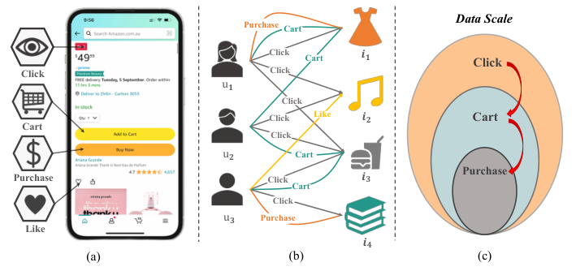
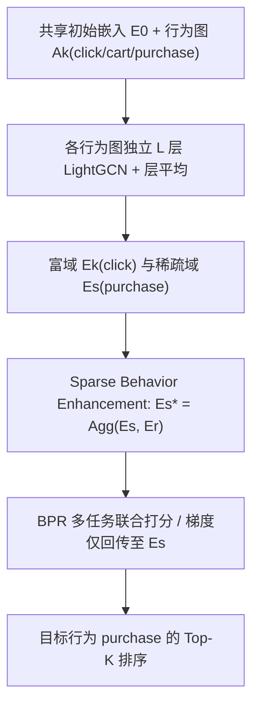
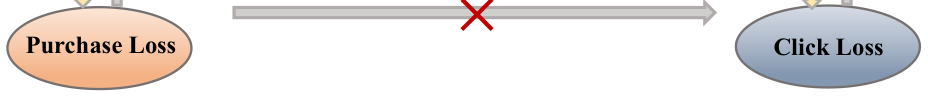

# Alleviating Behavior Data Imbalance for Multi-Behavior Graph Collaborative Filtering (缓解多行为图协同过滤中的行为数据失衡)

- **会议/期刊**: ICDM 2023 (Workshop)
- **作者与机构**: Yijie Zhang, Yuanchen Bei, Shiqi Yang, Hao Chen, Zhiqing Li, Lijia Chen, Feiran Huang（暨南大学、浙江大学、香港理工大学、华南农业大学、广东金融学院）
- **推荐链路定位**: 召回/精排之间的协同过滤打分（目标行为 = purchase）
- **研究方向**: 图神经网络与知识图谱推荐 / 多任务学习与列表级重排
- **论文原文**: [https://arxiv.org/abs/2311.06777v1](https://arxiv.org/abs/2311.06777v1)
- **开源代码**: [Beibei-dataset 数据处理仓库](https://github.com/Sunscreen123/Beibei-dataset)（仅数据集脚本，模型代码暂未开源）

## TL;DR (1分钟核心速览)

真实电商平台中点击/加购/购买的数据量相差一个数量级，而主流图协同过滤只在一张（通常是点击）行为图上传播消息，MMOE 类多任务方案又把结果交给海量负样本去"对齐"，稀疏的购买任务几乎学不到正样本结构。IMGCF 为每种行为单独建图跑 LightGCN 构成多任务骨架，再把数据丰富的点击域表征以**无参数聚合**注入购买域，并用**梯度路径隔离**防止稀疏任务反噬富域参数。在 Beibei/Taobao 的随机 80/20 划分、Recall@20/NDCG@20 全库评测下，相对 MMOE 分别提升 22.84%/26.62% 与 35.84%/49.09%。

## Background & Motivation (背景与核心矛盾)

- **主流范式**: 以 LightGCN 为代表的 GCF 在单张用户-物品二部图上做 $L$ 层归一化邻接传播并做层平均，多任务侧则以 MMOE 共享底层 + 多门控专家建模各行为任务。
- **前人局限 1（单域建模）**: 现有 GCF 默认只取点击图，cart/purchase 这类强转化信号被丢弃，而它们恰恰决定购买预测的天花板。
- **前人局限 2（正样本失衡被负样本掩盖）**: MMOE/ESSM 靠"每种行为都喂正负样本"来保证任务可训，但负样本并不代表用户真实负反馈；更关键的是图传播只走交互边，稀疏域连邻居结构都稀疏到无法完成有效消息传递。
- **核心洞察 (Key Insight)**: 稀疏域缺的不是"训练轮数"而是**结构先验**；富域已经学到高质量的用户/物品几何结构，把它当作稀疏域表征的上下文比继续采样负样本更划算。
- **本文切入点**: 零参数跨域表征聚合 + 隔离梯度回传路径，两处改动合计不足十行算子。

<figure class="paper-figure" markdown="span">
  <figcaption>图1. 真实平台中用户的多行为及多行为数据规模不平衡现象示意图。</figcaption>
</figure>

## Method (核心方法设计)

### 1. 整体框架 (Overall Architecture)

模型对 $K$种行为各建一张二部图$\mathbf{A}_k=\begin{bmatrix}0 & \mathbf{R}_k\\ \mathbf{R}_k^{\top} & 0\end{bmatrix}$，共享同一初始嵌入$\mathbf{E}^{(0)}$，各自传播$L$层并做层平均得到$\mathbf{E}_k$，每种行为作为一个任务用 BPR 独立优化。前向时，稀疏域（purchase）的表征不直接用$\mathbf{E}_s$，而是与富域（click）表征聚合为$\mathbf{E}_{s^*}$后再参与打分，从而"借用"富域结构；反向时只用聚合前的$\mathbf{E}_s$ 承接稀疏任务梯度，切断污染富域的路径。推理阶段仅需一次前向传播，无额外在线开销。

<figure class="paper-figure" markdown="span">
  <figcaption>图2. IMGCF 的整体架构，以数据规模丰富的点击行为图和规模稀疏的购买行为图为例。</figcaption>
</figure>

### 2. 关键设计拆解 (Key Designs)

1. **多行为分层表征（共享初始嵌入的 LightGCN 塔）**：痛点是不共享嵌入时不同行为图的坐标系无法对齐、跨域聚合就退化为噪声相加。做法是第 $l$层传播$\mathbf{E}_k^{(l+1)}=\tilde{\mathbf{A}}_k\mathbf{E}_k^{(l)}$，$\mathbf{E}_k^{(0)}=\mathbf{E}$，再取$\mathbf{E}_k=\frac{1}{L+1}\sum_{l=0}^{L}\mathbf{E}_k^{(l)}$。共享$\mathbf{E}^{(0)}$ 使得 click 与 purchase 的节点表示处于同一潜空间，后续拼接/平均才有语义。

2. **稀疏行为增强 SBE（Sparse Behavior Enhancement）**：痛点稀疏域交互边太少，$L$层传播后连自身邻居都覆盖不全。核心算子仅一行：$\mathbf{E}_{s^*}=\mathrm{Agg}(\mathbf{E}_s,\mathbf{E}_r)$，$\mathrm{Agg}\in\{\text{mean-pooling},\text{Concat}\}$，无任何可学习参数。物理直觉是把富域学到的"共现几何"直接当作稀疏域的归纳偏置，等价于用数据量换结构正则。

3. **梯度路径隔离与联合优化**：若 $\mathcal{L}_s$的梯度经由$\mathbf{E}_{s^*}$回传，富域表征会被极端稀疏的购买信号带偏。因此参数更新改为$\mathbf{E}_{s'}=\mathbf{E}_{s}-\eta\frac{\partial\mathcal{L}_s}{\partial\mathbf{E}_s}$，即用聚合**前**的$\mathbf{E}_s$ 承接梯度。总损失为各任务 BPR 之和：
$$\mathcal{L}=\sum_{k=1}^{K}\mathcal{L}_k,\quad \mathcal{L}_k=-\!\!\sum_{(u,i)\in\mathcal{O}_k^{+},(u,j)\notin\mathcal{O}_k^{+}}\!\!\ln\sigma(\hat{y}^{k}_{ui}-\hat{y}^{k}_{uj}),\ \hat{y}^{k}_{ui}=(\mathbf{e}^{k}_{u})^{\top}\mathbf{e}^{k}_{i}$$
负采样为 BPR 常规均匀采样（未使用难负样本或免采样方案）；推理为点积 Top-K，额外开销仅为 $K$套图嵌入的存储$O(KL|\mathcal{V}|d)$。

## Experimental Setup & Evaluation Protocol (实验设置与评估协议)

- **数据集与预处理**: 过滤交互数 < 20 的冷启动节点，行为包含 click / cart / purchase 三类。

| 数据集 | #Users | #Items | #Click | #Cart | #Purchase | 稀疏度/场景说明 |
| :--- | :---: | :---: | :---: | :---: | :---: | :--- |
| Beibei | 21,716 | 7,977 | 2,412,586 | 642,622 | 304,576 | 购买/点击 ≈ 12.6%，母婴电商 |
| Taobao | 9,773 | 11,268 | 389,632 | 19,145 | 22,115 | 购买/点击 ≈ 5.7%，更极端失衡 |

- **数据划分与防穿越**: 随机划分 `80% 训练 / 20% 测试`（非全局时间戳切分，存在轻度信息穿越风险）。
- **排名评测协议**: 以 Recall@20 / NDCG@20 汇报目标行为 purchase 的排序质量；原文未明确候选集规模与训练负采样比例，按该类工作惯例应为全库未交互排序（`Full-Ranking`），但该细节缺失构成复现性缺口。
- **对比基线与超参设置**: MF-BPR、LightGCN、MMOE(LightGCN 输入)共 3 个基线；$d=64$、batch=2048、lr=0.001、Adam；未报告显著性检验。

## Key Experimental Results (实验关键数据)

### 1. 主实验对比 (Main Results)

| Model | Beibei R@20 | Beibei N@20 | Taobao R@20 | Taobao N@20 |
| :--- | :---: | :---: | :---: | :---: |
| MF-BPR | 0.1004 | 0.0733 | 0.0021 | 0.0014 |
| LightGCN | 0.1250 | 0.0938 | 0.0125 | 0.0065 |
| MMOE | 0.1261 | 0.0943 | 0.0226 | 0.0110 |
| **IMGCF (Ours)** | **0.1549** | **0.1194** | **0.0307** | **0.0164** |
| Improv. vs best baseline | +22.84% | +26.62% | +35.84% | +49.09% |

### 2. 消融实验 (Ablation Study)

| 变体 | Beibei R@20 | Beibei N@20 | Taobao R@20 | Taobao N@20 |
| :--- | :---: | :---: | :---: | :---: |
| IMGCF-w/o SBE | 0.1464 | 0.1111 | 0.0207 | 0.0090 |
| IMGCF-Concat | 0.1472 | 0.1129 | **0.0445** | **0.0220** |
| IMGCF-Mean（正文） | **0.1549** | **0.1194** | 0.0307 | 0.0164 |

### 3. 关键实验发现 (Key Findings)

1. **SBE 是主要增益来源，且在越稀疏的域越关键**：去掉 SBE 后 Beibei Recall 仅降 5.5%（0.1549→0.1464），而 Taobao 上暴跌 32.6%（0.0307→0.0207）、NDCG 降 45.1%（0.0164→0.0090），说明购买/点击比越低（5.7% vs 12.6%），跨域注入的边际价值越大。
2. **聚合算子与数据密度强相关，且与正文结论自相矛盾**：较稠密的 Beibei 上 mean-pooling 优于 Concat（+5.2%/+5.8%），但更稀疏的 Taobao 上 Concat 反而大幅反超 mean（0.0445 vs 0.0307，+45%）；作者仍以 mean 版本作为最终 IMGCF 汇报，主表结论稳健性存疑。
3. **"多任务骨架"与"跨域增强"是两级叠加而非替代**：LightGCN→MMOE 在 Taobao Recall 上已获 +80.8%（0.0125→0.0226），但 MMOE→IMGCF 再增 35.8%/49.1%，证明仅靠多任务共享底层不足以解决失衡，必须显式传递富域表征。

## Highlights & Limitations (亮点、对比与审稿批判)

- **与代表作对比 (vs. Prior Work)**: 相比 MMOE/ESSM 依赖"每任务正负样本对齐"的隐式平衡，IMGCF 直接在图表征空间做显式富→贫迁移；相比 MBGCN/NMTR 这类构建行为感知融合图 + 注意力加权的多行为 GCN，本文只用一个零参数 mean/Concat 加一行梯度改写就取得相近量级收益，工程上更轻。
- **可迁移亮点**: (i) "聚合用 $\mathbf{E}_{s^*}$、回传用$\mathbf{E}_s$"的梯度隔离技巧可平移到任何跨域/跨场景蒸馏式推荐；(ii) 共享$\mathbf{E}^{(0)}$ 保证多图潜空间对齐，是低成本多图联合训练的前提。
- **审稿级局限批判**: (i) 聚合方向单一（仅 click→purchase）、无门控与多阶（click→cart→purchase）链式建模，cart 的作用被弱化成又一个独立任务；(ii) 实验仅 3 个基线、无显著性检验、未交代候选集与负采样协议，且消融中 Concat 在 Taobao 优于正文模型，主结论存在内部不一致；(iii) 每增一种行为即需一整套 $L$层 LightGCN，存储与训练开销随$K$ 线性增长，工业落地需先做行为剪枝。

## Rating (四维评分)

- **方法创新性 (Novelty)**: ⭐⭐⭐ （核心机制是零参数跨域聚合 + 梯度路径隔离，想法简洁有效但缺乏理论/谱分析支撑，属工程型增量）
- **评估协议与实验扎实度 (Protocol & Experiments)**: ⭐⭐ （仅 3 个基线、无显著性检验、划分/候选集协议交代不全，消融结果还与主表结论冲突）
- **写作与数学规范度 (Clarity & Rigor)**: ⭐⭐⭐ （公式与符号简洁清晰、推导无错，但缺少复杂度分析与聚合算子的选择准则）
- **工业落地与复现价值 (Industrial & Practical Value)**: ⭐⭐⭐ （改动极小、推理零额外开销、易插入现有 LightGCN 系统，但仅开源数据处理脚本、模型代码缺失，多行为存储成本随 $K$ 线性增长）

