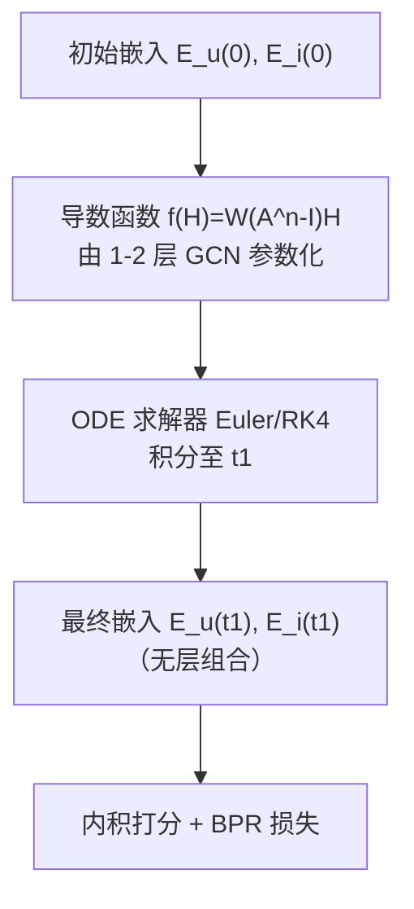
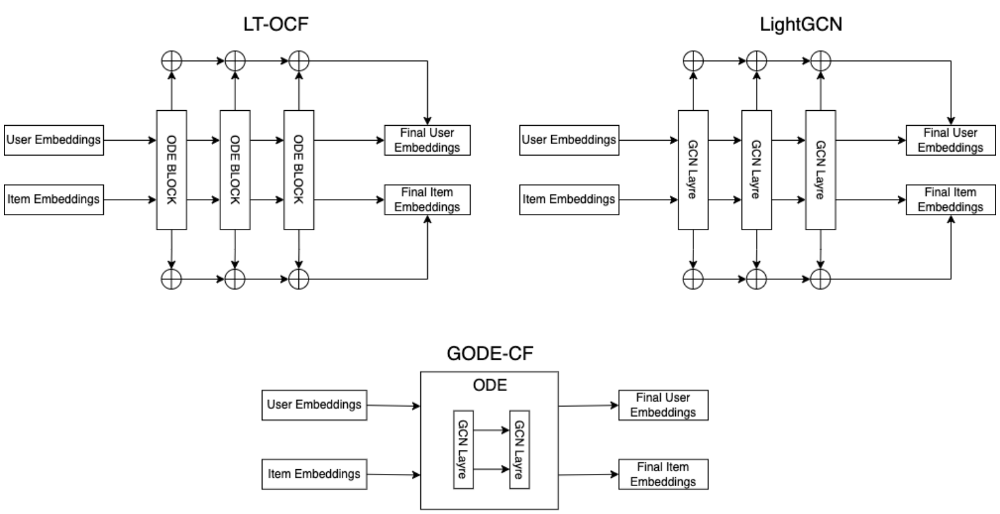

# Graph Neural Ordinary Differential Equations-based method for Collaborative Filtering (基于图神经常微分方程的协同过滤方法)

- **会议/期刊**: ICDM 2023
- **作者与机构**: Ke Xu, Yuanjie Zhu, Weizhi Zhang, Philip S. Yu（University of Illinois Chicago）
- **推荐链路定位**: 召回（用户/物品表征学习）
- **研究方向**: 图神经网络与知识图谱推荐 / 协同过滤与双塔召回
- **论文原文**: [https://arxiv.org/abs/2311.12329v1](https://arxiv.org/abs/2311.12329v1)
- **开源代码**: 暂未开源

## TL;DR (1分钟核心速览)

本文针对 LightGCN 类线性图卷积"层数堆叠即算力堆叠、层组合权重又是额外超参"的痛点，提出 GODE-CF：不建连续消息传递层，而是直接用 **1–2 层 GCN 参数化 ODE 的导数函数** $f(\mathbf{H})=\mathbf{W}(\mathbf{A}^n-\mathbf{I})\mathbf{H}$，用 Euler/RK4 积分到时刻$t_1$ 得到最终嵌入，**取消层组合**。在 4 个 Amazon 5-core 数据集、Leave-One-Out + 全库排序协议下，Recall@20 相对最强基线最高提升 **+11.8%**（Health vs LightGCN），且训练耗时在 3/4 数据集上低于所有基线。

## Background & Motivation (背景与核心矛盾)

- **主流范式**: 协同过滤的 SOTA 是线性 GCN（LightGCN）——去掉非线性与变换矩阵，逐层做归一化邻接传播 $\mathbf{E}^{(k)}=\mathbf{A}^k\mathbf{E}^{(k-1)}$，再对$0..K$ 层做加权层组合。
- **前人局限一（离散层数的两难）**: 层数太少捕获不到高阶协同信号，层数过多则过平滑+参数难优化，实践中收益饱和在 2–3 层，继续堆层反而掉点。
- **前人局限二（LT-OCF 的残留开销）**: LT-OCF 把 GCN 连续化为 CGNN 式 ODE，但仍需切分多个 ODE block、保留各 block 输出的可学习层组合权重 $w_l$与可学习时间点$T$，参数量与调参面并未真正缩减。
- **核心洞察 (Key Insight)**: 线性 GCN 的传播是一个初值问题，$\sum_{i=0}^{n}\mathbf{A}^i\mathbf{H}_0$本质是积分$\int_0^{t_1}(\mathbf{A}-\mathbf{I})\mathbf{H}(t)dt$ 的黎曼和——既然"积分天然等价于所有层之和"，那么**层组合可以整体被一次积分吸收掉**。
- **本文切入点**: 采用 GODE 范式：不必造出 $K$层，只用 1–2 层 GCN 定义导数、让求解器"跳过"中间层直达终态，并把$t_1$ 当作普通超参。

## Method (核心方法设计)

### 1. 整体框架 (Overall Architecture)

输入为用户/物品的初始嵌入 $\mathbf{E}_u(0),\mathbf{E}_i(0)$（$N(0,1)$初始化），二者直接送入 ODE 求解器；导数函数由 1–2 层图卷积构成（用户侧读物品、物品侧读用户，交替耦合），求解器从$t=0$积分到超参$t_1$直接输出最终嵌入，内积打分后以 BPR 损失端到端训练。相对 LightGCN 的"$K$层传播+层组合"与 LT-OCF 的"多 ODE block+层组合"，GODE-CF 只剩一个 ODE block、无层组合系数，前向开销由$t_1$ 与求解器步数而非层数决定。

<figure class="paper-figure" markdown="span">
  <figcaption>图1. LT-OCF、LightGCN 和 GODE-CF 的架构。左图：具有三个 ODE 块的 LT-OCF；右图：具有三层的 LightGCN，L 为层组合；中图：具有两层的 GODE-CF。</figcaption>
</figure>

### 2. 关键设计拆解 (Key Designs)

1. **用 GCN 参数化导数函数，积分替代层堆叠**：痛点是要拿到 $n$阶协同信号必须真的展开$n$层。本文令导数函数为$f(\mathbf{H})=\mathbf{W}(\mathbf{A}^n-\mathbf{I})\mathbf{H}$，只保留$n=1\!\sim\!2$的卷积核与可学习尺度$\mathbf{W}$，终态由
$$\mathbf{E}_u(t_1)=\mathbf{E}_u(0)+\int_0^{t_1}\mathbf{W}(\mathbf{A}^n-\mathbf{I})\mathbf{E}_i(t)\,dt,\quad \mathbf{E}_i(t_1)=\mathbf{E}_i(0)+\int_0^{t_1}\mathbf{W}(\mathbf{A}^n-\mathbf{I})\mathbf{E}_u(t)\,dt$$
给出。直觉：$\mathbf{A}^n-\mathbf{I}$是"邻域减自身"的漂移算子，积分项等价于$\sum_{l}\mathbf{A}^l$的连续和，一次积分即完成了层组合的工作，因此**不需要再学$w_l$**。作者证明当$n=1,\mathbf{W}=\mathbf{I}$ 且用 Euler 时，GODE-CF 退化为 CGNN / 单 block 的 LT-OCF，说明它是更一般的形式。
2. **无层组合 + $t_1$作为可搜超参（含信息量守恒直觉）**：$t_1$承担"总传播深度"的角色。实验发现层数与$t_1$存在互补关系——1 层需更大$t_1$（信息不足，需更长时间积分），2–3 层则需更小$t_1$（信息已接近终态），即**有效感受野由"层数 × 积分时长"共同决定**，把模型容量从"堆层"改为"调时间"后超参更可控、参数更少。
3. **训练目标、求解器与推理开销**：损失沿用 BPR，$\mathcal{L}=-\sum_{(u,i^+)\in\mathcal{O}}\ln\sigma(\hat{y}_{ui^+}-\hat{y}_{ui^-})$，逐样本均匀负采样（每个正样本配 1 个未交互负例），无额外对比/正则项。求解器只测 Euler 与 RK4；梯度经 `torchdiffeq` 反传。Euler 每步仅一次矩阵-嵌入乘法，故$t_1{=}1$ 附近的 Euler 等效于极浅的残差网络，训练成本与 LightGCN 同量级甚至更低。

## Experimental Setup & Evaluation Protocol (实验设置与评估协议)

- **数据集与预处理**: Amazon Reviews 四个类目，按 `5-core` 过滤（用户/物品至少 5 条交互），把评论存在性视为隐式正反馈。原文仅报告交互数与稀疏度，用户数可由"验证/测试各为用户数"反推：

| 数据集 | #Users | #Items | #Interactions(训/验/测) | 稀疏度/密度 | 特征/场景说明 |
| :--- | :---: | :---: | :---: | :---: | :--- |
| Beauty | 22,363 | ≈12.1k（推算） | 153,776 / 22,363 / 22,363 | 0.0734% | 美妆，最稠密 |
| Health | 38,609 | ≈18.5k（推算） | 269,137 / 38,609 / 38,609 | 0.0484% | 健康品，最稀疏 |
| Cell Phone | 27,879 | ≈10.4k（推算） | 138,681 / 27,879 / 27,879 | 0.0668% | 手机配件 |
| Office | 4,905 | ≈2.4k（推算） | 43,448 / 4,905 / 4,905 | 0.4487% | 办公用品，规模最小 |

- **数据划分与防穿越 (Splitting Strategy)**: `Leave-One-Out`——按用户交互时间排序，最后一条作测试、倒数第二条作验证，其余训练；无全局时间戳切分，故不存在跨用户信息穿越。
- **排名评测协议 (Ranking Protocol)**: 标准 `Full-Ranking`（对全库未交互物品打分排序，排除训练正例），报告 Recall@20 与 NDCG@20，对全部用户取平均。
- **对比基线与超参设置**: 基线覆盖非线性 GCN（NGCF）、线性 GCN（LightGCN）、layer-refined（layerGCN）、无限层极限近似（UltraGCN）、图趋势滤波（GTN）与 NODE 系（LT-OCF，Euler/RK4 两版）。统一 $d=128$、学习率 1e-3、初始嵌入$N(0,1)$；GODE-CF 网格搜索层数$n\in\{1,2,3\}$、$t\in\{0.7,\dots,1.0\}$；未做显著性检验。

## Key Experimental Results (实验关键数据)

### 1. 主实验对比 (Main Results)

| Method | Beauty R@20 | Beauty N@20 | Health R@20 | Health N@20 | Cell R@20 | Cell N@20 | Office R@20 | Office N@20 |
| :--- | :---: | :---: | :---: | :---: | :---: | :---: | :---: | :---: |
| NGCF | 0.0708 | 0.0300 | 0.0306 | 0.0123 | 0.0439 | 0.0169 | 0.0510 | 0.0221 |
| layerGCN | 0.0762 | 0.0314 | 0.0245 | 0.0101 | 0.0397 | 0.0151 | 0.0471 | 0.0210 |
| UltraGCN | 0.0566 | 0.0262 | 0.0317 | 0.0135 | 0.0360 | 0.0156 | 0.0469 | 0.0234 |
| GTN | 0.0715 | 0.0306 | 0.0329 | 0.0135 | 0.0456 | 0.0178 | 0.0436 | 0.0203 |
| LightGCN | 0.0778 | 0.0330 | 0.0303 | 0.0120 | 0.0443 | 0.0166 | 0.0565 | 0.0264 |
| LT-OCF (Euler) | 0.0788 | 0.0331 | 0.0302 | 0.0120 | 0.0464 | 0.0174 | 0.0563 | 0.0260 |
| LT-OCF (RK4) | 0.0783 | 0.0332 | 0.0303 | 0.0119 | 0.0456 | 0.0172 | 0.0553 | 0.0256 |
| **GODE-CF (RK4)** | 0.0787 | **0.0335** | **0.0336** | **0.0136** | 0.0485 | 0.0183 | 0.0559 | 0.0252 |
| **GODE-CF (Euler)** | **0.0808** | **0.0341** | **0.0339** | 0.0133 | **0.0508** | **0.0191** | **0.0567** | **0.0270** |
| Improv. (Recall, vs 最强基线) | +3.8% (LT-OCF-E) | +2.6% | +3.1% (GTN) / +11.8% (LightGCN) | +0.4% | +11.4% (GTN) | +7.3% | +0.4% (LightGCN) | +2.5% |

### 2. 消融实验 (Ablation Study)

| 变体 | Beauty R@20 | Health R@20 | Cell R@20 | Office R@20 | 说明 |
| :--- | :---: | :---: | :---: | :---: | :--- |
| 1 层 | 0.0753 | 0.0290 | 0.0420 | 0.0565 | 信息不足以约束终态 |
| **2 层** | **0.0808** | **0.0339** | **0.0508** | 0.0567 | 四个数据集一致最优 |
| 3 层 | 0.0792 | 0.0312 | 0.0476 | **0.0577** | 除 Office 外均过拟合 |
| Euler（w/o 权重 $\mathbf{W}$） | 0.0808 | 0.0340 | 0.0506 | 0.0559 | Beauty/Health/Cell 略优 |
| Euler（w/ 权重 $\mathbf{W}$） | 0.0803 | 0.0336 | 0.0508 | 0.0567 | Office 明显受益 |
| RK4 求解器 | 0.0787 | 0.0336 | 0.0485 | 0.0559 | 全面逊于 Euler |

### 3. 关键实验发现 (Key Findings)

1. **低阶求解器反而更准**：Euler 在四个数据集上全部优于 RK4（Cell Phone 0.0508 vs 0.0485，+4.7%；Beauty +2.6%），且收敛 epoch 更少。作者归因于 RK4 的高阶近似等价于更"深"的网络、在稀疏交互图上更容易拟合训练噪声——这直接颠覆了"高阶求解器更精确"的常识假设。
2. **"层数×积分时长"存在补偿效应**：2 层 + 较大 $t$与 3 层 + 较小$t$可达到相近精度，说明$t_1$是可替代层数的连续容量旋钮；但两者都在某个$t$ 处出现精度陡降后回升，作者未解释，构成超参鲁棒性隐患。
3. **精度提升伴随训练提速**：统一 1000 epoch、含验证耗时下，GODE-CF(Euler) 在 Beauty/Health/Cell/Office 上分别耗时 35/80/36/7 分钟，快于 LT-OCF(Euler) 的 48/115/48/8 分钟、LT-OCF(RK4) 的 98/263/94/13 分钟，亦快于 LightGCN 的 40/84/42 分钟（Beauty/Health/Cell），是唯一"又快又准"的配置；但 Office 上仅 +0.4%，增益处于噪声量级。

## Highlights & Limitations (亮点、对比与审稿批判)

- **与代表作对比 (vs. Prior Work)**: ①vs **LightGCN**：把"$K$层传播 +$K{+}1$ 个层组合权重"压成"1 个 ODE block + 1 个积分时长"，参数量与调参面同时下降；②vs **LT-OCF**：LT-OCF 仍是"多个 ODE block + 层组合 + 可学习中间时间点"的连续版 LightGCN，本文彻底去掉层组合，仅保留单次积分，故训练快 27%–30%；③vs **UltraGCN**：UltraGCN 用无限层极限近似绕开消息传递，本文则用连续积分"精确地跳过"中间层，二者思路互补但本文保留了显式图传播算子。
- **可迁移亮点**: (a) 把"层组合"识别为"积分"从而消融掉组合权重的做法，可迁移到任何线性传播模型（如简化 GCN、SVD 型召回）以省去层数网格搜索；(b) "低阶求解器更抗过拟合"的经验可作为 NODE 类推荐的默认配置基线，避免默认上 RK4 带来的额外 2–4 倍训练成本。
- **审稿级局限批判**: ①评估面偏窄：仅 4 个 Amazon 类目、仅报 N=20 的 Recall/NDCG，无全 N 曲线、无稀疏/长尾分桶、无显著性检验，Office 上 +0.4% 的提升缺乏统计支撑；②理论刻画薄弱：文中未给出积分与 $n$层卷积之间的误差界，$t$的精度"陡降后回升"现象被明确留作 future work，说明超参敏感性未解决；③实现细节缺失：ODE 步长$h$、积分区间离散化方式、反向传播的伴随法/离散梯度选择、单 epoch 复杂度均未报告，"更快"的证据仅来自墙钟时间而非 FLOPs 或参数量对比；④表格中首个基线误标为 "NDCG"（应为 NGCF），且未说明是否复现或引用原论文数值。

## Rating (四维评分)

- **方法创新性 (Novelty)**: ⭐⭐⭐ （用"积分吸收层组合"的视角统一 CGNN/LT-OCF 并做减法，思路干净但本质是 GODE 在 CF 上的直接应用，缺少新的理论结果）
- **评估协议与实验扎实度 (Protocol & Experiments)**: ⭐⭐⭐ （5-core + Leave-One-Out + 全库排序协议规范、7 个强基线齐全、含效率与多组消融，但仅单一数据源、无显著性检验与分桶分析）
- **写作与数学规范度 (Clarity & Rigor)**: ⭐⭐⭐ （公式 15 与退化关系的推导清晰，但符号 $\mathbf{W}$、$n$的作用边界模糊，$t$ 异常现象未解释，表格存在基线名误标）
- **工业落地与复现价值 (Industrial & Practical Value)**: ⭐⭐⭐⭐ （代码未开但结构极简，Euler + 单 block 可直接嵌入现有 LightGCN 召回管线，实测训练时间下降且精度不降，工程迁移成本低）

