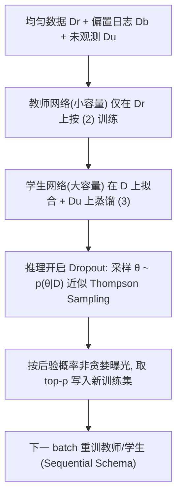

# Epsilon non-Greedy: A Bandit Approach for Unbiased Recommendation via Uniform Data (ε 非贪婪：基于均匀数据的无偏推荐 Bandit 方法)

- **会议/期刊**: ICDM 2023
- **作者与机构**: S.M.F. Sani, Seyed Abbas Hosseini, Hamid R. Rabiee (Sharif University of Technology)
- **推荐链路定位**: 召回（打分/曝光策略，含训练数据生成闭环）
- **研究方向**: 强化学习与动态探索推荐 / 去偏与可信推荐
- **论文原文**: [https://arxiv.org/abs/2310.04855v1](https://arxiv.org/abs/2310.04855v1)
- **开源代码**: [https://github.com/FeyzabadiSani/Epsilon-nonGreedy/](https://github.com/FeyzabadiSani/Epsilon-nonGreedy/)（论文中声明接收后公开）

## TL;DR (1分钟核心速览)

连续训练导致的自我反馈闭环偏差（self-feedback loop）使模型越训越偏。已有去偏工作只关心"估出无偏参数 $\theta$"，却忽略了一个事实：**模型这一轮推荐了什么，就决定了下一轮的训练数据长什么样**。本文提出 EnG：用少量均匀曝光数据训练小容量教师网络，通过蒸馏项在未观测集$\mathcal{D}_u$上约束大容量学生网络获得无偏估计（ε 分量）；再在推理期开启 Dropout 近似后验采样，做 Thompson Sampling 式非贪婪曝光（non-greedy 分量）。同时给出一个分$M$批、每批只保留 top-$\rho$ 曝光的**序贯训练范式**来模拟真实闭环。在 Coat/YahooR3 的均匀留出评估上，序贯范式下 AUC 相对最强基线提升 8.1% 与 5.2%，引入 TS 后单模型最高相对提升 15.0%。

## Background & Motivation (背景与核心矛盾)

- **主流范式**: 两条线并行——① 去偏方法：用 IPS 重加权或借助少量均匀曝光数据（epsilon-greedy、知识蒸馏 Bridge/Refine、AutoDebias 元学习、DUB 上界）学无偏 $\hat{\theta}$；② 不确定性感知方法：把推荐看作 contextual bandit，用 LinUCB / Thompson Sampling / Dropout-Bayesian 主动探索低置信物品。
- **前人局限**: 去偏方法在推荐阶段仍按 $\arg\max_a \mathbb{E}[r{=}1|a,c]$ 贪婪选品，对"下一轮训练集构成"零考量，闭环偏差原样复现；不确定性方法则把均匀数据的无偏价值完全浪费掉，只靠探索硬扛。
- **核心洞察 (Key Insight)**: 均匀数据天然无偏但量极少、方差大，无法直接训高容量网络；而**未观测集 $\mathcal{D}_u$ 数量巨大且与均匀数据同属"未被系统策略污染"的分布**，因此可以当作蒸馏的"自由画布"——让小容量教师在这些位置上给出稳定、低方差的软标签，用其去正则化学生。
- **本文切入点**: 把"无偏估计"（ε）与"生成更好的后续训练数据"（non-greedy）合成一个 teacher-student + Dropout-TS 的统一框架，并配套可复现闭环的序贯评估协议。

## Method (核心方法设计)

### 1. 整体框架 (Overall Architecture)

输入为三份数据：少量均匀曝光集 $\mathcal{D}_r$、大量系统策略日志$\mathcal{D}_b$（$\mathcal{D}=\mathcal{D}_r\cup\mathcal{D}_b$）、以及未观测对$\mathcal{D}_u$。第一阶段仅在$\mathcal{D}_r$上训练一个**小容量**教师网络（$p \ll q$）以获得低方差的无偏先验；第二阶段学生网络在全体$\mathcal{D}$上拟合真实反馈，同时被强制在$\mathcal{D}_u$上逼近教师输出，从而把无偏信息"外扩"到海量无标签位置。推理阶段对学生网络保持 Dropout 开启，多次前向即等价于从$p(\theta|\mathcal{D})$ 抽样，据此非贪婪地产生曝光，并把新曝光写回下一批训练数据，形成闭环。

### 2. 关键设计拆解 (Key Designs)

1. **ε 分量：跨容量教师-学生蒸馏（解决"均匀数据太少撑不起大模型"）**。教师只吃 $\mathcal{D}_r$且容量受限，方差被压住；学生则用教师在海量$\mathcal{D}_u$ 上的预测作为正则锚点：
$\mathcal{L}_s=\frac{1}{|\mathcal{D}|}\sum_{i} l(\hat{r}^s_i,r_i)+\frac{\gamma_{reg}}{|\mathcal{D}_u|}\sum_{j\in\mathcal{D}_u} l_{reg}(\hat{r}^s_j,\hat{r}^t_j)+\lambda_s R(\theta_s)$关键在于$l_{reg}$ 的选择：KL / Jeffreys（对称 KL）因带对数惩罚，比 MAE/MSE 更强地约束两网输出**分布**而非 logit 数值，知识迁移更彻底——实验上 Jeffreys 在两组协议下均为最优或次优。

2. **non-greedy 分量：Dropout 即后验采样（解决"贪婪曝光自我强化"）**。由贝叶斯改写 $p(r{=}1|a,c)=\int p(r{=}1|a,c,\theta)p(\theta|\mathcal{D})d\theta$，把选品准则从"期望收益最大"换成"成为最优臂的后验概率"：
$p(a=a^*|c)=\int \mathbb{I}\big[\mathbb{E}[r|a,c,\theta]=\max_{a'}\mathbb{E}[r|a',c,\theta]\big]\,p(\theta|\mathcal{D})\,d\theta$
积分不可解，故用 Gal & Ghahramani 的结论——推理期 Dropout 等价于从后验抽样，多次前向取最优臂即 TS。训练早期后验平坦 → 广域探索；后期后验收窄 → 回归利用；相比 UCB/bootstrapping 几乎零额外开销。

3. **训练目标、负采样与推理开销**。教师损失 $\mathcal{L}_t=\frac{1}{|\mathcal{D}_r|}\sum_i l(\hat{r}^t_i,r_i)+\lambda_t R(\theta_t)$，$l$取 BCE；总目标即$\mathcal{L}_t+\mathcal{L}_s$分阶段优化（非同时训练，避免 Bridge 式不稳定）。**免负采样**：直接在均匀留出的正负混合样本上做点式 BCE，不做采样 softmax。推理开销为$T$次 Dropout 前向（文中未量化$T$，属隐性成本）。

## Experimental Setup & Evaluation Protocol (实验设置与评估协议)

| 数据集 | #Users | #Items | #Interactions ($|\mathcal{D}_r|$/$|\mathcal{D}_b|$) | 稀疏度/密度 | 特征/场景说明 |
| :--- | :---: | :---: | :---: | :---: | :--- |
| Coat | 290 | 300 | 4,640 / 6,594（比值 0.70） | 稠密、二值化 | 每人先评 24 件自选 + 16 件随机；PR$(\mathcal{D}_r,\mathcal{D}_b)=(0.05,0.09)$ |
| YahooR3 | 15,400 | 1,000 | 54,000 / 311,704（比值 0.17） | 稀疏、二值化 | 常规交互 + 随机选歌打分；PR$=(0.03,0.24)$，均匀/偏置分布差异极大 |

- **数据划分与防穿越**: 均匀数据 $\mathcal{D}_r$三分（20% 训练 / 40% 验证 / 40% 测试），验证与测试**均取自均匀曝光**以保证无偏评估；序贯协议下再把$\mathcal{D}_r^{train}\cup\mathcal{D}_b$均分为$M=20$批，每批只把 top-$\rho$预测结果写回训练集（$\rho=0.25$Coat /$0.1$ YahooR3），每批均匀:偏置 ≈ 5%。
- **排名评测协议**: **非 Full-Ranking**，而是均匀留出集上的点式二分类评估（AUC + BCE），属"无偏留出 + 采样正负混合"协议。
- **对比基线与超参**: Uniform（仅 $\mathcal{D}_r$）、Union（全$\mathcal{D}$）、Bridge、Refine、AutoDebias、DUB，均为可改写为同类损失函数的蒸馏/去偏 SOTA；Embedding 维$d\in\{10,\dots,200\}$，2–3 层 MLP，每层 32–512，教师参数显著少于学生；正则$\lambda,\gamma_{reg}\in[10^{-4},1]$，batch$\in[16,\dots,256]$，早停按验证 BCE；Coat 报 10 次、YahooR3 报 5 次均值（未报告显著性检验）。

## Key Experimental Results (实验关键数据)

### 1. 主实验对比 (Main Results)

**表 1：传统训练协议（Table II）**

| Method | Coat AUC | Coat BCE | YahooR3 AUC | YahooR3 BCE |
| :--- | :---: | :---: | :---: | :---: |
| Uniform | 0.676 | 0.186 | 0.614 | 0.112 |
| Union | 0.749 | 0.204 | 0.631 | 0.279 |
| Refine | 0.774 | 0.209 | 0.765 | 0.325 |
| AutoDebias | 0.779 | 0.242 | 0.748 | 0.103 |
| Bridge | 0.801 | 0.183 | 0.668 | 0.224 |
| DUB | 0.796 | 0.194 | 0.727 | 0.112 |
| **EnG-Jeffrey** | **0.837** | **0.160** | **0.787** | 0.209 |
| Improv. | +4.5% | — | +2.9% | — |

**表 2：序贯训练协议（Table III）**

| Method | Coat AUC | Coat BCE | YahooR3 AUC | YahooR3 BCE |
| :--- | :---: | :---: | :---: | :---: |
| Uniform | 0.594 | 0.281 | 0.547 | 0.114 |
| Union | 0.687 | 0.209 | 0.612 | 0.289 |
| Refine | 0.708 | 0.296 | 0.731 | 0.359 |
| AutoDebias | 0.740 | 0.323 | 0.691 | 0.333 |
| Bridge | 0.737 | 0.280 | 0.653 | 0.226 |
| DUB | 0.644 | 0.207 | 0.646 | 0.128 |
| **EnG-KL** | **0.797** | **0.191** | 0.760 | 0.255 |
| **EnG-Jeffrey** | 0.795 | 0.216 | **0.769** | 0.231 |
| Improv. | +8.1% | — | +5.2% | — |

### 2. 消融实验 (Ablation Study)

**表 3：Thompson Sampling 消融（Table IV，同架构同超参，仅切换曝光采样方式）**

| 变体 | Coat AUC | Coat BCE | YahooR3 AUC | YahooR3 BCE |
| :--- | :---: | :---: | :---: | :---: |
| EnG-MAE | 0.726 | 0.266 | 0.665 | 0.175 |
| **EnG-MAE + TS** | **0.777** (+7.0%) | 0.192 | 0.728 (+9.5%) | 0.105 |
| EnG-MSE | 0.740 | 0.260 | 0.734 | 0.198 |
| **EnG-MSE + TS** | 0.779 (+5.3%) | 0.180 | 0.741 (+1.0%) | 0.116 |
| EnG-KL | 0.740 | 0.268 | 0.763 | 0.216 |
| **EnG-KL + TS** | 0.783 (+5.8%) | **0.110** | 0.768 (+0.7%) | 0.110 |
| EnG-Jeffrey | 0.715 | 0.263 | 0.672 | 0.201 |
| **EnG-Jeffrey + TS** | 0.773 (+8.1%) | 0.190 | **0.773 (+15.0%)** | 0.111 |

其他组件消融以曲线形式给出：均匀数据量 $|\mathcal{D}_r^{train}|/|\mathcal{D}_r|\uparrow$→ AUC 单调上升；$\rho\uparrow$（每批写入更多偏置样本）→ AUC 上升但收益递减；Dropout 率呈**倒 U 形**（Coat 上 BCE 先降后升，YahooR3 偏好低丢弃率）。

### 3. 关键实验发现 (Key Findings)

1. **传统协议显著高估去偏能力，序贯协议才是照妖镜**：切换到 $M=20$ 闭环协议后，所有方法 AUC 齐跌（EnG-KL：0.835→0.797），DUB 在 Coat 上更从 0.796 崩到 0.644、反被 Union 的 0.687 反超——因其"模仿教师预测误差"项在弱教师下变成误导信号。而 EnG 相对优势从 +4.5% 扩大到 +8.1%，说明其收益恰来自"改善后续训练数据构成"，这在传统协议里根本测不出来。
2. **TS 的增益主要体现在数据覆盖而非即时排序**：TS 带来的 BCE 改善（Coat KL 0.268→0.110，降 59%）远大于 AUC 改善（+5.8%）；且分布差异最大的 YahooR3 上 Jeffrey+TS 的 AUC 跃升 15.0%，证明探索把低分但高不确定的物品纳入训练集后缩小了训练/测试分布鸿沟。
3. **均匀数据贫瘠时蒸馏架构的鲁棒性决定胜负**：把均匀训练数据压到 1%、只放大偏置数据，EnG 在 Coat 上与其他 SOTA 拉开最大差距，而 Bridge（师生同步训练）与 DUB 在该设定下 AUC 甚至随偏置数据增多而下降；同时 KL/Jeffreys 稳定优于 MAE/MSE，印证"对数惩罚约束分布比约束 logit 更利于知识迁移"。

## Highlights & Limitations (亮点、对比与审稿批判)

- **与代表作对比 (vs. Prior Work)**: Bridge/Refine（Liu et al., SIGIR'20）只在损失项上做师生标签蒸馏，推荐阶段依旧贪婪；AutoDebias（SIGIR'21）用元学习在均匀数据上学样本权重，不控制后续数据生成；DUB（TOIS'23）给出泛化上界却同样缺乏探索机制。EnG 的本质差异是把"去偏"与"探索"耦合进同一个闭环：无偏估计负责**生成**低偏数据，bandit 探索负责**扩展**数据支撑集。
- **可迁移亮点**: ① 用 $\mathcal{D}_u$（未观测对）作为蒸馏"自由画布"的思路可迁移到任何"无标签数据远多于有标签数据"的去偏/对齐场景；② 推理期 Dropout 实现 TS 的思路成本极低，可直接套到现有 DNN 召回模型上做探索型曝光。
- **审稿级局限批判**: ① **评估协议偏弱**：仅在 290×300 与 15.4k×1k 两个二值化小数据集上做点式 AUC/BCE，既非全库排序，也无真实线上 A/B 或大规模日志，结论外推性存疑，且未与 IPS/DR 类主流去偏基线正面对比；② **假设过强与成本隐忧**：假设单物品曝光、上下文 $c$充分、$\mathcal{D}_u$与$\mathcal{D}_r$同分布，实际推荐是多物品列表曝光；同时推理需$T$次 Dropout 前向（$T$未报告），且严格依赖教师容量$p\ll q$ 与 Dropout 率的设定，超参敏感度高。

## Rating (四维评分)

- **方法创新性 (Novelty)**: ⭐⭐⭐⭐ （将"去偏估计"与"bandit 探索生成数据"统一为闭环，教师-学生在未观测集上蒸馏 + Dropout-TS 的组合简单而自洽）
- **评估协议与实验扎实度 (Protocol & Experiments)**: ⭐⭐⭐ （自提序贯训练范式是亮点，但数据集小、无显著性检验、无全库排序与 IPS 基线对比）
- **写作与数学规范度 (Clarity & Rigor)**: ⭐⭐⭐ （贝叶斯选品准则推导清晰，但损失函数缺乏理论保证/误差界，且多处符号与表格排版粗糙）
- **工业落地与复现价值 (Industrial & Practical Value)**: ⭐⭐⭐ （Dropout-TS 零部署成本、序贯训练范式可直接用作线上闭环仿真沙盒；但需多轮推理与教师网络额外训练开销）

