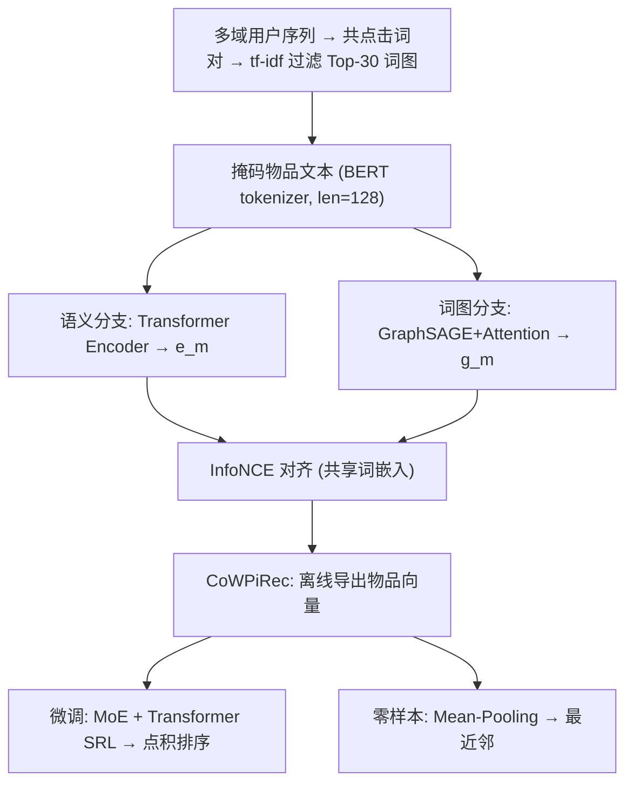
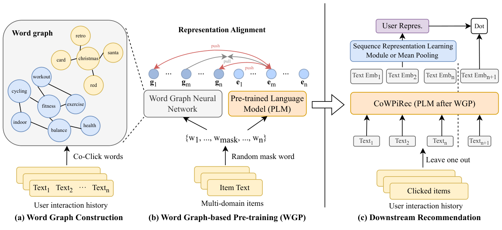
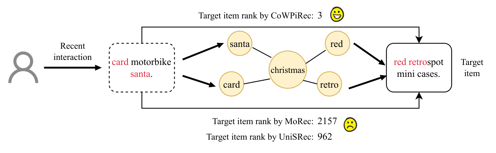

# Collaborative Word-based Pre-trained Item Representation for Transferable Recommendation (基于词级协同预训练的可迁移物品表征)

- **会议/期刊**: ICDM 2023
- **作者与机构**: Shenghao Yang, Chenyang Wang, Yankai Liu 等；清华大学、泉城实验室、中关村实验室、清华-中国移动联合研究院、中国移动研究院
- **推荐链路定位**: 召回（物品表征学习 / 序列召回）
- **研究方向**: 序列与会话推荐 / 跨域与多场景推荐
- **论文原文**: [https://arxiv.org/abs/2311.10501v2](https://arxiv.org/abs/2311.10501v2)
- **开源代码**: [https://github.com/ysh-1998/CoWPiRec](https://github.com/ysh-1998/CoWPiRec)

## TL;DR (1分钟核心速览)

ID 物品表征不可跨域共享，而现有文本表征（PLM）纯语义、丢失协同过滤 (CF) 信号，导致可迁移序列推荐器在稀疏域与冷启动物品上性能受损。本文把物品级交互降维成**词级共点击词图**，用 GraphSAGE + 掩码词对比对齐把 CF 信号灌入 BERT。在 6 个 Amazon/零售数据集、`Leave-One-Out` + `Full-Ranking` 协议下，微调设置 HR@10 相对最强基线 MoRec 提升 +7.67%(Scientific)，零样本设置 Online Retail HR@50 提升 +24.2%。

## Background & Motivation (背景与核心矛盾)

- **主流范式**: 可迁移序列推荐 = 文本 IRL（离线 PLM 物品向量，跨域共享词表）+ 多域预训练的 SRL 序列聚合模块（ZESRec、UniSRec）。
- **前人局限**: ① PLM 全程冻结，只提供语义相似度，而"语义近"≠"推荐相关"（"health" 与 "cycling" 语义远但共点击强）；② MoRec 试图用 item 级 next-item-prediction 联合训练 PLM，但 PLM 的预训练范式是**词级**掩码建模，item 级监督与模型粒度不匹配，收益被抵消。
- **核心洞察 (Key Insight)**: 用户偏好常落在物品文本的**词**上（card/santa → red/retro），因此共点击关系可以在词粒度上被抽取，且天然与 PLM 的建模单元对齐。
- **本文切入点**: 用"词图"作为 CF 知识源，设计词级预训练任务把词图结构蒸馏进 PLM，得到一个"既懂语义又懂协同"的即插即用 IRL 模块。

## Method (核心方法设计)

### 1. 整体框架 (Overall Architecture)

三段式流水线：(a) 从多域用户序列中统计词对共点击并建词图；(b) 对物品文本做 BERT 式掩码，同时送入 Transformer 语义分支与 GraphSAGE 词图分支，用对比损失把两个分支的掩码词表征拉齐（词嵌入参数共享，使 PLM 输出逐渐逼近邻域聚合结果）；(c) 迁移到新域时，用 CoWPiRec 离线导出 `[CLS]` 物品向量：微调设置下接 MoE 白化 + 2 层 Transformer SRL 做点积打分，零样本设置下仅用 mean-pooling 聚合历史物品向量后最近邻检索。

<figure class="paper-figure" markdown="span">
  <figcaption>图1. 我们提出的用于推荐的基于词的协同预训练物品表示（CoWPiRec）总体框架。(a) 词级协同过滤（CF）信号来自词图中词对的共同点击关系。(b) 执行基于词图的预训练（WGP），通过对比学习将PLM与词图的语义相关表示和CF相关表示对齐。wi表示物品文本中的词，gi和ei分别是词图建模和语义建模后的词表示。(c) 当将CoWPiRec迁移到新领域时，物品</figcaption>
</figure>

### 2. 关键设计拆解 (Key Designs)

1. **共点击词图构建（把 item 级 CF 降到 word 级）**：对用户序列中任意两物品文本内的词对 $(w_i,w_j)$统计共点击次数$c_{ij}$，再用 tf-idf 过滤高频泛词、每个词只保留 Top-$N{=}30$ 邻居：
$$tf\text{-}idf_{i,j}=\frac{c_{i,j}}{\sum_{k=1}^{V}c_{i,k}}\cdot\lg\frac{V}{|\{c_{k,j}\mid \forall k,c_{k,j}>0\}|}$$
该式同时抑制"到处都共现"的功能词，保留具有跨域判别力的偏好词（如 health–balance、cycling–indoor）。

2. **词图预训练 WGP（粒度对齐的双分支对比）**：语义分支给出上下文词表征 $e_m$，词图分支用注意力聚合邻居（GraphSAGE，$T{=}1$层）：$g_i=\sigma(\mathbf{W}_g(h_i^{T-1}\oplus h^{T-1}_{\mathcal{N}^*_{w_i}}))$，其中邻居权重$a_j^t=\mathrm{softmax}(\sigma(\mathbf{Q}_g h_j^{t-1})^\top\sigma(\mathbf{K}_g h_j^{t-1}))$。仅对掩码词做 InfoNCE，同句内其他词的图表征作为负样本：
$$\mathcal{L}=-\frac{1}{M}\sum_{m=1}^{M}\log\frac{\exp(\boldsymbol{e}_m\cdot\boldsymbol{g}_m/\tau)}{\sum_{i=0}^{n}\exp(\boldsymbol{e}_m\cdot\boldsymbol{g}_i/\tau)},\quad i\neq m$$
关键在于**词嵌入矩阵与图节点初始嵌入共享**：反传时 $e_m$ 被推向"共点击邻居的聚合"，等价于把 CF 邻接结构写进 PLM 的词向量空间，而无需改动 Transformer 结构。

3. **训练目标、负采样与推理效率**：预训练只用上式对比损失（负样本为 batch 内同句词，免额外采样）；下游微调用标准 next-item 交叉熵 + 全量 softmax。因 CoWPiRec 已含推荐信号，微调阶段**冻结 PLM**、离线缓存全部物品向量，在线只跑 2 层 SRL，成本与 UniSRec 同级；零样本阶段完全无参数训练。

## Experimental Setup & Evaluation Protocol (实验设置与评估协议)

- **数据集与预处理**: 全部 `5-core` 过滤，按时间戳排序；预训练用 5 个 Amazon 域混合，下游用另外 5 个 Amazon 域 + 跨平台 Online Retail。

| 数据集 | #Users | #Items | #Interactions | 密度 | 场景说明 |
| :--- | :---: | :---: | :---: | :---: | :--- |
| Pre-trained (5 域混合) | 1,361,408 | 446,975 | 14,029,229 | ~0.002% | Food/CDs/Kindle/Movies/Home |
| Scientific | 8,442 | 4,385 | 59,427 | 0.16% | 极稀疏，ID 模型重灾区 |
| Pantry | 13,101 | 4,898 | 126,962 | 0.20% | 日杂 |
| Instruments | 24,962 | 9,964 | 208,926 | 0.08% | 乐器 |
| Arts | 45,486 | 21,019 | 395,150 | 0.04% | 手工艺 |
| Office | 87,436 | 25,986 | 684,837 | 0.03% | 办公用品 |
| Online Retail | 16,520 | 3,469 | 519,906 | 0.91% | 跨平台 UK 电商，长序列 |

- **数据划分与防穿越**: `Leave-One-Out`（末位测试、倒数第二位验证、其余训练），严格按用户交互时间序。
- **排名评测协议**: 无偏 `Full-Ranking`（对全库所有物品按点积排序），指标 HR@{10,50}、N DCG@{10,50}，对所有测试用户取均值；微调/零样本两种设定分别报告。
- **对比基线与超参**: ID-IRL（SASRec、BERT4Rec）、文本 IRL（SASRec_T、S³Rec_T、ZESRec_T、UniSRec_T、MoRec_T）；BERT-base-uncased 初始化，词图 Top-30、文本长度 128、掩码 15%(80/10/10)、GNN 1 层、预训练 batch=100/lr=5e-5/30 epoch；下游 batch=2048，$d\in\{64,128,300\}$，MoE 白化网络 8 个，SRL 2 层；配对 t 检验$p\le0.05/0.01$ 标注。

## Key Experimental Results (实验关键数据)

### 1. 主实验对比 (Main Results)

微调设定，HR@10 / NDCG@10（加粗为最优）：

| 数据集 | SASRec | BERT4Rec | S³Rec_T | SASRec_T | ZESRec_T | UniSRec_T | MoRec_T | **CoWPiRec** | Improv. |
| :--- | :---: | :---: | :---: | :---: | :---: | :---: | :---: | :---: | :---: |
| Scientific | 0.1063 | 0.0488 | 0.0897 | 0.1163 | 0.1066 | 0.1124 | 0.1174 | **0.1264** | +7.67% |
| Pantry | 0.0493 | 0.0267 | 0.0393 | 0.0603 | 0.0629 | 0.0646 | 0.0639 | **0.0679** | +5.11% |
| Instruments | 0.1126 | 0.0788 | 0.0996 | 0.1175 | 0.1090 | 0.1087 | 0.1229 | **0.1270** | +3.34% |
| Arts | 0.1074 | 0.0647 | 0.0952 | 0.1078 | 0.1010 | 0.1099 | 0.1101 | **0.1164** | +5.72% |
| Office | 0.1064 | 0.0794 | 0.1085 | 0.1043 | 0.0955 | 0.1046 | 0.1096 | **0.1141** | +4.11% |
| Online Retail | 0.1460 | 0.1343 | 0.1433 | 0.1366 | 0.1320 | 0.1444 | 0.1465 | **0.1515** | +3.41% |
| N@10 (Scientific) | 0.0552 | 0.0243 | 0.0496 | 0.0631 | 0.0582 | 0.0595 | 0.0635 | **0.0664** | +4.57% |

零样本设定（无任何域内训练，HR@10 / HR@50）：

| 数据集 | ZESRec | S³Rec | UniSRec | MoRec | **CoWPiRec** |
| :--- | :---: | :---: | :---: | :---: | :---: |
| Scientific | 0.0519 | 0.0025 | 0.0553 | 0.0481 | **0.0614** (+11.0%) |
| Instruments | 0.0356 | 0.0079 | 0.0299 | 0.0356 | **0.0429** (+20.5%) |
| Online Retail (H@50) | 0.0780 | 0.0421 | 0.0814 | 0.0792 | **0.1011** (+24.2%) |

### 2. 消融实验 (Ablation Study)

原文未给组件级 `w/o` 消融表，下表以已有对照配置反推各组件贡献（同 SRL 骨架下比较 IRL 模块）：

| 配置 | Scientific H@10 | Online Retail H@10 | 移除的要素 |
| :--- | :---: | :---: | :--- |
| SASRec | 0.1063 | 0.1460 | 无文本、无词图（纯 ID） |
| SASRec_T | 0.1163 | 0.1366 | 有语义、无 CF（PLM 冻结） |
| UniSRec_T | 0.1124 | 0.1444 | 有语义 + SRL 多域预训练，仍无词级 CF |
| MoRec_T | 0.1174 | 0.1465 | 有 CF，但为 item 级监督（粒度错配） |
| CoWPiRec 零样本 | 0.0614 | 0.0440 | 去掉 SRL 训练与 MoE（仅 mean-pool） |
| **CoWPiRec 微调** | **0.1264** | **0.1515** | 完整模型 |

### 3. 关键实验发现 (Key Findings)

1. **CF 注入 PLM 比预训练 SRL 更划算**：CoWPiRec 微调时 MoE 与 SRL 均**从零训练**、完全不做 SRL 多域预训练，却在 6/6 数据集上超过做了序列级对比预训练的 UniSRec_T（Scientific 0.1264 vs 0.1124，+12.5%），说明增益主要来自 IRL 模块而非序列侧预训练。
2. **粒度对齐是关键，而非"是否用 CF"**：同样注入 CF，item 级联合训练的 MoRec_T 仅 0.1174，词级对齐的 CoWPiRec 达 0.1264（+7.67%），验证"监督粒度需匹配 PLM 建模单元"这一洞察。
3. **零样本与冷启动物品受益最大**：mean-pooling 零参数下 Online Retail H@50 相对 UniSRec 提升 +24.2%，且图 2 显示冷门物品组 [0,5) 与 [5,10) 的 HR@10 相对 SASRec 提升幅度最高；相反，热域 Office 的 N@10 未显著提升（0.0703 vs SASRec 0.0710），说明词级 CF 主要补足**长尾召回**而非头部精排。

<figure class="paper-figure" markdown="span">
  <figcaption>图3. “Online Retail”数据集中用户的交互历史、我们构建的词图的一个子图，以及零样本设置下模型对目标物品的排序结果。词“card”和“santa”在词图中与“retro”和“red”具有共同点击关系。CoWPiRec利用从词图学到的词级CF信号，并捕获目标物品中的“red”和“retro”。因此，CoWPiRec将目标物品排在靠前位置，并取得明显优于其他模型的性能。</figcaption>
</figure>

## Highlights & Limitations (亮点、对比与审稿批判)

- **与代表作对比 (vs. Prior Work)**: vs. ZESRec/UniSRec——它们把 PLM 当冻结特征、只预训练 SRL；本文反向，把推荐知识压进 IRL。vs. MoRec——同样想让 PLM "懂推荐"，但用 item 级 next-item 预测硬套语言模型；本文换成 word 级共点击图对齐，与 MLM 范式同构。vs. WG4Rec——同样用词图，但用于新闻域内建模且依赖 ID；本文把词图当作跨域可迁移的 CF 知识源。
- **可迁移亮点**: ①"把 item 级协同信号降维到词级"这一 trick 可直接移植到多模态/LLM 语义 ID 构建与冷启动物品向量初始化；②词嵌入与图节点嵌入共享参数、只用对比损失反传，是极低成本的知识注入范式（单卡 3090 训练 30 epoch）。
- **审稿级局限批判**: ①**缺少组件级消融**：词图规模 Top-$N$、温度$\tau$、GNN 层数$T$、语义/图分支各自贡献均未拆解，关键超参敏感性未知；②词图仅由 5 个 Amazon 域构建，跨平台 Online Retail 增益明显更小（H@50 仅 +1.45% 相对 MoRec），跨域泛化边界不清；③零样本对比缺少 SASRec 等 ID 基线与 SRL 预训练变体，且 mean-pooling 与"是否真的学到 CF"之间的因果链仅靠单个 case（图 3）支撑。

## Rating (四维评分)

- **方法创新性 (Novelty)**: ⭐⭐⭐⭐ （"词级共点击图 + 粒度对齐对比"切入点新颖，精准命中 item 级监督与 PLM 不匹配这一痛点，但整体仍是 PLM+对比学习的组合式创新）
- **评估协议与实验扎实度 (Protocol & Experiments)**: ⭐⭐⭐ （6 数据集 + 微调/零样本/冷启动三视角、Full-Ranking 与 t 检验规范，但缺组件级消融与超参敏感性分析）
- **写作与数学规范度 (Clarity & Rigor)**: ⭐⭐⭐⭐ （GraphSAGE 注意力聚合与 InfoNCE 定义清晰，符号统一、流水线易复现，理论分析偏薄）
- **工业落地与复现价值 (Industrial & Practical Value)**: ⭐⭐⭐⭐⭐ （代码开源；冻结 PLM 离线出向量、在线只跑 2 层 SRL，且零样本即可上线新域，工程性价比极高）

