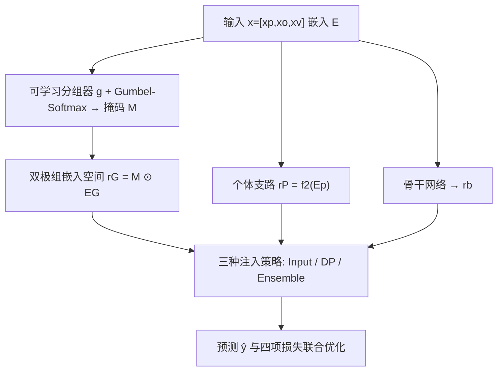

# GPRec: Bi-level User Modeling for Deep Recommenders (面向深度推荐器的双层用户建模)

- **会议/期刊**: ICDM 2024
- **作者与机构**: Yejing Wang, Xiangyu Zhao 等（香港城市大学、小红书、吉林大学、南方科技大学、西安交通大学）
- **推荐链路定位**: 精排（CTR 预估），模块可下探至召回侧用户表征
- **研究方向**: 协同过滤与双塔召回 / CTR 预估与特征交叉
- **论文原文**: [https://arxiv.org/abs/2410.20730v1](https://arxiv.org/abs/2410.20730v1)
- **开源代码**: [https://github.com/Applied-Machine-Learning-Lab/GPRec](https://github.com/Applied-Machine-Learning-Lab/GPRec)

## TL;DR (1分钟核心速览)

现有深度推荐器（DRS）对所有特征一视同仁，用户建模要么只做个体（APG/PEPNet 式参数生成），要么只做群组（MMoE/PLE/STAR/DGPM 式分群），忽略两层互补。GPRec 提出**双层用户建模插件**：可学习分类器 + Gumbel-Softmax 生成多标签软硬分组掩码，双极组嵌入空间（正/负嵌入）配对比损失拉开组模式差异，个体支路从 ID 类特征提取偏好并用正交损失与组表征解耦。在 ML1M/TenRec/KuaiRand 的 CTR 任务上，AUC 相对最强基线提升 0.12%–1.0%，且在 4 种骨干上一致增益（显著性 $p<0.05$）。

## Background & Motivation (背景与核心矛盾)

- **主流范式**: DRS 被抽象为 $F(\mathbf{x})$，学界精力集中在设计更强的特征交叉结构$F$（DCN/GDCN/FinalMLP/DESTINE），对所有特征场做统一处理。
- **前人局限一**: 只做个体建模（APG、PEPNet）会割裂用户间协作信号，无法复用群体共享偏好。
- **前人局限二**: 只做组建模（MMoE/PLE/STAR 依赖 Gender、Age 等硬规则分群）导致"爵士乐迷被塞进音乐爱好者群→推古典乐"的组-个体偏好冲突；DGPM 虽用余弦相似度软分群，但受限于线性关系且组嵌入易过拟合用户嵌入，组间相似度高达 0.9（近乎塌缩）。
- **核心洞察 (Key Insight)**: 组表征负责粗粒度、可泛化的协作知识，个体表征负责细粒度差异；二者若在同一空间内重叠，个体信号会被组信号淹没，必须**显式解耦**。
- **本文切入点**: 把"分群"从相似度加权换成可学习多标签分类器，把"单组嵌入"扩为"正/负双极嵌入"，再用正交损失把个体表征推出组子空间。

## Method (核心方法设计)

### 1. 整体框架 (Overall Architecture)

输入样本 $\mathbf{x}=[\mathbf{x}_p,\mathbf{x}_o,\mathbf{x}_v]$（个人特征/其他用户特征/物品特征）经嵌入表得$\mathbf{E}=[\mathbf{E}_p,\mathbf{E}_o,\mathbf{E}_v]$；骨干网络照常输出$\mathbf{r}_b$，GPRec 旁路并行产生组表征$\mathbf{r}_G$（用$\mathbf{E}_u=[\mathbf{E}_p,\mathbf{E}_o]$）与个体表征$\mathbf{r}_P$（仅用$\mathbf{E}_p$），随后以输入拼接／动态参数／集成三种策略注入预测 MLP，端到端联合优化主损失与三项辅助损失。骨干数据流完全不被修改，故为即插即用模块。

### 2. 关键设计拆解 (Key Designs)

1. **可学习分组器 + Gumbel-Softmax 硬掩码**：余弦相似度分群只能刻画线性关系、且组嵌入被用户嵌入反向污染。GPRec 用 MLP $g$直接输出$2\times G$判别分数$\mathbf{S}=g(\mathbf{E}_u;\theta_g)$，再经 Gumbel-Softmax 温度$\tau$ 松弛为近二值掩码：
$m_i^1=\frac{\exp((\log s_i^1+gn_1)/\tau)}{\sum_{j\in\{0,1\}}\exp((\log s_i^j+gn_j)/\tau)},\quad m_i^0=1-m_i^1$。
用户可同时隶属多个正组；硬掩码避免正负嵌入被平滑分数"搅拌"而丢失对立语义。

2. **双极组嵌入 + 对比辅助任务**：每组配正嵌入 $\mathbf{p}_i$与负嵌入$\mathbf{n}_i$，即$\mathbf{E}_G=[\mathbf{p}_1..\mathbf{p}_G;\mathbf{n}_1..\mathbf{n}_G]$，表征容量由$G$扩到$2G$：
$\mathbf{r}_G=\mathbf{M}\odot\mathbf{E}_G=[m_1^1\mathbf{p}_1+m_1^0\mathbf{n}_1,\dots]$。
辅助任务 $\hat{y}_1=f_1(\mathbf{r}_G,\mathbf{E}_v)$拟合真实标签得$\mathcal{L}_G$；同时构造反转掩码的"错分表征"$\mathbf{r}_G^{Con}=(\mathbf{1}-\mathbf{M})\odot\mathbf{E}_G$并**最大化**其预测损失$\mathcal{L}_G^{Con}$。直觉：若分组准确，反事实组嵌入必然预测失败，从而强制正负对语义对立（实测正负对余弦相似度仅 0.03）。

3. **个体支路与正交解耦 + 训练目标**：$\mathbf{r}_P=f_2(\mathbf{E}_p;\theta_2)$ 只吃 UserID 类唯一特征；由于体育迷的组表征已含运动偏好，个体支路须"让出"这部分：
$\mathcal{L}_O=\frac{\mathbf{r}_G\cdot\mathbf{r}_P}{\|\mathbf{r}_G\|_2\|\mathbf{r}_P\|_2}$，总目标
$\mathcal{L}=\mathcal{L}_{major}+\lambda_1\mathcal{L}_G-\lambda_2\mathcal{L}_G^{Con}+\lambda_3\mathcal{L}_O$。
推荐任务为 CTR，$\mathcal{L}_{major}$ 取 BCE，无负采样环节；推理仅多一次 MLP 前向 + 掩码加权，开销可忽略。

## Experimental Setup & Evaluation Protocol (实验设置与评估协议)

- **数据集与预处理**: 沿用原始发布版本，未额外做 k-core 过滤；KuaiRand 采用官方 pure 版本。

| 数据集 | #Users | #Items | #Interactions | 用户特征数/总特征数 | 场景说明 |
| :--- | :---: | :---: | :---: | :---: | :--- |
| ML1M | 6,040 | 3,706 | 1,000,209 | 5 / 8 | 电影评分，UserID 为唯一个人特征 |
| TenRec | 999,447 | 2,310,087 | 120,342,306 | 3 / 6 | 腾讯浏览器大规模 CTR 采样版 |
| KuaiRand | 27,077 | 7,551 | 1,436,609 | 30 / 89 | 快手短视频，特征最丰富、无 Gender 属性 |

- **数据划分与防穿越**: 随机 **80%/10%/10%** 训练/验证/测试划分（非时间序切分，属该文一处潜在穿越风险）。
- **排名评测协议**: 本文任务是 CTR 二分类，采用 **AUC↑ / LogLoss↓** 而非 Full-Ranking 或 Sampled Ranking；结果取 5 个随机种子均值，最优与次优做单侧 t 检验（$p<0.05$ 标 `*`）。
- **对比基线与超参**: 三类基线——特征交叉（MLP/DeepFM/DCN/GDCN/FinalMLP/DESTINE）、组建模（MMoE/PLE/STAR/DGPM）、个体建模（APG/PEPNet）。嵌入维度 $d=16$，预测 MLP 为 [64,32,16,1]，分组器每组 [64,32,2]，$G=60$，$\tau=0.5$，$\lambda_1=1.0,\lambda_2=10^{-3},\lambda_3=10^{-4}$。

## Key Experimental Results (实验关键数据)

### 1. 主实验对比 (Main Results)

| 类别 | 模型 | ML1M AUC↑ | ML1M LogLoss↓ | TenRec AUC↑ | KuaiRand AUC↑ | KuaiRand LogLoss↓ |
| :--- | :--- | :---: | :---: | :---: | :---: | :---: |
| 特征交叉 | MLP | 0.8081 | 0.5407 | 0.9126 | 0.7530 | 0.5857 |
| | DeepFM | 0.8044 | 0.5339 | 0.9134 | 0.7403 | 0.6120 |
| | DCN | 0.8087 | 0.5326 | 0.9139 | 0.7533 | 0.5987 |
| | GDCN | 0.8149 | 0.5196 | 0.9140 | 0.7564 | 0.5832 |
| | FinalMLP | 0.8101 | 0.5217 | 0.9142 | 0.7553 | 0.5837 |
| | DESTINE | 0.8082 | 0.5314 | 0.9152 | 0.7544 | 0.5854 |
| | **GPRec (GDCN)** | **0.8161\*** | **0.5167\*** | **0.9180\*** | **0.7573\*** | 0.5835 |
| 用户建模 | MMoE | 0.8081 | 0.5234 | 0.9134 | 0.7523 | 0.5877 |
| | PLE | 0.8088 | 0.5226 | 0.9150 | 0.7521 | 0.5881 |
| | STAR | 0.8095 | 0.5225 | 0.9161 | 0.7517 | 0.5876 |
| | APG | 0.8090 | 0.5214 | 0.9136 | 0.7560 | 0.5832 |
| | PEPNet | 0.8082 | 0.5280 | 0.9165 | 0.7563 | 0.5827 |
| | DGPM | 0.8086 | 0.5350 | 0.9146 | 0.7540 | 0.5853 |
| | **GPRec (MLP)** | **0.8141\*** | **0.5181\*** | 0.9163 | 0.7565 | 0.5830 |
| | Improv. (vs 次优) | +0.15% | −0.29% | +0.31% | +0.12% | — |

**兼容性（表 III）**：在 DCN/GDCN/DESTINE/FinalMLP 四种骨干上注入 GPRec，AUC 全部提升且均显著（如 ML1M 上 DCN 0.8087→0.8135、DESTINE 0.8082→0.8126、FinalMLP 0.8101→0.8136；TenRec 上 GDCN 0.9140→0.9180）；相比之下 DGPM 仅能配动态参数策略，在 FinalMLP 上直接不可用（表中记 `-`）。

### 2. 消融实验 (Ablation Study)

原文以变体/完整模型性能比值呈现（图 2），下表为定性结论方向（`↓` 表示劣于 GPRec）：

| 变体 | 移除内容 | ML1M | KuaiRand | 结论 |
| :--- | :--- | :---: | :---: | :--- |
| GPRec-1 | 双极嵌入 + 分类器分群（退回单嵌入 + Softmax，即 DGPM 式） | AUC↓ | AUC↓ | 双极空间与可学习分组是增益主源 |
| GPRec-2 | 个体表征 $\mathbf{r}_P$ | LogLoss↑明显 | LogLoss↑明显 | 个体偏好不可或缺 |
| GPRec-3 | 组辅助损失 $\mathcal{L}_G$ | AUC↓最大 | AUC↓ | ML1M 上最关键 |
| GPRec-4 | 对比损失 $\mathcal{L}_G^{Con}$ | AUC↓ | AUC↓最大 | KuaiRand 上最关键 |
| GPRec-5 | 正交损失 $\mathcal{L}_O$ | 轻微↓ | 轻微↓ | 收益小但稳定为正 |

### 3. 关键实验发现 (Key Findings)

1. **"分群方式"比"分群数量"更重要**：依赖预设属性的 MMoE/PLE/STAR 在 KuaiRand 上集体失效（STAR 0.7517 甚至低于 MLP 的 0.7530），因为该数据集缺 Gender，只能用"用户活跃度"替代；而可学习分组 + 双极嵌入的 GPRec 在无先验属性时仍稳居 0.7565–0.7573。
2. **双层建模优于任一单层，但单层增益本身有限**：个体系 PEPNet 在 TenRec 达 0.9165、组体系 DGPM 在各集稳定优于硬分群，说明两层各有价值；GPRec 用 MLP 骨干即达 0.8141（ML1M），超过所有 MLP 类基线并接近 GDCN 骨干（0.8149），证明增益来自用户建模而非更深的交叉网络。
3. **双极嵌入显著缓解组模式塌缩**：GPRec 正负组嵌入对余弦相似度低至 0.03、负嵌入间最大仅 0.6，而 DGPM 组嵌入平均相似度高达 0.9；配合 $G$从 3 增至 60 时 AUC 单调上升、超过 60 后不再涨（组嵌入欠训练），$\tau$过小（0.1）分组过刚易陷局部最优、过大（1.0）正负语义被模糊，$G=60,\tau=0.5$ 最优。

## Highlights & Limitations (亮点、对比与审稿批判)

- **与代表作对比 (vs. Prior Work)**: 对 DGPM（最相近工作），本文把"余弦相似度软加权 + 单组嵌入 + 仅动态参数注入"升级为"可学习多标签分类器 + 正负双极嵌入 + 三种注入策略 + 个体支路解耦"，从单层组建模跃迁到双层；对 APG/PEPNet，本文补上了协作侧共享模式；对 MMoE/PLE/STAR，本文摆脱了硬编码分群属性依赖。
- **可迁移亮点**: (a) 「反转掩码构造反事实表征 + 最大化其损失」是一种极轻量的组嵌入正则手段，可直接迁移到多场景/多任务的门控专家路由以抑制专家同质化；(b) 用余弦正交损失剥离两级表征的重叠语义，可复用于跨域迁移中的域不变/域特异解耦。
- **审稿级局限批判**: (a) 随机 80/10/10 划分而非全局时间戳切分，CTR 场景下存在特征穿越与指标虚高风险，且缺少 Full-Ranking 层面的验证；(b) 分组数 $G=60$与$\tau$、三个$\lambda$均需人工调参，且$\mathbf{r}_G$拼接$G$组嵌入带来维度随$G$ 线性膨胀（KuaiRand 89 特征场景尚可，超大工业特征空间下需改用求和压缩），文中未给出线上时延与吞吐实测；(c) 消融仅以相对比值图呈现，缺乏绝对值表格，削弱可复现性。

## Rating (四维评分)

- **方法创新性 (Novelty)**: ⭐⭐⭐⭐ （双极组嵌入 + 反转掩码对比任务是本方向少见的轻量解耦思路，但整体仍是模块拼接式创新，理论分析以相似度可视化为主）
- **评估协议与实验扎实度 (Protocol & Experiments)**: ⭐⭐⭐⭐ （三数据集跨量级、5 种子、t 检验、四骨干兼容性与参数敏感性齐备；扣分于随机划分而非时间切分、消融缺绝对值）
- **写作与数学规范度 (Clarity & Rigor)**: ⭐⭐⭐⭐ （公式链条清晰、损失符号统一、Gumbel-Softmax 与对比损失动机解释充分，但 $\mathcal{L}_G^{Con}$ 最大化与整体最小化的符号约定可再澄清）
- **工业落地与复现价值 (Industrial & Practical Value)**: ⭐⭐⭐⭐⭐ （骨干零改动、三种注入策略适配异构架构、代码开源、小红书工业作者背景，推理仅增一次 MLP 前向，落地成本极低）

