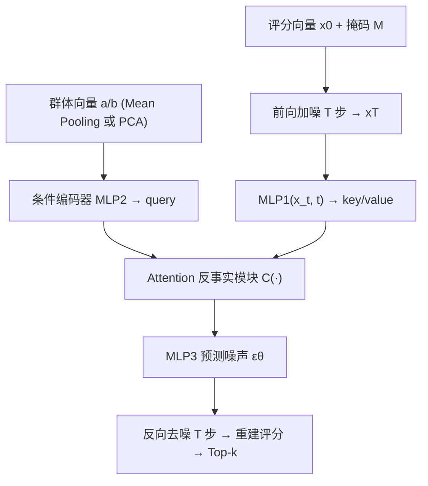
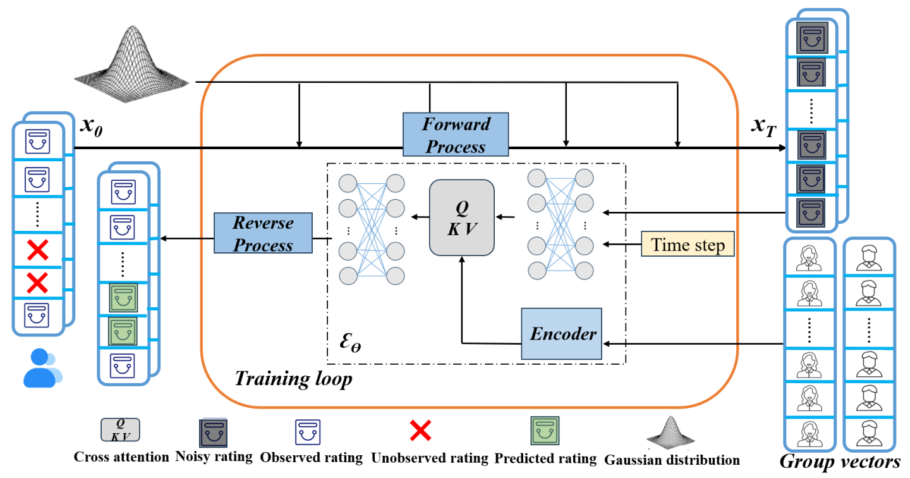

# DifFaiRec: Generative Fair Recommender with Conditional Diffusion Model (基于条件扩散模型的生成式公平推荐)

- **会议/期刊**: IEEE ICDM 2024
- **作者与机构**: Zhenhao Jiang, Jicong Fan*（香港中文大学（深圳））
- **推荐链路定位**: 端到端生成式（整列评分向量重建 + Top-k 排序）
- **研究方向**: 去偏公平、可信与工业架构 / 生成式推荐
- **论文原文**: [https://arxiv.org/abs/2410.02791v1](https://arxiv.org/abs/2410.02791v1)
- **开源代码**: 暂未开源

## TL;DR (1分钟核心速览)

针对"活跃度/性别/年龄敏感属性导致群体推荐差距"这一痛点，本文提出 DifFaiRec：把用户整列评分向量视作 $x_0$，用条件扩散模型的去噪过程做评分重建，并把**群体向量**经条件编码器 + 注意力构成的**反事实模块**注入噪声预测器，使模型在"该用户属于另一群体"的反事实条件下也必须还原同一份真实评分。作者进一步用贝叶斯推导说明公平约束可被吸收进去噪损失，从而把原本的双目标优化坍缩为单目标。在 MovieLens-1M 与 LastFM 两个数据集、8:1:1 划分与全库排序协议下，Recall@k/NDCG@k 提升 1.0%–5.1%，绝对平等 A@k 与机会均等 E@k 改善 1.2%–15.8%。

## Background & Motivation (背景与核心矛盾)

- **主流范式**: 公平推荐多采用"精度损失 + 公平正则/对抗去偏"的多目标框架（FairC、FairGO、FairGAN），或以 GAN/VAE 做生成式推荐（IFGAN、DiffRec）但完全不考虑公平。
- **前人局限**: ①多目标（精度 + 公平）难以逼近 Pareto 前沿，权重系数极其敏感，落地调参成本高；②对抗式去偏通过梯度反转抹除敏感信息，容易连带抹除与敏感属性相关的有效偏好，导致精度与公平双向受损。
- **核心洞察 (Key Insight)**: 若存在中间表征 $z$使得$z \perp s$，则输出$v=g(z)$天然满足$P(v|s{=}0)=P(v|s{=}1)$，即$\delta=0$。扩散模型的反向马尔可夫链恰好允许把"反事实条件"作为输入一路注入每一步去噪，使公平约束**内化**进生成过程而非外挂正则。
- **本文切入点**: 构造反事实群体条件 $y$（用户属于 A 则喂 B 的群体向量，反之亦然），用"在反事实世界里也要还原真实评分"这一要求隐式实现公平，仅保留一个去噪损失。

## Method (核心方法设计)

### 1. 整体框架 (Overall Architecture)

输入为用户对全部物品的评分列向量 $\mathbf{r}$（缺失项由掩码$\mathbf{M}$标记）。前向过程对$x_0=\mathbf{r}$加噪$T$次得到$x_T$；反向过程中一步的输入是$x_t$、时间步嵌入$t$与**该用户的反事实群体向量**$y$，噪声预测网络先用 MLP1 编码$(x_t,t)$得到$z$，用 MLP2 编码$y$得到 query，再以 Attention 将群体条件"注入"用户表征，最后 MLP3 输出$\hat{\epsilon}$；去噪$T$次后恢复完整的$\hat{x}_0$，按分数取 Top-k 生成推荐列表。训练只对齐掩码位置的噪声误差，无负采样、无显式公平损失。

<figure class="paper-figure" markdown="span">
  <figcaption>图 1：DifFaiRec 的流程图。原始评分向量为 x0。在前向过程中，向量被加入高斯噪声 T 次，成为 xT。在反向过程中，将 xT、群组向量和时间步输入 DifFaiRec 以估计噪声，经过 T 次去噪后可恢复 x0 中的缺失评分。</figcaption>
</figure>

### 2. 关键设计拆解 (Key Designs)

1. **群体向量构建（Mean Pooling / PCA）**：标量标签 $s\in\{-1,1\}$信息量过低，无法刻画两群体在评分空间中的既有偏置。Mean Pooling 直接取组内均值$\mathbf{a}=\sum_{j\in A}\mathbf{r}_j/|A|$；PCA 版本则对$R_A,R_B$的协方差矩阵做特征分解$U_A\Lambda_AU_A^\top=C_A$，取第一主成分$\mathbf{a}=\mathbf{u}_A^{(1)}$ 作为群体特征基。直觉：公平差距本就存在于训练数据中，群体向量应当"量化"而非"声明"这一差距。
2. **注意力反事实模块**：给定用户 $j$，取**另一群体**的向量$y_j$（$j\in B$则$y_j=\mathbf{a}$，否则$\mathbf{b}$）作为 query，用户自身表征为 key/value，做一次交叉注意力$z'_j=\mathrm{Atten}(\mathrm{Enc}(y_j),z_j,z_j)$，最终噪声估计为
$$\epsilon_\theta(x_t,t,y)=\mathrm{MLP3}\big(\mathrm{Atten}(\mathrm{MLP2}(y),\mathrm{MLP1}(x_t,t),\mathrm{MLP1}(x_t,t))\big)$$
   这里先经 MLP2（条件编码器）做特征交叉再算注意力是关键：直接用原始群体向量做 query 等价于对表征各维施加**均等相关性**，不合理；条件编码器让模型自适应地学到"哪些物品维度的差异才是群体差异"。
3. **单目标训练与贝叶斯解释**：损失仅为掩码噪声回归
$$\mathcal{L}=\mathbb{E}_{t,x_0,\epsilon}\big\|\mathbf{M}\odot(\epsilon-\epsilon_\theta(x_t,t,y))\big\|_2^2$$
   作者论证：真实世界评分 $I$依赖$Z=s$，而$\epsilon_\theta$的输入来自反事实世界$Z=1-s$；令$P(\epsilon)\approx P(\epsilon_\theta)$即等价于逼近$P(I|Z=s)=P(I|Z=1-s)$，故乘积形式$\prod_t\epsilon_\theta=\prod_t\epsilon$将公平项吸收进重建项。该性质依赖扩散模型的马尔可夫链结构，GAN/VAE 不具备。推理需$T$步迭代（默认$T=100$），可多次采样取均值/中位数，作者称标准差极小。

## Experimental Setup & Evaluation Protocol (实验设置与评估协议)

- **数据集与预处理**: 无 `k-core` 过滤；MovieLens-1M 每用户至少 20 条评分，LastFM 以播放次数作为评分。

| 数据集 | #Users | #Items | #Interactions | 稀疏度 | 分组(敏感属性) |
| :--- | :---: | :---: | :---: | :---: | :--- |
| MovieLens-1M | 6,040 | 3,900 | 1,000,209 | 0.0425 | 性别(男 71.7%/女 28.3%)；年龄(≤50 占 85.5%) |
| LastFM | 1,892 | 17,632 | 92,834 | 0.0028 | 活跃度(≥15000 播放 63%)；兴趣多样性(focused 9.5%) |

- **数据划分与防穿越**: **比例划分 8:1:1**，并强制训练集中每用户至少 10 条交互；未采用全局时间戳切分，存在轻量时序泄漏风险。
- **排名评测协议**: 训练目标是整列评分重建，评测在**重建后的完整物品集上做 Full-Ranking 排序**（非采样排序），指标 Recall@k、NDCG@k，$k=7$（MovieLens）/$k=10$（LastFM）；公平指标$A@k=|u_A-u_B|$（两组 MAE 之差）与$E@k=\sqrt{|e_A-e_B|}$（两组 Top-k 错误率之差），越小越公平。**无负采样**（扩散模型直接拟合评分分布）。
- **对比基线与超参**: 2 个精度基线（MF、AutoRec）+ 4 个公平/生成基线（IFGAN、DiffRec、ChatGPT4Rec、FairC、FairGO、FairGAN 共 7 个）。$T=100$，步嵌入 64，batch 64，Adam，lr$1\times10^{-3}$，方差尺度$L=1\times10^{-4}$；所有结果在配对 t 检验下$p<0.01$ 显著。

## Key Experimental Results (实验关键数据)

### 1. 主实验对比 (Main Results)

| 模型 | ML-1M 年龄 R@7 | N@7 | A@7↓ | E@7↓ | LastFM 活跃度 R@10 | N@10 | A@10↓ | E@10↓ |
| :--- | :---: | :---: | :---: | :---: | :---: | :---: | :---: | :---: |
| MF | 0.233 | 0.397 | 0.074 | 0.301 | 0.063 | 0.147 | 0.717 | 0.112 |
| AutoRec | 0.138 | 0.361 | 0.073 | 0.332 | 0.102 | 0.152 | 0.691 | 0.108 |
| IFGAN | 0.394 | 0.543 | 0.052 | 0.298 | 0.114 | 0.166 | 0.663 | 0.101 |
| DiffRec | 0.397 | 0.540 | 0.049 | 0.307 | 0.122 | 0.166 | 0.679 | 0.100 |
| ChatGPT4Rec | 0.286 | 0.399 | 0.047 | 0.301 | 0.119 | 0.142 | 0.647 | 0.101 |
| FairC | 0.391 | 0.537 | 0.034 | 0.286 | 0.118 | 0.144 | 0.581 | 0.094 |
| FairGO | 0.379 | 0.444 | 0.030 | 0.277 | 0.120 | 0.154 | 0.576 | 0.089 |
| FairGAN | 0.397 | 0.541 | 0.019 | 0.267 | 0.124 | 0.168 | 0.577 | 0.081 |
| DifFaiRec1 (Mean) | 0.400 | 0.549 | **0.016** | **0.261** | 0.124 | 0.171 | 0.557 | **0.080** |
| DifFaiRec2 (PCA) | **0.401** | **0.551** | **0.016** | 0.263 | **0.128** | **0.174** | **0.555** | 0.082 |
| **Improv.** | +1.01% | +1.85% | +15.79% | +2.25% | +3.23% | +3.57% | +3.65% | +1.23% |

性别维度上 DifFaiRec2 同样取得 R +1.83%、N +1.45%、A 降 13.64%、E 降 1.37%；LastFM 兴趣多样性维度 NDCG 提升达 5.14%。

### 2. 消融实验 (Ablation Study)

原文消融以柱状图（图 2，LastFM-活跃度）呈现，未给出精确数值，趋势如下；群体稀疏鲁棒性以表格量化：

| 变体 / 设置 | NDCG@10 | E@10↓ (机会均等) | 结论 |
| :--- | :---: | :---: | :--- |
| w/o 条件编码器 MLP2 | 略低于全模型 | 明显升高 | 条件编码器的特征交叉决定反事实表征质量 |
| w/o 反事实模块 | 小幅波动 | 大幅升高（回到不公平基线附近） | 公平性几乎全部来自反事实模块 |
| 全模型 | 最高 | 最低 | — |
| SR=50% (M-G 少数群体) | 0.553 | 0.224 | 基线 |
| SR=70% (M-G) | 0.549 | 0.226 | 精度几乎不变，A@ 由 0.022→0.029 |
| SR=90% (M-G) | 0.544 | 0.238 | A@ 由 0.022→0.051，公平性显著退化 |

### 3. 关键实验发现 (Key Findings)

1. **公平与精度并非零和**：MovieLens 年龄维度上 A@7 由最佳公平基线 FairGAN 的 0.019 降到 0.016（-15.8%），同时 Recall@7 反而从 0.397 升至 0.401——反事实条件起到了类似"数据增广"的正则作用，缓解了活跃群体的过拟合。
2. **群体向量的"有效信息"是双刃剑**：PCA 版本召回/NDCG 略高（$0.128$vs$0.124$），但公平指标反而不如 Mean Pooling 版本（$E@10=0.082$vs$0.080$）；作者归因于长尾数据下 PCA 保留了过多噪声维度，稀释了反事实约束方向。这说明公平任务需要的不是更"全"而是更"纯"的群体表征。
3. **少数群体极小样本下公平保障会失效**：90% 下采样后，M-G 的 A@ 从 0.022 翻倍到 0.051，L-ID 从 0.564 升到 0.691（回到 FairGAN 水平），而 NDCG 仅降 1.6%——群体向量依赖大数定律，二阶段方法在极端长尾群体上没有兜底机制。

## Highlights & Limitations (亮点、对比与审稿批判)

- **与代表作对比**: 对比 FairGO/FairC 的对抗式去偏（抹除敏感信息、需公平权重项），DifFaiRec 用"反事实条件输入 + 单一重建损失"替代，消解了权重调参；对比 DiffRec，本文首次将扩散推荐扩展至群体公平并给出可行性的马尔可夫链论证，而非简单叠加正则项。
- **可迁移亮点**: ①"把敏感属性替换为对方群体的表征后仍须还原真实反馈"这一反事实输入范式，可直接套用到 LLM 微调或双塔召回的公平正则上；②群体向量可用 Mean Pooling 而非复杂学习，提示公平建模中"低方差表征"优于"高信息表征"。
- **审稿级局限批判**: ①推理需 100 步去噪、每用户需多次采样，线上候选生成延迟远超单次前向的 DiffRec/GAN，缺少复杂度与吞吐分析；②公平指标 $A@k$基于 MAE 差、$E@k$ 基于 Top-k 错误率差，均是"性能差距"代理，未测评曝光/覆盖类公平；仅处理二元用户侧群体，未涉及物品侧与多值属性；③8:1:1 随机划分与时序切分不一致，且 MovieLens 年龄分组极度不平衡（85.5% vs 14.5%），与稀疏鲁棒性实验揭示的失效边界相互印证，削弱结论强度。

## Rating (四维评分)

- **方法创新性 (Novelty)**: ⭐⭐⭐⭐ （首次把条件扩散 + 反事实群体条件统一到单一去噪目标，并给出基于马尔可夫链的贝叶斯解释，理论包装优于多数公平推荐工作）
- **评估协议与实验扎实度 (Protocol & Experiments)**: ⭐⭐⭐ （采用无偏全库排序、$p<0.01$ 配对检验且消融齐全，但消融仅以图呈现无具体数值，划分方式未做时序对照，公平指标定义单一）
- **写作与数学规范度 (Clarity & Rigor)**: ⭐⭐⭐ （公式与算法流程完整、附录澄清了 $\epsilon$与$\epsilon_\theta$ 独立性的常见质疑，但"两目标压缩为一"的推导依赖近似假设，严格性偏弱）
- **工业落地与复现价值 (Industrial & Practical Value)**: ⭐⭐⭐ （思路轻量、无需负采样与对抗训练，但 100 步去噪的推理成本与群体向量对群体规模的强依赖，使其更适合离线批量召回而非在线实时精排，且暂无开源代码）

