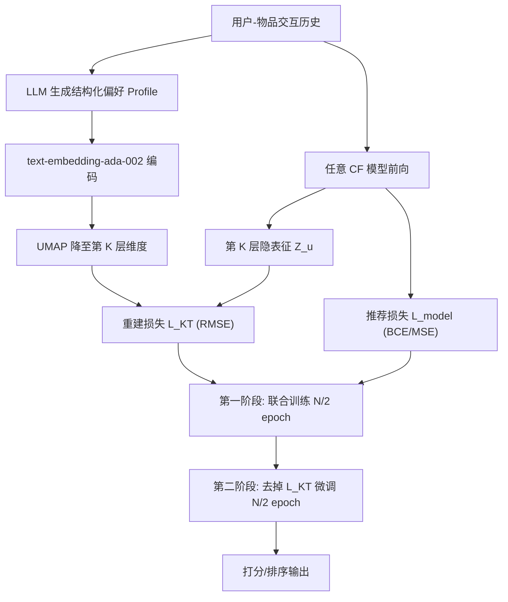

# LLM-KT: A Versatile Framework for Knowledge Transfer from Large Language Models to Collaborative Filtering (面向协同过滤的 LLM 知识迁移通用框架)

- **会议/期刊**: ICDM 2024 (Demo Track)
- **作者与机构**: Nikita Severin 等；HSE University、MIPT、Ural Federal University、Sber AI Lab、AIRI/ISP RAS
- **推荐链路定位**: 精排（打分/重排阶段），可前置于任意 CF 打分器
- **研究方向**: 大语言模型推荐 / 协同过滤
- **论文原文**: [https://arxiv.org/abs/2411.00556v1](https://arxiv.org/abs/2411.00556v1)
- **开源代码**: [https://github.com/a250/LLMRecSys](https://github.com/a250/LLMRecSys)

## TL;DR (1分钟核心速览)

现有 LLM→CF 知识迁移方法（KAR、LLM-CF）把 LLM 生成的文本特征当作**输入特征**喂给模型，因而只能作用于能接收 side-information 的 context-aware 模型，纯 ID 类 CF（NeuMF、SimpleX、MultVAE）完全用不上。本文提出 LLM-KT：把 LLM 用户画像嵌入经 UMAP 降到第 $K$ 层隐空间维度，作为**中间层重建辅助任务**注入模型，两阶段训练（先联合训练、后纯推荐微调），不改网络结构。在 ML-1M 与 Amazon CDs 上采用 70/10/20 时间序划分、Full-item 排序评测，NDCG@10 最高相对提升 21.57%，且 AUC 与 KAR 持平。

## Background & Motivation (背景与核心矛盾)

- **主流范式**: 用 LLM 的开放世界推理能力生成用户/物品语义表征，再以知识蒸馏或特征拼接方式增强 CF 模型（KAR、LLM-CF、RLMRec 一脉）。
- **前人局限一**: 这些方法把 LLM 特征作为 `feature_field` 输入，模型必须存在特征塔；NeuMF、MultVAE 这类纯交互矩阵模型无法接入，迁移方案被"特征接口"绑架。
- **前人局限二**: 把 LLM 语义直接拼到输入端会与 ID embedding 争抢表征容量，且推理期要额外维护长文本特征，工程链路重。
- **核心洞察 (Key Insight)**: 人类做推荐的直觉是"前几层识别兴趣、后几层据兴趣打分"；同理，让 CF 模型的**中间层**去重建 LLM 总结出的兴趣画像，等价于强迫其隐空间对齐语义先验，而不必改动输入接口与网络拓扑。
- **本文切入点**: 用"中间层特征重建"这一 pretext task 替代"输入特征拼接"，从而把 LLM 知识迁移推广到任意 CF 架构。

## Method (核心方法设计)

### 1. 整体框架 (Overall Architecture)

流程分四步：① **Profile Generation**——对每个用户的历史交互套用固定兴趣推理 prompt（"Based on the user's ratings, provide a general summary of their preferences… organized into several parts"），令 LLM 输出结构化偏好短文本，逐用户独立调用以压缩 API 次数；② **Profile Embedding**——用 `text-embedding-ada-002` 编码为稠密向量 $\boldsymbol{P}_u$；③ **空间对齐**——用非可学习变换$Trans(\cdot)$（实现为 UMAP，理由是比 PCA 更好保留距离结构、比 t-SNE 支持任意目标维度）把$\boldsymbol{P}_u$压到第$K$层输出$\boldsymbol{Z}_u$的维度；④ **两阶段训练**——前$N/2$epoch 联合优化推荐损失与重建损失，后$N/2$ epoch 移除重建项、仅微调推荐目标，避免辅助任务稀释排序信号。框架以 RecBole 为底座，通过 Model Wrapper 的 Hook Manager（挂取任意层输出）、Weights Manager（层冻结/解冻）、Loss Manager（增删自定义损失）三个组件实现"配置文件即实验流水线"。

### 2. 关键设计拆解 (Key Designs)

1. **中间层知识注入 (Intermediate-Layer Injection)**：痛点是不改架构就无法利用 LLM 语义；本文不动输入、只在第 $K$ 层挂一个重建头，把语义监督"压"进隐空间。总损失为加权和
$$\mathcal{L}_{combined}=\alpha\cdot\mathcal{L}_{KT}+(1-\alpha)\cdot\mathcal{L}_{model},\quad \alpha\in[0,1]$$
其中 $\mathcal{L}_{model}$ 沿用模型原生目标（交互预测用 BCE、评分预测用 MSE）。直觉：隐层被迫编码"这个用户喜欢什么类型"，而这些语义在下游打分时天然可复用。

2. **跨空间重建损失 (Profile Reconstruction Loss)**：LLM 向量维度（1536）与隐层维度（数十~数百）不匹配，故先降维再比对：
$$\mathcal{L}_{KT}(\boldsymbol{Z}_u,\boldsymbol{P}_u)=\mathcal{L}_{reconstruct}\big(\boldsymbol{Z}_u,\,Trans(\boldsymbol{P}_u)\big)$$
实验表明 RMSE 优于其他重建度量选项；UMAP 的非线性降维保证了降维后仍保留画像间的相对距离，使 $\boldsymbol{Z}_u$ 学到的是"兴趣几何"而非单纯拟合某个向量。

3. **训练目标、负采样与推理效率**：全流程无额外负采样设计，仅复用各基线原生采样器；推理阶段重建分支完全剥离，线上只保留原 CF 模型前向，**零额外延迟**，LLM 调用是一次性离线预处理（每用户一次 prompt），成本可控。超参关键在 $\alpha$、迁移层号$K$、两阶段 epoch 对半切分。

## Experimental Setup & Evaluation Protocol (实验设置与评估协议)

- **数据集与预处理**: 未声明 5-core 过滤，仅给出如下统计：

| 数据集 | #Users | #Items | #Interactions | 稀疏度 | 场景说明 |
| :--- | :---: | :---: | :---: | :---: | :--- |
| ML-1M | 6,041 | 3,707 | 1,000,209 | 95.53% | 电影评分，稠密 |
| Amazon CDs | 4,558 | 7,784 | 194,242 | 99.45% | 音乐 CD，极稀疏 |

- **数据划分与防穿越 (Splitting Strategy)**: **按时间序的 70/10/20 比例划分**（train/valid/test），遵循 YouTube DNN 与 Ji et al. 关于数据泄漏的规范，避免未来交互穿越。
- **排名评测协议 (Ranking Protocol)**: 通用 CF 走 **re-ranking 任务**，报告 Recall@10 / NDCG@10 / Hits@10；context-aware 模型走 **CTR 预估**，报告 AUC-ROC。原文未显式声明候选集规模与负采样比例（RecBole 默认为全库排序），此为复现时的模糊点。
- **对比基线与超参设置**: 通用 CF 基线 NeuMF（神经矩阵分解）、SimpleX（对比学习 CF）、MultVAE（VAE CF）；context-aware 基线 DCN、DeepFM，并对比 SOTA 迁移方法 KAR。所有基线统一训练 $N\ge 70$epoch 以规避 grokking 效应，两阶段各$N/2$。

## Key Experimental Results (实验关键数据)

### 1. 主实验对比 (Main Results)

| 数据集 | 模型 | Recall@10 (Base → LLM-KT) | NDCG@10 (Base → LLM-KT) | Hits@10 (Base → LLM-KT) | 最大 Improv. |
| :--- | :--- | :---: | :---: | :---: | :---: |
| CDs | NeuMF | 0.1511 → 0.1579 | 0.1519 → 0.1566 | 0.5855 → 0.6066 | +4.50% |
| CDs | SimpleX | 0.1594 → 0.1708 | 0.1560 → 0.1669 | 0.6091 → 0.6262 | +7.15% |
| CDs | MultVAE | 0.1451 → **0.1737** | 0.1428 → **0.1736** | 0.5790 → **0.6368** | **+21.57%** |
| ML-1M | NeuMF | 0.0980 → 0.1088 | 0.1800 → 0.1969 | 0.7035 → 0.7325 | +11.02% |
| ML-1M | SimpleX | 0.0935 → 0.1080 | 0.1838 → 0.2003 | 0.6899 → 0.7313 | +15.51% |
| ML-1M | MultVAE | 0.1297 → 0.1352 | 0.1925 → 0.1981 | 0.7281 → 0.7311 | +4.24% |

| 数据集 | 模型 | Base | KAR | LLM-KT |
| :--- | :--- | :---: | :---: | :---: |
| CDs | DCN | 0.8214 | 0.8204 | **0.8273** |
| CDs | DeepFM | 0.8427 | **0.8477** | 0.8463 |
| ML-1M | DCN | 0.7753 | 0.7755 | **0.7889** |
| ML-1M | DeepFM | 0.7934 | 0.7983 | **0.8175** |

### 2. 消融实验 (Ablation Study)

原文（Demo Track 篇幅所限）**未给出成表的组件消融**，仅有定性陈述，整理如下：

| 变量 | 可选设置 | 报告结论 | 是否给出数值 |
| :--- | :--- | :--- | :---: |
| 重建损失 $\mathcal{L}_{reconstruct}$ | RMSE / 其他度量 | RMSE 最优，全文采用 | 否 |
| 降维变换 $Trans$ | UMAP / PCA / t-SNE | UMAP：保距更好且支持任意目标维度 | 否 |
| 注入位置 $K$ | 任意中间层 | 框架支持可配置，未做逐层扫描 | 否 |
| 注入方式 | 输入拼接 (KAR) vs 中间层重建 | 二者 AUC 相当，后者适用面更广 | 是（间接） |
| 训练阶段 | 仅 Phase 1 vs Phase 1+2 | 两阶段为默认流程，未给单阶段对照 | 否 |

### 3. 关键实验发现 (Key Findings)

1. **收益与基线容量成反比**：最"简单"的 MultVAE 在 CDs 上获益最大（NDCG@10 0.1428→0.1736，+21.57%），而本就依赖对比学习强表征的 SimpleX 在 ML-1M 上 Recall 提升最大（+15.51%）却 NDCG 仅 +8.98%——说明中间层重建对表征能力弱、隐空间语义空洞的模型补益最显著。
2. **稀疏场景是主战场**：CDs 稀疏度 99.45%（约为 ML-1M 的 8 倍交互稀疏），其平均相对提升明显高于 ML-1M 的 NeuMF/MultVAE，佐证 LLM 画像提供的语义先验在交互稀缺时边际价值更高。
3. **"注入层"可与"输入拼接"等价**：ML-1M 上 DCN 由 0.7753→0.7889（KAR 仅 0.7755）、DeepFM 0.7934→0.8175（KAR 0.7983），说明中间层重建并不损失 SOTA 竞争力；CDs 上 KAR 甚至使 DCN 掉点（0.8214→0.8204），暴露输入拼接对特征-交互噪声敏感，而重建式迁移更稳。

## Highlights & Limitations (亮点、对比与审稿批判)

- **与代表作对比 (vs. Prior Work)**: 与 KAR、LLM-CF 的本质区别在于"作用位点"——它们把 LLM 特征写进 `feature_field`，只服务 context-aware 模型；LLM-KT 把监督信号挂在 Hook 出来的中间激活上，因此 NeuMF/SimpleX/MultVAE 等纯 ID 模型同样可用，同时保留与 KAR 相当的 AUC。相比 RLMRec 类表征对齐方法，本文不引入额外的图/对比学习目标，实现更轻。
- **可迁移亮点**: ① "降维 + 中间层重建"这一 pretext 模式可直接搬到时序推荐（把 profile 换成 LLM 生成的兴趣演化摘要）；② 基于 RecBole 的 Hook/Weights/Loss 三 Manager 设计，是把任意辅助损失插件化的良好工程范式。
- **审稿级局限批判**: ① **缺少真消融**：$\alpha$、层号$K$、重建损失类型、Phase 2 是否必要均无数字支撑，"两阶段对半切"更像经验设定；② **评估协议交代不清**：未说明候选集规模与负采样比例，也未给方差/显著性检验（单次运行），Demo Track 属性使其结论强度有限；③ LLM 调用虽一次性离线，但画像质量对 prompt 高度敏感，跨域可迁移性未验证。

## Rating (四维评分)

- **方法创新性 (Novelty)**: ⭐⭐⭐ （"中间层重建替代输入拼接"的思路朴素但切中现有 LLM4Rec 迁移范式的接口依赖痛点，理论深度有限，胜在视角清晰）
- **评估协议与实验扎实度 (Protocol & Experiments)**: ⭐⭐ （时间序划分规范、指标齐全，但仅两个数据集、单次运行、无显著性检验，且消融几乎全为定性陈述）
- **写作与数学规范度 (Clarity & Rigor)**: ⭐⭐⭐ （公式仅两条、定义清楚易复现，但 $Trans$ 与重建头的具体实现、维度细节交代偏简，Demo 篇幅下推导深度不足）
- **工业落地与复现价值 (Industrial & Practical Value)**: ⭐⭐⭐⭐ （开源且基于 RecBole，推理期零额外开销、LLM 调用全离线，可直接作为既有排序模型的低成本语义增强插件）

