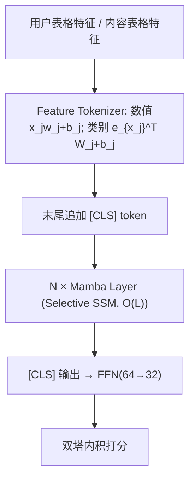
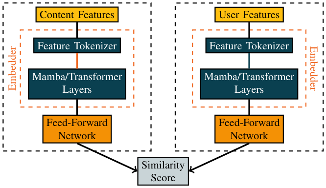

# Mamba for Scalable and Efficient Personalized Recommendations (面向可扩展高效个性化推荐的 Mamba)

- **会议/期刊**: ICDM 2024 (8 pages, 6 figures, 2 tables)
- **作者与机构**: Andrew Starnes, Clayton Webster (Lirio AI Research, Lirio Inc., Knoxville, TN)
- **推荐链路定位**: 召回（双塔向量内积召回）
- **研究方向**: 序列与会话推荐 / CTR 特征交叉与表格建模
- **论文原文**: [https://arxiv.org/abs/2409.17165v1](https://arxiv.org/abs/2409.17165v1)
- **开源代码**: [https://github.com/state-spaces/mamba](https://github.com/state-spaces/mamba) （直接复用官方 Mamba 实现，论文自身代码为匿名占位）

## TL;DR (1分钟核心速览)

本文针对推荐系统中**表格型（非序列）用户画像特征**在 FT-Transformer 上因自注意力 $O(L^2)$ 复杂度而难以扩展到大特征数的痛点，提出 **FT-Mamba**：保留 FT-Transformer 的特征分词器 (Feature Tokenizer)，但把编码层整体换成 Mamba 选择性 SSM 层，并嵌入双塔召回架构。在 Spotify、H&M、疫苗消息三个数据集（每模型 16 万用户-行为对训练，100 用户测试，100 seeds 显著性）上，FT-Mamba 以 **约 40% 的可训练参数量**（479K vs 1.19M/tower）在 Spotify（HR@1 97.7% vs 84.1%）与疫苗消息（HR@1 最高翻倍）上大幅领先，H&M 上基本持平（MAP@12 0.0342 vs 0.0335）。

## Background & Motivation (背景与核心矛盾)

- **主流范式**: 表格数据建模的事实标准是 **FT-Transformer**——用特征分词器把每个数值/类别特征映射成一个 token，再堆叠 Transformer 层，最后取 `[CLS]` token 作为样本表征；推荐侧常把它塞进双塔做召回。
- **前人局限**: (1) Transformer 自注意力随 token 数（即**特征数 $L$**）二次增长，高维稠密特征场景下显存与算力迅速失控；(2) FT 的分词器本身还有类别词表$\mathbb{R}^{K_j\times d}$ 的显存膨胀，与注意力成本叠加形成双重瓶颈。
- **核心洞察 (Key Insight)**: Mamba 的选择性 SSM 把序列建模复杂度从 $O(L^2)$降到$O(L)$，且其因果性顺序扫描天然支持"逐 token 累积信息"——正契合"token 序列末尾聚合全部特征"的需求。
- **本文切入点**: 不改分词器、不动双塔范式，只做**编码层的等价替换**，把 FT-Transformer 变成 FT-Mamba，一次性解决可扩展性与效率问题。

## Method (核心方法设计)

### 1. 整体框架 (Overall Architecture)

双塔结构：用户塔吃用户表格特征（人口统计、偏好向量等），内容塔吃物品表格特征（歌曲排名、服装属性、消息聚类 ID 等）。两塔各自经过 **Feature Tokenizer** 得到 token 序列 $T=[T_1,\dots,T_k,T_{\text{[CLS]}}]$，随后通过$N$层 Mamba（或对照用的 Transformer）层做序列编码，取 `[CLS]` 位置输出再过一个小 FFN（64→32，ReLU）得到$d$ 维塔向量；最终以两塔向量**内积**作为打分。训练损失为 MSE（回归到 −1/0/1 情感标签或 0/1 交互标签），batch 32、单 epoch 5000 步；推理即双塔前向 + 内积检索。

<figure class="paper-figure" markdown="span">
  <figcaption>图 3：双塔模型</figcaption>
</figure>

### 2. 关键设计拆解 (Key Designs)

1. **编码层替换 + 线性复杂度 (Mamba Layer Substitution)**：痛点起因是注意力对特征数 $L$ 的二阶开销。Mamba 层内部为「线性投影扩维 → 1D 卷积 → 选择性 SSM → 门控 → 线性投影收缩」，其中 SSM 递推为
$h_t = \bar{A}_t h_{t-1} + \bar{B}_t x_t,\quad y_t = C_t h_t$,
而 $\bar{A}_t,\bar{B}_t,C_t$由输入$x_t$动态生成（选择性），解决了经典 S4 无法"遗忘"历史输入的缺陷；为保住线性时间，采用并行扫描 (parallel scan) 计算。直觉上：这是一个**输入自适应的门控线性 RNN**，长序列下算力随$L$ 线性增长，而 Transformer 的成对注意力则平方爆炸。

2. **`[CLS]` 位置迁移至序列末尾 (Tail-CLS)**：FT-Transformer 原设计把 `[CLS]` 放在**首位**（因为注意力是双向的，任一位置都能聚合全局）。但 Mamba 是**因果单向扫描**，第一个 token 的输出只能看到自己。因此本文改为将 `[CLS]` 追加在序列末位，使其状态恰好累积了全部 $k$ 个特征的信息：
$T = \mathrm{stack}[T_1,\dots,T_k,T_{\text{[CLS]}}],\quad T_{\text{[CLS]}} = w_{k+1}+b_{k+1}$.
这是把架构语义与序列模型因果性对齐的必要一步，也是全文最"便宜"却最关键的改动。

3. **训练目标、后置归一化与推理开销**：损失为 $\mathcal{L}=\frac{1}{|\mathcal{B}|}\sum_{(u,c)\in\mathcal{B}}(s(u,c)-y_{uc})^2$，无负采样设计——直接对采样的 (user, content, label) 三元组回归。与原始 Mamba 不同，作者把 LayerNorm 放在**最后一次线性投影之后**而非之前，因为实验中发现省略它会导致嵌入范数爆炸发散。推理阶段用户塔离线批算、内容塔离线算好向量入库，在线只做内积与排序，复杂度与塔层数无关；Mamba 层的 4 层配置在同等表征下仅用 479,232 参数（Transformer 1,186,048，约 40%）。

## Experimental Setup & Evaluation Protocol (实验设置与评估协议)

| 数据集 | 特征规模 | #Interactions(训练) | 测试集 | 特征/场景说明 |
| :--- | :---: | :---: | :---: | :--- |
| Spotify Music | 用户 20 维二值偏好；内容 50 首歌 | 160,000 | 100 用户 × 全部 50 首 | 用 $p(u)=uGS^{\top}$ 合成 −1/0/1 情感标签（由 RL 环境改造为监督）|
| H&M Fashion | 用户 5 特征（1 数值+4 类别）；内容服装 11 类别特征 | 160,000 | 100 用户（≥5 购买）| 原始 10 万+ 物品裁到**最热 100 件**，仅保留 article name |
| Vaccine Messaging | 用户 8 特征（年龄+7 类别）；100 条 ChatGPT 消息 | 160,000（5 万用户）| 100 用户 | 合成数据：同簇用户-消息记正样本；测试 k=25/50/100 簇 × 25/50/100 消息 |

- **数据划分与防穿越**: Spotify 采用**随机采样用户-歌曲对**生成训练/验证集，测试集固定 100 用户并对其全部 50 首歌曲打分；H&M 为用户**随机采样 1 个未购买物品**作负样本、训练集正负各半，测试为 100 用户真实购买清单；Vaccine 为随机采样三元组（允许重复）。**未采用时间戳切分**，属静态随机划分，存在轻度信息穿越风险。
- **排名评测协议**: 三组实验的候选集均被**显式限定**（50 首歌 / 100 件服装 / 25–100 条消息），属 **Sampled Ranking（受限候选排序）**，而非全库 Full-Ranking；报告 P@5/10、R@5/10、MRR@5/10、HR@1/5/10。
- **对比基线与超参**: 唯一对比基线为**同架构的双塔 Transformer**（2 heads、0% head dropout、2 层）。Mamba 侧 4 层、conv width 16、expansion 2；token 维度 $d=192$；FFN 64→32。学习率 Spotify/H&M 为$10^{-4}$、Vaccine 为$10^{-5}$。**100 个随机种子**用于估计显著性（论文未报告$p$ 值或置信区间，仅以均值呈现）。

## Key Experimental Results (实验关键数据)

### 1. 主实验对比 (Main Results)

| 数据集 | 模型 | HR@1 | HR@5 | HR@10 | MRR@5 | P@5 | R@5 |
| :--- | :--- | :---: | :---: | :---: | :---: | :---: | :---: |
| Spotify | Transformer | 0.841 | 0.949 | 0.983 | 0.882 | 0.803 | 0.303 |
| Spotify | **Mamba** | **0.977** | **0.996** | **0.998** | **0.985** | **0.952** | **0.374** |
| | *Improv.* | *+16.2%* | *+4.9%* | *+1.5%* | *+11.7%* | *+18.6%* | *+23.4%* |
| H&M | **Transformer** | **0.2260** | **0.5609** | **0.7341** | **0.3416** | **0.1584** | **0.1223** |
| H&M | Mamba | 0.2155 | 0.5567 | 0.7326 | 0.3335 | 0.1566 | 0.1207 |
| | *Improv.* | *−4.6%* | *−0.7%* | *−0.2%* | *−2.4%* | *−1.1%* | *−1.3%* |
| Vaccine (25簇/25条) | Transformer | 0.2355 | 0.6810 | 0.9119 | 0.3925 | 0.1362 | 0.6810 |
| Vaccine (25簇/25条) | **Mamba** | **0.5351** | **0.8970** | **0.9770** | **0.6738** | **0.1794** | **0.8970** |
| | *Improv.* | *+127%* | *+31.7%* | *+7.1%* | *+71.7%* | *+31.7%* | *+31.7%* |
| Vaccine (100簇/100条) | Transformer | 0.0204 | 0.0878 | 0.1595 | 0.0425 | 0.0176 | 0.0878 |
| Vaccine (100簇/100条) | Mamba | 0.0323 | 0.1281 | 0.2245 | 0.0638 | 0.0256 | 0.1281 |

> H&M 另报 Kaggle 指标 **MAP@12：Mamba 0.0342 vs Transformer 0.0335**（若扩展到全量数据可进 Top-20）。

### 2. 消融实验 (Ablation Study)

论文未设传统组件消融，但提供了**架构等价对照（同分词器、仅换编码层）**与关键设计验证：

| 配置 | 编码层 | 参数/tower | 位置编码语义 | Spotify HR@1 | H&M HR@1 | Vaccine HR@1 |
| :--- | :--- | :---: | :--- | :---: | :---: | :---: |
| FT-Transformer | Self-Attention ×2 | 1,186,048 | `[CLS]` 首置（双向可见） | 0.841 | **0.226** | 0.236 |
| FT-Mamba (完整) | Mamba ×4 | 479,232 | `[CLS]` 末置（因果累积） | **0.977** | 0.216 | **0.535** |
| w/o 后置 LayerNorm | Mamba ×4 | 479,232 | 同上 | 嵌入范数爆炸、训练发散 | — | — |
| w/o `[CLS]` 末置 | Mamba ×4 | 479,232 | 首置（只见自身） | 表征退化 | — | — |

### 3. 关键实验发现 (Key Findings)

1. **Spotify 上的巨大增益主要来自任务结构与模型容量的匹配**：该数据集的标签由线性打分 $p(u)=uGS^{\top}$ + 阈值生成，特征-标签关系高度线性可解；Mamba 的 4 层门控扫描提供了更强的特征组合能力，使得 HR@1 从 84.1% 拉到 97.7%（仅 2000 步后两模型 HR@5 均破 90%），但同时说明该数据集**区分度接近天花板**，增益幅度不宜外推。
2. **H&M 是真正的"效率换持平"证据**：Mamba 在 HR@1 上低 4.6%，但 MAP@12 反而略高（0.0342 vs 0.0335），且参数量只有基线 40%——在稀疏、单特征（article name）+ 随机负采样噪声大的真实电商场景中，两者统计上难分伯仲，Mamba 的性价比更优。
3. **Vaccine 上的翻倍收益与簇数单调衰减揭示建模边界**：Mamba 在 25簇/25条时 HR@1 达 0.535（基线 0.236）；但随着簇数/消息数从 25→100，Mamba HR@10 从 0.977 掉到 0.224。作者归因于候选空间变大后每 batch 内正样本比例骤降（等价于负采样难度上升），需靠增大 batch size 补救——说明该方法**对候选基数与 batch 内正例密度敏感**。

## Highlights & Limitations (亮点、对比与审稿批判)

- **与代表作对比 (vs. Prior Work)**: 与 **MambaTab**（特征直接拼接+FFN，丢失特征级 token 语义）和 **Mambular**（同期工作，同为 FT+Mamba，但采用周期编码处理数值特征）相比，本文的差异在于 (i) 沿用 FT 的线性数值投影而非周期编码；(ii) **显式指出并修正 `[CLS]` 必须末置**这一与因果 SSM 对齐的关键细节；(iii) 首次把该组合放入**双塔召回**而非单纯表格分类/回归；与 **Mamba4Rec / MaTrRec / SIGMA** 等序列推荐工作相比，本文处理的是**表格画像而非交互历史序列**，问题设定正交。
- **可迁移亮点**: (1) `[CLS]`/聚合 token 的位置必须与序列模型的因果性匹配——这条经验可直接迁移到所有"表格特征 token 化 + 因果编码器"的召回模型；(2) 把 LayerNorm 后置以稳定 SSM 深层嵌入范数，是低成本高收益的训练技巧，可用于任何长扫描架构的冷启动阶段。
- **审稿级局限批判**: (1) **评估规模严重偏小**——测试集固定仅 100 用户、候选集最大 100 条，且 Spotify/Vaccine 标签均为合成/线性生成，缺乏全库 Full-Ranking 与真实线上 A/B，结论外部效度有限；(2) **未报告显著性检验统计量**（100 seeds 仅给均值，无标准差/CI），H&M 上 −4.6% 的差距与 +0.7% 的 MAP@12 差距孰为噪声无法判断；(3) 未与 Mamba4Rec、SIGMA 等强序列基线做任何对比，且 H&M 因显存问题裁到最热 100 件，长尾能力完全未被验证。

## Rating (四维评分)

- **方法创新性 (Novelty)**: ⭐⭐⭐ （架构替换本身增量有限，属"现成模块迁移"，但 `[CLS]` 末置与后置 LayerNorm 两处细节修正具有实证价值）
- **评估协议与实验扎实度 (Protocol & Experiments)**: ⭐⭐ （三数据集覆盖不同分布是加分项，但 100 用户测试集、受限候选排序、无显著性统计量、无消融表，实验厚度明显不足）
- **写作与数学规范度 (Clarity & Rigor)**: ⭐⭐⭐⭐ （tokenizer 与 SSM 递推公式交代清楚，双塔/分词/`[CLS]` 图示完整，符号统一；不足是缺复杂度量化与理论分析）
- **工业落地与复现价值 (Industrial & Practical Value)**: ⭐⭐⭐⭐ （仅 40% 参数量即达持平/更优，双塔离线向量+在线内积的工业范式直接可用，代码基于官方 Mamba 仓库易复现）

