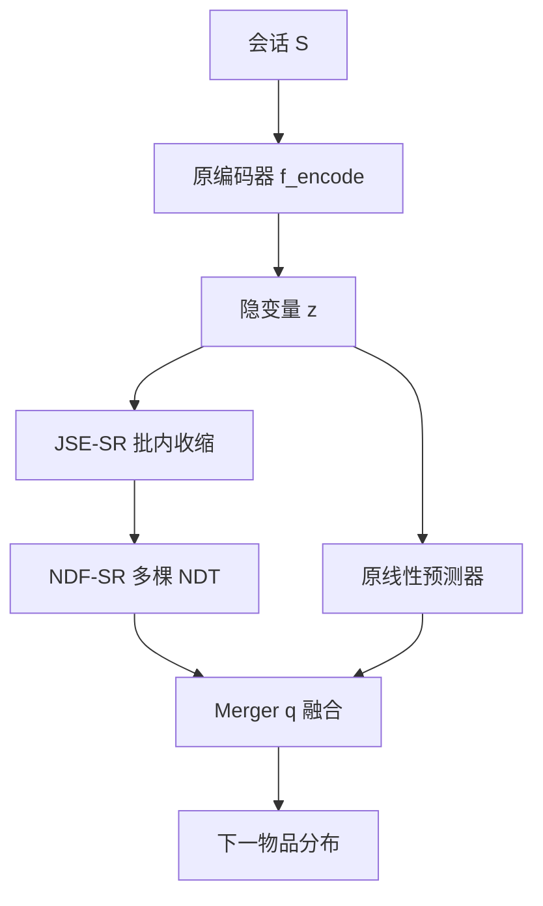
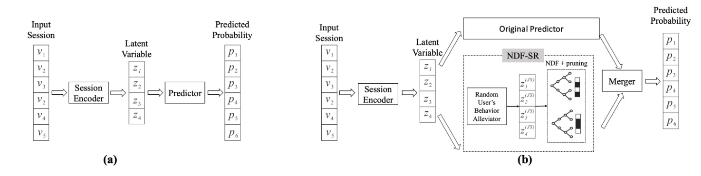
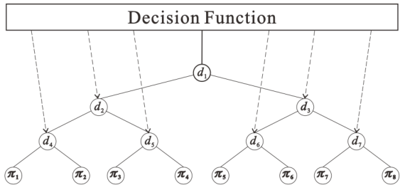

# SR-PredictAO: Session-based Recommendation with High-Capability Predictor Add-On（SR-PredictAO：带高能力预测器插件的会话推荐）

- **会议/期刊**: ICDM 2024
- **作者与机构**: Ruida Wang, Raymond Chi-Wing Wong, Weile Tan（HKUST）
- **推荐链路定位**: 端到端会话推荐排序（next-item prediction）
- **研究方向**: 序列与会话推荐
- **论文原文**: [论文原文链接](https://arxiv.org/abs/2309.12218v2)
- **开源代码**: [开源代码仓库链接](https://github.com/RickySkywalker/SR-PredictAO-official)

## TL;DR (1分钟核心速览)

针对会话推荐中现有模型只卷编码器、预测器多为线性层导致决策能力不足，且会话含随机行为噪声的问题，本文提出即插即用 SR-PredictAO：用 James-Stein 收缩去噪隐变量，外挂神经决策森林 NDF-SR，再与线性预测分布融合。在 Yoochoose1/64 与 Diginetica 的全库排序 HR@20/MRR@20 上，DIDN 最高提升 2.9%/2.3%。

## Background & Motivation (背景与核心矛盾)

- **主流范式**: GNN/Transformer 编码 session 得到隐变量 $z$，预测器通常是线性层：$s_h=\operatorname{Linear}(z)$、$c=A s_h$、$\hat y=\operatorname{softmax}(c)$。
- **前人局限**: ① 预测器容量低（DoF 低），但 LESSR、SGNN-HN、DIDN 等几乎只优化编码器；② 直接加大预测器容量易过拟合；③ 会话含随机点击/多意图噪声，编码端去噪不彻底。
- **核心洞察 (Key Insight)**: 模型能力可用 Degrees-of-Freedom (DoF) 量化；神经决策树可显著提高 DoF，随机剪枝可控制容量；James-Stein 批内收缩能用同列间接证据降低隐变量噪声。
- **本文切入点**: 不改原编码器，在 predictor 侧增加高能力分支，并与原线性分支融合，形成通用 add-on。

## Method (核心方法设计)

### 1. 整体框架 (Overall Architecture)

对任意 encoder-predictor 基模型，先由原编码器得到 $z$；JSE-SR 在 batch 内对$Z$做列级收缩，得到$\hat Z^{(JS)}$；NDF-SR 用多棵 NDT 输出高能力分布$\hat y_{NDF}$；原线性分支输出$\hat y_{base}$，Merger 以$q$线性融合得$\hat y$。训练时基模型与附加模块端到端联合优化交叉熵；推理时两分支并行打分，新增开销主要随叶子数$k$ 增长。整体框架见图1。

<figure class="paper-figure" markdown="span">
  <figcaption>图 1：(a) 基础模型概览，(b) SR-PredictAO 框架；给定输入会话 S，编码器模块生成隐变量 z。在 (a) 中，z 被传入基础模型预测器模块，得到对所有物品的预测概率分布。在 (b) 中，z 同时被传入基础模型预测器模块和新预测器模块（称为 NDF-SR），得到两个对所有物品的预测概率分布。然后，Merger 模块将这两个分布合并，输出最终分布。</figcaption>
</figure>

### 2. 关键设计拆解 (Key Designs)

1. **JSE-SR 随机行为去噪**：痛点起因是编码器输出受随机行为扰动，不能当作真实隐变量。假设 $z_{ij}|\mu_{ij}\sim\mathcal N(\mu_{ij},\sigma_j^2)$、$\sigma_j\ge1$，用 James-Stein 估计$\hat\mu_{ij}^{(JS)}=(1-\frac{m-2}{\|\xi_j\|^2})z_{ij}$，其中$\xi_j$为 batch 第$j$列。它借同列其他会话的间接证据做收缩，Lemma 4.1 证明其平方误差不大于 MLE$z_{ij}$，故能压低随机行为影响。
2. **NDF-SR 高能力预测器**：NDT 用神经决策函数 $f:\mathbb R^{n'}\to\mathbb R^{2^d-1}$产生分裂分数$s=\sigma(f(\hat z^{(JS)}))$，节点到达概率递归$p_{\text{left}}=p_{\text{root}}s$、$p_{\text{right}}=p_{\text{root}}(1-s)$，叶子分布经$\hat p=p_{\text{leaf}}^\top\operatorname{softmax}(\pi)$得单树输出。NDF 对$T$棵树平均$\hat y_{NDF}=\frac1T\sum_i\hat p_i$；训练时对叶子随机 mask 剪枝、对每棵树随机屏蔽输入维度，以控制过拟合。NDT 结构见图2。
3. **融合与训练**：$\hat y=q\hat y_{base}+(1-q)\hat y_{NDF}$，$q\in[0,1]$；损失$\mathcal L(y,\hat y)=-y^\top\log\hat y$，全库 softmax，无负采样，端到端反传。复杂度$O(mn'k+mkN)$，仅比线性预测器的$O(mn'N)$ 略高。

<figure class="paper-figure" markdown="span">
  <figcaption>图 2：NDT 概览，决策函数给出根节点和内部节点的分裂分数，叶子节点的结果是会话到达该节点的概率</figcaption>
</figure>

## Experimental Setup & Evaluation Protocol (实验设置与评估协议)

- **数据集与预处理**: 沿用 LESSR/SGNN-HN 的公开 session 预处理；Yoochoose 取 1/64 子集。会话级数据未给 #Users 与密度，按点击量统计如下：

| 数据集 | #Clicks | #Train Sessions | #Test Sessions | #Items | Avg Len |
| :--- | :---: | :---: | :---: | :---: | :---: |
| Yoochoose 1/64 | 565,332 | 375,625 | 55,896 | 17,792 | 6.14 |
| Diginetica | 982,961 | 647,523 | 71,947 | 43,097 | 5.12 |

- **数据划分与防穿越**: 沿用前人 session 预处理与按时间切分，训练用历史会话、测试用近期会话，避免未来会话泄漏。
- **排名评测协议**: **Full-Ranking**，对全部物品 softmax 打分并排序；指标 HR@20、MRR@20；训练为全库交叉熵，**无负采样**。
- **对比基线与超参**: 对比 Item-KNN、GRU4REC、STAMP、SR-IEM、SR-GNN，以及 LESSR/SGNN-HN/DIDN 三个基模型；基模型沿用原文最优超参，新增超参二分搜索；双比例 z 检验，$p<0.05$ 视为显著。

## Key Experimental Results (实验关键数据)

### 1. 主实验对比 (Main Results)

| 方法 | Diginetica HR@20 | Diginetica MRR@20 | Yoochoose HR@20 | Yoochoose MRR@20 |
| :--- | :---: | :---: | :---: | :---: |
| Item-KNN | 35.75 | 11.57 | 51.60 | 21.81 |
| GRU4REC | 29.45 | 8.33 | 60.64 | 22.89 |
| STAMP | 45.64 | 14.32 | 68.74 | 29.67 |
| SR-IEM | 52.35 | 17.64 | 71.15 | 31.71 |
| SR-GNN | 50.73 | 17.59 | 70.57 | 30.94 |
| LESSR | 51.71 | 18.15 | 70.94 | 31.16 |
| SGNN-HN | 55.67 | 19.12 | 72.06 | **32.61** |
| DIDN | 56.22 | 20.03 | 68.95 | 31.27 |
| SR-PredictAO(LESSR) | 53.10 | 18.38 | 71.73 | 31.70 |
| SR-PredictAO(SGNN-HN) | 55.91 | 19.06 | **72.62** | 32.47 |
| SR-PredictAO(DIDN) | **57.86** | **20.49** | 69.50 | 31.44 |

相对基模型：LESSR +2.7%/+1.3%；SGNN-HN +0.4%/-0.3% 与 +0.8%/-0.4%；DIDN +2.9%/+2.3% 与 +0.8%/+0.5%（Diginetica/YC 的 HR/MRR）。DIDN/LESSR 上提升统计显著（$p<10^{-5}$），SGNN-HN 在 Diginetica 的 HR 提升不显著（$p=0.179$）。

### 2. 消融实验 (Ablation Study)

下表为 HR@20 (%)：

| 数据集/基模型 | Full | w/o Alleviator | w/o Pruning |
| :--- | :---: | :---: | :---: |
| Diginetica / LESSR | 53.15 | 52.99 | 53.06 |
| Diginetica / SGNN-HN | 55.91 | 55.79 | 55.78 |
| Diginetica / DIDN | 57.86 | 57.33 | 57.26 |
| YC1/64 / LESSR | 71.73 | 71.67 | 71.66 |
| YC1/64 / SGNN-HN | 72.62 | 72.58 | 72.58 |
| YC1/64 / DIDN | 69.50 | 69.26 | 69.20 |

### 3. 关键实验发现 (Key Findings)

1. **预测器容量是真瓶颈**：DIDN 在 Diginetica 上 HR@20 从 56.22 升至 57.86（+2.9%），MRR@20 从 20.03 升至 20.49（+2.3%），$p<10^{-5}$；LESSR 也提升 +2.7%/+1.3%，说明仅改 predictor 侧即可获益。
2. **强编码器上未必稳定**：SGNN-HN 在 Diginetica 仅 +0.4% HR、MRR -0.3%，YC 上 MRR -0.4%，$p=0.179/1.8\times10^{-2}$；高能力树与强编码器可能饱和，融合权重$q$ 与树深需调。
3. **去噪与剪枝均有效且数据越脏越重要**：去掉 Alleviator 或 Pruning，DIDN 在 Diginetica 从 57.86 降至 57.33/57.26，降幅大于 YC 的 69.50→69.26/69.20；NDF 在深度约 5、树数约 128 较优，说明噪声越重、容量控制越关键。

## Highlights & Limitations (亮点、对比与审稿批判)

- **与代表作对比 (vs. Prior Work)**: LESSR/SGNN-HN/DIDN 主要优化 GNN 编码器，本文不改编码器而补 predictor；相对简单放大基模型，SR-PredictAO(SGNN-HN) 以 1118MB 优于 1605MB 的 enlarged SGNN-HN（55.91 vs 55.24 HR@20）。
- **可迁移亮点**: predictor add-on 可插件化到任意 encoder-predictor；JSE-SR 批收缩可用于任何噪声隐变量；随机 mask 剪枝可控制树模型容量。
- **审稿级局限批判**: ① NDF 推理随叶子数/树数增加，在线延迟需评估；② $q$、树深、剪枝率敏感，且 SGNN-HN 的 MRR 出现下降；③ 仅两个基准、三个较老基模型，缺少更多近期 SOTA 与线上 A/B。

## Rating (四维评分)

- **方法创新性 (Novelty)**: ⭐⭐⭐⭐ （首次系统指出 predictor 低能力问题，并用 NDF+JSE 做 add-on；但仍是既有范式上的增强）
- **评估协议与实验扎实度 (Protocol & Experiments)**: ⭐⭐⭐⭐ （两个公开基准、三个 SOTA 基模型、全库排序与显著性检验齐全；缺重复运行方差与更多新基线）
- **写作与数学规范度 (Clarity & Rigor)**: ⭐⭐⭐⭐ （JSE 引理与 NDT 公式清楚；但部分表格数值不一致，剪枝公式表述略粗）
- **工业落地与复现价值 (Industrial & Practical Value)**: ⭐⭐⭐⭐ （代码开源、插件式易接入；树并行带来额外开销，需按叶子数控制线上成本）

