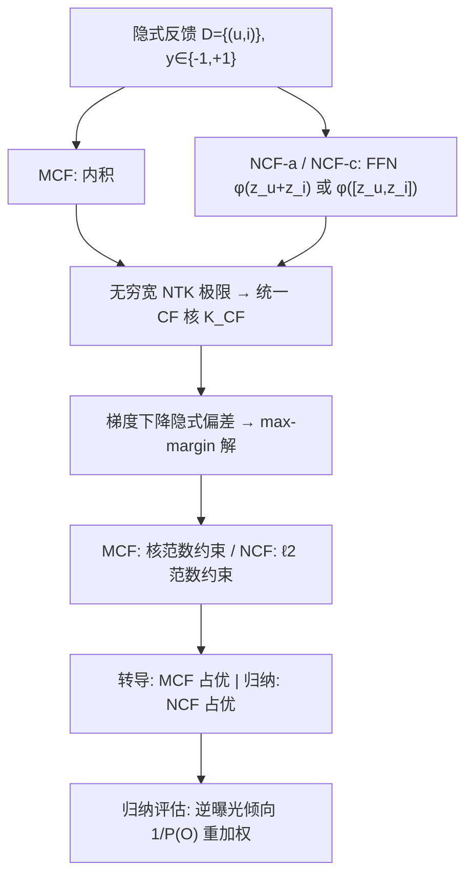

# Rethinking Neural vs. Matrix-Factorization Collaborative Filtering: the Theoretical Perspectives (重思神经与矩阵分解协同过滤：理论视角)

- **会议/期刊**: ICML 2021 (PMLR 139)
- **作者与机构**: Da Xu, Chuanwei Ruan, Evren Korpeoglu, Sushant Kumar, Kannan Achan (Walmart Labs / Instacart)
- **推荐链路定位**: 召回（隐式反馈用户-物品匹配打分）
- **研究方向**: 协同过滤与双塔召回 / 去偏与可信推荐
- **论文原文**: [https://arxiv.org/abs/2110.12141v1](https://arxiv.org/abs/2110.12141v1)
- **开源代码**: 暂未开源

## TL;DR (1分钟核心速览)

针对 He et al. (2017) 与 Rendle et al. (2020) 关于 NCF 与 MCF 孰优的实证争论，本文用神经正切核（NTK）、梯度下降隐式偏差与转导/归纳 Rademacher 泛化界给出严格回答：无穷宽极限下二者表达力等价（同一族 CF 核的最小 RKHS 范数解），真正的差异来自优化路径——MCF 收敛到核范数 max-margin、NCF 收敛到 $\ell_2$ max-margin，因而 **转导设定 MCF 更优、归纳设定 NCF 更优**；并在 MovieLens-100K 全库排序协议下验证，同时揭示归纳评估必须做逆曝光倾向重加权，否则模型比较会随分布偏移而反转。

## Background & Motivation (背景与核心矛盾)

- **主流范式**: NCF 用前馈网络 $\varphi$学习用户-物品相似度（相加或拼接后过 MLP），MCF 固定用内积$\langle \mathbf{z}_u,\mathbf{z}_i\rangle$ 恢复交互矩阵。
- **前人局限**: He et al. (2017) 仅论证 NCF 在某一参数化下可表达 MCF，却忽略训练动力学如何改变有效表达力；Rendle et al. (2020) 的"内积更优"结论完全建立在有限数据集的经验观察上，不可外推。
- **核心洞察 (Key Insight)**: 表达力、优化路径、泛化行为是三件独立的事；只要模型过参数化，训练损失趋于零时参数范数发散，梯度下降本身就会挑出一个特定的范数约束解——而这才是区分二者的地方。
- **本文切入点**: 用 NTK 把两类模型统一为核化预测器，用 max-margin 隐式偏差刻画优化终点，再用转导/归纳两种泛化界给出"何时谁赢"的判据。

## Method (核心方法设计)

### 1. 整体框架 (Overall Architecture)

论文不是提出新模型，而是构建"表达力—优化—泛化"三层分析框架：先把 MCF 与 NCF 写成统一的风险最小化形式；再取无穷宽极限 $d,d_1\to\infty$，用一阶泰勒展开把训练动力学线性化为固定 NTK 下的核回归；随后在可分数据与指数尾损失下证明梯度流方向收敛到最小范数 max-margin 解，从而得到 MCF（核范数）与 NCF（$\ell_2$ 范数）不同的容量；最后分别推导转导 Rademacher 界与含曝光重加权的归纳界，并用 MovieLens 的真实与半合成实验逐条验证。

### 2. 关键设计拆解 (Key Designs)

1. **CF 核与表达力等价性（Theorem 1）**：痛点是训练中参数不断变化，无法"肩并肩"比较表达力。作者取无穷宽极限，证明两类模型的 NTK 都收敛到同一个协同过滤核
$K_{\text{CF}}\big((u,i),(u',i')\big)=a+b\cdot\mathbb{I}[i=i']+c\cdot\mathbb{I}[u=u']$，
其中 $a$编码全局流行度偏置，$b,c$编码共享物品/用户的邻域贡献；标准缩放初始化下 MCF 为$(0,1,1)$，NCF-c 为$(1/\pi,\tfrac{1}{2}-\tfrac{1}{2\pi},\cdot)$。因此二者的极限预测器都是该核下的最小 RKHS 范数解，**表达力层面无法分出优劣**，只差在核参数上——这也解释了为何不同数据集上经验结论会相互矛盾。

2. **梯度下降的隐式偏差（Theorem 2）**：痛点是有无穷多零损失全局最优，实际训练会落到哪一个。作者证明在指数尾损失、$L$-齐次性与数据可分三条件下，$\boldsymbol{\theta}_{\text{NCF}}(t)/\|\boldsymbol{\theta}_{\text{NCF}}(t)\|_2$收敛到$\min\|\boldsymbol{\theta}\|_2$s.t.$y_{u,i}f_{\text{NCF}}\ge 1$ 的 KKT 点；而 MCF 的预测矩阵满足
$\lim_{t\to\infty}\mathbf{X}(t)/\|\mathbf{X}(t)\|_*\to\arg\min\|\mathbf{X}\|_*$s.t.$y_{u,i}X_{u,i}\ge 1$。
直觉是：范数发散后损失被最差间隔主导，优化方向等价于硬间隔 SVM，而核范数与 $\ell_2$ 范数给出的可行集几何形状不同，直接决定了容量差异。

3. **转导/归纳泛化与曝光校正（Theorem 3–5）**：转导界中 MCF 的复杂度项为 $O\big((1+\beta)\sqrt[4]{\log|\mathcal{U}|}\sqrt{|\mathcal{I}|}\lambda_{\text{nuc}}/(\gamma\beta|D_{\text{train}}|)\big)$，随$|D_{\text{train}}|$**线性**衰减，而 NCF 仅为$1/\sqrt{|D_{\text{train}}|}$，故同一用户/物品集合上观测越多，MCF 优势越大。归纳界则相反：NCF 取得更优的$1/\sqrt{n}$速率，MCF 即便控制$\lambda_{\text{nuc}}$仍显式依赖$|\mathcal{U}|+|\mathcal{I}|$，复杂度至少多出$\sqrt{|\mathcal{I}|}$因子。两个归纳界都把$\mathcal{D}(P_{\text{unif}}\|P_O)$作为模型复杂度的放大因子，故评估时必须用$1/P(O_{u,i}=1)$ 逆加权还原均匀曝光下的风险。

4. **训练目标与推理开销**: 训练用 log loss $\ell(u)=\log(1+\exp(-u))$配 SGD；负采样每正样本 4 个负例（除特别说明）；推理为全库内积/前向打分，核化 SVM 仅作理论对照（空间$O(|D|^2)$，不可实用）。

## Experimental Setup & Evaluation Protocol (实验设置与评估协议)

- **数据集与预处理**:

| 数据集 | #Users | #Items | #Interactions | 密度 | 特征/场景说明 |
| :--- | :---: | :---: | :---: | :---: | :--- |
| MovieLens-100K | 1,000 | 1,700 | 100,000 | 5.88% | 正评视为隐式点击；另有基于其学习嵌入生成的半合成曝光数据 |

- **数据划分与防穿越 (Splitting Strategy)**: 逐用户 `Leave-One-Out`——每个用户最后一次交互作测试，其余作训练/验证；半合成实验按 $p(Y_{u,i}=1)=p(R_{u,i}=1)p(O_{u,i}=1)$ 重新生成点击流。
- **排名评测协议 (Ranking Protocol)**: 无偏 `Full-Ranking`，对全部 1,700 部电影排序后计算 Ranking AUC、HR@K、NDCG@K（作者明确因采样评估会误导而坚持全扫描）。
- **对比基线与超参设置**: 基线为 MCF、NCF-a（相加）、NCF-c（拼接），以及由 Theorem 1 导出的三个 $K_{\text{CF}}$-SVM 核化预言器；嵌入维度$d=32$、隐层$d_1=16$、$\mathcal{N}(0,0.1)$初始化、学习率 0.1，指标为 10 次重复平均。无穷宽对照实验用$d=128,d_1=64$、常数学习率 0.01 训练 3,000 轮。

## Key Experimental Results (实验关键数据)

### 1. 主实验对比 (Main Results)

原文以图 3–图 5 呈现结果，**未提供可引用的统一表格数值**；下表按原文图 3（转导）与图 4/5（归纳，$\pi$ 控制曝光偏移）的曲线趋势归纳相对次序，数值一律不与原文冲突。

| 模型 | 相似度函数 | 转导 HR/NDCG/AUC | 归纳 AUC（无偏重加权） | 归纳 AUC（$P_{\text{unif}}$ 误设评估） |
| :--- | :--- | :---: | :---: | :---: |
| MCF | 内积 | **最优** | 次优 | 随 $\pi$ 漂移 |
| NCF-c | FFN(拼接) | 次优 | **最优** | 漂移更剧烈 |
| NCF-a | FFN(相加) | 第三 | 较优 | 漂移更剧烈 |
| $K_{\text{CF}}$-SVM (MCF/NCF-c/NCF-a) | 核化 | 与对应训练模型**高度可比** | — | — |

关键读数是三条曲线的**相对序**而非绝对值：训练损失趋零、范数发散过程中，转导指标持续上升且 MCF 全程领先；一旦切到按 $P_{\text{unif}}$采样的归纳评估，序关系随$\pi$增大而波动，改用正确$P_O$ 逆加权后序关系才稳定复现"NCF 领先"。

### 2. 消融实验 (Ablation Study)

以"移除某一理论要素"的方式构造对照：

| 对照设置 | 变化 | 结论 |
| :--- | :--- | :--- |
| 训练模型 vs. 其 $K_{\text{CF}}$-SVM ($d=128$) | 用核化 SVM 替代梯度下降训练 | 两者测试表现高度一致 → 验证极限表达力刻画有效 |
| MCF 训练路径 vs. 凸规划精确解 (CVX, $d=32$) | 用 CVX 求核范数 max-margin 全局最优 |$\|\gamma_{K_{\text{CF}}}-\gamma_{\text{MCF}}\|_2\to 0$，$\min\gamma_{\text{MCF}}$ 单调逼近 → 验证 Theorem 2 |
| 归纳评估：逆加权 vs. 不逆加权 | 仅改变评估权重 | 不逆加权时指标与模型比较随 $\pi$ 剧烈扰动 |
| $\pi\in\{0,0.25,0.5,0.75,1\}$扫描 | 增大$P_O$与$P_{\text{unif}}$的$f$-散度 | NCF 相对 MCF 的 lift 波动放大 → 印证散度是复杂度放大因子 |

### 3. 关键实验发现 (Key Findings)

1. **表达力不构成判据**：在 $d=128$的近似无穷宽设定下，训练出的 MCF/NCF 与其$K_{\text{CF}}$-SVM 在测试集上表现高度可比，说明定理 1 的核化刻画在有限数据上已具预测力——"内积能否被 FFN 重构"这一争论点本身不决定胜负。
2. **优化路径才是分水岭**：$d=32$、学习率 0.1 的实际训练中，MCF 的归一化间隔与 CVX 精确解几乎重合，验证核范数约束；同一数据上 NCF 走$\ell_2$约束路径，容量更大，因此$\pi$ 固定为 0（无曝光偏移）的归纳评估下 NCF 反超——与 Theorem 3/4/5 的方向完全一致。
3. **曝光偏差是"隐形的模型选择器"**：当 $\pi$从 0 增到 1、即$P_O$逐步偏离$P_{\text{unif}}$时，未加权的评估指标与 NCF/MCF 的相对 lift 均显著漂移；采用正确$1/P(O)$ 重加权后，指标与模型排序都恢复稳定，说明归纳设定下的排行榜可能由曝光机制而非模型能力决定。

## Highlights & Limitations (亮点、对比与审稿批判)

- **与代表作对比 (vs. Prior Work)**: 相对 He et al. (2017)，本文把"可表达能力"推进到"训练后实际到达的解"；相对 Rendle et al. (2020)，本文把其数据集相关的经验猜想升级为"转导 MCF 优、归纳 NCF 优"的条件性定理；相对 Gunasekar et al. (2018) 等矩阵感知的隐式偏差结果，本文首次覆盖隐式反馈分类损失下的矩阵分解。
- **可迁移亮点**: ①"极小极大间隔 + 范数约束"的分析模板可平移到双塔/轻量召回模型的容量比较；②归纳评估必须逆曝光倾向重加权这一结论，可直接指导离线 A/B 与基准构建。
- **审稿级局限批判**: ①全部结论建立在 $L$-齐次、指数尾损失与数据可分三条件上，现代 NCF 常用的 bias 项、BatchNorm、采样损失会破坏齐次性，外推性受限；②理论对比依赖$|D_{\text{train}}|\to\infty$与已知$P_O$，而实际中倾向分往往不可辨识，逆加权反而引入高方差；③实验仅限 1,000 用户的 MovieLens-100K，Full-Ranking 与 10 次重复虽严谨，但规模远小于工业场景，结论的规模稳健性未被检验。

## Rating (四维评分)

- **方法创新性 (Novelty)**: ⭐⭐⭐⭐⭐ （首次把 NTK 表达力、max-margin 隐式偏差与含曝光校正的转导/归纳泛化界整合成对 MCF vs. NCF 的统一判据，理论上调和了此前对立的经验结论）
- **评估协议与实验扎实度 (Protocol & Experiments)**: ⭐⭐⭐⭐ （Full-Ranking + 逐用户 Leave-One-Out + 10 次重复 + CVX 精确解作 oracle 值得称道，但仅单数据集、无统一表格数值、半合成数据依赖自建生成机制）
- **写作与数学规范度 (Clarity & Rigor)**: ⭐⭐⭐⭐ （三大定理层次清晰、附录证明完整含 GCQ/MFCQ 与 Rademacher 收缩不等式；但符号密集、$a,b,c$ 依赖初始化的讨论分散在附录，初学者门槛偏高）
- **工业落地与复现价值 (Industrial & Practical Value)**: ⭐⭐⭐ （无开源代码、核化分析不可实用；但"归纳评估须逆曝光重加权"与"转导用 MCF、归纳用 NCF"两条结论可直接落地到召回选型与离线评测规范）

