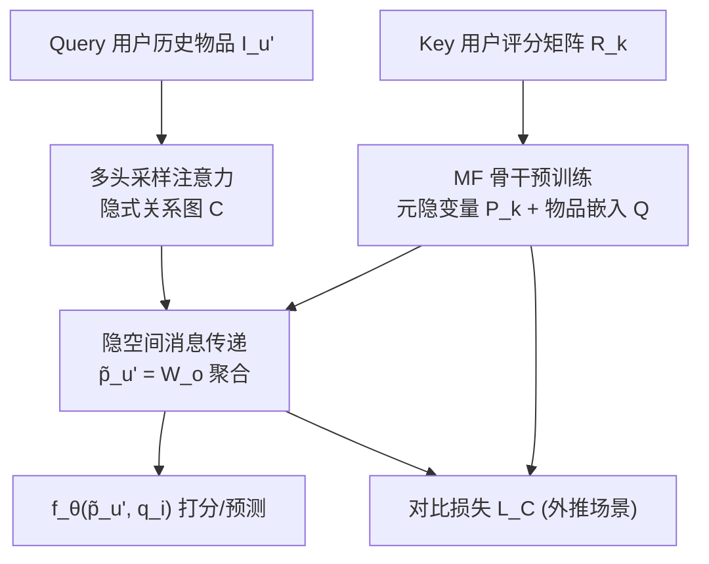

# Towards Open-World Recommendation: An Inductive Model-based Collaborative Filtering Approach (面向开放世界推荐：归纳式模型协同过滤方法)

- **会议/期刊**: ICML 2021 (PMLR 139)
- **作者与机构**: Qitian Wu, Hengrui Zhang, Xiaofeng Gao, Junchi Yan (上海交通大学)，Hongyuan Zha (CUHK-Shenzhen)
- **推荐链路定位**: 召回（用户表征学习 / 冷启动在线推断）
- **研究方向**: 协同过滤与双塔召回 / 冷启动与长尾推荐
- **论文原文**: [论文原文链接](http://proceedings.mlr.press/v139/wu21j/wu21j.pdf)
- **开源代码**: [IDCF](https://github.com/qitianwu/IDCF)

## TL;DR (1分钟核心速览)

传统 MF/CF 的用户嵌入是**按 one-hot 索引独立参数化**的直推式（transductive）学习，训练集外的用户必须重训或增量拟合；而特征驱动 / 子图归纳模型虽能泛化，却以牺牲表征容量为代价。本文提出 IDCF：先在 key 用户评分矩阵上做任意 MF 骨干预训练得到"元隐变量" $P_k$，再用多头注意力关系模型估计 query 用户到 key 用户的隐式关系图，通过隐空间消息传递即时合成$\tilde{p}_{u'}$。理论上证明其重构损失与 MF 等价，实验在 Douban/ML-100K/ML-1M 新用户上 RMSE 相对降低 2.6%–4.0%、Amazon 隐式数据新用户 AUC 提升 25.7%。

## Background & Motivation (背景与核心矛盾)

- **主流范式**: MF/CF 将评分矩阵分解为用户/物品隐因子，预测 $\hat{r}_{ui}=f_\theta(p_u,q_i)$；GCMC/NGCF/PinSAGE 等进一步用 GNN、MLP 替换$f_\theta$ 以提升表达力。
- **前人局限 1**: 用户嵌入与用户索引绑定，模型训练完即"冻结"在训练用户集合上，测试期新用户只能重训全量矩阵或拟合新嵌入（易过拟合、无法 on-the-fly 推理）。
- **前人局限 2**: 特征驱动模型（NIMC/BOMIC）依赖用户画像，而同龄同职业用户评分可能截然不同，且隐私约束下高质量特征难获取；IGMC 依赖局部子图，不同行为的用户子图可能**不可辨识**，且无法处理隐式反馈、无法输出用户表征。
- **核心洞察 (Key Insight)**: 用户之间存在未被观测的隐式关系图（偏好邻近/行为相似），只要识别该图，就可用消息传递把已有用户的隐变量"传播"给新用户——归纳能力与表征容量可解耦。
- **本文切入点**: 保留 MF 的完整表达能力（元隐变量），只把"用户→嵌入"的映射从查表改为注意力关系头。

## Method (核心方法设计)

### 1. 整体框架 (Overall Architecture)

用户被划分为 key 用户 $U_k$与 query 用户$U_q$。第一阶段：在$R_k$上以常规直推方式训练 MF 骨干，得到用户元隐变量$P_k$、物品嵌入$Q$与打分网络$f_\theta$。第二阶段：冻结$P_k,Q$，用多头注意力关系模型$h_w$由 query 用户历史物品集合$d_{u'}=\sum_{i\in I_{u'}}q_i$估计其对各 key 用户的注意力权重，加权汇聚$P_k$得到$\tilde{p}_{u'}$，再用同一$f_\theta$ 预测；外推场景额外加自监督对比正则。推理时新用户只需一次注意力前向，无需任何重训。

### 2. 关键设计拆解 (Key Designs)

1. **元隐变量 + 注意力归纳（容量等价定理）**: 前人归纳模型失效的根因是把用户表示压缩到共享特征/子图，容量受限。作者证明：若最优 $P_k$列满秩（$d\ll N$时近乎必然），则任一使$D_{S_q}<\epsilon$的 MF 解都能被某个关系矩阵$C$复现，即 IDCF 可达到与 MF 相同量级的重构误差。于是只需把$C$参数化为注意力：$c_{u'u}=\mathrm{softmax}_{u\in U_k}\big(e^{\top}[W_q d_{u'}\,\|\,W_k p_u]\big)$，既把参数量从$O(M_kM_q)$ 降至常数，又天然支持未见用户。
2. **多头采样注意力与消息传递（可扩展性）**: 全局归一化需遍历全部 key 用户，故每头独立采样子集 $U_k^{(l)}$，多头并行后拼接：$\tilde{p}_{u'}=W_o\big[\big\|_{l=1}^{L}\sum_{u\in U_k^{(l)}}c^{(l)}_{u'u}W_v^{(l)}p_u\big]$。$d_{u'}$由历史物品嵌入求和构成，注意力因而捕捉**一阶行为邻近**并隐式保持**二阶邻近**（历史相似者对 key 用户的关系分布相似）；当$I_{u'}=\emptyset$ 时可随机取候选物品兜底，或直接替换为用户画像特征以做混合推荐。
3. **训练目标、负采样与推理开销**: 第一阶段 $\min_{P_k,Q,\theta}D_{S_k}(\hat R_k,R_k)$；第二阶段$\min_{w,\theta}D_{S_q}(\hat R_q,R_q)+\lambda\mathcal{L}_C$，其中外推场景的对比损失为$\mathcal{L}_C=\frac{1}{M_q}\sum_u\log\frac{\exp(p_u^{\top}\tilde p_u)}{\sum_{u'\in U_q}\exp(p_u^{\top}\tilde p_{u'})}$（分母用 in-batch 负样本近似）。$\ell$显式用 MSE、隐式用交叉熵，无额外负采样算子；泛化界$O\big(2LHB\sqrt{2M_q\ln M_k/T_q}+\sqrt{\ln(1/\delta)/T_q}\big)$ 表明 key 用户集合的**规模与代表性**需权衡。

## Experimental Setup & Evaluation Protocol (实验设置与评估协议)

| 数据集 | #Users | #Items | #Interactions | 密度 | 特征/场景说明 |
| :--- | :---: | :---: | :---: | :---: | :--- |
| Douban | 3,000 | 3,000 | 0.13M | 0.0152 | 显式评分；2,131 key / 869 query |
| ML-100K | 943 | 1,682 | 0.10M | 0.0630 | 显式评分 [1–5] |
| ML-1M | 6,040 | 3,706 | 1.0M | 0.0447 | 显式评分；5,114 key / 926 query |
| Amazon-Books | 52,643 | 91,599 | 2.1M | 0.0012 | 隐式反馈，无画像特征 |
| Amazon-Beauty | 2,944 | 57,289 | 0.08M | 0.0004 | 隐式反馈，无画像特征 |

- **数据划分与防穿越**: Douban/ML-100K 沿用 Monti et al. 给定划分；ML-1M 采用 9:1 训练/测试划分；Amazon 取每用户**最后 10 条交互**作测试，其余训练；统一留出 5% 训练数据作验证集用于 early stopping。Amazon 原始数据经 **5-core 过滤**（剔除交互数 <5 的用户/物品）。
- **排名评测协议**: 显式数据用 **RMSE + NDCG**（回归/多分类视角）；隐式数据用 **Sampled Ranking**——每个正样本**均匀采样 5 个负样本**（正负比 1:5），报告 AUC 与 NDCG。**未采用 Full-Ranking 全库排序**，正文亦未报告显著性检验。
- **场景定义**: 少样本（few-shot/interpolation）指训练评分数 < $\tau$（Douban/ML 为 30，Amazon 为 20）的用户入$U_2$；新用户（new/extrapolation）指训练阶段完全未出现、测试期仅有少量评分的用户。
- **对比基线与超参**: 直推 PMF/NNMF/GCMC、特征驱动 NIMC/BOMIC、子图归纳 IGMC、item-based FISM/Mult-VAE、图模型 NGCF/PinSAGE；骨干两种规格 IDCF-NN（3 层 MLP+点积）与 IDCF-GC（GCMC 图卷积），嵌入维度与超参详见原文附录 D.1。

## Key Experimental Results (实验关键数据)

### 1. 主实验对比 (Main Results)

少样本用户（RMSE↓ / NDCG↑，加粗为当前列最优）：

| 方法 | 类型 | Douban RMSE | Douban NDCG | ML-100K RMSE | ML-100K NDCG | ML-1M RMSE | ML-1M NDCG |
| :--- | :--- | :---: | :---: | :---: | :---: | :---: | :---: |
| PMF | 直推 | 0.718 | 0.954 | 1.003 | 0.843 | 0.946 | 0.940 |
| NNMF | 直推 | **0.705** | 0.952 | 0.987 | 0.940 | **0.878** | 0.940 |
| GCMC | 直推 | 0.706 | **0.956** | 0.989 | **0.947** | 0.886 | **0.947** |
| NIMC | 归纳+特征 | 0.745 | 0.931 | 1.065 | 0.832 | 0.995 | 0.904 |
| BOMIC | 归纳+特征 | 0.747 | 0.925 | 1.001 | 0.828 | 0.953 | 0.924 |
| IGMC | 归纳无特征 | 0.728 | — | 0.997 | — | 0.956 | — |
| IDCF-NN | 归纳无特征 | 0.712 | **0.956** | 0.996 | 0.896 | 0.952 | 0.940 |
| IDCF-GC | 归纳无特征 | 0.712 | **0.956** | **0.981** | 0.901 | 0.944 | 0.940 |

隐式反馈（AUC / NDCG，Few-Shot 与 New 分列）：

| 方法 | Books AUC(FS) | Books NDCG(FS) | Books AUC(New) | Books NDCG(New) | Beauty AUC(FS) | Beauty AUC(New) |
| :--- | :---: | :---: | :---: | :---: | :---: | :---: |
| PMF | 0.917 | 0.888 | — | — | 0.779 | — |
| NGCF | 0.916 | 0.896 | — | — | 0.793 | — |
| PinSAGE | 0.923 | 0.901 | — | — | 0.790 | — |
| FISM | — | — | 0.752 | 0.792 | — | 0.613 |
| Mult-VAE | — | — | 0.738 | 0.701 | — | 0.644 |
| IDCF-NN | **0.944** | **0.928** | 0.939 | 0.920 | 0.792 | 0.750 |
| IDCF-GC | 0.938 | 0.921 | **0.946** | **0.930** | **0.801** | **0.791** |

新用户（外推）相对最优竞争者的提升：Douban RMSE 2.6% / NDCG 3.6%（0.723 vs IGMC 0.743）；ML-100K 3.8% / 2.0%；ML-1M 4.0% / 6.7%；Amazon-Books 新用户 AUC +25.7%、NDCG +17.4%；Amazon-Beauty AUC +22.8%、NDCG +16.4%。

### 2. 消融实验 (Ablation Study)

原文无标准 `w/o` 表格，此处按"是否有归纳关系头 / 归纳方式"拆解，数字均取自原文各表（✗ 表示该模型无法在不重训前提下服务新用户）：

| 配置 | Douban RMSE(FS) | ML-1M RMSE(FS) | Douban RMSE(New) | Books AUC(New) |
| :--- | :---: | :---: | :---: | :---: |
| GCMC（去掉关系头，退化为直推骨干） | 0.706 | 0.886 | ✗ | ✗ |
| IDCF-GC（完整，元隐变量+注意力关系图） | 0.712 | 0.944 | **0.723** | **0.946** |
| IDCF-NN（完整，MLP 骨干） | 0.712 | 0.952 | 0.749 | 0.939 |
| IGMC（局部子图归纳，无元隐变量） | 0.728 | 0.956 | 0.743 | ✗ |
| FISM（item-based 归纳） | — | — | 1.910 | 0.752 |

### 3. 关键实验发现 (Key Findings)

1. **归纳不损容量，但直推无法外推**：在少样本用户上 IDCF-GC 与直推骨干 GCMC 的 RMSE 差仅 0.006（ML-1M 0.944 vs 0.886 之外，Douban 0.712 vs 0.706），NDCG 完全持平，实证验证 Theorem 1；但 GCMC 面对新用户必须重训，IDCF 单次前向即得 0.723 的 RMSE，反超 IGMC 2.6%。
2. **稀疏隐式场景才是归纳式的主战场**：Amazon-Books 密度仅 0.0012，IDCF-GC 新用户 AUC 0.946 远超 FISM 的 0.752（+25.7%）与 Mult-VAE 的 0.738；即便在少样本组也以 AUC 0.938 胜过最强直推 PinSAGE 0.923，说明"关系图 + 元隐变量"在极端稀疏下比"item 聚合/自编码"更能刻画偏好。
3. **稀疏鲁棒性与注意力可解释性同向**：把 ML-1M 训练评分压到 1% 时，IDCF 的 RMSE 衰减速率显著低于 NNMF/GCMC，在 <5 条评分用户上比最好的直推方法再降 2.5%；注意力可视化显示少数历史评分丰富的 key 用户被绝大多数 query 用户高权重引用，为"如何挑 key 用户"提供了可操作准则。

## Highlights & Limitations (亮点、对比与审稿批判)

- **与代表作对比**: vs **F-EAE**——后者需输入整张评分矩阵，无法 mini-batch，本文可批训练且推理 O(|U_k|)；vs **IGMC**——后者靠局部子图作输入特征，行为相近的用户子图不可辨识、不支持隐式反馈、不输出用户表征，本文保容量、支持隐式并直接产出可下游复用的用户向量；vs **NIMC/BOMIC**——后者强依赖画像特征，Amazon 无特征时直接不可用。
- **可迁移亮点**: (1) "元隐变量冻结 + 轻量关系头适配"的两阶段范式可套用到任意 MF/CF 骨干（MLP/GCN/RNN）的冷启动扩展；(2) 用对比正则把归纳表征拉回直推表征空间，是缓解两阶段训练目标错位的通用技巧。
- **审稿级局限批判**: (1) 注意力归一化需遍历全部 key 用户，靠多头**采样**近似，引入方差且对采样规模敏感，附录 E 亦承认 key/query 划分比例影响显著；(2) 隐式评测仅 1:5 采样排序、无 Full-Ranking 与显著性检验，"25.7% 提升"存在采样偏差放大风险，且缺少线上 A/B 与延迟实测（仅报告每 epoch 训练时间约为 GCMC 的 1 倍、IGMC 的 1/10）。

## Rating (四维评分)

- **方法创新性 (Novelty)**: ⭐⭐⭐⭐ （把"元隐变量 + 注意力关系图"用于归纳 CF，并给出容量等价与泛化界两条定理支撑，理论-架构咬合度高）
- **评估协议与实验扎实度 (Protocol & Experiments)**: ⭐⭐⭐ （五个数据集覆盖显式/隐式与 few-shot/zero-shot 两场景较全面，但隐式评测仅采样排序、缺少消融表与显著性检验）
- **写作与数学规范度 (Clarity & Rigor)**: ⭐⭐⭐⭐ （两种归纳场景定义清晰、公式与符号规整、附录补充了骨干规格与超参，个别表格编号与列对齐欠严谨）
- **工业落地与复现价值 (Industrial & Practical Value)**: ⭐⭐⭐ （代码开源、可插拔任意 MF 骨干，两阶段训练与在线单次前向开销可控，但 key 用户维护与采样归一化在大规模场景仍需工程折中）

