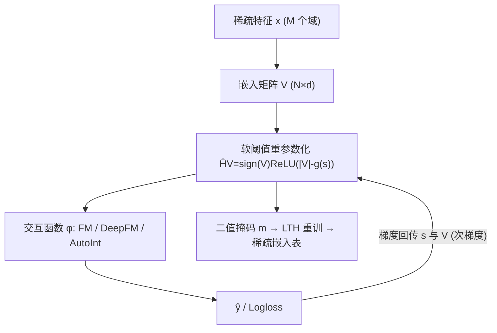

# Learnable Embedding Sizes for Recommender Systems (推荐系统中的可学习嵌入维度)

- **会议/期刊**: ICLR 2021
- **作者与机构**: Siyi Liu (UESTC)、Chen Gao / Depeng Jin / Yong Li (清华大学电子系)、Yihong Chen (UCL)
- **推荐链路定位**: 精排（CTR 预估模型的嵌入层压缩，可插拔）
- **研究方向**: CTR/CVR 预估与特征交叉
- **论文原文**: [https://arxiv.org/abs/2101.07577v2](https://arxiv.org/abs/2101.07577v2)
- **开源代码**: [https://github.com/ssui-liu/learnable-embed-sizes-for-RecSys](https://github.com/ssui-liu/learnable-embed-sizes-for-RecSys)

## TL;DR (1分钟核心速览)

CTR 模型给所有特征域统一分配维度 $d$，导致嵌入表占满内存、低频特征严重过拟合。本文把「为每个特征选维度」重写为「对嵌入矩阵$\mathbf{V}$施加列稀疏」，提出 PEP：用可与嵌入联合梯度下降的**可学习软阈值**$g(s)$ 一次性剪掉冗余元素，并用 Lottery Ticket 假设回填初始权重重训。在 MovieLens-1M / Criteo / Avazu 三个数据集上以 FM/DeepFM/AutoInt 为基座，参数减少 **97%–99%(Criteo/Avazu 相对最优基线 99.90%)**，AUC 反而相对 UE 提升 **0.59%**，训练时间仅增加 **24.47%**。

## Background & Motivation (背景与核心矛盾)

- **主流范式**: 特征型推荐模型（FM/DeepFM/AutoInt）用统一维度 $d$的嵌入矩阵$\mathbf{V}\in\mathbb{R}^{N\times d}$ 把稀疏 one-hot 映射为稠密向量，再接内积/自注意力做特征交叉。
- **前人局限**: ①参数共享路线（MGQE、Hash Embedding、Compositional Embedding）靠人工设定共享比例，粗粒度复用无法定位"冗余的那几列"，精度必掉；②混合维度路线（MDE 按热度定维度、NIS/DartsEmb/DNIS 用 NAS 或可微搜索）需要预设候选维度空间，且双层优化使搜索开销近乎翻倍；③MDE 这类"频率正比维度"规则无法处理"低频但重要"的特征。
- **核心洞察 (Key Insight)**: 嵌入维度 $\tilde{d}_i$ 的离散搜索不可导、空间巨大，但如果把向量里某些**列置零**，等价于把维度降 1——维度选择因此可以转化为嵌入矩阵的 **column-wise 稀疏**问题，用连续阈值替代离散搜索。
- **本文切入点**: 用 soft-threshold 重参数化把 $L_0$ 约束松弛为可学习阈值的软剪枝，一次训练即可扫出整条"参数-精度"前沿曲线。

## Method (核心方法设计)

### 1. 整体框架 (Overall Architecture)

输入为 $M$个特征域的 one-hot 拼接$\mathbf{x}=[\mathbf{x}_1;\dots;\mathbf{x}_M]$，经查表得到$\mathbf{v}_i=\mathbf{V}_i\mathbf{x}_i$；PEP 在查表与交互函数$\phi$之间插入重参数化算子$\hat{\mathbf{V}}=S(\mathbf{V},s)$，即先按阈值得掩码、再送入 FM/DeepFM/AutoInt 计算$\hat{y}=\phi(\mathbf{x}\mid\hat{\mathbf{V}},\Theta)$。训练阶段阈值$s$与嵌入、下游参数一起反向传播，稀疏度随 epoch 单调上升；收敛后按预算$P$冻结二值掩码$\mathbf{m}$，用原始初始化权重$\mathbf{m}\odot\mathbf{V}_0$ 重训，最终以稀疏矩阵存储 + 按特征实际维度切片推理。

### 2. 关键设计拆解 (Key Designs)

1. **可学习软阈值重参数化（把离散维度搜索变成连续剪枝）**：直接优化 $\|\mathbf{V}\|_0\le k$是 NP-hard，$L_1$/PGD 投影在百万级参数上代价过高且预算$k$需人工设定。本文改为对$\mathbf{V}$ 做逐元素重参数化：
   $\hat{\mathbf{V}}=S(\mathbf{V},s)=\mathrm{sign}(\mathbf{V})\,\mathrm{ReLU}(|\mathbf{V}|-g(s))$，其中$g(s)=\sigma(s)$为可训练阈值（$s_{\text{init}}$取使$g(s)\approx 0$的值）。直觉：$|\mathbf{V}|$ 小于阈值的元素被硬性压到 0 且不再收到梯度，等价于"边训练边按重要性淘汰列"；当某特征的整行全为 0 时该特征被彻底丢弃，突破了 NAS 类方法"最小维度为 1"的下界。
2. **多粒度阈值（应对特征/维度异质性）**：全局标量 $s\in\mathbb{R}$让所有元素共用阈值，忽略了不同域、不同维度重要性差异。本文给出四档粒度：Dimension-wise$s\in\mathbb{R}^{d}$、Feature-wise$s\in\mathbb{R}^{N}$、Feature-Dimension-wise$s\in\mathbb{R}^{N\times d}$，粒度越细越能贴合"高频特征需大容量、低频特征几维足够"的分布，代价是阈值参数量线性增长。
3. **训练目标、次梯度与推理效率**：总损失即标准 Logloss $\mathcal{L}=-\frac{1}{|\mathcal{D}|}\sum_j\big[y_j\log\hat{y}_j+(1-y_j)\log(1-\hat{y}_j)\big]$，CTR 二分类真实曝光标签，**无需负采样**。因$S(\cdot)$ 在零点不可导，用次梯度
   $\mathbf{V}^{(t+1)}\leftarrow\mathbf{V}^{(t)}-\eta_t\,\nabla_{\hat{\mathbf{V}}}\mathcal{L}\odot\mathbb{I}\{S(\mathbf{V}^{(t)},s)\neq 0\}$屏蔽被剪元素；对$s$因$g$连续故可直接求导。掩码确定后按 LTH 用$\mathbf{m}\odot\mathbf{V}_0$（而非随机初始化）重训，收敛更快更稳。推理时只保留非零列，实际存储为$O(\sum_i\tilde{d}_i)$。

## Experimental Setup & Evaluation Protocol (实验设置与评估协议)

- **数据集与预处理**（原文正文未列统计表，下表为公开版本常用规模，仅作参照）：

| 数据集 | #Users | #Items | #Interactions | 稀疏度/密度 | 特征/场景说明 |
| :--- | :---: | :---: | :---: | :---: | :--- |
| MovieLens-1M | 6,040 | 3,706 | 1,000,209 | 密度 ≈4.47% | 用户画像 + 物品属性，考察多域特征交叉 |
| Criteo | 未提供 | — | $\sim10^{6}$ 级样本 | 13 数值 + 26 类别域，高稀疏 | 展示广告点击率 |
| Avazu | 未提供 | — | $\sim10^{6}$ 级样本 | 类别域极多（ad_id 等），极高稀疏 | 移动广告点击率 |

- **数据划分与防穿越 (Splitting Strategy)**: 原文未明确交代划分细节，按 CTR 基准惯例采用随机比例切分（非时间戳切分），因此不存在序列穿越风险但存在轻度分布漂移。
- **排名评测协议 (Ranking Protocol)**: 本文属 **pointwise 二分类评估**，在全测试集上计算 **AUC 与 Logloss**，不是 Full-Ranking 也不是 Sampled Ranking；正负样本由真实曝光/点击标签天然构成，无人工负采样比例。
- **对比基线与超参设置**: 基线为 UE（统一维度）、MGQE（嵌入片段共享）、MDE（频率正比维度）、DartsEmb（可微 NAS 搜索）；三基座 FM / DeepFM / AutoInt 同配置接入，比较维度为「AUC vs. 参数量」前沿曲线（PEP 取 PEP-0～PEP-4 五个预算点）。

## Key Experimental Results (实验关键数据)

### 1. 主实验对比 (Main Results)

AUC 数值读自原文图 2–4 前沿曲线（标 `≈`），参数量为嵌入表规模量级：

| 数据集 | 基座 | UE | MGQE | MDE | DartsEmb | **PEP** | Improv.(vs UE) |
| :--- | :--- | :---: | :---: | :---: | :---: | :---: | :---: |
| MovieLens-1M | FM | 0.8455≈ | 0.849≈ | 0.851≈ | 0.853≈ | **0.856≈** | +1.24% |
| MovieLens-1M | DeepFM | 0.850≈ | — | 0.852≈ | 0.853≈ | **0.855≈** | +0.59% |
| MovieLens-1M | AutoInt | 0.848≈ | — | 0.851≈ | 0.854≈ | **0.855≈** | +0.83% |
| Criteo | FM | 0.7946 | — | — | 0.7974 | **0.7993** | **+0.59%** |
| Avazu | FM | 0.762≈ | — | — | 0.764≈ | **0.766≈** | +0.52% |
| 参数规模 | Criteo/Avazu | $10^{6}$|$10^{5}$|$10^{5}$|$10^{5}$| **$10^{3}$(PEP-0)** | −99.90% |

### 2. 消融实验 (Ablation Study)

| 配置 | 参数量 | AUC 表现 | 说明 |
| :--- | :---: | :---: | :--- |
| Global-wise ($s\in\mathbb{R}$) | 中 | 基准 | 所有维度共享阈值，最粗粒度 |
| Dimension-wise ($s\in\mathbb{R}^{d}$) | 中 | ↑ | 逐维度独立剪枝 |
| Feature-wise ($s\in\mathbb{R}^{N}$) | 较低 | ↑↑ | 可按域差异化容量 |
| Feature-Dimension ($s\in\mathbb{R}^{N\times d}$) | 最低 | ↑↑↑ | 最细粒度，前沿曲线最优（图 10） |
| w/o LTH 重训（随机重初始化） | 同剪枝后 | ↓ / 收敛慢 | 附录 A.6：回填 $\mathbf{m}\odot\mathbf{V}_0$ 更快更稳 |

### 3. 关键实验发现 (Key Findings)

1. **剪掉的是噪声交互而非有用信号**：Criteo-FM 上 PEP 相对 UE AUC +0.59%、相对 DartsEmb +0.24%，同时嵌入参数从 $10^{6}$级降到$10^{3}$级（−99.90%）；图 5 的$\mathbf{V}\mathbf{V}^{\top}$ 交互矩阵显示，PEP 主要削弱的是弱相关特征域之间的点积强度，说明精度提升来自去噪而非容量补偿。
2. **训练代价远低于 NAS 路线，且"一次训练多档预算"**：表 2 中每 epoch 耗时 PEP 平均仅 +24.47%（FM 1,039→1,341s），而 DartsEmb 为 +98.02%；更关键的是 PEP 一次训练即可导出 PEP-0～PEP-4 五个稀疏档位，覆盖 $10^{3}$–$10^{6}$ 全区间前沿，工程上可按内存预算直接取点。
3. **频率并非维度的唯一决定因素**：图 6 的分层稀疏轨迹显示高频特征组平均稀疏度显著更低（获得更大维度），但热力图中存在"低频特征保留大维度""高频特征被压到很小"的反例，证明 MDE 式频率正比规则过于粗糙，数据驱动的端到端剪枝能捕捉更本质的特征重要性。

## Highlights & Limitations (亮点、对比与审稿批判)

- **与代表作对比 (vs. Prior Work)**: 相比 MGQE/Hash 类**参数共享**方法，PEP 在元素级定位冗余、不依赖人工共享比例，且允许维度降到 0；相比 MDE 的**人工频率规则**，PEP 端到端学习阈值，能处理低频重要特征；相比 DartsEmb/DNIS 的 **NAS 双层搜索**，PEP 是单层单次训练，时间开销仅 +24% 而非 +98%，且无需设计搜索空间。
- **可迁移亮点**: ①「软阈值重参数化 + 预算冻结 + LTH 回填」这套三件套可直接搬到任何大规模嵌入表（序列物品 ID 嵌入、双塔物品侧嵌入、多模态投影层）做容量分配；②"一次训练产出多档稀疏掩码"的思路天然适配线上多内存预算的灰度分档部署。
- **审稿级局限批判**: ①评估仅 AUC/Logloss 的 pointwise 指标，缺少 Full-Ranking/Recall@K 与线上 A/B，无法证明对排序链路的真实收益；②阈值粒度越细，$s$参数量达$N\times d$，与"省内存"的初衷存在张力，且$s_{\text{init}}$、学习率与阈值函数形式（sigmoid vs. 其他）对最终稀疏度敏感，原文只在附录浅尝；③剪枝后按稀疏矩阵存储，工业界实际还需稀疏 gather 算子与不定长维度拼接的工程改造，论文未给延迟/吞吐的推理端数据。

## Rating (四维评分)

- **方法创新性 (Novelty)**: ⭐⭐⭐⭐ （把离散维度搜索等价重写为嵌入矩阵列稀疏 + 可学习软阈值，视角简洁优雅，LTH 结合有理论依据但非全新）
- **评估协议与实验扎实度 (Protocol & Experiments)**: ⭐⭐⭐⭐ （三数据集 × 三基座 × 四基线的前沿曲线对比充分，含效率与可解释性分析；但缺 Full-Ranking 类排序指标与显著性检验，划分细节交代不足）
- **写作与数学规范度 (Clarity & Rigor)**: ⭐⭐⭐⭐ （重参数化与次梯度推导清晰，PyTorch 伪代码仅十余行；多粒度阈值与可学习预算 $k$ 的关系略欠形式化说明）
- **工业落地与复现价值 (Industrial & Practical Value)**: ⭐⭐⭐⭐⭐ （代码开源、插件式接入现有 CTR 模型、97–99% 参数压缩且训练仅 +24%，是少数可直接进生产的嵌入表压缩方案）

