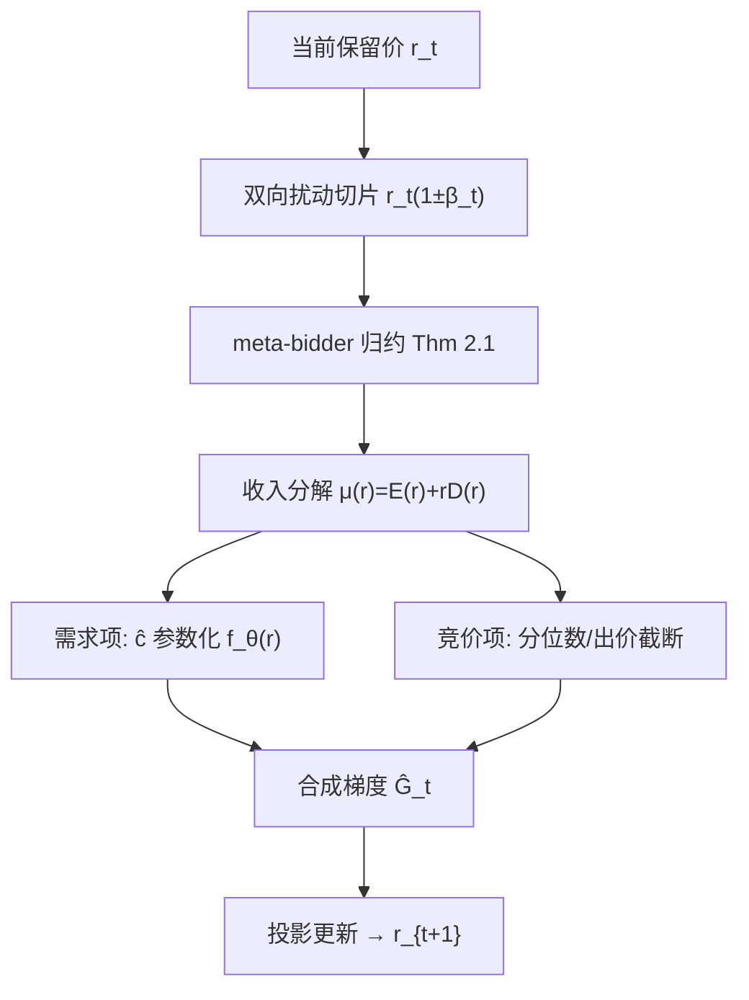
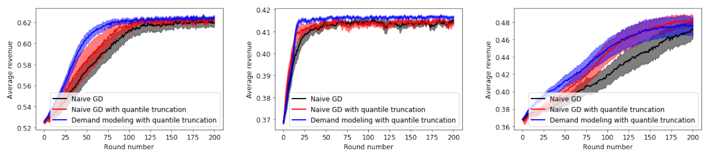

# Reserve Price Optimization for First Price Auctions in Display Advertising (展示广告一价拍卖中的保留价优化)

- **会议/期刊**: ICML 2021 (PMLR 139)
- **作者与机构**: Zhe Feng (Harvard, 实习于 Google NYC), Sébastien Lahaie, Jon Schneider, Jinchao Ye (Google Inc, NYC)
- **推荐链路定位**: 精排下游的**定价/计费**环节（保留价直接写入 bid request，决定 rD(r) 的成交门槛与成交价）
- **研究方向**: CTR/CVR 预估与特征交互（广告计费/定价子问题）/ 强化学习与动态探索推荐（Bandit 在线优化）
- **论文原文**: [论文原文链接](http://proceedings.mlr.press/v139/feng21b/feng21b.pdf)
- **开源代码**: 暂未开源

> 分类说明：本文落在广告链路中 pCTR/pValue 估计之后的**计费定价**环节，故归 `ctr_feature_interaction`（广告变现链路）主类，其方法内核为 bandit 反馈下的在线零阶优化，交叉 `rl_bandit_rec`。

## TL;DR (1分钟核心速览)

广告交易全面转向一价拍卖后，二价时代的保留价优化彻底失效：出价随保留价变动（bid shading）、卖方观测不到真实估值、收入函数对保留价非凸。本文提出零阶随机投影梯度框架，在随机流量切片上施加 $\pm\beta$扰动以估计离散梯度；核心创新是把收入精确分解为需求分量$rD(r)$与竞价分量$E(r)$，对前者用跨轮参数化需求曲线拟合（方差降为 0），对后者用分位数截断（依赖"递减敏感性"性质）。理论上收敛率由$\tilde{O}(N^{-1/4})$提升至$\tilde{O}(N^{-1/3})$；在 20 家 publisher 的真实出价半合成数据上，朴素梯度下降即达 oracle 最优收入的$\geq 95\%$。

## Background & Motivation (背景与核心矛盾)

- **主流范式**: 二价/VCG 下 truthful bidding 是占优策略，卖方可直接从历史出价学习估值分布 $F$，保留价优化有成熟的 bandit / no-regret 理论（Mohri & Medina 2016；Paes Leme 2016；Munoz & Vassilvitskii 2017）。
- **前人局限**: ① 一价拍卖中出价函数 $b(r,v)$因广告主而异且对保留价敏感，真实估值不可观测，二价最优保留价无任何理由继续有效；② 收入$\mu(r)$对$r$ 非凸，且单次拍卖反馈是"最高出价"这一极重尾统计量，梯度噪声极大，零阶收敛极慢。
- **核心洞察 (Key Insight)**: 收入可精确拆成**需求侧**（多少人愿意跨过保留价）与**竞价侧**（赢家愿意多付多少）两项；需求曲线只依赖 $F$、单调递减且跨轮稳定，可参数化复用；同时"远高于保留价的出价几乎不随保留价变化"，这些样本只贡献噪声而非梯度信号。
- **本文切入点**: 用结构分解把梯度估计的两项偏置/方差解耦，逐项设计降方差估计器，再接回零阶投影梯度下降。

## Method (核心方法设计)

### 1. 整体框架 (Overall Architecture)

每轮 $t$从当前保留价$r_t$出发，在独立流量切片上分别施加$r_t^{+}=(1+\beta_t)r_t$与$r_t^{-}=(1-\beta_t)r_t$，各采集$n_t$条出价样本。借助 **meta-bidder 归约**（Thm 2.1：$m$个买家的一价拍卖可等价为单一虚拟买家，令$b(r,v)=B_r^{-1}(F(v))$即可复现最高出价分布），将多买家问题压缩为单买家问题。随后按$rD(r)+E(r)$分解分别估计离散梯度$\hat{G}_t=\hat{G}_D+\hat{G}_E$，再投影更新$r_{t+1}=\Pi_{(0,1)}(r_t+\alpha_t\hat{G}_t)$。整个流程是纯在线学习，无离线训练、无模型推理开销，保留价直接下发 bid request。

### 2. 关键设计拆解 (Key Designs)

1. **收入分解 (Thm 4.1)**：$\mu(r)=\mathbb{E}_{v\sim F}[\max(b(r,v)-r,0)]+r\Pr_{v\sim F}[v\geq r]\equiv E(r)+rD(r)$。需求项$rD(r)$正是"若按保留价成交"的明标价收入，竞价项$E(r)$是赢家超额支付。分解的价值在于$\mathrm{Bias}(\hat{G})\leq \mathrm{Bias}(\hat{G}_E)+\mathrm{Bias}(\hat{G}_D)$且$\mathrm{Var}(\hat{G})\leq 2(\mathrm{Var}(\hat{G}_D)+\mathrm{Var}(\hat{G}_E))$，即两个物理机制相反的噪声源可独立压制。

2. **需求分量参数化（方差归零）**：把 $D(r)$换成跨轮历史样本拟合的$f_{\hat{\theta}}(r)$，则$\hat{G}_D=\frac{r^{+}f_{\hat{\theta}}(r^{+})-r^{-}f_{\hat{\theta}}(r^{-})}{r^{+}-r^{-}}$。由于$f_{\hat{\theta}}$与当轮样本独立，$\mathrm{Var}(\hat{G}_D)=0$，代价是$\varepsilon_D/\delta$ 的建模偏置。直觉：需求只由估值分布驱动、远比收入曲线规整（单调），是"低方差高偏置"的划算交易。

3. **竞价分量分位数截断（核心鲁棒设计）**：先对 $B(r^{+})$、$B(r^{-})$排序，只保留最低$q$ 分位的出价再补上截断修正：
$\hat{G}_E=\frac{\sum_{i\leq qn}\max(X_i^{+}-r^{+},0)-\sum_{i\leq qn}\max(X_i^{-}-r^{-},0)}{n(r^{+}-r^{-})}-(1-q)$。
其偏置 $\leq (1-q)\frac{b(r^{+},t)-b(r^{-},t)}{\delta}+O(n^{-2/3})$，方差$\leq 2\tilde{t}^2/(n\delta^{2})$。关键前提是 Def 2.3 的**递减敏感性**：估值越高，出价对保留价的反应越小，故高分位样本对$\mu(r^{+})-\mu(r^{-})$几乎无期望贡献，纯属噪声。由于$b(r,v)$对$v$ 单调，按出价分位截断等价于按估值分位截断，这是该技巧成立的数学根据。

4. **出价截断（完美响应下的特例）**：若假设 perfect response（出价不足则抬到 $r$，否则不变），令$Y_i^{-}=\max(X_i^{-}-r^{-},0)$（当$X_i^{-}\leq r^{+}$），否则取$r^{+}-r^{-}$，则$\hat{G}_E=-\sum_i Y_i^{-}/[n(r^{+}-r^{-})]$，$\mathrm{Bias}=2\varepsilon/\delta$、$\mathrm{Var}\leq 1/(4n)$，完美响应下无偏。代价是对响应模型假设极敏感。

5. **训练目标与开销**：无显式损失函数，目标是 $\max_{r}\mu(r)$的在线逼近；负采样概念不适用（bandit 反馈）。每轮成本为$2n_t$次真实拍卖询价，总预算$N=\sum_t n_t$，$n_t$与$T$ 之间存在显式权衡；线上推理零额外开销。

## Experimental Setup & Evaluation Protocol (实验设置与评估协议)

- **数据与生成机制**（原文未给交互量级统计，故列配置表）：

| 数据源 | 无保留价基础出价分布 | 响应模型 | 关键参数 |
| :--- | :--- | :--- | :---: |
| 合成数据 | $U[0,1]$| perfect /$\varepsilon$-bounded | shading$\gamma=0.4$ |
| 合成数据 | $\max\{v_1^2,v_2^2\}$,$v_i\sim U[0,1]$| equilibrium（BNE）|$m=2$ 买家 |
| 半合成数据 | 20 家 publisher 单日获胜出价经验分布（去异常、归一化 $[0,1]$）| perfect /$\varepsilon$-bounded（equilibrium 无闭式，不测）|$\gamma=0.3$ |

- **数据划分与防穿越**: 无离线划分，采用**逐轮 rollout**（$t=1,\dots,T$）；需求曲线拟合仅使用$t$ 轮之前累积的历史样本，当轮 2 次扰动样本只用于梯度估计，严格无信息穿越。
- **评测协议**: 非排序评测，指标为每轮平均收入 $\mu(r_t)$与保留价轨迹$r_t$；oracle 最优值由枚举$r$ 构造完整 revenue curve 得到（20 条半合成曲线中 19 条单峰、1 条双峰）。
- **对比基线与超参**: 5 个变体 (I)~(V)（见下表）+ 零阶优化 SOTA 收敛率 $\tilde{O}(N^{-1/4})$ 作为理论基线；需求模型在合成数据用 logistic 回归，半合成用 1 隐层 15 节点 ReLU 网络；文中未报告显著性检验与置信区间。

## Key Experimental Results (实验关键数据)

### 1. 主实验对比 (Main Results)

原文主结果以收敛曲线（图 1/图 2）呈现，下表汇总各变体的估计器配置与理论上界：

| 变体 | 需求梯度 | 竞价梯度 | 偏置上界 | 方差上界 | 收敛率 | 实测表现 |
| :--- | :--- | :--- | :---: | :---: | :---: | :--- |
| (I) Naive GD | naive $\hat{D}$| Eq.(3) |$0$|$1/(2\delta^2 n)$|$\tilde{O}(N^{-1/4})$| 基线，达最优收入$\geq 95\%$，曲线抖动 |
| (II) Naive + bid trunc | naive | Eq.(6) | $2\varepsilon/\delta$|$\leq 1/(4n)$ | — | perfect 下强，equilibrium 下**收敛到显著次优** |
| (III) Naive + quantile | naive | Eq.(7) | $(1-q)\Delta b/\delta$|$2\tilde{t}^2/(n\delta^2)$|$\tilde{O}(\varepsilon_D+1-q+N^{-1/3})$ | 稳定，整体优于 (I) |
| (IV) Demand + bid trunc | $f_{\hat{\theta}}$| Eq.(6) |$2\varepsilon/\delta+\varepsilon_D/\delta$|$\leq 1/(4n)$|$\tilde{O}(\varepsilon+\varepsilon_D+N^{-1/3})$ | perfect 下收敛最快，鲁棒性差 |
| (V) Demand + quantile | $f_{\hat{\theta}}$| Eq.(7) |$(1-q)\Delta b/\delta+\varepsilon_D/\delta$|$2\tilde{t}^2/(n\delta^2)$|$\tilde{O}(\varepsilon_D+1-q+\cdots)$ | **收入最高、收敛最快（推荐配置）** |

<figure class="paper-figure" markdown="span">
  <figcaption>图1：在 (a) 完美响应的合成数据、(b) 均衡响应的合成数据以及 (c) 完美响应的半合成数据下，收益随轮次 t 的变化。</figcaption>
</figure>

### 2. 消融实验 (Ablation Study)

| 配置变更（相对 V） | 效果 |
| :--- | :--- |
| w/o 需求参数化 (V→III) | 需求方差项从 0 回升至 $(r^{+})^2/(2\delta^2 n)$，收敛变慢、稳态收入下降 |
| w/o 分位数截断，退化为 naive 竞价项 (V→I 竞价侧) | 竞价方差回升至 $1/(2\delta^2 n)$，训练曲线抖动明显 |
| 分位数截断 → 出价截断 (V→IV 竞价侧) | perfect response 下更优；equilibrium 下被拖向次优保留价（图 2） |
| 截断分位 $q$过小 | 偏置项$(1-q)\Delta b/\delta$ 主导，稳态收入下降 |
| 截断分位 $q\to 1$| 方差项$2\tilde{t}^2/(n\delta^2)$ 主导，收敛变慢 |

### 3. 关键实验发现 (Key Findings)

1. **非凸性可被梯度下降驯服**：20 条半合成 revenue curve 中 19 条只有一个局部极大，且所有情形下朴素梯度下降取得的收入均 $\geq$oracle 最优值的$95\%$，为"用局部搜索替代全局网格搜索"提供了实证支撑（这也是相对 grid search 的主要成本优势）。
2. **结构分解带来一整个数量级的理论加速**：朴素估计的 $\mathrm{Var}\leq 1/(2\delta^2 n)$随扰动步长$\delta$收缩而爆炸，正是$\tilde{O}(N^{-1/4})$天花板的根源；竞价项截断把方差压到与$\delta$无关的$1/(4n)$，配合需求项方差归零，收敛率提升到$\tilde{O}(N^{-1/3})$。
3. **鲁棒性 > 无偏性**：bid truncation 在 perfect response 下无偏且最优，但在 equilibrium 响应下（图 2）会把保留价拉向明显次优；分位数截断虽引入 $(1-q)\Delta b/\delta$的偏置，却只依赖递减敏感性这一弱假设，在 perfect /$\varepsilon$-bounded / equilibrium 三类响应下均稳定——在真实广告环境中响应模型未知，这个权衡是决定性的。

## Highlights & Limitations (亮点、对比与审稿批判)

- **与代表作对比 (vs. Prior Work)**: 二价保留价文献（Mohri & Medina 2016；Paes Leme 2016；Munoz & Vassilvitskii 2017）全部建立在 truthful bidding 之上，可直接回归估值分布；本文直面 bid shading 带来的内生性。相对零阶优化 SOTA（Ghadimi & Lan 2013）并非换算法，而是**换问题结构**——把目标函数的可分解性注入估计器设计。
- **可迁移亮点**: ① "目标函数分解 + 分量级偏置/方差分配"可直接搬到任何由"参与率 × 成交价"构成的业务指标（GMV、LTV、曝光-点击-转化漏斗）；② 用**分位数阈值替代绝对阈值**做截断，因单调变换下分位对应关系不变，这一技巧在重尾、量纲未知的线上指标上尤其好用。
- **审稿级局限批判**: ① 核心假设是 $b(r,v)$在稳态下固定，忽略广告主跨轮学习、预算约束与长期策略性反应（作者亦列为 future work），在预算受限的 DSP 场景下可能系统性高估保留价收益；② 仅考虑单维匿名保留价$r\in[0,1]$，未触及分段/个性化保留价与多物品（多广告位）联动，而工业界真正的收入杠杆恰在分层定价；③ 实验仅给收敛曲线，缺最终收入数值表、方差/置信区间与显著性检验，且探索期（$\pm10\%$ 扰动流量）的收入损失与 regret 未量化，难以直接换算为线上 A/B 的净收益。

## Rating (四维评分)

- **方法创新性 (Novelty)**: ⭐⭐⭐⭐ （收入的需求/竞价结构分解 + 递减敏感性下的分位数截断是真正的 problem-specific 洞察，而非套用零阶优化模板）
- **评估协议与实验扎实度 (Protocol & Experiments)**: ⭐⭐⭐ （合成 + 20 家 publisher 半合成覆盖三类响应模型较扎实，但仅以曲线呈现、无显著性检验与 regret 量化）
- **写作与数学规范度 (Clarity & Rigor)**: ⭐⭐⭐⭐ （Thm 2.1 归约、Thm 4.1 分解与三个估计器的偏置-方差界推导完整清晰，收敛率对比明确）
- **工业落地与复现价值 (Industrial & Practical Value)**: ⭐⭐⭐⭐ （直接对应一价拍卖切换后的计费痛点，实现仅为排序+求均值+投影更新，线上零推理开销；但无开源代码，超参 $q,\beta_t,\alpha_t$ 需按流量规模重调）

