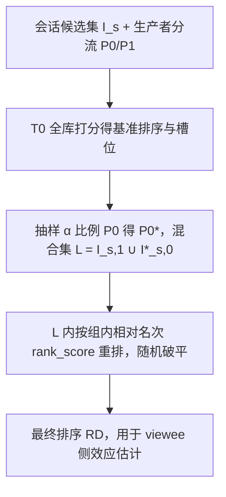

# A/B Testing for Recommender Systems in a Two-sided Marketplace (双边市场推荐系统的 A/B 实验设计)

- **会议/期刊**: NeurIPS 2021
- **作者与机构**: Preetam Nandy, Divya Venugopalan, Chun Lo, Shaunak Chatterjee（LinkedIn Corporation）
- **推荐链路定位**: 重排（排序层实验设计 / 反事实重排）
- **研究方向**: 去偏公平、可信隐私与工业架构 / 多任务学习与列表级重排
- **论文原文**: [https://arxiv.org/abs/2106.00762v2](https://arxiv.org/abs/2106.00762v2)
- **开源代码**: 暂未开源

## TL;DR (1分钟核心速览)

双边市场中生产者侧 A/B 实验违背 SUTVA：图聚类随机化在稠密图下功效低下，传播假设类方法缺乏严格误差控制，且多数需先验已知图结构。UniCoRn 在排序层「统一」互相冲突的反事实排序，用设计不精度 $\mathbb{E}(R_D-R^*)^2$与打分成本双目标刻画实验质量，参数$\alpha$显式控制二者权衡，并证明$\alpha=1$时不精度最优、给出偏差与方差界。LinkedIn 边缘推荐（千万级成员、日均十亿次推荐）40% viewer 流量实测 viewee 侧 WAU$+0.51\%$、Sessions$+0.57\%$（$p<0.001$），且无显著服务延迟增加。

## Background & Motivation (背景与核心矛盾)

- **主流范式**: 消费侧用标准 A/B 随机分流估计 ATE，其合法性依赖 SUTVA（单元间互不干扰）。
- **前人局限**: 生产者体验取决于所有关联消费者的分流，SUTVA 必然失效。图聚类随机化需把图切成近可分离簇，网络越稠密可分离簇越少，丢弃大量边后实验功效骤降；OASIS 类「资源复制 / 预算拆分」或「修改版 treatment 传播」方法虽适配稠密图，却依赖treatment 效应传播形式假设，缺乏严格误差控制；HaThucEtAl 的小 ramp 反事实排序法方差极高且被限制在 10%/10% 分流。
- **核心洞察 (Key Insight)**: 若全体生产者都分到同一 treatment，则存在唯一的消费侧排序；当生产者被分到不同组时，会同时出现多个互相冲突的「反事实排序」，冲突数量由 treatment/control 打分的相关性 $\rho$决定（$\rho=-1$ 冲突最多）。
- **本文切入点**: 放弃图划分与传播假设，直接在**排序算子层**把冲突的反事实排序融合成一个可行排序，让实验设计本身可量化、可调、可证最优。

## Method (核心方法设计)

### 1. 整体框架 (Overall Architecture)

每次会话输入候选集 $I_s$与生产者分流集合$P_0$（控制）、$P_1$（实验）。先用控制模型$T_0$对全库打分得到基准排序与槽位；按概率$\alpha$从$P_0$随机抽取生产者子集$P_0^*$，把其物品与全部$P_1$物品合并成混合集$L$并记录它们原本占据的槽位；随后对$L$内每个物品用**其自身所属组**的模型打分，转成组内相对名次作为融合分数，在槽位$L$上重新排序（并列随机破平）；未参与混合的$P_0$物品保持原位。$\alpha=0$退化为纯控制打分（零额外成本），$\alpha=1$ 为最大混合（成本最高、理论最优）。算法全程不需要知道生产者—消费者图结构。

### 2. 关键设计拆解 (Key Designs)

1. **设计质量的两个可量化标尺（Inaccuracy / Cost）**：前人只谈「实验有没有偏」，无法比较两种设计的优劣。本文定义理想排序 $R^*(i,I_s)=\sum_{k=0}^{K} R_k(i,I_s)\mathbb{I}\{i\in P_k\}$，即每个物品都用其所属组模型打分时的名次，并把设计不精度定义为$\mathrm{Inaccuracy}(\mathcal{D})=\mathbb{E}\left(R_\mathcal{D}(i,I_s)-R^*(i,I_s)\right)^2$；成本定义为打分函数被重复调用的期望次数$\mathrm{Cost}(\mathcal{D})=\mathbb{E}[N_\mathcal{D}(i,I_s)]$。物理直觉：不精度即「实验排序偏离理想反事实排序的平方秩误差」，平方形式天然惩罚最坏冲突。

2. **UniCoRn 混合算子（消除组间曝光窃取）**：直接把两组排序拼起来会造成一个组系统性抢占另一组的名次（cannibalization），使 viewee 侧比较失效。核心融合分数为 $\mathrm{rank\_score}(i)=R_0(i,I_{s,1}\cup I^*_{s,0})\mathbb{I}\{i\in P^*_0\}+R_1(i,I_{s,1}\cup I^*_{s,0})\mathbb{I}\{i\in P_1\}$，再在槽位集合$L=\{R_0(i,I_s):i\in I_{s,1}\cup I^*_{s,0}\}$内按升序重排并随机破平。该设计保证三条性质：$P_0$内部相对序与$T_0$一致、$P_1$内部与$T_1$一致、且随机取一个物品其名次分布在两组间相同且为$\mathrm{Uniform}\{1,\dots,K\}$——因为$L$ 是槽位的均匀随机采样。这是无偏组间比较的根基。

3. **最优性与误差界 + 推理开销**：$\alpha=1$时对任意其他设计$\mathcal{D}$有$\mathbb{E}(R_{\mathcal{D}_U}-R^*)^2\le\mathbb{E}(R_\mathcal{D}-R^*)^2$；并给出条件偏差与方差界$|\mathbb{E}(R_{\mathcal{D}_U}-R^*|\mathcal{A})|\le c(k,p_1)$、$\mathrm{Var}\le 2\min(r-1,|I_s|-r)p_1(1-p_1)+c(k,p_1)(1-c(k,p_1))$，其中$c(k,p_1)=\{k(1-p_1)+(1-k)p_1\}/2$。等式在$r\neq(|I_s|+1)/2$且$T_1$排序恰为$T_0$的完全逆序时取到，即为最坏冲突场景。成本由$\alpha$与分流比$p_0,p_1$决定：单 treatment 下总成本约$c_0+(\alpha p_0+p_1)c_1$；多 treatment 的「greater mixing」为$c_0+(1-(1-\alpha)p_0)\sum_{k\ge1}c_k$，「limited mixing」为$c_0+\alpha\sum_{k\ge1}c_k+(1-\alpha)\sum_{k\ge1}p_kc_k$。级联（召回+精排）系统只需把未被某组选中的候选其二次打分置$-\infty$，无需额外训练或负采样。

## Experimental Setup & Evaluation Protocol (实验设置与评估协议)

- **数据集与预处理**: 本文不含离线数据集，评估由**合成仿真**与**线上生产实验**两部分构成：

| 环境 | 规模/参数 | 说明 |
| :--- | :---: | :--- |
| 仿真 I（$\alpha$影响） |$L=100$槽位，$N_S=50000$会话，$\rho\in\{-1,-0.4,0.2,0.8\}$| 打分由二元高斯生成，$\rho$ 控制两模型排序冲突度 |
| 仿真 II（对比基线） | $L=100$，$N_S=1000$会话，重复 100 次 | 响应函数 avg_fn / max_fn，期望 ATE 分别为$0.16$与$-0.87$ |
| 生产环境 | LinkedIn 边缘推荐，750M+ 成员、日均十亿次推荐 | 40% viewer 流量（受并行实验限制，效应被低估） |

- **数据划分与防穿越 (Splitting Strategy)**: 无训练/测试划分概念；取而代之是**生产者级随机分流**（$P_0,\dots,P_K$互斥、按 ramp 比例$p_k$独立随机分配），$\rho$与 treatment proportion$\mathrm{TP}=|P_1|/(|P_0|+|P_1|)\in\{0.1,0.5\}$ 作为控制变量扫描。
- **排名评测协议 (Ranking Protocol)**: 仿真使用 **Full-Ranking**（每次会话对全部 $L=100$个槽位全排序），误差指标为平均绝对误差 MAE 与均方根误差 RMSE（对应不精度定义），效果指标为 ATE 估计误差；生产侧采用 viewee 级聚合响应$Y_i$（窗口内该 viewee 相关指标总计数），报告 treatment 组与 control 组平均响应的相对差$\Delta\%$。
- **对比基线与超参设置**: 基线为 HaThucEtAl（小 ramp 反事实排序，按其原文限定 10%/10%）与 OASIS 的**排名式改造版**（用归一化分数 $p_k(s,i)=T_k(s,i)/\sum_{i=1}^{L}T_k(s,i)$构造$p^*(s,i)$，跳过原始约束优化与事后校正，使得分/排序两种范式可比）；UniCoRn 取$\alpha\in\{0,0.2,1\}$；生产显著性以$p<0.001$ 为准。

## Key Experimental Results (实验关键数据)

### 1. 主实验对比 (Main Results)

线上生产实验（viewee 侧，40% viewer 流量，UniCoRn(0)）：

| 变更类型 | 指标 | Delta % | 显著性 |
| :--- | :---: | :---: | :---: |
| 候选生成（shared-edge 归一化 vs. 绝对数） | WAU | **+0.51%** | $p<0.001$ |
| 候选生成（同上） | Sessions | **+0.57%** | $p<0.001$ |
| 精排模型（优化 viewee 留存） | WAU | **+0.13%** | $p<0.001$ |
| 精排模型（同上） | Sessions | **+0.11%** | $p<0.001$ |

仿真 ATE 估计误差与成本对比（原文以图 4a/4b 呈现，无表格数值，此处按相对关系整理）：

| 方法 | TP=0.1 误差 | TP=0.5 误差 | 成本（定义 2） | 备注 |
| :--- | :---: | :---: | :---: | :--- |
| UniCoRn(0) | 中等 | 与 α=1 近似持平 | **最低** | 仅 P1 物品被两组打分 |
| UniCoRn(0.2) | 接近 α=1 | 与 α=1 近似持平 | 中等 | TP=0.1 的推荐折中点 |
| UniCoRn(1) | **最低（RMSE）** | **最低（RMSE）** | 最高 | 定理 1 的最优设计 |
| HaThucEtAl | 方差显著偏高 | 不适用（仅小 ramp） | 中等 | 被 10%/10% 限制 |
| OASIS（改造版） | 高于 UniCoRn(0) | 高于 UniCoRn(0) | 中等 | 得分式 vs. 排序式差距 |

### 2. 消融实验 (Ablation Study)

以 $\alpha$ 为核心消融项（同时消融「混合范围」与「成本」）：

| 配置 | 参与混合的物品 | 成本 | 不精度（RMSE） | 组内 $P_1$ 偏差 |
| :--- | :---: | :---: | :---: | :---: |
| $\alpha=0$（无混合） |$I_{s,1}$|$c_0+p_1c_1$| 较高 | 最大（$P_0$ 偏差为 0） |
| $\alpha=0.2$（limited） |$\alpha P_0$+ 全部$P_1$| 中 | 接近$\alpha=1$ | 较小 |
| $\alpha=1$（full） | 全部$P_0$+ 全部$P_1$|$c_0+c_1$ | **最低（理论最优）** | **最小** |

（若进一步消融掉「随机破平 + 均匀槽位采样」，则组间名次分布不再同为 $\mathrm{Uniform}\{1,\dots,K\}$，cannibalization 直接引入系统性偏差——这是设计成立的硬前提。）

<figure class="paper-figure" markdown="span">
  <figcaption>图5：在示例边缘推荐产品中演示基于 UniCoRn 重排序的玩具示例。右上角为带分数的候选排序。红色表示带实验组模型分数的实验组候选，蓝色表示带对照组模型分数的对照组候选。子图 (a) 展示不使用 UniCoRn 的排序列表，(b) 展示使用 UniCoRn 的排序列表。</figcaption>
</figure>

### 3. 关键实验发现 (Key Findings)

1. **$\alpha=1$在平方损失下确为最优，但 MAE 上$\alpha=0$略优**：因为$\alpha=0$时$P_0$物品误差恒为 0、误差全部集中在$P_1$；这正说明不精度定义（平方秩误差）与人们在意的 MAE 并不等价，指标选择会改变设计偏好。
2. **$\rho=-1$（两模型排序完全逆序）最难、$\mathrm{TP}$越高越难**：冲突数量随$\rho$下降与 ramp 上升而增加，对应定理 2 中偏差/方差界取等号的对抗场景；$\mathrm{TP}=0.5$时最便宜的 UniCoRn(0) 已在成本—误差帕累托前沿上，而$\mathrm{TP}=0.1$必须用$\alpha\approx0.2$才追平$\alpha=1$，即低 ramp 对$\alpha$ 显著更敏感。
3. **线上候选生成变更的 viewee 增益（WAU $+0.51\%$、Sessions$+0.57\%$）约为精排模型变更（$+0.13\%$、$+0.11\%$）的 4 倍**，且 UniCoRn(0) 以 Java 实现在分布式实时系统上线后未带来统计显著的服务延迟增加，说明「只对$P_1$ 子集重打分」的低成本变体足以支撑十亿级推荐的生产实验。

## Highlights & Limitations (亮点、对比与审稿批判)

- **与代表作对比 (vs. Prior Work)**: 相比图聚类随机化，UniCoRn 不切图、不依赖密度，稠密图下不损失功效；相比 OASIS，不做效应传播假设、无需解约束优化与事后校正，且排序式融合优于得分式归一化；相比 HaThucEtAl，突破 10%/10% 小 ramp 限制、方差显著更低，并把其作为 $\alpha\to0$ 的特例纳入统一框架。
- **可迁移亮点**: (i) 用 $\mathbb{E}(R_D-R^*)^2$ 作为「实验设计质量」的离线可计算代理指标，可在不跑线上实验的前提下比较多种分流方案；(ii) 「随机槽位采样 + 组内相对名次 + 随机破平」这一组合可作为任何列表级对照实验的公平重排模板。
- **审稿级局限批判**: (i) 由于所有 viewer 都收到混合排序，viewer 注意力类效应（停留时长、会话数）会被稀释，该方法只捕捉生产者曝光分布差异，无法度量双侧联合效应，且缺少 ground truth 无法验证测量保真度；(ii) 不精度基于平方秩误差，与 ATE 估计精度之间并无一般性等价关系（作者也承认需额外假设），且 $\alpha$ 与 TP 的敏感度在 max_fn 型凹性较强的排序—响应函数下被放大，超参选择偏经验。

## Rating (四维评分)

- **方法创新性 (Novelty)**: ⭐⭐⭐⭐ （把「双边市场实验设计」转化为排序层的反事实融合问题，并给出最优性与偏差/方差界，机制简洁且有理论支撑）
- **评估协议与实验扎实度 (Protocol & Experiments)**: ⭐⭐⭐ （仿真覆盖 $\rho$、TP、$\alpha$与两类响应函数，线上 40% 流量$p<0.001$，但无公开数据集、无 ground truth 校验，且线上仅报告两个指标）
- **写作与数学规范度 (Clarity & Rigor)**: ⭐⭐⭐⭐ （不精度/成本定义与算法步骤清晰，定理与证明完整，成本公式区分 greater/limited mixing 便于工程选型；但部分证明推至附录、$\alpha<1$ 的界仅留作练习）
- **工业落地与复现价值 (Industrial & Practical Value)**: ⭐⭐⭐⭐⭐ （千万级成员、十亿级推荐真实部署且零显著延迟增加，级联系统仅需把未选中候选打分置 $-\infty$ 即可接入，改造成本极低；不足是代码未开源）

