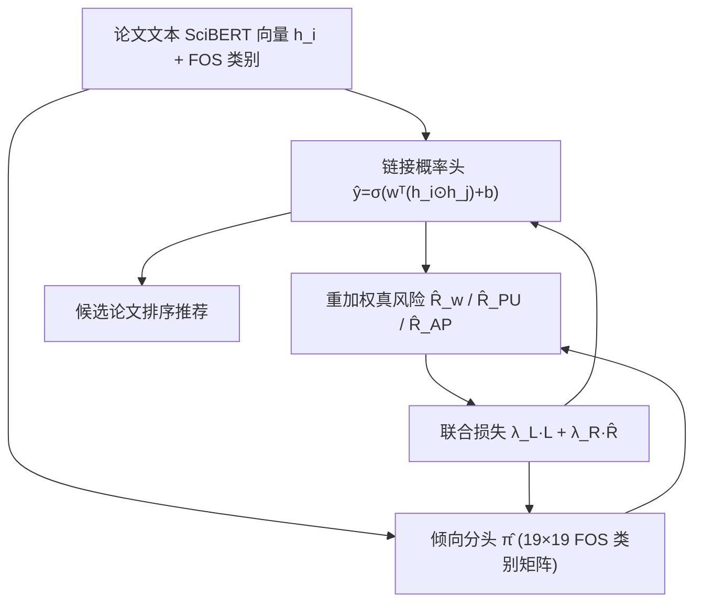
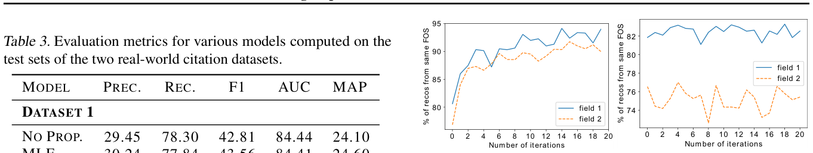

# Correcting Exposure Bias for Link Recommendation（链接推荐中的曝光偏差矫正）

- **会议/期刊**: ICML 2021 (PMLR 139)
- **作者与机构**: Shantanu Gupta (CMU / Amazon Intern), Hao Wang (Rutgers), Zachary C. Lipton (CMU), Yuyang Wang (AWS AI Labs)
- **推荐链路定位**: 召回（链接 / 引文候选推荐）
- **研究方向**: 去偏公平、可信隐私与工业架构 / 图神经网络与知识图谱推荐
- **论文原文**: [arXiv:2106.07041v1](https://arxiv.org/abs/2106.07041v1)
- **开源代码**: [exposure-bias-link-rec](https://github.com/shantanu95/exposure-bias-link-rec)

## TL;DR (1分钟核心速览)

链接推荐器直接在观测图上训练，会把「没被曝光」误判成「不相关」，导致低倾向分节点被系统性低估，并在迭代推荐中形成反馈回路。本文定义「全曝光」下的真风险，提出三个基于倾向分的重加权估计器 $\hat{R}_w$、$\hat{R}_{PU}$、$\hat{R}_{AP}$，证明其偏差/方差优于朴素估计器，并把估计器直接当作训练损失联合学习倾向分与链接概率。半合成 MAG 引文数据上 Precision 67.24→83.28、Recall 54.81→65.54，真风险估计 RMSE 由 1.50 降至 0.03，且推荐论文的 FOS 熵更高、反馈回路消失。

## Background & Motivation (背景与核心矛盾)

- **主流范式**: 引文/社交网络中的链接推荐直接以观测图 $G(V,E)$ 为监督信号训练预测器，并在观测边上计算 Precision/Recall 等指标。
- **前人局限**: ① 观测图里的缺失边大量是「伪负样本」——因未曝光而非不相关，朴素评估给出的是有偏风险；② 以观测交互为反馈继续训练会放大流行度偏差，形成自我强化的反馈回路。
- **核心洞察 (Key Insight)**: 作者把数据生成拆成 $o_{ij}=o'_{ij}a_{ij}$，其中$o'_{ij}\sim\mathrm{Ber}(y_{ij})$是「若曝光是否引用」，$a_{ij}\sim\mathrm{Ber}(\pi_{ij})$是曝光。由论文给出的例子：ML 与 PH 的$y$同为 0.8，但$\pi$ 分别为 0.9 与 0.6，观测频率变成 0.72 vs 0.48，朴素训练会把同等相关但低曝光的 PH 论文判为低相关。
- **本文切入点**: 既然曝光机制可建模，就用倾向分 $\pi$ 对正/负样本做不同权重的重加权，直接估计真风险，并让该估计器充当训练目标。

## Method (核心方法设计)

### 1. 整体框架 (Overall Architecture)

模型由「打分头 + 倾向分头 + 重加权风险」三部分组成：节点用 SciBERT 生成 768 维文本向量 $h_i$并附根级 FOS 类别；链接概率用双线性形式$\hat{y}_{ij}=\sigma(\boldsymbol{w}^{\top}(h_i\odot h_j)+b)$建模，倾向分则用依赖 FOS 类别对的$19\times19$参数矩阵$\hat{\theta}_{\pi}$参数化。两者送入$\hat{R}_w/\hat{R}_{PU}/\hat{R}_{AP}$得到真风险估计，与观测似然组成联合目标$l=\lambda_L L(o|\hat{\pi},\hat{y})+\lambda_R\hat{R}$，端到端反向传播。推理时仅用$\hat{y}_{ij}$ 排序推荐候选论文，倾向分不参与线上打分，因此不增加服务开销。

### 2. 关键设计拆解 (Key Designs)

1. **真风险与三个重加权估计器**：朴素估计 $\hat{R}_{naive}=\frac{1}{|U|}\sum\delta(o_{ij},\hat{o}_{ij})$只在$\pi\equiv1$时无偏，其偏差为$\frac{\Delta}{|U|}|\sum y_{ij}(1-\pi_{ij})(1-2\hat{o}_{ij})|$。本文令正样本按逆倾向加权、负样本按下式降权：$w_{ij}=\frac{o_{ij}}{\hat{\pi}_{ij}}+(1-o_{ij})\psi_{ij},\ \psi_{ij}=\frac{1-\hat{y}_{ij}}{1-\hat{\pi}_{ij}\hat{y}_{ij}}$。直觉是：观测为负的对子里，一部分其实是「被曝光则会被链接」的漏检正样本，其被漏检的概率与$\hat{y}(1-\hat{\pi})$成正比，故把负样本按$\psi\le1$ 折价即可校正系统性低估。
2. **PU 与 AP 两种变体**：$\hat{R}_{PU}$借鉴 PU 学习，从每个正样本中「删掉」一个按$|w'_{ij}|=o_{ij}(1/\hat{\pi}_{ij}-1)$加权的负样本；$\hat{R}_{AP}$反向操作，为每个负样本「补出」一个按$\tau_{ij}=\hat{y}_{ij}(1-\hat{\pi}_{ij})/(1-\hat{\pi}_{ij}\hat{y}_{ij})$加权的正样本。作者证明方差排序$\mathrm{Var}(\hat{R}_{AP})<\mathrm{Var}(\hat{R}_{naive})$且$\mathrm{Var}(\hat{R}_{AP})<\mathrm{Var}(\hat{R}_w)<\mathrm{Var}(\hat{R}_{PU})$，偏差优于朴素估计的充分条件是$\frac{\pi_{ij}}{2-\pi_{ij}}<\hat{\pi}_{ij}<1$（$\hat{R}_{AP}$另需$\hat{y}$ 不过度高估），即只要倾向分不被严重低估，矫正就成立。
3. **泛化界驱动的联合损失与反馈回路刻画**：由 Rademacher 复杂度得 $R(\hat{y})\le\hat{R}(\hat{y},\hat{\pi})+B(\hat{R})+2G(\mathcal{F},\hat{R})+M$，因此最小化$\hat{R}$即可压低真风险；但纯最小化$\hat{R}$存在平凡解（令$\hat{y}\equiv1$使$\hat{R}_w=0$；令$\hat{\pi}\equiv1,\hat{y}>0.5$使 PU/AP 为 0），故必须保留$\lambda_L>0$。在类别化模型下进一步证明：不矫正时高$q=\pi y$组的推荐占比单调上升，且$\kappa^{(t)}_{vw}\to 1-\frac{1}{1+c^t},\ c=q_v/q_w$——倾向分越低衰减越快；矫正后$c$ 退化为纯相关性之比，回路被抑制。

<figure class="paper-figure" markdown="span">
  <figcaption>图2. 来自同一 FOS 的推荐论文比例</figcaption>
</figure>

## Experimental Setup & Evaluation Protocol (实验设置与评估协议)

- **数据集与预处理**: 基于 Microsoft Academic Graph；半合成版本用 41,600 篇论文的 BFS 子图，propensity 矩阵对角取 $U(0.7,1)$、非对角取$U(0.1,0.3)$，$y$由固定$(w,b)$ 生成，因而可拿到「真链接」；真实版本取两个不相交子图。

| 数据集 | #Nodes(论文) | #Nodes(论文) | #Interactions | 密度 | 特征/场景说明 |
| :--- | :---: | :---: | :---: | :---: | :--- |
| MAG-Semi | 41,600 | 41,600 | — | — | SciBERT 768d + 19 类 FOS，真链接可观测 |
| MAG-Real-1 | 2,442,008 | 2,442,008 | 7,577,886 | 1.27e-6 | 稠密子图，Biology 26.5% 占比最高 |
| MAG-Real-2 | 1,328,664 | 1,328,664 | 1,469,899 | 8.33e-7 | 更稀疏，材料/工程类占比显著更大 |

- **数据划分与防穿越 (Splitting Strategy)**: 按拓扑序切分，前 70% 训练、10% 验证、20% 测试，保证引文边不跨越时间（防穿越）。
- **排名评测协议 (Ranking Protocol)**: 属于**全库式 (Full-Ranking) 稠密打分**——对测试子图中节点对全集 $U$ 逐对打分，未观测对全部视作负例，不做事先负采样；另报 Recall@100、Mean Rank、Top-100 真阳性的 FOS 熵。半合成数据在**真链接**上算 Prec/Rec/AUC/MAP（真风险），真实数据只能在**观测链接**上算（朴素风险）。
- **对比基线与超参设置**: No Prop（仅 $\hat{y}$头、朴素训练）与 MLE（$\lambda_R=0$）为主基线，三个估计器互为对照；$\lambda_R=10,\lambda_L=1$，Adam，lr$10^{-4}$，batch 32，$d=768$。

## Key Experimental Results (实验关键数据)

### 1. 主实验对比 (Main Results)

半合成数据（对**真链接**评估，即真风险）：

| 模型 | Precision | Recall | AUC | MAP |
| :--- | :---: | :---: | :---: | :---: |
| No Prop | 67.24 | 54.81 | 84.45 | 41.87 |
| MLE ($\lambda_R=0$) | 81.04 | 60.19 | 93.12 | 56.77 |
| $\hat{R}_w$ | **83.28** | 63.73 | **96.42** | 56.96 |
| $\hat{R}_{PU}$ | 82.16 | 63.07 | 94.28 | 58.01 |
| $\hat{R}_{AP}$ | 83.01 | **65.54** | 95.38 | **59.90** |

真实 MAG（对**观测链接**评估）：

| 模型 | D1 Prec. | D1 F1 | D1 MAP | D1 Entropy@100 | D2 Prec. | D2 F1 | D2 MAP |
| :--- | :---: | :---: | :---: | :---: | :---: | :---: | :---: |
| No Prop | 29.45 | 42.81 | 24.10 | 1.65 | 44.86 | 54.94 | 33.19 |
| MLE | 30.24 | 43.56 | 24.60 | 1.73 | 44.43 | 55.71 | 34.39 |
| $\hat{R}_w$ | 31.46 | 44.84 | 25.60 | **1.74** | **48.70** | **57.98** | **36.25** |
| $\hat{R}_{PU}$ | 30.98 | 44.49 | 25.11 | 1.73 | 42.17 | 54.28 | 33.26 |
| $\hat{R}_{AP}$ | **36.07** | **48.94** | **28.58** | 1.71 | 47.22 | 56.98 | 35.27 |

### 2. 消融实验 (Ablation Study)

以「真风险估计 RMSE」为对象的训练目标 × 评估估计器交叉消融（Table 2，越小越好）：

| 训练所用风险 | 用 $\hat{R}_{naive}$估 | 用$\hat{R}_w$估 | 用$\hat{R}_{PU}$估 | 用$\hat{R}_{AP}$ 估 |
| :--- | :---: | :---: | :---: | :---: |
| No Prop | 1.50 | — | — | — |
| MLE | 0.67 | 0.23 | 0.24 | 0.32 |
| $\hat{R}_w$ | 0.43 | **0.04** | 0.10 | 0.11 |
| $\hat{R}_{PU}$ | 0.38 | 0.05 | 0.11 | **0.04** |
| $\hat{R}_{AP}$ | 0.41 | 0.06 | 0.08 | **0.03** |

### 3. 关键实验发现 (Key Findings)

- **真风险层面收益显著且一致**：半合成数据上朴素训练 Precision 仅 67.24，$\hat{R}_w$达 83.28（相对 +23.9%），$\hat{R}_{AP}$ 的 Recall 从 54.81 升至 65.54（+19.6%）；即便只看 AUC，也从 84.45 升至 96.42（+14.2%），说明收益来自「找回未曝光的真相关边」而非随机扰动。
- **估计器把真风险「估准」了**：当训练与评估都用对应估计器时，RMSE 落到 0.03–0.04，而用朴素估计器去估同一模型则高达 0.38–0.43（约一个数量级差距）；同时估计出的倾向分热力图与真实 $\pi$ 的平均相对误差仅 19.47%，验证了倾向分可从数据中自洽恢复。
- **多样性提升且不牺牲观测指标**：真实数据上 $\hat{R}_{AP}$把 D1 的 F1 从 42.81 提到 48.94（+14.3%）、MAP 从 24.10 提到 28.58（+18.6%）；$\hat{R}_w$在 D2 取得最优 F1 57.98、MAP 36.25，并将 Top-100 真阳性的 FOS 熵提到 1.74（vs 1.65），即在观测指标不降的前提下推荐了更多跨领域论文；反馈回路模拟中 No Prop 的同 FOS 推荐占比随迭代持续上升，$\hat{R}_w$ 则保持平稳（图 2）。

## Highlights & Limitations (亮点、对比与审稿批判)

- **与代表作对比 (vs. Prior Work)**: 相比 Schnabel et al. (2016) 与 Yang et al. (2018) 的逆倾向加权，本文将 propensity 与 link probability 的**乘积关系**显式建模（$o=o'\cdot a$），因此需要正/负样本分权重而非统一 IPS；相比 Liang et al. (2016) 的曝光隐变量模型（item 推荐设定），本文针对链接推荐给出偏差/方差闭式比较与泛化界，并额外给出反馈回路的收敛速率刻画。
- **可迁移亮点**: ① 「用估计器当损失 + 保似然正则」的 $\lambda_L$防坍缩配方，可直接搬到任何需要 IPS 训练的排序/召回任务；② 用类别级$\pi$ 参数化（如 FOS、类目、地域）替代逐对倾向分，是把 IPS 做到千万级节点可行的关键工程折中。
- **审稿级局限批判**: ① 基线过弱——只与 No Prop/MLE 比较，未与 GNN 链接预测、Bayes 深度链接模型等主流 SOTA 对照，「性能可比」的说服力受限；② 真实数据只能评估观测风险，无法验证真风险下降，核心主张完全依赖半合成模拟；③ 倾向分被简化为 19×19 FOS 类别矩阵，忽略了同领域内的作者声誉、机构等曝光因素，且未报告该假设的敏感性分析。

## Rating (四维评分)

- **方法创新性 (Novelty)**: ⭐⭐⭐⭐ （把链接推荐的缺失边显式拆成曝光×偏好两层，并给出偏差/方差比较与回路收敛速率 $1-\frac{1}{1+c^t}$，理论增量扎实）
- **评估协议与实验扎实度 (Protocol & Experiments)**: ⭐⭐⭐ （全库排序 + 拓扑切分 + 真链接半合成评估设计合理，但缺少强 SOTA 基线与真实场景的真风险验证）
- **写作与数学规范度 (Clarity & Rigor)**: ⭐⭐⭐⭐ （三估计器的偏差/方差引理与 Rademacher 泛化界推导完整，平凡解讨论到位，公式密度高但组织清晰）
- **工业落地与复现价值 (Industrial & Practical Value)**: ⭐⭐⭐⭐ （打分头与倾向分头解耦，线上只保留 $\hat{y}$ 不增加延迟，方法可插拔；代码已开源，适合作为曝光去偏的通用训练插件）

