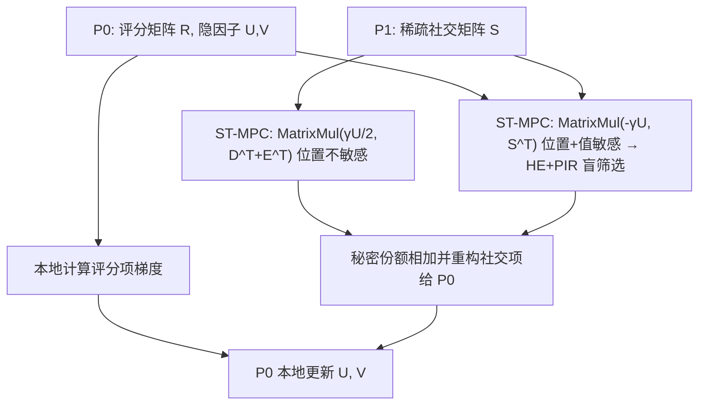
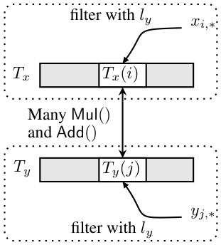
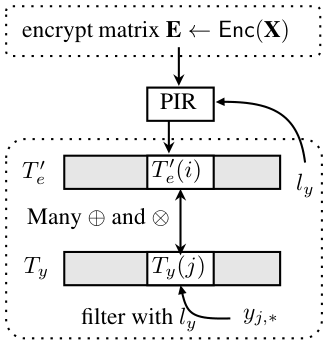

# Exploiting Data Sparsity in Secure Cross-Platform Social Recommendation (面向跨平台社交推荐的安全稀疏矩阵乘法)

- **会议/期刊**: NeurIPS 2021
- **作者与机构**: Jamie Cui, Chaochao Chen, Lingjuan Lyu, Carl Yang, Li Wang（蚂蚁集团、浙江大学、Sony AI、Emory University）
- **推荐链路定位**: 召回（矩阵分解式协同召回的训练阶段）
- **研究方向**: 去偏公平、可信隐私与工业架构 / 社交与群组推荐
- **论文原文**: [arXiv:2202.07253v1](https://arxiv.org/abs/2202.07253v1)
- **开源代码**: [microsoft/SealPIR](https://github.com/microsoft/SealPIR)（PIR 组件依赖；完整 S3Rec 暂未单独开源）

## TL;DR (1分钟核心速览)

现实中的评分数据（评分平台 $P_0$）与社交关系（社交平台$P_1$）分属不同平台且高度稀疏敏感，现有隐私社交推荐方案 SeSoRec 靠泄露"两行/两列元素和"换效率、且把社交矩阵当稠密矩阵处理。本文以 Soreg 为目标模型，将梯度计算拆为$P_0$本地评分项与双方协作社交项，并把后者归约为两次安全矩阵乘法：对角矩阵（位置不敏感）用 Beaver 三元组稀疏化到$O(km)$，社交矩阵（位置+值均敏感）用 HE+PIR 盲化筛选降到$O(\alpha km)$。Epinions/LibraryThing 上五折 CV 的 RMSE 与明文基线**完全一致**，单轮通信量降低约 423×、耗时降低约 40×。

## Background & Motivation (背景与核心矛盾)

- **主流范式**: 社交推荐以矩阵分解为载体（代表 Soreg），在 BPR/MSE 目标上额外加入社交正则项 $\sum s_{if}\lVert \mathbf{u}_i-\mathbf{u}_f\rVert^2$，强制社交邻居表征靠近。
- **前人局限**: 其一，SeSoRec 为提速主动泄露社交矩阵行/列元素和，在二元社交关系下几乎等同于泄露邻接信息，安全收益被架空；其二，SeSoRec 把 $S$视作稠密矩阵沿用 Beaver 三元组乘法，通信量$O(km^2)$，$m\approx10^4$ 时单轮即达 7.4GB，百轮 ~1.5TB，工业不可用。
- **核心洞察 (Key Insight)**: 社交推荐数据有两个可利用的结构性质——(a) 社交正则项中的 $D,E$是**对角阵**，零元位置天然公开；(b)$S$ 的社交密度极低（LibraryThing 仅 0.02%）。零元乘法占了全部计算量的绝对大头，只要能在"不泄露零元位置"的前提下跳过这些乘法，通信量就能按密度线性下降。
- **本文切入点**: 把"稀疏性可见程度"形式化为两个安全等级，分别设计精确对齐的最小通信协议，而非在通用 MPC 上做算子近似。

## Method (核心方法设计)

### 1. 整体框架 (Overall Architecture)

$P_0$持评分矩阵$\mathbf{R}$与物品侧参数$\mathbf{V}$，$P_1$持社交矩阵$S$，双方共享同一用户集。每轮迭代中，$P_0$先在本地计算评分项梯度并更新$\mathbf{V}$；对$\mathbf{U}$的更新则需联合计算社交项，双方调用 ST-MPC 协议：先由 MatrixMul 安全算出$\frac{\gamma}{2}\mathbf{U}(\mathbf{D}^\top+\mathbf{E}^\top)$与$-\gamma\mathbf{U}\mathbf{S}^\top$的秘密份额，加法聚合后把**明文社交项**重构给$P_0$，$P_0$再做本地梯度下降。由于$S$全程不离开$P_1$、$\mathbf{U}$全程不离开$P_0$，安全性完全由 ST-MPC 承担；而 ST-MPC 的代价几乎全部压在矩阵乘法上，这构成全文唯一的效率战场。

<figure class="paper-figure" markdown="span">
  <figcaption>图 3：我们提出的 S3Rec 框架，其中 MatrixMul 表示安全矩阵乘法协议，Add 表示安全加法协议，Rec 表示秘密共享的重构协议。</figcaption>
</figure>

### 2. 关键设计拆解 (Key Designs)

1. **不敏感稀疏：分箱对齐 + 三元组裁剪**：$D,E$为对角阵，$P_1$可公开零元位置。双方把$\mathbf{X}$的每行、$\mathbf{Y}$的每列按非零位置装入对齐的桶$T_x(i)\subseteq \mathbf{x}_{i,*}$、$T_y(j)\subseteq \mathbf{y}_{*,j}$，只对桶内元素做 Beaver 内积。零乘被彻底裁掉，三元组消耗从$km^2$降到$k\cdot nnz(\mathbf{Y})$，对角情形$nnz=m$即$O(km)$。
2. **敏感稀疏：HE+PIR 的盲化筛选**：此时 $P_0$无权知道$P_1$的非零位置，无法自行建桶。做法是$P_0$用 Paillier 加密整个$\mathbf{X}$得$E$作为 PIR 数据库，$P_1$依据自己的位置向量$l_y$生成一批 PIR 查询取回**仅自己需要的加密元素**，构成过滤后的表$T'_e$；随后$P_1$在同态域上做$\beta_{i,j}=\bigoplus_{\mathbf{v}\in T'_e(i),\mathbf{u}\in T_y(j)} \mathbf{v}\otimes\mathbf{u}$，加随机掩码$g_{i,j}$后交$P_0$解密，双方分别持有份额。明文乘法次数从$m^2$降为$\alpha m^2$，通信$O(\alpha km)$。
3. **训练目标、泄露预算与推理开销**: 总损失即 Soreg 的 MSE+社交正则（式 1），无负采样（评分预测任务）。$\mathbf{V}$与评分项均在$P_0$本地闭式更新，在线推理只发生在$P_0$内部，**零额外密码学开销**。关键的安全论证是：$P_0$每轮只见到一个线性组合$\gamma\mathbf{U}\mathbf{S}^\top$的明文，而迭代轮数$T$远小于用户数$n$，方程组欠定、有无穷多解，故无法反解$S$；协议要求双方事前约定$T<n$。

<figure class="paper-figure" markdown="span">
  <figcaption>图 6：具有敏感稀疏性的矩阵乘法。</figcaption>
</figure>

## Experimental Setup & Evaluation Protocol (实验设置与评估协议)

- **数据集与预处理**: 沿用 SeSoRec 的过滤口径，移除交互数少于 15 的用户与物品：

| 数据集 | #Users | #Items | #Interactions | 评分密度 | 社交关系数 | 社交密度 |
| :--- | :---: | :---: | :---: | :---: | :---: | :---: |
| Epinions | 11,500 | 7,596 | 283,319 | 0.32% | 275,117 | 0.21% |
| LibraryThing | 15,039 | 14,957 | 529,992 | 0.24% | 44,710 | 0.02% |

- **数据划分与防穿越**: **五折交叉验证**（非时间切分），论文未显式讨论评分时间戳穿越问题。
- **排名评测协议**: **不使用 Top-N 排名**，采用评分预测的 **RMSE**（评分域 $[0,5]$）；效率侧报告单/总训练时长（秒）与两方通信量（GB）。无负采样环节。
- **对比基线与超参设置**: MF（仅用 $P_0$评分，等价$\gamma=0$）、Soreg（明文集中式，无隐私）、SeSoRec（SOTA 隐私方案）。隐因子维度$k=10$（另测 15/20），学习率与$\lambda$在$\{10^{-3},\dots,10^{1}\}$ 网格调优；密码学参数为 128-bit 计算安全 + 40-bit 统计安全，64-bit 秘密共享，本地网络 ~3ms 延迟。

## Key Experimental Results (实验关键数据)

### 1. 主实验对比 (Main Results)

| 模型 | Epinions RMSE | Epinions 总时间(s) | Epinions 通信(GB) | Lthing RMSE | Lthing 总时间(s) | Lthing 通信(GB) |
| :--- | :---: | :---: | :---: | :---: | :---: | :---: |
| MF | 1.193 | 3.85 | — | 0.927 | 9.60 | — |
| Soreg (明文) | **1.062** | 40.50 | — | **0.908** | 57.76 | — |
| SeSoRec | **1.062** | 7,799 | 798.6 | **0.908** | 16,084 | 1,365 |
| **S3Rec (本文)** | **1.062** | **419.9** | **3.552** | **0.908** | **262.1** | **2.201** |
| Improv. vs SeSoRec | — | 18.57× | 224.8× | — | 61.37× | 620.2× |

### 2. 消融/敏感性分析 (Ablation & Sensitivity)

| 分析维度 | 设置 | SeSoRec | S3Rec | 相对收益 |
| :--- | :--- | :---: | :---: | :---: |
| 社交采样率 (Epinions 时间) | 0.4 / 0.6 / 0.8 | 7,799（恒定） | 366.3 / 381.2 / 401.8 | 21.3× / 20.5× / 19.4× |
| 社交采样率 (Lthing 通信) | 0.4 / 0.6 / 0.8 | 1,366（恒定） | 1.62 / 1.82 / 2.01 | 843× / 751× / 680× |
| 隐因子维度 $k$(Epinions 通信) | 10 / 15 / 20 | 798.6 / 1,198 / 1,597 | 3.552 / 3.552 / 3.552 | 恒定不随$k$ 增长 |
| 社交项离线开销 | Epinions | 7,271 s | 10.86 s | 离线成本几乎归零 |

### 3. 关键实验发现 (Key Findings)

1. **精度零损失**：S3Rec 与明文 Soreg、SeSoRec 的 RMSE 逐位相同（1.062 / 0.908），说明密码学协议是"精确计算"而非近似近似（对比之下 NN-based MPC 方案常因非线性激活近似掉点），隐私成本完全体现在时间而非精度上。而引入社交信息本身带来 MF→Soreg 的 1.193→1.062（Epinions，10.7% 降幅）与 0.927→0.908（Lthing），验证跨平台社交迁移的价值。
2. **稀疏性红利随密度线性兑现**：SeSoRec 的时间与通信对社交采样率完全不敏感（恒为 7,799s / 798GB），而 S3Rec 随采样率下降近似线性收缩，Lthing（社交密度仅 0.02%）上通信降幅达 843×，远高于 Epinions（0.21%）的 255×——**收益与 $\alpha$ 成反比**，证明协议真正跳过了零元而非仅仅换了个乘法实现。
3. **对 $k$的通信规模不敏感**：$k$ 从 10 增到 20 时，SeSoRec 通信从 798.6GB 膨胀到 1,597GB（近 2×），S3Rec 恒为 3.552GB，这一"通信量与嵌入维度解耦"的性质对大模型化召回极具工程吸引力。

## Highlights & Limitations (亮点、对比与审稿批判)

- **与代表作对比 (vs. Prior Work)**: 与 SeSoRec 的本质差异不在模型而在**威胁模型**——SeSoRec 交出行/列元素和换取效率，本文用 PIR 让 $P_1$ 盲取所需密文，杜绝该泄露；与 ROOM 等通用稀疏安全计算框架相比，本文不依赖预生成相关随机性，且同时支持"位置公开"与"位置保密"两档，可按矩阵类型分别选用，因此更贴合社交推荐的异构稀疏结构。
- **可迁移亮点**: (a) "按稀疏性敏感等级分档设计协议"的思路可迁移到联邦/隐私跨域推荐中的 item embedding 传输、跨域映射矩阵对齐等场景；(b) 把对角正则矩阵单独抽出走廉价通道（$O(km)$）这一工程 trick，对任何带度归一化/对角拉普拉斯项的安全图推荐都适用。
- **审稿级局限批判**: 其一，**评估协议偏弱**——仅用 RMSE 五折 CV，未做 Top-N 排名（Recall/NDCG）、无时间切分，也未报告显著性检验，且 $k=10$过小、缺乏现代神经社交推荐基线（如 GraphRec/DiffNet），"精度一致"只在极简 MF 家族内成立；其二，**安全模型与扩展性受限**：仅抗半诚实敌手、需双方共享用户集、每轮向$P_0$明文泄露社交项并依赖$T<n$ 这一约定来保证不可反解，属于"弱化版"安全而非完整 MPC 训练；此外 HallG 等第三方库/网络延迟的实测开销（~3ms LAN）在广域网下会被显著放大。

## Rating (四维评分)

- **方法创新性 (Novelty)**: ⭐⭐⭐⭐ （将稀疏可见性形式化为两档安全等级并各配精确协议，$O(km^2)\to O(\alpha km)$ 的复杂度改进扎实且证明完备，但模型侧无新意，创新集中在密码学工程）
- **评估协议与实验扎实度 (Protocol & Experiments)**: ⭐⭐⭐ （效率评估充分且有 $k$ 与稀疏率双维度敏感性分析，但仅有 RMSE 五折 CV、无 Top-N/时间切分/显著性检验，基线偏旧）
- **写作与数学规范度 (Clarity & Rigor)**: ⭐⭐⭐⭐ （协议伪代码与安全引理清晰、复杂度推导明确，安全论证靠"欠定方程组"直观说明而非形式化泄露界，稍显薄弱）
- **工业落地与复现价值 (Industrial & Practical Value)**: ⭐⭐⭐⭐ （通信量与原模型精度不变使其具备真实跨企业协作可行性，但依赖 PIR/HE 库、需 $T<n$ 的运营约束，完整系统未开源）

