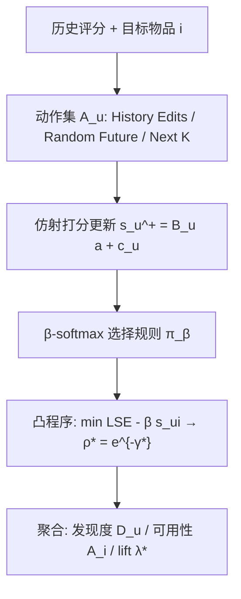
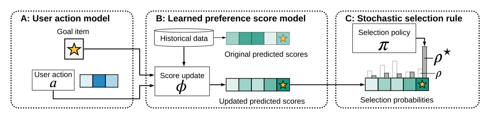
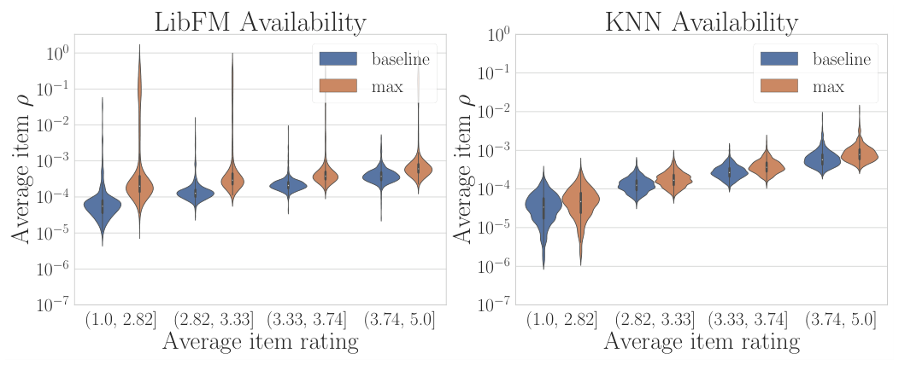

# Quantifying Availability and Discovery in Recommender Systems via Stochastic Reachability (通过随机可达性量化推荐系统中的内容可用性与发现机会)

- **会议/期刊**: ICML 2021
- **作者与机构**: Mihaela Curmei*, Sarah Dean*, Benjamin Recht（UC Berkeley EECS，* 同等贡献）
- **推荐链路定位**: 排序/选择策略的离线审计与评测（不改进模型精度）
- **研究方向**: 去偏公平、可信隐私与工业架构 / 强化学习与动态探索推荐
- **论文原文**: [https://arxiv.org/abs/2107.00833v1](https://arxiv.org/abs/2107.00833v1)
- **开源代码**: [https://github.com/berkeley-reclab/RecLab](https://github.com/berkeley-reclab/RecLab)

## TL;DR (1分钟核心速览)

本文不评估推荐准不准，而评估"用户/内容能不能被看到"。针对观测式偏差指标只看单轮结果、闭环仿真必须假设用户行为模型的矛盾，提出**随机可达性** $\rho^{\star}(u,i)$：在一组界面允许的策略性动作（改历史评分、给未见物品打分）内，最大化 softmax 选择策略推荐目标物品的概率。该量在仿射打分更新 + Boltzmann 选择下可化为 log-sum-exp 凸程序，逐对高效求解。在 ML-1M/LastFM/MIND 上用 LibFM 与 ItemKNN 审计：KNN 的流行度偏差在最优情形下仍无法消除（$r_s$ 0.950→0.943），而 LibFM 可从 0.827 降到 0.501。

## Background & Motivation (背景与核心矛盾)

- **主流范式**: 推荐偏差审计长期依赖观测式指标（novelty、serendipity、coverage、calibration 重排），或闭环/仿真方法（RL 模拟用户长期行为）。
- **前人局限**: ①观测式指标只检查"某一轮推荐的输出"，无法把**模型结构性偏差**与**用户行为造成的偏差**分开；②闭环仿真与 RL 必须显式指定行为模型（点击模型、策略偏好），结论高度依赖建模假设，难以定论"平台是否限制了用户"。
- **核心洞察 (Key Insight)**: 如果只关心"系统允许的最好情况"，就无需知道用户行为的概率分布——只需知道**界面允许哪些动作**（动作集 $\mathcal{A}_u$）。因此应把用户视为具有能动性的策略主体，计算"最大可达推荐概率"这一上界。
- **本文切入点**: 将 Dean et al. (2020) 的**确定性可达性**推广到随机（softmax）选择策略，证明其可解为凸优化，从而支持大规模逐 user-item 对审计。

## Method (核心方法设计)

### 1. 整体框架 (Overall Architecture)

审计对象被拆成三件套：**A 用户动作模型**（哪些评分可被策略性修改）、**B 学到的偏好打分模型** $\phi_u$（输入动作$a$输出新分数$s_u^{+}=\phi_u(a)$）、**C 随机选择规则**$\pi_\beta$（按 Boltzmann 分布抽样推荐）。对每个$(u,i)$求解"在动作集内最大化推荐概率"的凸问题得到$\rho^{\star}$，再向上聚合为**用户侧发现度**$D_u$与**物品侧可用性**$A_i$，并对照基线$\rho_0$ 计算 lift 与 rank gain。全流程不需要训练新模型，只需对已训练打分器做一次审计求解。

<figure class="paper-figure" markdown="span">
  <figcaption>图2：我们在用户动作模型（A）、学习到的偏好模型（B）和随机选择规则（C）下审计推荐系统。</figcaption>
</figure>

### 2. 关键设计拆解 (Key Designs)

1. **随机可达性与凸化（核心贡献）**：定义 $\rho^{\star}(u,i)=\max_{a\in\mathcal{A}_u}\mathbb{P}\big(\pi(\phi_u(a),\Omega^{t}_u)=i\big)$。因为$\log\mathbb{P}=\beta s_{ui}-\mathrm{LSE}_{j\in\Omega^{t}_u}(\beta s_{uj})$，最大化概率等价于最小化负对数似然：$\min_{a\in\mathcal{A}_u}\mathrm{LSE}_{j\in\Omega^{t}_u}\big(\beta(\boldsymbol{b}_{uj}^{\top}a+c_{uj})\big)-\beta(\boldsymbol{b}_{ui}^{\top}a+c_{ui})$，且$\rho^{\star}=e^{-\gamma^{\star}}$。LSE 凸、仿射复合保凸，故只要动作集凸即可用指数锥求解——这是把"行为不可知的上界"变成可计算量的关键。

2. **仿射打分更新（覆盖 MF 与邻域模型）**：把一次交互后的分数更新写成 $s_u^{+}=B_ua+c_u$。对矩阵分解，SGD 一步更新给出$B_u=-\alpha QQ_{\mathcal{A}}^{\top}$、$c_u=Q(p_u-\alpha Q_{\mathcal{A}}^{\top}Q_{\mathcal{A}}p_u)$；对 ItemKNN，$s_u=Wr_u$天然线性，$B_u=WE_{\Omega^{\mathcal{A}}}$。物理直觉：$B_u$的第$i$ 行描述"改动动作物品评分能在多大程度上抬升目标物品分数"，模型结构直接决定可达性上限。

3. **几何条件与"无精度损失可达性"**：若 $\boldsymbol{b}_{ui}$是$\{\boldsymbol{b}_{uj}\}_{j\in\Omega^{t}_u}$凸包的**顶点**，则$\beta\to\infty$时$\rho^{\star}\to1$（可 top-1 可达）；进一步构造$\tilde{Q}=[Q,\boldsymbol{v}]$（$v_i^2=C^2-\lVert q_i\rVert_2^2$）、$\tilde{P}=[P,\boldsymbol{0}]$，使$\tilde{P}\tilde{Q}^{\top}=PQ^{\top}$且所有物品成为顶点——证明**可达性与精度并非必然冲突**，只需$d+1$维与满秩的"充分丰富"动作集（$|\Omega^{\mathcal{A}}_u|\ge d+1$）。

4. **训练目标与推理开销**：本文无训练损失与负采样（评估的是既有打分器），核心开销是逐对求解指数锥程序：ML-1M/LibFM 上 $K=5/10/20$ 分别约 0.82/0.87/0.91 s，ItemKNN 因矩阵稠密需 9.8–11.4 s，LastFM 4.91 s、MIND 0.44 s，故实践中按用户与目标物品采样审计。

## Experimental Setup & Evaluation Protocol (实验设置与评估协议)

| 数据集 | #Users | #Items | #Interactions | 密度 | 特征/场景说明 |
| :--- | :---: | :---: | :---: | :---: | :--- |
| ML-1M | 6,040 | 3,706 | 1,000,209 | 4.47% | 1–5 显式电影评分，无需额外预处理 |
| LastFM 360K | 13,698 | 20,109 | 178,388 | 0.065% | 隐式，随机抽 10% 用户/艺人，$r_{ui}=\log(\#\text{listens}+1)$ |
| MIND-small | 50,000 | 247 | 670,773 | 5.54% | 新闻**子类**级点击聚合，$r_{ui}=\log(\#\text{clicks}+1)$ |

- **数据划分与防穿越**: 先用 10%–90% 的 test-train split 做超参搜索（LibFM：$lr\in(0.001,0.5)$、$reg\in(10^{-5},100)$、$d=64$、SGD 128 轮；ItemKNN：近邻 100、shrinkage 22.22），再用**全量数据重训**后做审计；不存在时序泄漏问题（审计对象是静态打分器的一步更新）。
- **排名评测协议**: 非传统 Full-Ranking/Sampled 排序指标，而是**逐对概率上界**：ML-1M 取 3% 用户（176 人）× 每人 500 个"未见且非动作"目标物品；LastFM 取 100 用户 × 500 目标物品；MIND 全量。目标集 $\Omega^{t}_u$ 内做 softmax 归一化，等价于在目标集上的全库排序分布。
- **对比基线与超参**: 两类打分器（LibFM / ItemKNN）× 三类动作空间（History Edits、Random Future、Next $K$，$K\in\{5,10,20\}$）× 随机性$\beta\in\{1,2,4,10\}$；无显著性检验，改用 Spearman 秩相关量化偏差强度。

## Key Experimental Results (实验关键数据)

### 1. 主实验对比 (Main Results)

本文主表是**偏差审计表**（原文 Table 4），"基线"指不同偏好模型而非不同算法家族；RMSE 仅作打分器可用性校验。

| 数据集 | 偏好模型 | Test RMSE | 与数据流行度 $r_s$| 基线可用性$r_s$| 最优可用性$r_s$ | Improv.(偏差降幅) |
| :--- | :--- | :---: | :---: | :---: | :---: | :---: |
| ML-1M | LibFM | 0.716 | 0.346 | 0.827 | **0.501** | −39.4% |
| ML-1M | ItemKNN | 0.756 | 0.346 | 0.950 | 0.943 | −0.7% |
| MIND | LibFM | 0.318 | 0.864 | 0.825 | **0.435** | −47.3% |
| LastFM | LibFM | 1.122 | 0.133 | 0.671 | **0.146** | −78.2% |

### 2. 消融实验 (Ablation Study)

| 变体（ML-1M, LibFM, $\beta=2$） | 流行度–可用性$r_s$| 经验–发现度$r_s$ | 每对求解耗时 |
| :--- | :---: | :---: | :---: |
| 观测式基线（无策略干预） | 0.827 | 0.476 | — |
| Max 可达（Next $K$=10） | **0.501** | 0.530 | 0.87 s |
| Max 可达（$K$=5 → 20） |$\rho^{\star}$ 单调上升 | — | 0.82 → 0.91 s |
| $\beta$: 1 → 10（趋确定性） | 大于均匀阈值物品数↓，高$\rho^{\star}$ 物品数↑ | — | ≈常数 |
| ItemKNN Max（同设置） | 0.943 | −0.032 | 10.2 s |

### 3. 关键实验发现 (Key Findings)

1. **偏差是否"不可避免"取决于打分模型的几何结构**：ItemKNN 的基线可用性与流行度几乎完全绑定（$r_s=0.950$），即使允许用户任意改评分也只能降到 0.943；而 LibFM 可从 0.827 降至 0.501（MIND 0.825→0.435、LastFM 0.671→0.146）。说明邻域加权模型把"流行度"直接编码进分数可达域，用户能动性无法突破。
2. **随机性带来双向效应，且 lift 存在虚高陷阱**：$\beta$小（探索强）时更多物品达到"优于均匀"阈值$1/|\Omega^{t}_u|$；$\beta$大时少数物品可拿到$>5\%$的推荐概率，平均 lift 更高——但高 lift 部分源于基线概率极低（分母趋零），并非真实可及性提升；$\beta\to\infty$ 严格退化为 top-1 可达性。
3. **动作空间的"类型"比"大小"更关键**：$K$从 5 增到 20 对$\rho^{\star}$单调增益；但 Random History 的平均 lift 始终高于 Random Future（因被修改项占历史评分的比例更大）；对 ItemKNN，Next$K$ 几乎无效——近邻几何聚集使"下一个该推的物品"彼此邻近，用户被锁在局部邻域内。用户经验长度与发现度仅弱相关（ML-1M 0.476/0.530，MIND 0.051/0.113），性别维度未观察到系统性差异。

<figure class="paper-figure" markdown="span">
  <figcaption>图7：比较 LibFM（左）和 KNN（右）偏好模型在四个流行度类别下内容的基线与最佳情况可用性。在 ML-1M 上针对 β = 2 的 Next 10 动作空间评估可达性。</figcaption>
</figure>

## Highlights & Limitations (亮点、对比与审稿批判)

- **与代表作对比 (vs. Prior Work)**: 相比 Dean et al. (2020) 的确定性 top-1 可达性，本文引入随机选择策略并给出凸规划解与 $\beta\to\infty$ 的极限刻画；相比 calibration / 重排类去偏工作（Steck 2018、Singh & Joachims 2018）只做观测式后处理，本文是**干预式**归因，能区分"结构性偏差"与"行为导致偏差"；相比闭环仿真/RL 审计，本文不需行为模型但给出必要非充分上界。
- **可迁移亮点**: ①"仿射打分更新 + LSE"这一模板可套用到任意线性打分器（FM、SLIM、线性冷启动模型）做可达性/可申诉性分析；②$\tilde{Q}$增广维度的构造提示：仅需$d+1$ 维、且保证动作集满秩，即可在**不损失任何预测精度**下获得全域 top-1 可达性，可作为训练时的正则约束。
- **审稿级局限批判**: ①上界允许用户拥有模型内部结构与全部参数的完全知识并做精确最优动作，真实用户不可能做到，故"可达但不可达"的落差需另建行为模型测量，指标是必要非充分；②仅覆盖 pointwise 打分 + 单轮软最大化选择，无法刻画 pairwise 排序、整页 slate 推荐与多轮长期效应；③每对求解 0.44–11.4 s，全库审计必须采样，且结论对动作集定义与 $\beta$ 的取值敏感，缺乏跨数据集统一的阈值准则。

## Rating (四维评分)

- **方法创新性 (Novelty)**: ⭐⭐⭐⭐ （把确定性可达性推广为随机可达性并证明凸性，配合凸包顶点/维度增广的几何刻画，"可达性与精度不冲突"的构造性证明颇具洞见）
- **评估协议与实验扎实度 (Protocol & Experiments)**: ⭐⭐⭐⭐ （三数据集 × 两模型 × 三动作空间 × 四档 $\beta$ 的网格审计较完整，并用 Spearman 相关与流行度分桶给出可解释归因；但缺少真正的算法级基线与显著性检验）
- **写作与数学规范度 (Clarity & Rigor)**: ⭐⭐⭐⭐⭐ （三命题均给出完整证明，$\rho^{\star}$、lift、$D_u$、$A_i$ 定义边界清晰，凸性与复杂度讨论到位）
- **工业落地与复现价值 (Industrial & Practical Value)**: ⭐⭐⭐⭐ （审计可在模型上线前作为"偏差体检"运行，且动作集设计可反向指导 UI；但稠密求解开销与"全知用户"假设限制其对超大工业库的直接套用）

