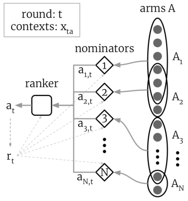
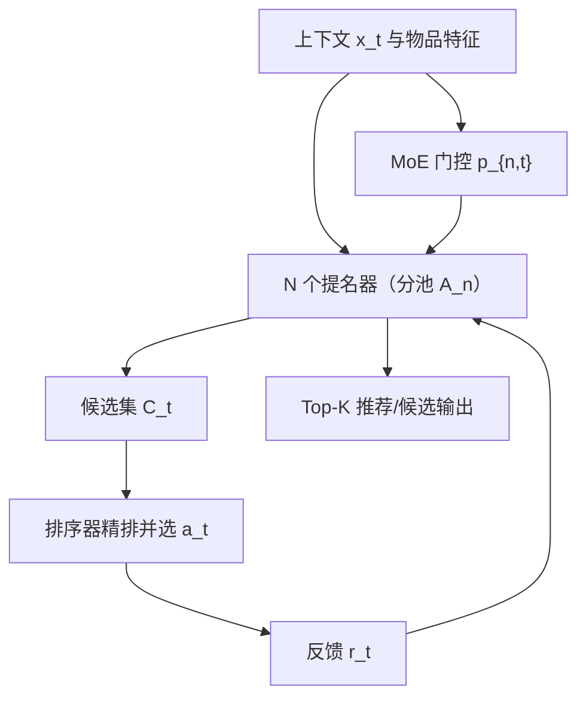

# On component interactions in two-stage recommender systems (两阶段推荐系统中的组件交互研究)

- **会议/期刊**: NeurIPS 2021
- **作者与机构**: Jiri Hron（Cambridge）、Karl Krauth（UC Berkeley）、Michael I. Jordan（UC Berkeley）、Niki Kilbertus（TUM / Helmholtz AI）
- **推荐链路定位**: 召回 + 精排级联 / 两阶段推荐
- **研究方向**: 多任务学习与列表级重排 / 强化学习与动态探索推荐
- **论文原文**: [https://arxiv.org/abs/2106.14979v3](https://arxiv.org/abs/2106.14979v3)
- **开源代码**: 暂未开源

## TL;DR (1分钟核心速览)

两阶段推荐长期被当作“提名器 + 排序器”的简单相加，忽略组件间的算法-算法交互。本文用 bandit 实验与遗憾分解证明：独立训练提名器可能退化到随机推荐水平；并提出 MoE 门控学习物品池分配，让提名器专业化。AmazonCat-13K 离线 prec@5/recall@5 在多数配置下显著优于随机池分配。

## Background & Motivation (背景与核心矛盾)

- **主流范式**: 工业推荐常用 N 个低延迟提名器从全库各选候选，再由高容量排序器在候选集 $C_t$ 上精排；两阶段被视为可分别训练、分别评估的组件。
- **前人局限**: 现有工作常假设两阶段性能可由各组件单阶段性能解释，忽略排序器反馈会回流提名器、池分配会改变候选分布；手工划分物品池难以最优，且可能极差。
- **核心洞察 (Key Insight)**: 两阶段遗憾可分解为提名器遗憾与排序器遗憾；若排序器对自适应上下文鲁棒，其遗憾可受控，系统瓶颈常转向提名器；但训练目标与池分配错配会让提名器失效。
- **本文切入点**: 先用合成与 Amazon bandit 实验验证组件交互，再用 MoE 学习软池分配，使每个提名器专精不同物品子集。

<figure class="paper-figure" markdown="span">
  <figcaption>图2：左：两阶段推荐设置。右：Amazon 奖励直方图。前 5 个臂贡献了正奖励的 19.22%，而后 50 个臂仅贡献了 19.85%。</figcaption>
</figure>

## Method (核心方法设计)

### 1. 整体框架 (Overall Architecture)

输入上下文 $x_t$（用户/物品特征）后，N 个低延迟提名器分别在分池$\mathcal{A}_n$内选一个候选，组成$C_t$；排序器用全特征在$C_t$上精选$a_t$，反馈$r_t$同时回流更新提名器与排序器。本文不改主干网络，而在训练层加入 MoE 门控$p_{n,t}$ 学习软池分配：每个提名器作为专家专精不同物品子集；部署时可把门控蒸馏成硬分池，保持原有召回-精排链路与低延迟。

### 2. 关键设计拆解 (Key Designs)

1. **遗憾分解与组件交互诊断**：两阶段总遗憾不是组件遗憾的简单相加，而是 $R_T^{2s}=R_T^N+R_T^R$；$R_T^N$衡量最佳候选$\tilde{a}_t$与全局最优$a_t^\star$的差距，$R_T^R$衡量排序器所选$a_t$与候选内最优的差距。若排序器满足单阶段鲁棒遗憾界，则$R_T^R\le B_T^R$，系统性能主要由提名器决定。该分解把“组件交互”变成可测量、可归因的优化目标。

2. **独立提名器训练的失效机制**：提名器只观察部分反馈，其加权训练目标为 $f_{n,t}=\arg\min_{f_n\in\mathcal{F}_n}\{\|f_n\|_{\mathcal{F}_n}+\sum_{i<t}w_{n,i}(r_i-f_n(x_{n,i},a_i))^2\}$。`training-on-all` 取$w_{n,i}=1$，`training-on-own` 取$w_{n,i}=\mathbb{I}\{a_i\in\mathcal{A}_n\}$。Proposition 2 构造反例表明二者都可能产生线性遗憾，且一个失效时另一个可能有效；根因是池内/池外上下文分布差异叠加模型错配。

3. **MoE 学习池分配与低延迟推理**：把每个提名器视为专家，用门控 $p_{n,t}\ge0,\sum_n p_{n,t}=1$学习软池分配，训练目标为$\mathcal{L}=-\frac{1}{B}\sum_{t=1}^B \log\sum_{n=1}^N p_{n,t}\exp\{-(r_t-\hat{r}_{n,t})^2/(2\sigma^2)\}$。相比对指数级候选集求和，MoE 只对 N 个专家求和，方差更低；门控 logits 可用用户/物品嵌入相加实现，推理仅增加 O(N) 打分，并可将学到的权重蒸馏为硬分池。训练不使用 BPR/InfoNCE 负采样，bandit 场景每步仅观察所选臂奖励，MoE 实验用多标签正负样本监督。

## Experimental Setup & Evaluation Protocol (实验设置与评估协议)

- **数据集与预处理**: 非传统 `5-core` 用户-物品矩阵；AmazonCat-13K 为多标签分类转 bandit，取第 3–102 高频类别，保留约 10.73% 正奖励。

| 数据集/场景 | #用户/上下文 | #物品(臂) | #交互/样本 | 稀疏度/特征说明 |
| :--- | :---: | :---: | :---: | :--- |
| Synthetic bandit | N/A | 100 / 10,000 | $T=1000$，30 seeds |$d\in\{10,40,80\}$，$s<d$，5 nominators |
| AmazonCat-13K bandit | N/A（评论特征） | 100（另有1000） | 10.73% 正奖励 | BERT 768→400 维；前5臂贡献19.22%，后50臂仅19.85% |
| Amazon MoE | N/A | 100 items | 50k test entries；$c=100/500/750$/arm |$s\in[25,100]$，$d_e\in\{5,10,50\}$，N=10/20 |

- **数据划分与防穿越 (Splitting Strategy)**: 合成与 Amazon bandit 为在线反馈模拟；MoE 使用独立测试集 50,000 条，训练集每臂 $c$ 条。未采用 Leave-One-Out 或全局时间戳切分，离线评估需谨慎解读。
- **排名评测协议 (Ranking Protocol)**: bandit 主实验用期望遗憾，并以均匀随机智能体遗憾归一化；MoE 用 100 候选上的全量 precision@5 / recall@5，非采样负例排序。
- **对比基线与超参设置**: 单阶段 UCB/Greedy；两阶段 U+U、U+G、G+G；N=2/5/10；随机池分配 vs. MoE；$d=400$，$s$与$d_e$ 变化；30 个随机种子并报告两倍标准误区域。

## Key Experimental Results (实验关键数据)

### 1. 主实验对比 (Main Results)

原文主实验以图 3–5 呈现，无精确表格；表 1 按图 5（N=10，$c=500$，$s=100$）读取近似值，仅用于比较趋势。相对提升以 random-$d_e=10$ 为基准。

| 系统（N=10, c=500, s=100） | prec@5 | recall@5 | Improv.% (prec/recall) |
| :--- | :---: | :---: | :---: |
| Random pool, $d_e=5$ | ≈0.160 | ≈0.075 | -5.9% / -6.3% |
| Random pool, $d_e=10$ | ≈0.170 | ≈0.080 | baseline |
| Random pool, $d_e=50$ | ≈0.155 | ≈0.070 | -8.8% / -12.5% |
| MoE, $d_e=5$ | ≈0.200 | ≈0.100 | +17.6% / +25.0% |
| **MoE, $d_e=10$** | **≈0.230** | **≈0.110** | **+35.3% / +37.5%** |
| MoE, $d_e=50$ | ≈0.190 | ≈0.095 | +11.8% / +18.8% |

### 2. 消融实验 (Ablation Study)

| 消融/敏感性设置 | prec@5 | recall@5 | Δ vs. full |
| :--- | :---: | :---: | :---: |
| Full MoE（$d_e=10$，$c=500$） | ≈0.230 | ≈0.110 | — |
| w/o MoE gating → random pool | ≈0.170 | ≈0.080 | -26.1% / -27.3% |
| w/o 排序器（最佳单阶段提名器） | ≈0.180 | ≈0.085 | -21.7% / -22.7% |
| $d_e=50$（容量过大） | ≈0.190 | ≈0.095 | -17.4% / -13.6% |
| $c=100$（小样本） | ≈0.160 | ≈0.070 | -30.4% / -36.4% |

### 3. 关键实验发现 (Key Findings)

- 在 $c=500$、N=10、$d_e=10$ 时，MoE 相比随机池分配把 prec@5 从约 0.17 提到约 0.23（约 +35%），recall@5 从约 0.08 提到约 0.11（约 +37.5%），说明收益来自提名器专业化带来的候选多样性，而非仅排序器变强。
- 当正奖励率约 10% 时，10 个非重叠随机提名器至少命中一个最优臂的概率约为 $1-(0.9)^{10}\approx0.65$，解释了 N 增大时提名器遗憾$R_T^N$快速下降；但 N 继续增大后$R_T^R$ 占比上升，排序器容量成为新瓶颈（图4）。
- MoE 并非无脑占优：$c=100$或$d_e=50$ 时门控易过拟合、优化器易陷局部最优，优势缩小甚至反转，说明池分配学习需要足够样本、正则或 EM/张量分解等替代训练。

## Highlights & Limitations (亮点、对比与审稿批判)

- **与代表作对比 (vs. Prior Work)**: 不同于 Covington 等 YouTube 两阶段架构只做工程拆分，本文用遗憾分解显式诊断“算法-算法”交互；不同于 [67] 对联合两阶段策略做策略梯度、需对指数级候选集求和，MoE 只对 N 个专家求和，方差更低且可蒸馏成硬池。
- **可迁移亮点**: 遗憾分解可直接用于诊断召回-精排级联瓶颈；MoE 软池分配可先离线学习、再阈值化蒸馏为工业硬分池，兼容任意 score-based 提名器。
- **审稿级局限批判**: 未在生产系统做在线 A/B，离线 bandit/多标签代理与真实推荐分布仍有差距；理论反例主要覆盖线性/LSO 模型，MoE 的门控训练存在局部最优与小样本过拟合，且未开源代码。

## Rating (四维评分)

- **方法创新性 (Novelty)**: ⭐⭐⭐⭐ （把两阶段组件交互形式化为遗憾分解，并给出独立提名器训练可能退化的反例，理论视角新颖）
- **评估协议与实验扎实度 (Protocol & Experiments)**: ⭐⭐⭐ （合成+Amazon 多配置与 30 seeds 较扎实，但缺标准推荐划分、线上验证和精确表格）
- **写作与数学规范度 (Clarity & Rigor)**: ⭐⭐⭐⭐ （遗憾分解与 Proposition 2 表述清晰，MoE 目标简洁；但非线性理论仍留白）
- **工业落地与复现价值 (Industrial & Practical Value)**: ⭐⭐⭐ （MoE 门控可蒸馏为硬池、推理开销可控，但无开源代码且需改造训练/池分配流程）

