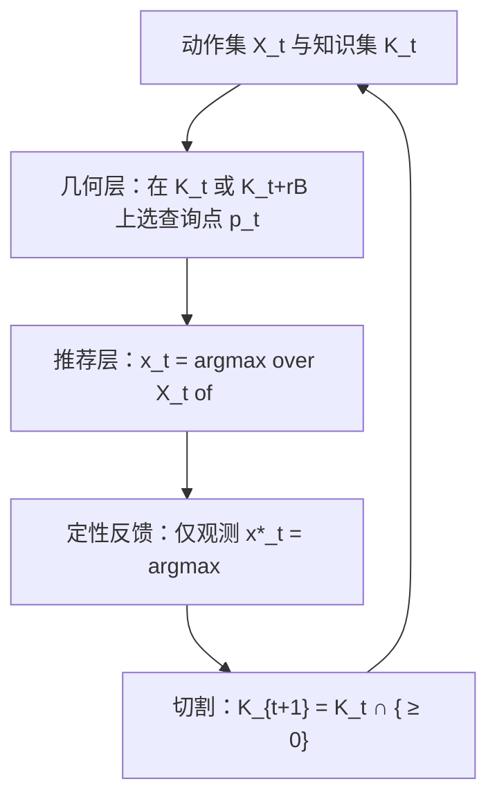

# Contextual Recommendations and Low-Regret Cutting-Plane Algorithms (上下文推荐与低遗憾切割平面算法)

- **会议/期刊**: NeurIPS (arXiv 2106.04819, 2021-06)
- **作者与机构**: Sreenivas Gollapudi, Guru Guruganesh, Kostas Kollias, Pasin Manurangsi, Renato Paes Leme, Jon Schneider（Google Research）
- **推荐链路定位**: 召回（在线交互式召回 / 路由与列表推荐）
- **研究方向**: 强化学习与动态探索推荐 / 冷启动与在线偏好学习
- **论文原文**: [https://arxiv.org/abs/2106.04819v1](https://arxiv.org/abs/2106.04819v1)
- **开源代码**: 暂未开源

## TL;DR (1分钟核心速览)

导航与推荐场景中，系统推荐一条路线/物品后，往往**只能看到用户最终选了什么（最优动作身份），拿不到效用数值**，这使得 LINUCB/OFUL 一类依赖绝对奖励估计的算法直接失效。本文提出 Contextual Recommendation 模型，把它归约为"低遗憾切割平面"几何在线学习问题：最小化返回超平面到隐向量 $w^\*$的累计距离。由此得到强分离预言机下$O(d\log T)$与$\exp(O(d\log d))$遗憾界，弱预言机下$\mathrm{poly}(d)$遗憾界，允许列表（$L=\mathrm{poly}(d)$）时$O(d^2\log d)$，全部为纯理论保证、与动作集大小$|\mathcal{X}_t|$ 无关。

## Background & Motivation (背景与核心矛盾)

- **主流范式**: 上下文线性 Bandit 用 LINUCB / LinRel 维护 $w^\*$的置信椭球，靠每轮**观测到的奖励值**$\langle x_t,w^\*\rangle$ 做最小二乘更新。
- **前人局限**: ① 定性反馈（只给 $\arg\max$）下无法获得任何绝对效用估计，回归式更新彻底失效；② 传统切割平面法（椭球法）只优化"调用预言机的**次数**"，一旦找到近邻超平面后便再无低遗憾保证，无法约束后续返回超平面的质量。
- **核心洞察 (Key Insight)**: 若把"推荐动作"换成"查询点 $p_t$"，用户反馈的$x^\*_t$恰好给出一个过$p_t$、方向为$x^\*_t-x_t$的分离超平面——于是推荐问题可等价转成"累计超平面—真实点距离"最小化；再借助 Steiner 公式与重心轨迹的**有界次有理曲线**性质做离散化，即可把几何遗憾压到$\mathrm{poly}(d)$。
- **本文切入点**: 用"低遗憾切割平面"作为中间抽象层，把推荐算法设计转化为凸几何算法设计，并首次（对弱预言机）利用曲率路径 $\mathrm{cg}(K+rB)$ 可高效离散化。

## Method (核心方法设计)

### 1. 整体框架 (Overall Architecture)

每轮维护知识集 $K_t$（与观测相容的$w^\*$候选凸体，初始为单位球）。几何侧算法在$K_t$（或其 Minkowski 膨胀$K_t+rB$）上选查询点$p_t$；推荐侧取$x_t\in\mathrm{BR}_t(p_t)=\arg\max_{x\in\mathcal{X}_t}\langle p_t,x\rangle$作为推荐（或推荐列表）。若用户反馈$x^\*_t\neq x_t$，则以$v_t=(x^\*_t-x_t)/\|x^\*_t-x_t\|$作为分离预言机答案，用半空间$\langle w-p_t,v_t\rangle\ge 0$切割$K_t$；若$x^\*_t=x_t$则零遗憾、跳过该轮。最终遗憾被证明$\le 2\times$ 几何遗憾（Thm 3.1），因此只需设计几何遗憾低的切割平面算法。

### 2. 关键设计拆解 (Key Designs)

1. **推荐↔切割平面归约（强预言机）**：痛点是用 $x^\*_t$无法估效用值。取$v_t=(x^\*_t-x_t)/\|x^\*_t-x_t\|$，由$x_t\in\mathrm{BR}_t(p_t)$得$\langle p_t,x_t-x^\*_t\rangle\ge 0$，故$v_t$是合法分离方向；且本轮遗憾满足$\langle w^\*,x^\*_t-x_t\rangle \le \|x^\*_t-x_t\|\langle w^\*-p_t,v_t\rangle \le 2\langle w^\*-p_t,v_t\rangle$。直觉：**用"谁更好"替代"好多少"**，代价仅常数 2。该归约只要求能对$\mathcal{X}_t$ 做线性优化（如最短路集合上仍高效）。
2. **两个强预言机低遗憾算法（势函数多尺度分析）**：不再最小化查询次数，而是控制 $\Phi_r(K)=\mathrm{Vol}(K+rB)$。① 查询$K_t$的 **John 椭球中心**，用$E\subseteq K\subseteq dE$得体积比界，任一半空间使势函数乘性下降$(1-\frac{1}{20d^d})$，累计得$\exp(O(d\log d))$；② 查询$\mathrm{cg}(K_t+\frac1T B)$只盯**单一尺度**：若本轮宽度$\ge 50d/T$，由近似 Grünbaum 定理（$\frac{\mathrm{Vol}(K\cap H^+)}{\mathrm{Vol}(K)}\ge \frac1e-\frac{2t(d+1)}{\text{width}(K;u)}$）推出
$$\mathrm{Vol}\big(K_{t+1}+\tfrac1T B\big)\le 0.9\,\mathrm{Vol}\big(K_t+\tfrac1T B\big),$$
否则每轮至多付 $50d/T$，总计$O(d\log T)$。
3. **曲率路径离散化（弱预言机 / 列表推荐）**：弱预言机方向预先固定（仅符号取决于 $p_t$），宽度与$p_t$ 无关但未知。利用 Steiner 公式的重心版本
$$\mathrm{cg}(K+rB)=\frac{\sum_{i=0}^{d}V_{d-i}(K)\kappa_i r^i\,c_i(K)}{\sum_{i=0}^{d}V_{d-i}(K)\kappa_i r^i},$$
可知 $\rho_K(r)=\mathrm{cg}(K+rB)$是**有界次有理曲线**，且各曲率重心$c_i(K)\in K$，故经 John 变换后路径长度$\le 4d^3$、可离散为$O(d^4)$点；随机取一个离散点以概率$\Omega(d^{-4})$逼近任意尺度所需重心，得$O(d^5\log^2 d)$遗憾。列表推荐则把离散点对应的最优响应$x_i\in\mathrm{BR}(p_i)$（$k=200d^4$个）作为推荐列表，直接覆盖多个潜在偏好方向，遗憾$O(d^2\log d)$。
4. **训练目标、反馈与推理开销**：无梯度损失，优化的唯一目标是期望遗憾 $\mathbb{E}[\mathrm{Reg}]=\mathbb{E}\big[\sum_t\langle x^\*_t-x_t,w^\*\rangle\big]$（随机性仅来自算法）。**无需负采样**；每轮只需一次线性优化 + 一次重心/体积计算，$K_t+\frac1T B$的重心计算是$\mathrm{poly}(d,T)$，在$d$小、需理论保证的路线推荐场景可接受；局部反馈变体每轮额外均匀抽$H-1$个动作，遗憾放大为$O(\rho\cdot A/(H-1))$。

## Experimental Setup & Evaluation Protocol (实验设置与评估协议)

- **数据集与预处理**: 本文为**纯理论论文，无任何真实数据集与离线实验**，故无 `5-core` 过滤、无统计表。评估对象是数学模型本身（最短路推荐、上下文推荐、列表推荐、局部反馈推荐四类设定）。
- **数据划分与防穿越 (Splitting Strategy)**: 不适用；对手（adversary）每轮自适应选择 $\mathcal{X}_t$ 与反馈，属"对抗式在线设定"，天然无信息穿越。
- **排名评测协议 (Ranking Protocol)**: 不适用 Full-Ranking / Sampled Ranking；对应协议为**累积遗憾 $\mathrm{Reg}$（对全动作集最优臂的效用差）** 与**期望遗憾**，并考核"预言机查询次数"与是否$\mathrm{poly}(d,T)$可实现；对手可为多值$\arg\max$ 任意返回。
- **对比基线与超参设置**: 基线为 LINUCB / LinRel（需奖励值，本模型下不可用）、传统椭球法与重心切割平面（仅保证查询次数、无遗憾界）、上下文搜索算法（需预先知道方向 $v_t$）。无 Embedding 维度调参，$d$为符号化维数；结论为确定性上界与定理 6.4 的下界匹配（"nearly tight"，相差$\mathrm{poly}(d)$ 因子）。

## Key Experimental Results (实验关键数据)

### 1. 主"实验"对比：遗憾界汇总（本文即理论结果表）

| 设定 / 反馈类型 | 算法核心操作 | 遗憾界 | 列表大小 | 是否 $\mathrm{poly}(d,T)$ 可实现 |
| :--- | :--- | :---: | :---: | :---: |
| 强预言机（Thm 4.2） | 查询 John 椭球中心 | $\exp(O(d\log d))$ | 1 | 是 |
| 强预言机（Thm 4.4） | 查询 $\mathrm{cg}(K_t+\frac1T B)$|$\mathbf{O(d\log T)}$ | 1 | 是 |
| 弱预言机（Thm 5.3） | 曲率路径 $O(d^4)$离散随机取点 |$O(d^5\log^2 d)$ | 1 | 是 |
| 列表推荐（Thm 5.4） | 离散点最优响应成表 | $\mathbf{O(d^2\log d)}$|$\mathrm{poly}(d)$ | 是 |
| 局部反馈（Cor 6.2 / 6.3） | 归约 + $H-1$随机动作 |$O(\frac{A}{H-1}\cdot d\log T)$|$H$ | 是 |
| 局部反馈下界（Thm 6.4） | 任意算法 | $\Omega(\min(2^{\Omega(d)},\Omega(T)))$|$2^{\Omega(d)}$ | — |
| LINUCB / LinRel | 奖励值回归 | 本模型下**不可用** | 1 | — |
| 经典椭球法 | 最小化查询次数 | 无遗憾保证 | 1 | 是 |

### 2. 消融/变体分析（组件级）

| 变体配置 | 遗憾界变化 | 说明 |
| :--- | :---: | :--- |
| 完整强预言机算法（$K_t+\frac1T B$重心） |$O(d\log T)$ | 基准 |
| 改用 $K_t$重心（不加膨胀） | 升至$\exp(O(d\log d))$ | 单尺度势函数缺失，只能走多尺度路线 |
| 改为弱预言机（方向预先固定） | 升至 $O(d^5\log^2 d)$| 需靠曲率路径猜测未知尺度$r$ |
| 关掉曲率路径离散化（直接取 $\mathrm{cg}$） | 无上界 | 尺度$r$ 未知，无法对准正确膨胀半径 |
| 单动作推荐 → 列表推荐（$L=\mathrm{poly}(d)$） | 降至$O(d^2\log d)$ | 列表可同时覆盖多偏好方向 |
| 列表大小 $H=1$（局部反馈） | 无信息、无法学习 | 用户只能回报推荐本身 |

### 3. 关键实验发现 (Key Findings)

1. **单尺度膨胀 $(1/T)B$是$O(d\log T)$的全部秘诀**：把重心查询点从$K_t$平移到$K_t+\frac1T B$，使"宽度大"与"势函数降 10%"两个条件合流，$O(d^d)$级别的因子从界中彻底消失，代价是$\log T$ 项。
2. **曲率路径有界次有理性是弱反馈下 $\mathrm{poly}(d)$的唯一支点**：路径长度上界$4d^3$+ 每点以$\Omega(d^{-4})$命中正确膨胀尺度，使随机化查询把$\exp(O(d\log d))$换成$O(d^5\log^2 d)$——指数换多项式，但维数多项式次数较高。
3. **列表推荐性价比极高**：列表大小仅 $\mathrm{poly}(d)$（$k=200d^4$）即把遗憾从$O(d^5\log^2 d)$压到$O(d^2\log d)$；而局部反馈（只保证"不劣于列表最优"）虽可用$H=2$的列表给出$O(\frac{A}{H-1}d\log T)$上界，但 Thm 6.4 证明即使列表达$2^{\Omega(d)}$仍会遭遇$\Omega(2^{\Omega(d)})$遗憾，上下界仅差$\mathrm{poly}(d)$，说明该变体本质上难得多了。

## Highlights & Limitations (亮点、对比与审稿批判)

- **与代表作对比 (vs. Prior Work)**: 相比 LINUCB / LinRel，本文不要求任何数值奖励，只吃"谁最优"的定性信号；相比 Cohen 等 / Leme 等的上下文搜索工作，本文首次移除"每轮预先给定方向 $v_t$"这一前提（即 context-free 变体），改用 John 椭球与$\mathrm{cg}(K+\frac1T B)$ 近似中线；相比经典椭球法，本文把评价指标从"查询次数"换成"累计超平面—真点距离"，是一个全新的切割平面遗憾范式。
- **可迁移亮点**: ①"用 $\mathrm{BR}_t(p_t)$ 把几何查询点映射成推荐动作"的归约，可直接套到最短路/组合动作集召回（只要支持线性优化）；②曲率路径离散化 + 随机取点这一招，可用于任何"参数尺度未知但曲线代数次数有界"的在线决策问题。
- **审稿级局限批判**: ① **完全无实证**：$\exp(O(d\log d))$与$O(d^5\log^2 d)$的常数与$d$的高次多项式在真实推荐（$d\!\sim\!10^2$、$|\mathcal{X}_t|\!\sim\!10^6$）中几乎不可实现，重心/John 椭球的高精度计算本身代价高昂；② 模型假设偏强——线性效用$\langle x,w^\*\rangle$、每轮必观测到全局最优动作、$w^\*$位于单位球，与真实用户噪声点击、位置偏置、非最优曝光差距较大，且未讨论批处理/延迟反馈；③$K_t$为凸体但体积计算$\mathrm{poly}(d)$ 仅为理论可实现，缺少对在线推理延迟与数值稳定性的讨论。

## Rating (四维评分)

- **方法创新性 (Novelty)**: ⭐⭐⭐⭐⭐ （首次在仅有定性反馈下给出 $O(d\log T)$与$\mathrm{poly}(d)$ 遗憾，且首创"低遗憾切割平面"与曲率路径离散化，凸几何工具属跨领域硬核贡献）
- **评估协议与实验扎实度 (Protocol & Experiments)**: ⭐⭐⭐ （定理链完整、上下界近乎匹配，但零真实数据、零离线/线上实验，界内 $\mathrm{poly}(d)$ 次数偏大）
- **写作与数学规范度 (Clarity & Rigor)**: ⭐⭐⭐⭐ （归约、势函数、Grünbaum 引理推导严谨，符号稍密、Steiner 重心变体需附录支撑）
- **工业落地与复现价值 (Industrial & Practical Value)**: ⭐⭐⭐ （无开源代码，重心/体积计算开销大；但"仅用偏好反馈做召回探索"的思路对路线推荐、冷启动在线学习有直接启发）

