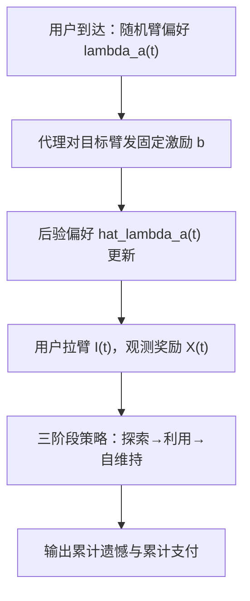
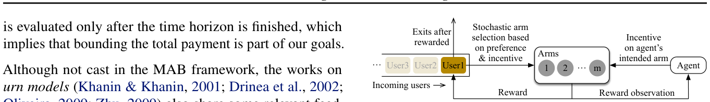

# Incentivized Bandit Learning with Self-Reinforcing User Preferences (激励式 Bandit 学习与自增强用户偏好)

- **会议/期刊**: ICML 2021
- **作者与机构**: Tianchen Zhou, Jia Liu（Ohio State University）；Chaosheng Dong, Jingyuan Deng（Amazon）
- **推荐链路定位**: 在线探索与排序 / 推荐策略学习
- **研究方向**: 强化学习与动态探索推荐
- **论文原文**: [https://arxiv.org/abs/2105.08869v3](https://arxiv.org/abs/2105.08869v3)
- **开源代码**: 暂未开源

## TL;DR (1分钟核心速览)

本文研究推荐系统中代理无法直接拉臂、需付费激励用户、且用户偏好随历史奖励“自增强”的 MAB 新模型；用多色 Pólya 罐刻画偏好演化，提出三阶段 ALnETC 与 UCB-List，并证明二者在 $F(x)=\Theta(x^\alpha),\alpha>1$下同时取得$O(\log T)$期望遗憾与$O(\log T)$ 期望支付；仿真显示其显著优于无激励/部分激励机制。

## Background & Motivation (背景与核心矛盾)

- **主流范式**: 经典 MAB 与激励式 Bandit 通常假设代理可直接选臂，或用户按确定贪心策略响应激励，并以 UCB/Explore-Then-Commit 平衡探索与利用。
- **前人局限**: Shah et al. (2018) 虽建模自增强偏好，但代理可完全控制用户拉臂；Frazier et al. (2014)、Wang & Huang (2018) 等激励式 Bandit 未建模用户偏好的历史强化，且常假设确定性贪心行为。
- **核心洞察 (Key Insight)**: 自增强偏好会使“支配（dominance）”远早于“垄断（monopoly）”发生；若反馈函数满足 $\sum_{i=1}^{\infty}1/F(i)<+\infty$，则仅需$O(\log T)$ 的激励期即可让最优臂自我维持。
- **本文切入点**: 将“随机用户选臂 + 付费激励 + 自增强偏好”联合建模，用三阶段策略把遗憾与激励支付同时压到对数级。

## Method (核心方法设计)

### 1. 整体框架 (Overall Architecture)

每轮用户到达后，依据当前偏好率与代理激励随机选择臂并产生伯努利奖励；代理观察奖励后更新累计收益与偏好率，并按“探索—利用—自维持”三阶段决定是否对目标臂支付固定激励 $b$。探索阶段覆盖所有臂，利用阶段持续激励经验最优臂直至其支配，自维持阶段停止付费、依赖自增强偏好继续采样。策略目标是同时控制累计遗憾与累计支付。

<figure class="paper-figure" markdown="span">
  <figcaption>图 1. 随机臂选择的激励式 MAB 模型</figcaption>
</figure>

### 2. 关键设计拆解 (Key Designs)

1. **自增强偏好与激励后验**：初始偏好采用多项 Logit 形式 $\lambda_a(t)=F(S_a(t-1)+\theta_a)/\sum_i F(S_i(t-1)+\theta_i)$，其中$F$递增、$\theta_a$为初始偏好偏置。对目标臂支付$b$后，后验偏好变为$\hat\lambda_a(t)=(\lambda_a(t)+G(b,t))/(1+G(b,t))$，非目标臂为$\hat\lambda_i(t)=\lambda_i(t)/(1+G(b,t))$，且$G(b,t)\triangleq\bar G(b,t)/\sum_i F(S_i(t-1)+\theta_i)$。其物理直觉是“优惠券效应”：激励提升目标臂选择率，但存在边际递减；当$G(b,t)>1$ 时激励足以压过历史累计收益的影响。

2. **三阶段 ALnETC 与支配—垄断机制**：令 $n=q\ln T$，探索阶段激励累计奖励最少的臂直至每臂至少获得$n$奖励；利用阶段持续激励经验最优臂$\hat a^*$直至$S_{\hat a^*}(t)\ge\sum_{a\ne\hat a^*}S_a(t)$，即支配；随后停止激励。关键理论是：若$\sum_i1/F(i)<+\infty$（如$F(x)=\Theta(x^\alpha),\alpha>1$），则支配后经有限轮会以概率 1 收敛到单臂垄断，故$O(\log T)$ 激励期足够。

3. **UCB-List 与目标函数**：UCB-List 用 $c_a(t)=\sqrt{\ln T/(2T_a(t))}$动态剔除被支配臂，无需 ALnETC 的调参$q$；两策略均以$\min_\pi\mathbb{E}[R_T]$为主目标，其中$\mathbb{E}[R_T]=\mu_{a^*}T-\mathbb{E}[\Gamma_T]$，并约束$\mathbb{E}[B_T]=O(\log T)$。ALnETC 的遗憾上界形如$\sum_a\frac{2(G-L_{a^*})\Delta_{\max}}{(G-1)\mu_a}q\ln T+o(\log T)$，支付上界形如$\sum_{a\ne a^*}\frac{2b(G+1)}{\mu_a(G-1)}q\ln T$；无需离线训练与负采样，在线每轮仅需维护臂统计量，计算开销与臂数$m$ 线性相关。

## Experimental Setup & Evaluation Protocol (实验设置与评估协议)

- **数据集与预处理**: 本文为理论/仿真论文，无公开真实数据集；采用伯努利奖励的多臂仿真，每点 1000 次实验平均。

| 仿真场景 | #Arms | 奖励均值 $\mu$| 初始偏好$\theta$|$F/G$ 与激励 | 规模/重复 |
| :--- | :---: | :---: | :---: | :---: | :--- |
| ALnETC 对照 | 2 | $[0.3,0.5]$|$[100,1]$|$F=x^{1.5},G=x,b=1.5,q=15$ | 图 2，1000 trials |
| 不完美条件 | 2 | $[0.3,0.5]$|$[100,1]$|$G=0.5/0.2,\alpha=1.0/0.2$ | 图 3，1000 trials |
| 基准对照 | 3 | $[0.2,0.4,0.6]$|$[10,10,1]$|$F=x^{1.5},G=x,b=1.2,q=20$ | 图 4，1000 trials |
| 强自增强 | 3 | 同上 | 同上 | $\alpha=2$ | 图 5 |
| 大初始偏置 | 3 | 同上 | $[50,50,1]$ | 其余同上 | 图 6 |
| 高单次支付 | 3 | 同上 | 同上 | $b=1.8$ | 图 7 |

- **数据划分与防穿越**: 在线 $T$ 轮序贯仿真，无训练/测试划分；每轮用户到达后即时选臂并观测奖励，不存在时间穿越。
- **排名评测协议**: 不适用 Full-Ranking / Sampled Ranking；核心指标为累计遗憾 $\mathbb{E}[R_T]$与累计支付$\mathbb{E}[B_T]$。
- **对比基线与超参设置**: 对比无激励、仅探索期激励、ALnETC、UCB-List；设置 $\alpha=1.5/2$、$b=1.2/1.5/1.8$、$G(b,t)=b$、$q=15/20$；原文未报告显著性检验。

## Key Experimental Results (实验关键数据)

### 1. 主实验对比 (Main Results)

原论文未给数值表格，图 2–7 以曲线给出趋势；下表为可复核的定性/渐近结论，不臆造具体数值。

| 策略 | 激励范围 | 期望遗憾 | 期望支付 | 仿真表现 | 相对改善 |
| :--- | :--- | :---: | :---: | :--- | :--- |
| 无激励 | 无 | 线性 | 0 | 大初始偏置下线性增长 | — |
| 仅探索期激励 | 仅探索 | 线性 | 部分 | 仍线性，无法抵消偏置 | 不足 |
| ALnETC | 探索+利用 | $\mathbf{O(\log T)}$|$\mathbf{O(\log T)}$ | 次线性遗憾 | 线性→对数 |
| UCB-List | 探索+利用 | $\mathbf{O(\log T)}$|$\mathbf{O(\log T)}$ | 次线性且免调参 | 自适应剔除 |

### 2. 消融实验 (Ablation Study)

| 变体/参数 | 改动 | 遗憾趋势 | 支付趋势 | 归因 |
| :--- | :--- | :---: | :---: | :--- |
| $\alpha=2$ | 增强自增强强度 | 下降 | ALnETC 上升 | 更快收敛到激励臂，但 ALnETC 更多拉次优臂 |
| $\theta=[50,50,1]$ | 增大次优臂初始偏置 | 上升 | 上升 | 需更长探索/利用期抵消初始偏置 |
| $b=1.8$| 提高单次支付 | 基本不变 | 上升 | 支付增大未显著换回遗憾下降，需调$b$ |
| $G=0.5/0.2,\alpha\le1$ | 破坏理论条件 | 近线性 | 近线性 | 激励不足或自增强不足时无次线性保证 |

### 3. 关键实验发现 (Key Findings)

1. 图 2 中，无激励与仅探索期激励因初始偏置 $[100,1]$ 和自增强效应，累计遗憾呈线性；ALnETC 在相同设置下转为对数增长，说明“利用期持续激励至支配”是破局关键。
2. 图 5 将 $\alpha$ 从 1.5 提到 2 后，两策略遗憾均下降，但 ALnETC 支付上升、UCB-List 支付更稳，表明强自增强降低学习难度，却可能让 Explore-Then-Commit 多付“错误臂学费”。
3. 图 6–7 显示，$\theta$从$[10,10,1]$增至$[50,50,1]$会同时抬高遗憾与支付；$b$ 从 1.2 增至 1.8 对遗憾影响有限但支付明显上升，故激励额度应按系统状态调节，而非一味加大。

## Highlights & Limitations (亮点、对比与审稿批判)

- **与代表作对比 (vs. Prior Work)**: 相比 Shah et al. (2018) 与 Fiez et al. (2018)，本文不允许代理直接控制选臂，而把“随机用户选择 + 自增强偏好 + 付费激励”耦合；相比 Frazier et al. (2014)、Wang & Huang (2018)，本文显式建模偏好随累计奖励非线性强化，并给出支付与遗憾的双 $O(\log T)$ 保证。
- **可迁移亮点**: 三阶段“探索至支配→激励至自维持”可迁移到冷启动/反馈回路推荐；UCB-List 的置信区间剔除适合做激励预算下的候选臂筛选。
- **审稿级局限批判**: 仅考虑固定支付 $b$，未优化时变激励与预算；理论依赖$G(b,t)>1$、$F=\Theta(x^\alpha),\alpha>1$ 等理想条件。实验仅为 2–3 臂仿真，缺少真实推荐数据、显著性检验与线上 A/B，且无开源代码。

## Rating (四维评分)

- **方法创新性 (Novelty)**: ⭐⭐⭐⭐ （首次联合建模激励式 MAB 与自增强偏好，并用多色 Pólya 罐/指数嵌入给出垄断与支配理论）
- **评估协议与实验扎实度 (Protocol & Experiments)**: ⭐⭐⭐ （仅小规模仿真、1000 次平均，无真实数据与显著性检验，但理论证明完整）
- **写作与数学规范度 (Clarity & Rigor)**: ⭐⭐⭐⭐ （定理、引理与证明结构清晰，条件与界明确；常数与符号略密）
- **工业落地与复现价值 (Industrial & Practical Value)**: ⭐⭐⭐ （三阶段策略与 UCB-List 易工程化，但固定支付假设、无代码与真实场景验证限制落地）

