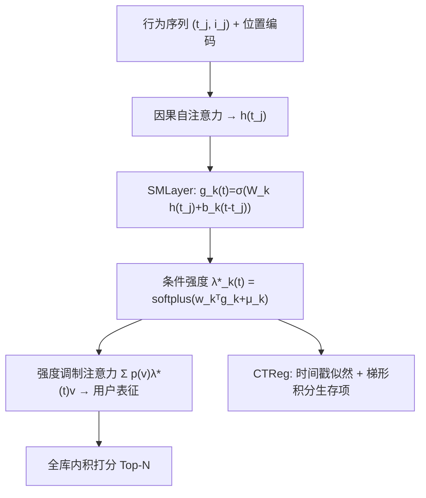
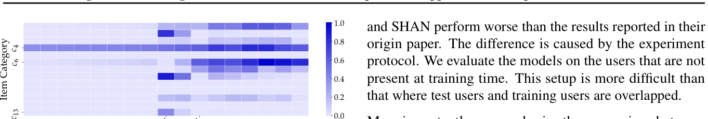

# Learning Self-Modulating Attention in Continuous Time Space with Applications to Sequential Recommendation (连续时间空间中的自调制注意力及其在序列推荐中的应用)

- **会议/期刊**: ICML 2021 (PMLR 139)
- **作者与机构**: Chao Chen, Haoyu Geng, Nianzu Yang, Junchi Yan 等（上海交通大学 AI 研究院 / 美团）
- **推荐链路定位**: 召回（Next-Item 序列召回；SMLayer 亦可作精排 DIN 的即插即用插件）
- **研究方向**: 序列与会话推荐 / 连续时间动态建模
- **论文原文**: [论文原文链接](http://proceedings.mlr.press/v139/chen21h/chen21h.pdf)
- **开源代码**: 暂未开源（论文引用的 `hidasib/GRU4Rec` 仅为对比基线仓库，非本文实现）

## TL;DR (1分钟核心速览)

现有注意力只按 query-key 语义相关度分配权重，隐含"时间无关"假设：等长但时间间隔不同的行为序列被同等对待，且 softmax 把权重稠密摊派给全部历史。本文用时间点过程的**条件强度函数** $\lambda^*(t\mid\mathcal{H}_t,v)$ 显式调制注意力系数（强度 <1 削弱、=0 剔除），提出可堆叠的 **SMLayer** 与**连续时间正则 CTReg**。在 Amazon/Koubei/Tmall 的 Strong Generalization（8:1:1 用户划分、测试用户训练时不可见）协议下，HR@10 与 NDCG@10 全面超越 SASREC+，NDCG 最高 +4.32%。

## Background & Motivation (背景与核心矛盾)

- **主流范式**: SASRec/DIN/SHAN 类自注意力对历史行为做 softmax 加权，权重仅由位置与内容相关度决定，是当前 top-N 序列推荐的主流骨架。
- **前人局限 ①**: 模型默认序列模式时间无关，而现实中同一行为序列若间隔数周或数分钟，其含义应完全不同；时间嵌入类工作（SASREC+ 的随机傅里叶特征）只把时间当额外特征拼接，并不改变权重分布形态。
- **前人局限 ②**: softmax 给出稠密归一化分布，把不相关历史也分到权重；sparsemax 虽能稀疏化，却几乎丢掉了时间信息，无法刻画细粒度时序动态。
- **核心洞察 (Key Insight)**: 文中定理 1 给出注意力类模型的泛化界 $O\!\left(L\mu\sqrt{C\rho\ln|\Omega|/|\Omega|}\right)$，误差随相关历史稀疏度$\rho$与单条历史影响力上界$\mu$ 同时下降——即"让未来行为只依赖少数历史，且每条历史影响有界"本身就有正则收益。
- **本文切入点**: 将经典注意力视为强度恒等于 1 的特例，用神经化的时变强度函数做乘性调制，使"稀疏 + 有界"由数据自适应学到。

## Method (核心方法设计)

### 1. 整体框架 (Overall Architecture)

输入为用户行为序列 $S=\{(t_j,i_j)\}_{j=1}^{L}$与位置编码，先经因果掩码自注意力得到逐步表征$h(t_j)$；随后把$h(t_j)$送入自调制层 SMLayer，为每个候选物品（或物品簇）$k$计算连续时间条件强度$\lambda_k^*(t\mid\mathcal{H}_t)$；强度作为乘性因子回填到注意力聚合中，得到随时间变化的用户表征并做全库内积打分。训练侧在常规偏好重构损失之外并联连续时间正则 CTReg（时间戳对数似然 + 生存项，用梯形数值积分近似），推理侧无需采样，仅多一次 per-group 前向。

### 2. 关键设计拆解 (Key Designs)

1. **强度调制注意力（把 softmax 注意力变成特例）**：从"物品 $i_j$在$[t,t+dt)$内再现的期望次数"出发，用贝叶斯公式把概率比化为风险函数，得到$\widetilde{\mathrm{Att}}(q,\mathcal{H}_t)=\mathbb{E}_{p(v\mid\mathcal{H}_t)}\big[v\,\lambda^*(t\mid\mathcal{H}_t,v)\big]$。当$\lambda^*\equiv 1$时该式退化为式 (1) 的经典注意力，因此本文是**严格泛化**；直觉上强度是时变门控，$<1$抑制语义相关但已过时的行为，$=0$直接断边，与定理 1 的$\rho,\mu$ 双上界一一对应。

2. **SMLayer：内生-外生分解 + 可学习时间尺度**：多数 TPP 用固定核（Hawkes/Poisson）难以拟合复杂偏好，本文把强度写成神经层：$g_k(t)=\sigma\big(W_k^{G}h(t_j)+b_k^{G}(t-t_j)\big)$，前项是随序列演化的内生相关，后项是随间隔线性漂移的外生衰减；强度取$\lambda_k^*=f_k(w_k^{\top}g_k(t)+\mu_k)$，其中$f_k(x)=\phi_k\log(1+\exp(x/\phi_k))$（softplus + 可学习尺度$\phi_k$）同时保证非负性与不同物品的差异化时间尺度。工程上 item-wise FFN 参数爆炸，改用谱聚类把物品分簇后做 group-wise FFN。

3. **CTReg 与训练目标**：偏好学习唯一的监督信号来自行为矩阵本身、与时间无关，强度可能"跑偏"，故加时间戳似然 $\mathcal{R}(\Theta;u)=\sum_{j}\log\lambda^*_{k_j}(t_j\mid\mathcal{H}_j)-\int_{t_1}^{t_L}\lambda^*(s\mid\mathcal{H}_j)\,\mathrm{d}s$，总目标$\min_{\Theta}\ \ell(R,\hat R)-\gamma\,\mathbb{E}_{u}\mathcal{R}(\Theta;u)$，$\gamma\in\{10^{-4},10^{-5},10^{-6}\}$。积分无闭式解，作者实测 MC 采样与梯形法则效果相当而后者更快，故选数值积分；负采样沿用所挂载基线（SASRec 的 next-item 训练方式），论文未额外设计 hard negative。

<figure class="paper-figure" markdown="span">
  <figcaption>图1. Koubei 上用户偏好强度示例。</figcaption>
</figure>

## Experimental Setup & Evaluation Protocol (实验设置与评估协议)

- **数据集与预处理**:

| 数据集 | #Users | #Items | #Interactions | 稀疏度/密度 | 特征/场景说明 |
| :--- | :---: | :---: | :---: | :---: | :--- |
| Amazon Electronics | 211,384 | 18,490 | 1.6M | 密度 ≈ 4.1e-4 | 评论二值化，用户/物品 ≥5 条 |
| Koubei | 212,831 | 10,213 | 1.8M | 密度 ≈ 8.3e-4 | 本地生活购买行为，用户 ≥5、物品 ≥100 |
| Tmall | 320,497 | 21,876 | 7.6M | 密度 ≈ 1.1e-3 | 点击行为，用户 ≥10、物品 ≥200 |

- **数据划分与防穿越 (Splitting Strategy)**: 采用 **Strong Generalization** 划分——用户按 $8:1:1$ 切为 train/val/test，**测试用户在训练期完全不可见**；对 val/test 用户保留最后一条记录做测试、其余用于构建表征；注意力层做因果 mask 防止未来泄漏。
- **排名评测协议 (Ranking Protocol)**: 报告 HR@10 与 NDCG@10。原文未明确交代候选集构造与负采样比例，按同类 next-item 工作惯例应为**全库排序**；但此点缺失使跨论文数值可比性存疑（复现时需自行对齐候选集）。
- **对比基线与超参设置**: 5 个基线——SHAN、DIN、GRU4REC、SASREC、SASREC+（随机傅里叶时间嵌入，最接近的对手）；所有注意力 embedding 维度统一 $d=50$，网格搜索学习率与 dropout，显著性用 95% 置信度 t-test。

## Key Experimental Results (实验关键数据)

### 1. 主实验对比 (Main Results)

| Model | Amazon HR@10 | Amazon NDCG@10 | Koubei HR@10 | Koubei NDCG@10 | Tmall HR@10 | Tmall NDCG@10 |
| :--- | :---: | :---: | :---: | :---: | :---: | :---: |
| SHAN | 0.19250 | 0.11724 | 0.28150 | 0.20256 | 0.37316 | 0.25840 |
| DIN | 0.21955 | 0.13443 | 0.32665 | 0.24186 | 0.48460 | 0.33855 |
| GRU4REC | 0.24380 | 0.15822 | 0.32655 | 0.27052 | 0.46877 | 0.33746 |
| SASREC | 0.25595 | 0.16131 | 0.35455 | 0.27070 | 0.50433 | 0.34326 |
| SASREC+ (时间嵌入) | 0.25820 | 0.16204 | 0.35690 | 0.27148 | 0.50607 | 0.34328 |
| **SASREC w/ ours** | **0.26545** | **0.16529** | **0.36235** | **0.28083** | **0.51347** | **0.35811** |
| **Improv. vs SASREC+** | +2.81% | +2.01% | +1.53% | +3.44% | +1.46% | **+4.32%** |

### 2. 消融实验 (Ablation Study)

| 主干 | 变体 | Amazon HR / NDCG | Koubei HR / NDCG | Tmall HR / NDCG |
| :--- | :--- | :---: | :---: | :---: |
| DIN | Origin | 0.21955 / 0.13443 | 0.32665 / 0.24186 | 0.48460 / 0.33855 |
| DIN | +SMLayer | **0.22065** / 0.13383 | **0.33940** / **0.25444** | 0.49033 / 0.34580 |
| DIN | +CTReg | 0.21985 / 0.13296 | 0.33780 / 0.25411 | **0.49157** / **0.35062** |
| SASREC | Origin | 0.25595 / 0.16131 | 0.35455 / 0.27070 | 0.50433 / 0.34326 |
| SASREC | +SMLayer | **0.26545** / 0.16475 | 0.36194 / 0.27862 | 0.51218 / 0.35214 |
| SASREC | +CTReg | 0.26058 / **0.16529** | **0.36235** / **0.28083** | **0.51347** / **0.35811** |

### 3. 关键实验发现 (Key Findings)

1. **SMLayer 是互补而非替代**：弱主干 DIN 上增益最猛，Koubei NDCG 从 0.24186 涨到 0.25444（+5.20%）、HR +3.90%；强主干 SASREC 上 6 个指标全涨但幅度温和（HR +0.62%~+3.71%），说明强度调制与位置注意力作用在不同维度上，正交可叠加。
2. **CTReg 收益高度依赖时间戳质量**：Tmall 上 SASREC+CTReg 取得全局最优（NDCG 0.34326→0.35811，+4.32%）；而 Amazon 上 DIN+CTReg 反而从 0.13443 降到 0.13296（-1.09%），原因是该数据集约 5.39% 用户在同一时刻批量补写全部评论，强度被迫拟合这种伪时间戳而轻微过拟合——这是本文诚实地报告的唯一负向结果。
3. **强度调制改善的是排序位次而非仅命中率**：相对 SASREC+，NDCG 的提升（+2.01%~+4.32%）系统性高于 HR 的提升（+1.46%~+2.81%），意味着命中物品被推得更靠前；定性上（图 1）用户对 $c_{13}$类目的强度在$(t_9,t_{11})$窗口内升至约 0.4 后回落至 0，模型确实能按时段"开关"历史行为，且$c_4$ 类目上越近行为权重越大。

## Highlights & Limitations (亮点、对比与审稿批判)

- **与代表作对比 (vs. Prior Work)**: 对比 SASREC+（Xu et al., 2019），后者用随机傅里叶特征把时间当**加性输入特征**，本文把时间写进注意力系数的**乘性强度**，可直接置零形成稀疏结构；对比 sparsemax 类稀疏注意力，本文稀疏性由强度函数在连续时间上自适应产生而非单纯熵正则，保留了时间信息；对比 Neural Hawkes（Mei & Eisner, 2017）等 TPP 工作，后者目标是建模事件时间分布，本文把强度当作偏好学习的调制器。
- **可迁移亮点**: ① 任何注意力骨架（DIN/SASRec/BST）都可"乘一个强度标量"做软门控，改造成本极低；② item-wise 参数用谱聚类降级为 group-wise，是处理大规模 item 侧 FFN 的通用工程技巧。
- **审稿级局限批判**: ① 绝对增益偏小（HR 仅 +1.5%~+2.8%），且只报告 t-test 未给多次运行的方差，稳定性证据不足；② 评测协议未交代候选集与负采样，Full-Ranking 与否不明，跨论文数值可比性存疑；③ 未给冷启动/长尾分桶或线上 A/B，工业价值仅以"插件"论证；④ SMLayer 需为每个物品/簇维护参数并计算时间积分，超长序列与超大规模 item 库的训练开销被低估。

## Rating (四维评分)

- **方法创新性 (Novelty)**: ⭐⭐⭐⭐ （把 TPP 条件强度作为注意力的乘性调制因子，并证明经典注意力是其强度恒为 1 的特例，配合泛化界理论支撑，视角新颖）
- **评估协议与实验扎实度 (Protocol & Experiments)**: ⭐⭐⭐ （Strong Generalization 用户不重叠划分比常规划分更严格、消融覆盖两个主干三套数据，但缺候选集/负采样说明与方差报告）
- **写作与数学规范度 (Clarity & Rigor)**: ⭐⭐⭐⭐ （式 (4) 的贝叶斯-风险函数推导链清晰，定理 1 与设计动机强对应；积分近似选择给了 MC vs 梯形的实测依据）
- **工业落地与复现价值 (Industrial & Practical Value)**: ⭐⭐⭐ （SMLayer 可作为插件低成本接入现有注意力模型，谱聚类分组也务实，但无官方开源代码、时间积分带来额外训练开销）

