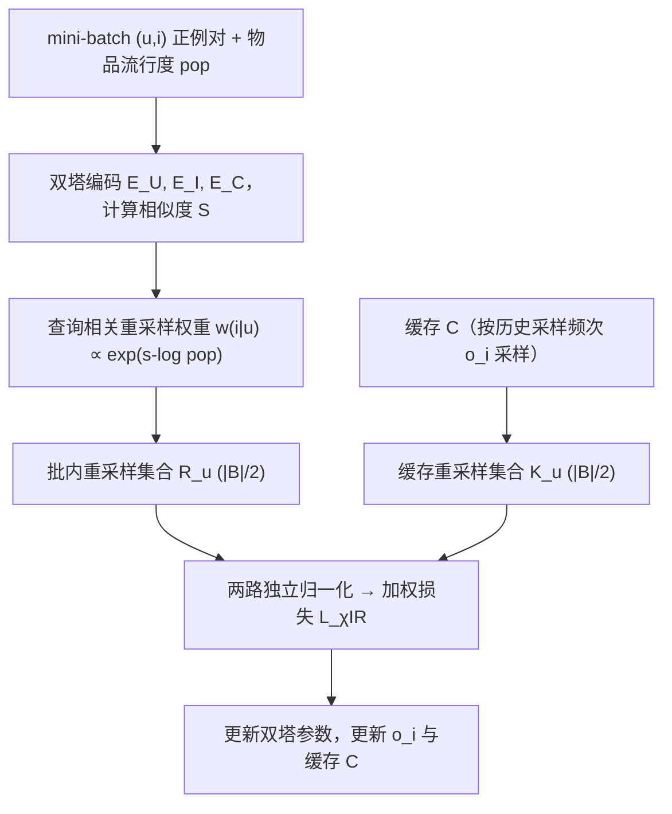
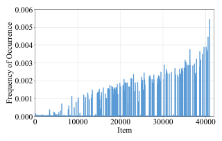

# Cache-Augmented Inbatch Importance Resampling for Training Recommender Retriever (缓存增广的批内重要性重采样：面向推荐召回模型的负采样训练)

- **会议/期刊**: arXiv 2022（Preprint，18 页，含完整理论附录）
- **作者与机构**: Jin Chen, Defu Lian, Yucheng Li, Baoyun Wang, Kai Zheng, Enhong Chen（电子科技大学、中国科学技术大学、海信）
- **推荐链路定位**: 召回（双塔 + MIPS 全库检索）
- **研究方向**: 协同过滤与双塔召回 / 负采样理论与训练效率
- **论文原文**: [https://arxiv.org/abs/2205.14859v1](https://arxiv.org/abs/2205.14859v1)
- **开源代码**: 暂未开源

## TL;DR (1分钟核心速览)

双塔召回器用 sampled softmax 训练时，inbatch 采样只能做「查询无关」的流行度纠偏，与真正依赖用户查询的 softmax 分布仍差很远。本文提出 BIR：在 mini-batch 内按 $w(i|u)\propto\exp(s(u,i)-\log pop(i))$ 为每个用户重采样不同的负样本，理论上随 batch 增大渐近无偏地逼近全 softmax；再加一个按采样频次维护的硬负样本缓存构成 χIR，两路独立归一化后加权。在 5 个公开数据集、全库排序协议下，NDCG@10 相对最优基线提升 2.9%–17.3%。

## Background & Motivation (背景与核心矛盾)

- **主流范式**: 双塔模型以 log-softmax 为目标，用负采样估计配分函数；线上为省去额外物品塔前向，普遍采用 **inbatch 采样**（同批其他样本共享为负例），并以物品频率（G-Tower 流式估计 / SSL-Pop）做重要性校正。
- **前人局限一**: 这类校正后的提议分布 $pop(i)$是**查询无关**的静态分布，而理想提议分布应是$P^*(i|u)\propto\exp(s(u,i))$，逐用户不同且随训练动态变化，因此残余偏差始终存在。
- **前人局限二**: 批内共享同一负例集合，同一 batch 内的所有用户看到完全相同的负样本；且静态分布训练若干 epoch 后大量采到「简单负例」，梯度贡献趋零。
- **核心洞察**: softmax 的无偏梯度估计要求提议分布等于 softmax 分布本身；由重要性采样的乘法规则可推出，只要「按 $1/pop$采样 + 按$\exp(s)$加权」两步复合，就能从批内长尾分布还原出查询相关的 softmax 分布（$|B|\to\infty$ 时严格成立）。
- **本文切入点**: 把批内共享负例改造成**逐查询的加权重采样（BIR）**，再用缓存复用历史高信息量难负例（χIR）补充批外样本。

## Method (核心方法设计)

### 1. 整体框架 (Overall Architecture)

输入是一个 mini-batch 的 $(u,i)$正例对与从训练集统计的物品流行度$pop(i)$。先经用户塔/物品塔得到$E_U,E_I$（$d=32$），算相似度矩阵$S=E_UE_I^\top$与缓存相似度$S'=E_UE_C^\top$；随后对每个用户$u$分别在批内按$w(i|u)$重采样$|\mathcal{B}|/2$个负例得$\mathcal{R}_u$、在缓存$C$中按$w_c$重采样$|\mathcal{B}|/2$个得$K_u$；两路因分布不同**不可共享归一化常数**，故各自归一化后以$\lambda$加权成$\mathcal{L}_{\chi IR}$反传；同时统计被采样次数向量$o$，按$o_i$ 采样更新缓存。推理阶段与普通双塔无异，仅需 MIPS 检索。

### 2. 关键设计拆解 (Key Designs)

1. **BIR：查询相关的批内重要性重采样**：痛点是批内负例对所有用户相同、且仅按频率纠偏。做法是对每个用户独立按 $\(w(i|u)=\frac{\exp(s(u,i)-\log pop(i))}{\sum_{j\in\mathcal{B}}\exp(s(u,j)-\log pop(j))}\)$做多项式重采样得到$\mathcal{R}_u$（同尺寸$|\mathcal{B}|$），目标改为$\(\mathcal{L}_{BIR}=-\sum_{(u,i)\in\mathcal{B}}\log\frac{\exp(s(u,i))}{\sum_{j\in\mathcal{R}_u}\exp(s(u,j))}\)$。由乘法规则$P(i|i\in\mathcal{R}_u)=pop(i)\cdot\frac{|\mathcal{B}|}{|\mathcal{D}|}\cdot w(i|u)\propto\exp(s(u,i))$，即重采样集合的经验分布收敛到查询相关的 softmax 分布，梯度渐近无偏。直观上：高相似度物品被反复采到、低相似度物品被稀释，等价于为每个用户定制了「由易到难」的负例分布，且随训练自动更新（定理 3.2 给出 bias$\sim O(1/|\mathcal{B}|)$且与批内流行度极差$\max_{j,l\in\mathcal{B}}|p(j)-p(l)|$ 成正比）。
2. **χIR：频次缓存复用历史难负例**：痛点是 MNS 等批外补充用的是**固定均匀分布**，多轮后同样退化为简单负例。做法是维护出现计数 $o_i$（每次被 BIR/缓存采样即累加），缓存$C$按$o_i$为权重采样更新——被反复采样的物品意味着在多数查询上平均得分高，即「历史难负例」。缓存与批内分布不同，故独立重采样并按两路损失加权：$\(\mathcal{L}_{\chi IR}=\lambda\sum_{(u,i)\in\mathcal{B}}\frac{\exp(s(u,i))}{\sum_{j\in K_u}\exp(s(u,j))}+(1-\lambda)\sum_{(u,i)\in\mathcal{B}}\frac{\exp(s(u,i))}{\sum_{j\in R_u}\exp(s(u,j))}\)$3. **训练目标、负采样与推理开销**：总损失即上式（$\lambda$默认 0.5，各取$|\mathcal{B}|/2$），全程**免显式全局负采样**；重采样与相似度计算复杂度$O(|\mathcal{B}|^2k)$，缓存更新$O(N)$，相对塔模型前向可忽略；代价是每步需额外把$|C|$ 个缓存物品过一遍物品塔。推理端零额外开销，仍走 FAISS/Scann 类 MIPS。

<figure class="paper-figure" markdown="span">
  <figcaption>图 2：物品出现情况。物品按流行度降序排列。</figcaption>
</figure>

## Experimental Setup & Evaluation Protocol (实验设置与评估协议)

- **数据集与预处理**: 5 个公开数据集（RecBole 版本）。Amazon 仅把评分高于该用户均值的书籍视为正例，其余数据集交互全部视为正例。

| 数据集 | #Users | #Items | #Interactions | 密度 | 场景说明 |
| :--- | :---: | :---: | :---: | :---: | :--- |
| Gowalla | 29,858 | 40,988 | 1,027,464 | 8.40e-4 | LBS 签到 |
| Amazon | 130,380 | 128,939 | 2,415,650 | 1.44e-4 | 图书评分 |
| Ta-feng | 19,451 | 10,480 | 630,767 | 3.09e-4 | 零售购物 |
| Echonest | 217,966 | 60,654 | 4,422,471 | 3.35e-4 | 音乐收听 |
| Tmall | 125,553 | 58,058 | 2,064,290 | 2.83e-4 | 电商（含 SellerID/CateID） |

- **数据划分与防穿越**: 每个用户 **80%/20% 比例划分**（非 Leave-One-Out），训练集统计 $pop(i)$ 供采样使用，测试集物品全部视为未交互候选。
- **排名评测协议**: **Full-Ranking（全库未交互物品排序）**，指标 NDCG@10 与 Recall@10，5 个随机种子取均值 ± 标准差。
- **对比基线与超参**: SSL（均匀提议）、SSL-Pop（流行度提议）、MNS（批内 + 等量均匀批外负例）、G-Tower（多哈希流式频率估计，5 组哈希）。$d=32$、batch=2048、lr=1e-3、100 epochs、Adam（每 5 epoch 衰减 0.95），$l_2\in\{1e{-4},1e{-5},1e{-6}\}$，$\lambda\in\{0,0.2,0.5,0.8,1.0\}$。

## Key Experimental Results (实验关键数据)

### 1. 主实验对比 (Main Results)

| Method | Gowalla | Amazon | Ta-feng | Echonest | Tmall |
| :--- | :---: | :---: | :---: | :---: | :---: |
| SSL | 0.1381 | 0.0718 | 0.0437 | 0.1436 | 0.0340 |
| SSL-Pop | 0.1479 | 0.0764 | 0.0625 | 0.1609 | 0.0547 |
| MNS | 0.1486 | 0.0781 | 0.0634 | 0.1648 | 0.0561 |
| G-Tower | 0.1500 | 0.0764 | 0.0496 | 0.1600 | 0.0429 |
| BIR | 0.1523 | 0.0833 | 0.0675 | 0.1682 | 0.0590 |
| **χIR** | **0.1543** | **0.0877** | **0.0730** | **0.1842** | **0.0658** |
| **Improv.%** (vs 最优基线) | **+2.87%** | **+12.29%** | **+15.14%** | **+11.77%** | **+17.29%** |

Recall@10 趋势一致：χIR 在 Tmall 上 0.0651（SSL-Pop 0.0544）、Echonest 0.1703（MNS 0.1537）、Amazon 0.0895（MNS 0.0796）。

### 2. 消融实验 (Ablation Study)

| 累加组件（Amazon / Tmall / Echonest, NDCG@10） | Amazon | Tmall | Echonest |
| :--- | :---: | :---: | :---: |
| 仅批内 + 流行度纠偏（SSL-Pop） | 0.0764 | 0.0547 | 0.1609 |
| + 批外均匀负例（MNS） | 0.0781 | 0.0561 | 0.1648 |
| BIR（$\lambda=0$，查询相关重采样） | 0.0833 | 0.0590 | 0.1682 |
| **χIR（$\lambda=0.5$，+ 缓存）** | **0.0877** | **0.0658** | **0.1842** |

### 3. 关键实验发现 (Key Findings)

1. **纠偏方式决定下限，查询相关性决定上限**：从 SSL 到 SSL-Pop 仅带来 1.84%（跨数据集均值）NDCG@10 增益，而由 SSL-Pop 换到 BIR 的增益远大于此（Amazon +9.0%、Tmall +7.9%），说明「查询无关的频率校正」只能修选择偏差，无法逼近 softmax。
2. **缓存是唯一能撬动 Echonest 的模块**：Echonest 上 BIR 仅比 MNS 高 2.1%，加缓存后 χIR 跃升至 0.1842（相对 BIR +9.5%），证明静态均匀批外负例在该数据上几乎失效，而被频次缓存反复选中的历史难负例才是有效增广。
3. **重采样可大幅压缩批内负例预算**：图 3 显示仅重采样 batch 的 $1/64$物品即达到 SSL-Pop 使用**全批**负例的效果，且梯度汇总时间更短（Speedup 曲线），在 batch=256 的小批量下 BIR 仍稳定优于 SSL-Pop，对小显存线上训练友好；$\lambda=0.5$时两路贡献均衡最优，$\lambda\to1$（近乎只用缓存）明显退化。

## Highlights & Limitations (亮点、对比与审稿批判)

- **与代表作对比 (vs. Prior Work)**: 相对 SSL-Pop / G-Tower，本质区别是把「物品频率提议」升级为「批内 softmax 近似提议」，从 query-independent 变为 query-dependent，并给出渐近无偏证明与非渐近偏差界；相对 MNS，把批外负例由固定均匀分布换成**随训练动态演化的频次缓存分布**，从而持续产出难负例而非退化为简单负例。
- **可迁移亮点**: (1) 「$1/pop$采样 +$\exp(s)$ 加权」的两段式构造可直接套用到任何长尾日志分布的采样器（如多任务召回、跨域采样）；(2) 以出现频次作为「难度」代理来维护难负例队列，无需额外打分即可低成本复用历史样本。
- **审稿级局限批判**: (1) 渐近无偏依赖 $|\mathcal{B}|\to\infty$，实际 batch=2048 下的非渐近偏差界含$\max_{j,l\in\mathcal{B}}|p(j)-p(l)|$项，在流行度极不均匀的批内仍不可忽略；(2) 缓存需要每步过物品塔前向，且更新按$O(N)$ 统计，工业级亿级物品下需额外近似结构；(3) 仅验证 ID 特征 + 两层 MLP 塔，未测试真实深度多特征塔与线上 A/B，评估止步于离线全库排序。

## Rating (四维评分)

- **方法创新性 (Novelty)**: ⭐⭐⭐⭐ （把重要性重采样与软对齐联合建模，给出 Theorem 3.1 渐近无偏 + Theorem 3.2 非渐近界，理论支撑扎实）
- **评估协议与实验扎实度 (Protocol & Experiments)**: ⭐⭐⭐☆☆ （5 数据集 + 5 随机种子 + 标准差齐全，但全为离线全库排序，缺显著性检验与线上验证）
- **写作与数学规范度 (Clarity & Rigor)**: ⭐⭐⭐⭐ （推导链条完整，附录证明清楚；符号略冗余，部分图表引用不够统一）
- **工业落地与复现价值 (Industrial & Practical Value)**: ⭐⭐⭐⭐ （训练端可省去批外负例塔前向、推理零开销、小批量仍有效，未开源代码减分）

