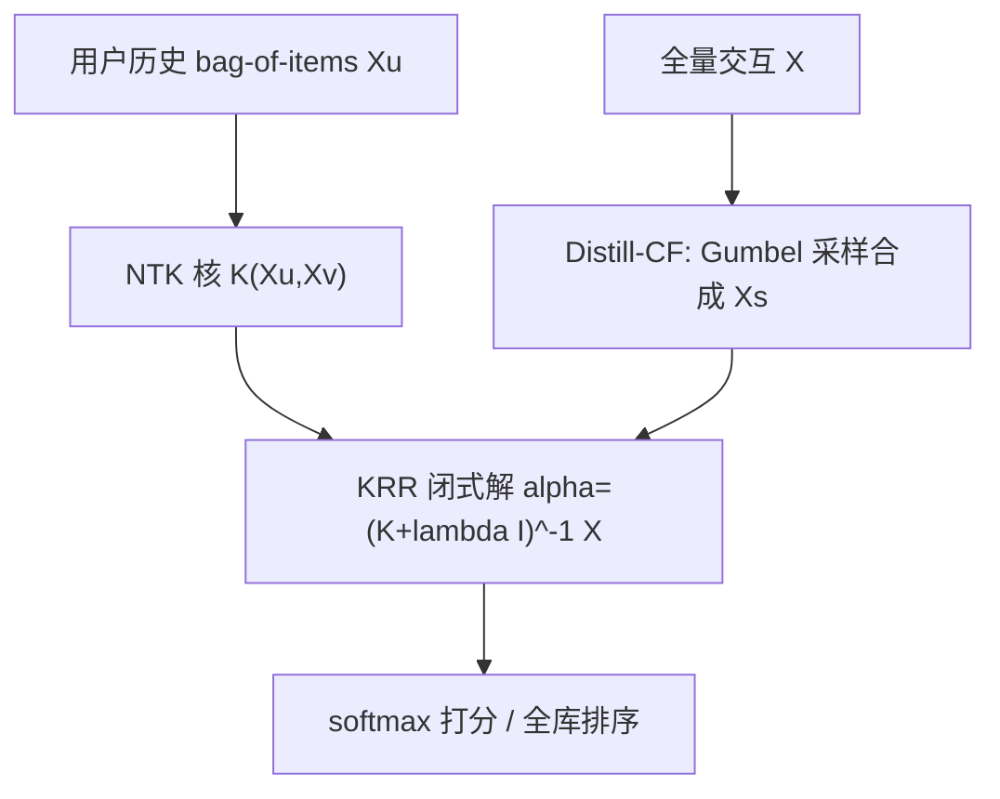

# Infinite Recommendation Networks: A Data-Centric Approach（无限推荐网络：一种以数据为中心的方法）

- **会议/期刊**: NeurIPS 2022
- **作者与机构**: Noveen Sachdeva, Mehak Preet Dhaliwal, Carole-Jean Wu, Julian McAuley；UC San Diego & Meta AI
- **推荐链路定位**: 召回/全库排序（协同过滤打分）
- **研究方向**: 协同过滤与双塔召回 / 数据蒸馏与去噪（交叉）
- **论文原文**: [论文原文链接](https://arxiv.org/abs/2206.02626v3)
- **开源代码**: [∞-AE](https://github.com/noveens/infinite_ae_cf)；[Distill-CF](https://github.com/noveens/distill_cf)

## TL;DR (1分钟核心速览)

本文针对协同过滤中“深宽模型难训、海量交互数据冗余且含噪”的痛点，提出无限宽自编码器 ∞-AE：用 NTK 把推荐问题化为核岭回归，得到单超参闭式解；再用 Distill-CF 的可微 Gumbel 采样蒸馏出极小用户摘要。在 4 个数据集的全库排序中显著优于 EASE/LightGCN 等，仅用 0.1% 用户即保持 ∞-AE 的 96–105% 性能。

## Background & Motivation (背景与核心矛盾)

- **主流范式**: 隐反馈推荐常用 EASE、LightGCN、MVAE 等有限宽模型；数据侧则依赖随机、头部用户或 coreset 采样来缩小训练集。
- **前人局限**: 深度/宽度模型在推荐上未必优于调好的线性模型；而图像领域的数据蒸馏依赖连续稠密特征，无法直接处理推荐数据的稀疏、离散、长尾与半结构化特性。
- **核心洞察 (Key Insight)**: 推荐中用户可由其物品历史表示，无需独立用户隐向量；若把自编码器瓶颈推到无限宽，NTK 对应 KRR 的闭式解仍具表达力，且能用少量“信息量最大”的合成用户概括全量数据。
- **本文切入点**: 用 ∞-AE 提供高效内循环，用 Distill-CF 合成稀疏离散的用户摘要，二者互补。

## Method (核心方法设计)

### 1. 整体框架 (Overall Architecture)

∞-AE 将每个用户表示为 bag-of-items 向量 $X_u$，用单层自编码器的 NTK 计算用户间核相似度，再以 KRR 闭式解得到对偶参数，最终 softmax 打分做全库排序。Distill-CF 在外层学习一个可采样的用户-物品重要性先验，经多步可微 Gumbel 采样得到二值合成用户集$\hat{X}_s$，内层用 ∞-AE 闭式解快速拟合，外层用验证集重构损失更新先验。

### 2. 关键设计拆解 (Key Designs)

1. **∞-AE：无限宽瓶颈 + 闭式 KRR**：前人需训练有限宽自编码器且调大量超参；本文把用户写成物品历史，核为 $K(X_u,X_v)=\tilde{\sigma}(X_u^\top X_v)+\tilde{\sigma}'(X_u^\top X_v)\cdot X_u^\top X_v$，闭式解$\hat{\alpha}=(\mathbf{K}+\lambda\mathbf{I})^{-1}\mathbf{X}$，预测$\hat{P}(\cdot|u,D)=\mathrm{softmax}(f(X_u|\hat{\alpha}))$。直觉是：用户落在物品线性张成空间，核相似度已足够表达协同信号，且新用户可直接推理。

2. **Distill-CF：面向稀疏离散数据的数据蒸馏**：图像蒸馏假设连续特征，无法处理推荐中的二值稀疏矩阵。本文求解双层目标 $\min_{X_s}\mathbb{E}_{D_{val}}[\ell(\phi^*_{D_s}(u,i),r)]$，其中$\phi^*_{D_s}=\arg\min_\phi\mathbb{E}_{D_s}[\ell]$；外层不直接优化离散$X_s$，而学习先验并经$\hat{X}_s=\sigma(\sum_{i=1}^{\gamma}\mathrm{Gumbel}_\tau(\mathrm{softmax}(X_s)))$采样，再加$\lambda_2\|\hat{X}_s\|_1$ 控制稀疏。多步有放回采样契合用户长尾稀疏度，使合成数据可迁移到 EASE/MVAE。

3. **训练目标、负采样与推理效率**：∞-AE 无 SGD、无负采样，复杂度为 $O(|U|^2|I|+|U|^{2.376})$时间和$O(|U||I|+|U|^2)$内存；单用户推理$O(|U||I|)$。Distill-CF 内层仅在$\mu$个合成用户上求解，降至$O(\mu^2|I|)$，使百亿级交互数据可蒸馏；外层用 logistic 重构损失 + L1，SGD 更新先验。

## Experimental Setup & Evaluation Protocol (实验设置与评估协议)

- **数据集与预处理**:

| 数据集 | #Users | #Items | #Interactions | 稀疏度 | 特征/场景说明 |
| :--- | :---: | :---: | :---: | :---: | :--- |
| Amazon Magazine | 3k | 1.3k | 12k | 99.7% | 亚马逊评论隐反馈 |
| ML-1M | 6k | 3.7k | 1M | 95.6% | 电影评分转隐反馈 |
| Douban | 2.6k | 34k | 1.2M | 98.7% | 跨域豆瓣交互 |
| Netflix | 476k | 17k | 100M | 98.9% | 大规模电影评分 |

- **数据划分与防穿越**: 每用户交互随机按 80/10/10% 切为 train/test/validation；仅剔除交互少于 3 的用户，不裁剪物品。
- **排名评测协议**: 无偏 **Full-Ranking（全库未交互物品排序）**；报告 AUC、HR@10/100、NDCG@10/100、PSP@10，其中 PSP 侧重尾部物品。
- **对比基线与超参**: PopRec、MF、NeuMF、LightGCN、EASE、MVAE；嵌入维度搜索 $\{4,8,16,32,50,64,128\}$，∞-AE 仅调$\lambda$，Distill-CF 调$\tau,\gamma,\lambda_2$。固定 seed 42，未报告显著性检验/误差棒。

## Key Experimental Results (实验关键数据)

### 1. 主实验对比 (Main Results)

| 数据集/指标 | Pop | MF | NeuMF | LGCN | EASE | MVAE | ∞-AE | D+∞ |
| :--- | ---: | ---: | ---: | ---: | ---: | ---: | ---: | ---: |
| Amz HR@10 | 14.35 | 18.36 | 18.35 | 27.12 | 26.31 | 17.94 | 27.09 | **28.27** |
| Amz PSP@10 | 6.85 | 9.24 | 9.00 | 13.20 | 12.96 | 8.81 | 13.22 | **13.76** |
| ML-1M HR@10 | 13.07 | 24.63 | 23.25 | 27.43 | 28.54 | 21.70 | **31.51** | 31.16 |
| ML-1M PSP@10 | 1.10 | 2.41 | 2.26 | 2.72 | 3.06 | 2.42 | **3.22** | 3.15 |
| Douban HR@10 | 11.06 | 12.69 | 12.79 | 15.98 | 17.93 | 15.36 | **23.56** | 22.98 |
| Douban PSP@10 | 0.52 | 0.63 | 0.63 | 0.86 | 1.06 | 0.87 | **1.28** | 1.24 |
| Netflix HR@10 | 12.14 | 11.69 | 11.06 | —† | 26.03 | 20.60 | **29.69\*** | 29.57 |
| Netflix PSP@10 | 1.45 | 1.31 | 1.21 | —† | 3.59 | 2.77 | **3.75\*** | 3.62 |

注：D+∞ 为 Distill-CF+∞-AE 且仅用 500 个合成用户；†LightGCN 在 Netflix 超时；\*∞-AE 用 25K 用户（5.4%）随机子集。粗体为行最优。

### 2. 消融实验 (Ablation Study)

| 数据集 | HR@10 全量∞-AE | HR@10 D+∞(500) | 保留率 | PSP@10 全量∞-AE | PSP@10 D+∞(500) | 保留率 |
| :--- | ---: | ---: | ---: | ---: | ---: | ---: |
| Amazon | 27.09 | **28.27** | 104.4% | 13.22 | **13.76** | 104.1% |
| ML-1M | **31.51** | 31.16 | 98.9% | **3.22** | 3.15 | 97.8% |
| Douban | **23.56** | 22.98 | 97.5% | **1.28** | 1.24 | 96.9% |
| Netflix | **29.69** | 29.57 | 99.6% | **3.75** | 3.62 | 96.5% |

### 3. 关键实验发现 (Key Findings)

- ∞-AE 以单层闭式解击败复杂模型：Douban HR@10 达 23.56，较 EASE 的 17.93 提升 31.4%；ML-1M NDCG@10 达 32.82，较 EASE 的 29.88 提升 9.8%，支持“推荐中宽度比深度更有效”的判断。
- Distill-CF 仅用 500 合成用户即可在 Netflix（约 0.1% 用户）保持 99.6% HR@10，在 Amazon 上甚至超过全量 ∞-AE 4.4%；同一摘要在 EASE/MVAE 上也可迁移，说明其蒸馏的是通用协同知识而非模型特例。
- 噪声实验显示 5% 随机翻转下，用极小 Distill-CF 摘要训练 EASE 可优于全量含噪数据；∞-AE 与 EASE 的差距随噪声增大而扩大，且深度 1–2 层最佳，体现隐式去噪与低深度偏好。

## Highlights & Limitations (亮点、对比与审稿批判)

- **与代表作对比**: 相比 EASE 的 item-item 线性回归，∞-AE 用 NTK 核在无限宽瓶颈中建模用户-用户相似度，且天然支持新用户；相比 LightGCN/MVAE，无图传播或变分推断，仅单超参闭式求解；相比随机/coreset 采样，Distill-CF 合成的是“为模型训练而优化”的用户，而非仅真实或代表性用户。
- **可迁移亮点**: 多步可微 Gumbel + L1 的稀疏离散数据蒸馏，可迁移到图/序列推荐的数据压缩；用闭式模型做内循环极大降低双层优化成本。
- **审稿级局限批判**: ① ∞-AE 的 Gram 矩阵求逆为 $O(|U|^2|I|+|U|^{2.376})$，全量训练仍难扩展，Netflix 只能子采样；② 实验仅 4 个数据集、固定 seed 42，未报告显著性，噪声注入也较简化，隐私与持续学习仅初步验证。

## Rating (四维评分)

- **方法创新性 (Novelty)**: ⭐⭐⭐⭐⭐ （首次将无限宽 NTK 自编码器用于推荐，并与数据蒸馏形成闭式互补，机制新颖且有理论支撑）
- **评估协议与实验扎实度 (Protocol & Experiments)**: ⭐⭐⭐⭐ （全库排序、多指标、4 数据集与采样/噪声/冷热分桶较完整，但缺显著性检验与误差棒）
- **写作与数学规范度 (Clarity & Rigor)**: ⭐⭐⭐⭐ （NTK/KRR 与双层蒸馏公式清晰，复杂度分析到位；部分实现细节依赖附录）
- **工业落地与复现价值 (Industrial & Practical Value)**: ⭐⭐⭐⭐ （代码开源、Distill-CF 可把训练数据压到 0.1%，但 ∞-AE 全量 Gram 求逆仍是工程瓶颈）

