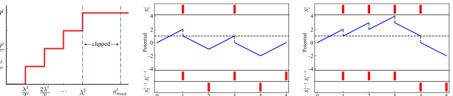
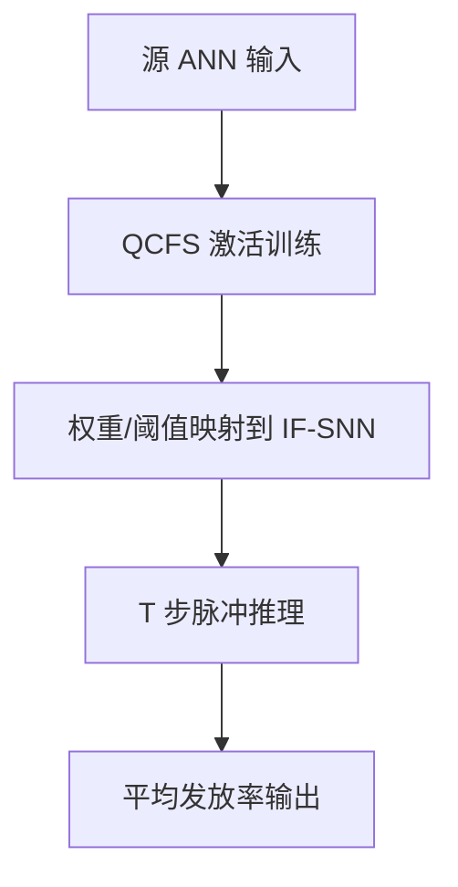
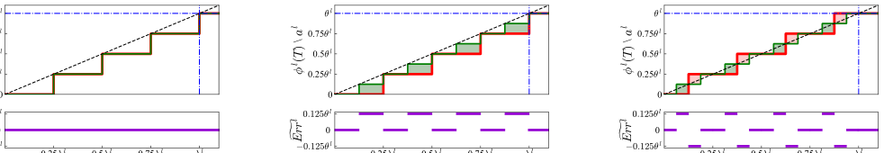

# Optimal ANN-SNN Conversion for High-accuracy and Ultra-low-latency Spiking Neural Networks (面向高精度与超低延迟脉冲神经网络的最优 ANN-SNN 转换)

> 说明：本文并非推荐系统论文。按用户指定优先归入 `collaborative_filtering`，以下保留其真实任务、公式与评估协议；推荐链路定位相应标注为“非推荐链路”。

- **会议/期刊**: ICLR 2022
- **作者与机构**: Tong Bu, Wei Fang, Jianhao Ding, PengLin Dai, Zhaofei Yu, Tiejun Huang；北京大学、西南交通大学
- **推荐链路定位**: 非推荐链路（面向神经形态硬件的低延迟推理/模型转换）
- **研究方向**: 按指定归档为协同过滤；论文实际方向为 ANN-SNN 转换与脉冲神经网络
- **论文原文**: [https://arxiv.org/abs/2303.04347v1](https://arxiv.org/abs/2303.04347v1)
- **开源代码**: [https://github.com/putshua/SNN](https://github.com/putshua/SNN)

## TL;DR (1分钟核心速览)

ANN-SNN 转换依赖长时步把 ReLU 激活映射为脉冲发放率，短时步下精度骤降。本文把转换误差拆为裁剪、量化与“不均匀”误差，提出量化 clip-floor-shift 激活替代源 ANN 的 ReLU，并证明当 $T=L$时误差为零、加入$\phi=1/2$后任意$T,L$ 下期望误差为零。CIFAR-10 上 VGG-16 仅 2 步达 91.18%，4 步 93.96%，32 步 95.54% 超过源 ANN 的 95.52%。

## Background & Motivation (背景与核心矛盾)

- **主流范式**: ANN-SNN 转换将 ANN 的 ReLU 激活值映射为 IF 神经元在 $T$ 个时步内的平均发放率/平均突触后电位，配合权重归一化、阈值缩放、soft-reset 等减小转换误差。
- **前人局限**: 其一，短时步下裁剪误差与量化误差显著，精度随 $T$减小急剧下降；其二，已有工作多关注裁剪/量化，却忽视脉冲到达时刻变化引起的“不均匀误差”，且无法保证$T\neq L$ 时误差可控。
- **核心洞察 (Key Insight)**: 若把 SNN 输出近似为“对加权输入做 clip-floor 量化”，则源 ANN 只要采用同款量化激活，转换误差可在 $T=L$时严格归零；进一步加一个移位项可消除$T\neq L$ 的量化偏置。
- **本文切入点**: 不额外校正 SNN 权重/偏置，而是直接改造源 ANN 的激活函数，使 ANN 与 SNN 的激活函数在数学上对齐。

<figure class="paper-figure" markdown="span">
  <figcaption>图1：源ANN与转换后SNN之间的转换误差。sl−1</figcaption>
</figure>
图1：源 ANN 与转换后 SNN 之间的三类转换误差示意（裁剪、量化、不均匀）。

## Method (核心方法设计)

### 1. 整体框架 (Overall Architecture)

先用量化 clip-floor-shift 激活训练源 ANN，保留权重并转换为同结构的 IF-SNN；转换时令阈值 $\theta^l=\lambda^l$，SNN 以$T$个时步做事件驱动推理。核心闭环是：误差分析给出 SNN 的估计激活$\to$用该估计设计 ANN 激活$\to$定理保证$T=L$零误差$\to$移位项保证$T\neq L$ 时期望零误差。训练仅改激活与阈值可学习，不引入额外 SNN 校准阶段。

### 2. 关键设计拆解 (Key Designs)

1. **转换误差分解与 SNN 估计激活**：前人只优化权重/阈值，未显式建模脉冲时序。本文把误差写为 $\tilde{Err}^l=\theta^l \mathrm{clip}(\frac{1}{T}\lfloor \frac{z^l T+v^l(0)}{\theta^l}\rfloor,0,1)-h(z^l)$，其中裁剪误差来自激活上界、量化误差来自离散脉冲、不均匀误差来自脉冲到达时刻。该估计把 SNN 输出变成可微的 clip-floor 形式，为后续激活设计提供直接目标。

2. **量化 clip-floor 激活 (QCFS)**：既然 SNN 输出是量化形式，源 ANN 也改用 $a^l=\bar h(z^l)=\lambda^l \mathrm{clip}(\frac{1}{L}\lfloor \frac{z^l L}{\lambda^l}\rfloor,0,1)$。定理 1 证明：若$T=L$、$\theta^l=\lambda^l$、$v^l(0)=0$，则$\tilde{Err}^l=0$。直觉是 ANN 的量化台阶与 SNN 的发放率分辨率完全一致，转换不再产生系统性偏差。

3. **移位项与训练/推理效率**：实际推理时 $T$常不等于$L$，floor 会带来均值偏置。本文加移位$\phi$：$\hat h(z^l)=\lambda^l \mathrm{clip}(\frac{1}{L}\lfloor \frac{z^l L}{\lambda^l}+\phi\rfloor,0,1)$。定理 2 证明$\phi=1/2$时$\mathbb{E}_{z}(\tilde{Err}^l)=0$，即量化区间居中，任意$T,L$下期望误差为零。训练用 straight-through estimator 反传 floor，损失为交叉熵$\mathcal{L}_{CE}$；无负采样；推理仅需$T$步事件驱动，$T=4$比 SNNC-AP 的$T=32$ 快 8 倍。

<figure class="paper-figure" markdown="span">
  <figcaption>图2：相同输入 zl 下，SNN 输出 φl(T ) 与 ANN 输出 al 的比较</figcaption>
</figure>
图2：相同输入 $z^l$下 SNN 输出$\phi^l(T)$与 ANN 输出$a^l$ 的对比；移位项使量化曲线居中。

## Experimental Setup & Evaluation Protocol (实验设置与评估协议)

- **数据集与预处理**: CIFAR-10、CIFAR-100、ImageNet；标准图像分类训练/测试集，无推荐系统常见的 `5-core` 过滤。

| 数据集 | #Classes | 输入尺寸 | 训练/测试 | 场景说明 |
| :--- | :---: | :---: | :---: | :--- |
| CIFAR-10 | 10 | 32×32 | 50k/10k | 小规模分类基准 |
| CIFAR-100 | 100 | 32×32 | 50k/10k | 细粒度分类 |
| ImageNet | 1000 | 224×224 | 1.28M/50k | 大规模分类 |

- **数据划分与防穿越**: 标准训练/测试划分，非 `Leave-One-Out`、非全局时间戳切分；源 ANN 训练后固定权重转换，测试集不参与转换调参。
- **排名评测协议**: Top-1 分类准确率，非 `Full-Ranking` / `Sampled Ranking`；报告不同时步 $T$ 下的 SNN 精度。
- **对比基线与超参设置**: 对比 RMP、TSC、RTS、RNL、SNNC-AP 等 ANN-SNN 转换方法，以及 STBP、DT、TSSL 等直接训练方法；主干为 VGG-16、ResNet-20、ResNet-18/34；量化步 $L\in\{2,4,8,16,32\}$，推荐$L=4$或$8$。

## Key Experimental Results (实验关键数据)

### 1. 主实验对比 (Main Results)

CIFAR-10 上 VGG-16 与 ResNet-20 的代表结果（Top-1 精度，加粗为同时步最优）：

| 模型 | 方法 | ANN | T=2 | T=4 | T=8 | T=16 | T=32 | T=64 |
| :--- | :--- | :---: | :---: | :---: | :---: | :---: | :---: | :---: |
| VGG-16 | RMP | 93.63 | - | - | - | - | 60.30 | 90.35 |
| VGG-16 | TSC | 93.63 | - | - | - | - | - | 92.79 |
| VGG-16 | RTS | 95.72 | - | - | - | - | 76.24 | 90.64 |
| VGG-16 | RNL | 92.82 | - | - | - | 57.90 | 85.40 | 91.15 |
| VGG-16 | SNNC-AP | 95.72 | - | - | - | - | 93.71 | 95.14 |
| VGG-16 | **Ours** | 95.52 | **91.18** | **93.96** | **94.95** | **95.40** | **95.54** | **95.55** |
| ResNet-20 | RMP | 91.47 | - | - | - | - | - | - |
| ResNet-20 | TSC | 91.47 | - | - | - | - | - | 69.38 |
| ResNet-20 | **Ours** | 91.77 | **73.20** | **83.75** | **89.55** | **91.62** | **92.24** | **92.35** |

ImageNet 上 ResNet-34 / VGG-16 的关键对比：

| 模型 | 方法 | ANN | T=16 | T=32 | T=64 | T=128 | T=256 |
| :--- | :--- | :---: | :---: | :---: | :---: | :---: | :---: |
| ResNet-34 | RMP | 70.64 | - | - | - | - | 65.47 |
| ResNet-34 | TSC | 70.64 | - | - | - | - | 61.48 |
| ResNet-34 | RTS | 75.66 | - | 0.09 | 0.12 | 3.19 | 47.11 |
| ResNet-34 | SNNC-AP | 75.66 | - | 64.54 | 71.12 | 73.45 | 74.61 |
| ResNet-34 | **Ours** | 74.32 | **59.35** | **69.37** | **72.35** | 73.15 | 73.37 |
| VGG-16 | SNNC-AP | 75.36 | - | 63.64 | 70.69 | 73.32 | 74.23 |
| VGG-16 | **Ours** | 74.29 | **50.97** | **68.47** | **72.85** | **73.97** | 74.22 |

### 2. 消融实验 (Ablation Study)

| 组件/参数 | 代表结果（CIFAR-10 VGG-16） | 结论 |
| :--- | :--- | :--- |
| Full QCFS + shift, $L=4$ | T=4 93.96；T=16 95.40；T=32 95.54 | 低延迟与高精度兼得 |
| 去掉 shift | T≠L 时误差累积，精度先升后降 | 移位项是 $T\neq L$ 稳定的关键 |
| $L=2$ | 低 T 较好，高 T 上限明显低于 ANN | 量化过粗，模型容量不足 |
| $L=8$ | T=4 略低，T=16/32 更高 | 高延迟场景更优，推荐 4 或 8 |

### 3. 关键实验发现 (Key Findings)

1. **超低延迟优势是数量级的**：VGG-16 在 CIFAR-10 上 $T=4$达 93.96%，已超过 SNNC-AP 在$T=32$的 93.71%，等于用 1/8 时步取得更高精度；$T=2$ 仍达 91.18%，此前方法在 2 步几乎不可用。
2. **移位项决定 $T\neq L$的鲁棒性**：无 shift 时，转换 SNN 精度随$T$先升后降，峰值仍低于源 ANN；加$\phi=1/2$后，$T=32$ 的 95.54% 已略超源 ANN 的 95.52%，说明 floor 偏置被系统性消除。
3. **ImageNet 上低时步收益更明显**：ResNet-34 在 $T=32$ 达 69.37%，比 SNNC-AP 的 64.54% 高 4.83 个百分点，而 RTS 在同设置仅 0.09%；VGG-16 同设置 68.47% vs. 63.64%，提升 4.83 个百分点。

## Highlights & Limitations (亮点、对比与审稿批判)

- **与代表作对比 (vs. Prior Work)**: RTS 在 SNN 侧加 bias 平移理论曲线，SNNC-AP 依赖量化微调校准；本文直接在源 ANN 训练阶段用 QCFS 对齐 SNN 激活，无需额外 SNN 校准，且一个模型覆盖超低与高时步。相比直接训练 STBP/DT，本文避免 BPTT 的长时步 GPU 开销。
- **可迁移亮点**: 其一，“先估计目标离散算子的激活，再反设计源网络激活”的思路可迁移到量化网络、二值网络与低精度部署；其二，移位项用 $\phi=1/2$ 居中量化区间，是消除 floor/round 偏置的通用技巧。
- **审稿级局限批判**: 其一，$T=1$仍难高精度，且不均匀误差在$L=T$时仍残留下界，ImageNet 上本文$T=32$的 69.37% 仍低于源 ANN 74.32%；其二，$L$ 是敏感超参，低延迟与高时步最优精度存在明确 trade-off，且论文未报告神经形态硬件上的实际能耗/延迟。

## Rating (四维评分)

- **方法创新性 (Novelty)**: ⭐⭐⭐⭐ （把转换误差拆为三类并给出零期望误差定理，QCFS 激活设计简洁且有理论支撑）
- **评估协议与实验扎实度 (Protocol & Experiments)**: ⭐⭐⭐⭐ （CIFAR/ImageNet 多主干、多时步对比完整，但缺少硬件能耗与更多随机种子显著性检验）
- **写作与数学规范度 (Clarity & Rigor)**: ⭐⭐⭐⭐ （定理、估计激活与 STE 反传推导清晰；不均匀误差的剩余下界讨论略简）
- **工业落地与复现价值 (Industrial & Practical Value)**: ⭐⭐⭐⭐ （代码开源，转换流程不改推理结构，$T=4$ 的低延迟对神经形态芯片部署价值高；实际芯片收益仍需补测）

