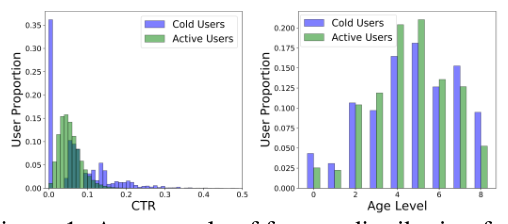
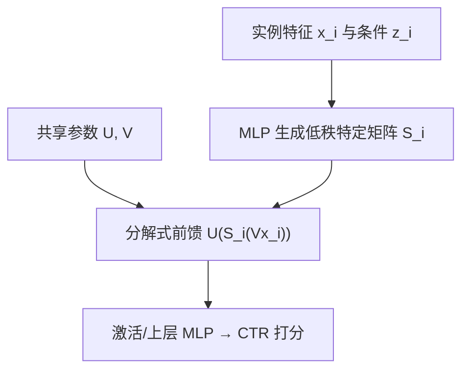
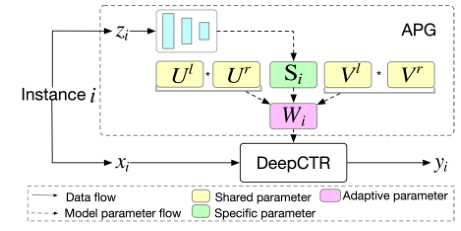

# APG: Adaptive Parameter Generation Network for Click-Through Rate Prediction (自适应参数生成网络用于点击率预估)

- **会议/期刊**: NeurIPS 2022
- **作者与机构**: Bencheng Yan, Pengjie Wang, Kai Zhang, Feng Li, Hongbo Deng, Jian Xu, Bo Zheng；阿里巴巴
- **推荐链路定位**: 精排（CTR 预估）
- **研究方向**: CTR/CVR 预估与特征交叉 / 冷启动与长尾推荐
- **论文原文**: [https://arxiv.org/abs/2203.16218v3](https://arxiv.org/abs/2203.16218v3)
- **开源代码**: 暂未开源

## TL;DR (1分钟核心速览)

深度 CTR 模型通常让所有实例共享同一套静态参数，难以刻画活跃/冷启动用户、不同类目等异质分布，长尾实例还易被高频特征主导。APG 用实例条件 $z_i$动态生成低秩中心矩阵$S_i$，并以共享$U,V$ 保留共性模式；配合分解式前馈与过参数化，在 MovieLens/Amazon/IAAC 的样本级 AUC 上对 7 个 backbone 普遍提升（IAAC 平均 +0.91 点），大模型训练时间降 38.7%、内存降 96.6%，线上 A/B 取得 CTR +3%、RPM +1%。

## Background & Motivation (背景与核心矛盾)

- **主流范式**: 现有深度 CTR 工作主要沿两条线推进：引入更丰富的特征（行为、多模态、知识图谱）或设计更强架构（DeepFM、DCN、AutoInt、AutoML），但隐藏层权重 $W$ 仍由全量实例静态共享。
- **前人局限**: 其一，不同用户群、类目、冷热程度的特征分布差异明显，静态 $W$ 难以做实例级定制；其二，共享参数易被高频样本主导，对长尾实例给出误导性决策。粗粒度参数分配（MMoE、STAR）虽按任务/域分参数，但需人工预定义且存储开销大，难以细粒度到实例。
- **核心洞察 (Key Insight)**: 参数空间也应“共性 + 个性”并存：既有跨实例共享的 common pattern，也有由输入条件即时生成的 custom pattern；且权重矩阵存在低秩内在维度，可用低秩分解控制生成成本。
- **本文切入点**: 不改变特征与主干结构，只把 MLP 权重替换为“共享低秩基 + 动态中心矩阵”的生成式参数，作为通用插件提升现有 CTR 模型。

<figure class="paper-figure" markdown="span">
  <figcaption>图1：不同用户（即活跃用户与冷启动用户）的特征分布示例。左：不同用户组的 CTR 分布存在差异，应考虑定制模式。右：适合采用通用模式来建模不同用户组间相似的年龄分布。</figcaption>
</figure>

## Method (核心方法设计)

### 1. 整体框架 (Overall Architecture)

输入实例特征 $x_i$后，APG 先由条件编码器得到$z_i$（可用 group-wise、mix-wise 或 self-wise 条件），再由轻量 MLP 生成$K\times K$的特定矩阵$S_i$；共享矩阵$U\in\mathbb{R}^{N\times K}$、$V\in\mathbb{R}^{K\times M}$随机初始化并跨实例复用。前向时不再显式重建$W_i$，而是按$V\to S_i\to U$顺序对$x_i$做分解式乘法，输出经激活送入下一层。训练用 CTR 交叉熵端到端学习共享参数与生成网络；推理前将过参数化的$U^lU^r$、$V^lV^r$折叠为$U,V$，因此线上延迟与普通 MLP 基本相同。

<figure class="paper-figure" markdown="span">
  <figcaption>图3：APG 的框架。为简洁起见，本图省略了分解式前馈过程。</figcaption>
</figure>

### 2. 关键设计拆解 (Key Designs)

1. **实例感知低秩参数生成（common + custom 解耦）**：针对静态 $W$无法定制的痛点，将权重参数化为$W_i\approx U S_i V$，其中$S_i=\mathrm{reshape}(\mathrm{MLP}(z_i))$，$K\ll\min(N,M)$。$S_i$捕捉实例/群组特有条件分布，$U,V$捕捉全局共性；生成量从$N\times M$降为$K\times K$，使细粒度参数化在工业规模可行。

2. **分解式前馈（Decomposed Feed-forwarding）**：若先算 $U_iS_iV_i$再乘$x_i$，重建成本为$O(NKK+NMK)$。APG 改为
$$
y_i=\sigma\big(U(S_i(Vx_i))\big),
$$
即把 $x_i$依次穿过$V,S_i,U$，每层复杂度降为$O(KKD+NK+MK+KK)$，避免大矩阵显式重构；这也是低秩分解自然带来的算子级收益。

3. **过参数化与训练/推理不对称**：为弥补 $K$较小导致共享参数容量不足，令$U=U^lU^r$、$V=V^lV^r$，$P\gg K$，训练时扩大共享参数空间并形成隐式正则；推理时预计算并存储折叠后的$U,V$，不增加线上延迟与内存。总损失为 CTR 交叉熵$\mathcal{L}=-\sum_i y_i\log\hat{y}_i+(1-y_i)\log(1-\hat{y}_i)$，沿用曝光日志样本训练，未设计特殊负采样；线上服务只多做一次小型$S_i$ 生成。

## Experimental Setup & Evaluation Protocol (实验设置与评估协议)

- **数据集与预处理**:

| 数据集 | 类型 | #Users | #Items | #Interactions | 特征/场景说明 |
| :--- | :---: | :---: | :---: | :---: | :--- |
| MovieLens | 公开 | 未披露 | 未披露 | 未披露 | 电影推荐，条件示例为 movie gender |
| Amazon | 公开 | 未披露 | 未披露 | 未披露 | 商品推荐，条件示例为 item category |
| IAAC | 公开 | 未披露 | 未披露 | 未披露 | 条件示例为 item brand |
| IndusData | 工业 | 未披露 | 未披露 | 未披露 | 工业赞助搜索日志 |

原文未给出 5-core 等过滤细节与数据统计，仅报告 AUC；这是评估披露上的一个缺口。

- **数据划分与防穿越 (Splitting Strategy)**: 正文未明确公开集的划分比例或全局时间戳切分；工业集按线上日志训练并部署，线上 A/B 验证。无法确认是否存在严格时间切分。
- **排名评测协议 (Ranking Protocol)**: 任务为 CTR 二分类点估计，采用样本级 **AUC**，不是 Full-Ranking 或 Sampled Ranking 协议；因此本文不涉及全库负采样排序指标。
- **对比基线与超参设置**: 基线含 WDL、PNN、FIBINET、DIFM、DeepFM、DCN、AutoInt，以及粗粒度参数分配 MMoE、STAR；效率实验固定 $K=4$、WDL 三层 MLP，隐藏单元从$[64,32,16]$扩至$[1024,512,256]$。作者按 CTR 领域惯例以 0.1% 绝对 AUC 视为显著，未报告$p$ 值。

## Key Experimental Results (实验关键数据)

### 1. 主实验对比 (Main Results)

下表为各 backbone 原模型与加入 APG 后的 AUC（%），括号内为绝对提升点数：

| 方法 | MovieLens Base → +APG | Amazon Base → +APG | IAAC Base → +APG |
| :--- | :---: | :---: | :---: |
| WDL | 79.21 → 79.73 (+0.52) | 69.15 → 69.43 (+0.28) | 65.17 → 65.94 (+0.77) |
| PNN | 79.50 → 79.67 (+0.17) | 69.16 → 69.37 (+0.21) | 65.30 → 65.87 (+0.57) |
| FIBINET | 79.78 → 79.82 (+0.04) | 68.88 → 69.19 (+0.31) | 65.15 → 66.15 (+1.00) |
| DIFM | 79.84 → **79.94** (+0.10) | 69.17 → 69.23 (+0.06) | 65.76 → **66.42** (+0.66) |
| DeepFM | 79.30 → 79.60 (+0.30) | 69.10 → **69.43** (+0.33) | 65.64 → 66.17 (+0.53) |
| DCN | 79.29 → 79.62 (+0.33) | 68.98 → 69.42 (+0.44) | 64.78 → 66.39 (+1.61) |
| AutoInt | 79.36 → 79.64 (+0.28) | 68.96 → 69.38 (+0.42) | 64.99 → 66.21 (+1.22) |
| **Ave** | 79.46 → 79.70 (+0.24) | 69.06 → 69.34 (+0.28) | 65.26 → 66.15 (+0.91) |

工业侧：IndusData 离线 AUC +0.2%，线上 A/B 取得 CTR +3%、RPM +1%；服务内存由 138.03M 降至 16.14M，RT 14.5ms → 14.8ms，基本无损。

### 2. 消融实验 (Ablation Study)

| 版本 | 关键改动 | MovieLens | Amazon | IAAC | Ave AUC | Ave Δ |
| :--- | :--- | :---: | :---: | :---: | :---: | :---: |
| Base | 静态 $W$ | 79.21 | 69.15 | 65.17 | 71.18 | — |
| v1 | 直接生成 $W_i$ | 79.51 | 69.33 | 65.52 | 71.45 | +0.27 |
| v2 | + 低秩参数化 | 79.49 | 69.24 | 65.61 | 71.45 | +0.27 |
| v4 | + 参数共享 | 79.61 | 69.36 | 65.78 | 71.58 | +0.40 |
| v5 | + 过参数化 | **79.73** | **69.43** | **65.94** | **71.70** | **+0.52** |

效率上，v1 在大模型训练时间相对 Base 增加 11117.6%、内存增加 3146.4%；v4 则训练时间降低 38.7%、内存降低 96.6%。与 MMoE/STAR 的细粒度方案相比，APG 在 IAAC 达 65.76 AUC 且隐藏层内存仅 0.38M，而 STAR 细粒度需 13753.71M。

### 3. 关键实验发现 (Key Findings)

1. **普适增益而非单模型偶然**：7 个 backbone 在 3 个公开集全部正向，IAAC 平均提升 +0.91 点，说明“静态参数瓶颈”是跨架构共性问题；类目/品牌差异越大的数据集收益越高。
2. **低秩不损效果、共享与过参数化贡献明确**：v2 与 v1 平均 AUC 同为 71.45，证明低秩压缩基本无损；引入共享 $U,V$ 后 v4 提升至 71.58，过参数化 v5 再提升至 71.70，验证“共性 + 个性”解耦有效。
3. **效率与长尾收益兼得**：v4 在大模型上时间 -38.7%、内存 -96.6%，线上内存缩小约 8 倍；按用户频次分 10 组后，低频组（group 0）的 AUC/CTR 增益高于高频组，说明动态参数确实缓解了长尾被高频主导的问题。

## Highlights & Limitations (亮点、对比与审稿批判)

- **与代表作对比 (vs. Prior Work)**: 相比 MMoE/STAR 的粗粒度人工分参数，APG 细粒度到实例且不存储特定参数，内存低数个量级；相比普通低秩 CTR 改造，APG 只让 $S_i$ 动态化，兼顾 custom 与 common；相比纯架构搜索，APG 与特征/架构正交，可直接插到现有 MLP。
- **可迁移亮点**: 任何以 MLP 权重矩阵为核心的模块都可尝试“共享低秩基 + 小型动态中心矩阵”；推理前折叠过参数化矩阵，可在不增延迟的前提下扩大训练容量，适合工业精排。
- **审稿级局限批判**: 其一，$K$、$P$与条件策略均需人工选择，附录显示$K$过大收益饱和、$P$ 过小明显掉点，缺少自适应机制；其二，评估仅用 AUC，未披露公开集划分/过滤细节，也无校准、排序或显著性检验，线上 RT 并未下降（14.8ms vs. 14.5ms），收益主要来自内存与效果而非时延。

## Rating (四维评分)

- **方法创新性 (Novelty)**: ⭐⭐⭐⭐ （把动态参数生成引入 CTR 精排，低秩分解与共享/特定解耦的组合简洁且有明确物理直觉）
- **评估协议与实验扎实度 (Protocol & Experiments)**: ⭐⭐⭐ （backbone 覆盖广、效率与线上实验完整，但数据划分与过滤披露不足，仅 AUC 单指标、无显著性检验）
- **写作与数学规范度 (Clarity & Rigor)**: ⭐⭐⭐⭐ （复杂度和分解前馈推导清楚，符号统一；条件策略与超参分析放在附录，主文略紧凑）
- **工业落地与复现价值 (Industrial & Practical Value)**: ⭐⭐⭐⭐⭐ （线上 A/B 与内存/RT 数据充分，模块通用、推理可折叠，工程迁移价值高；可惜未开源）

