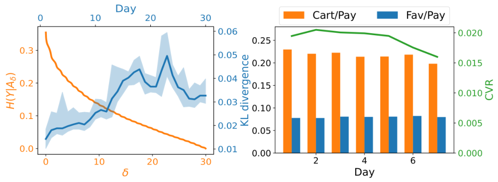
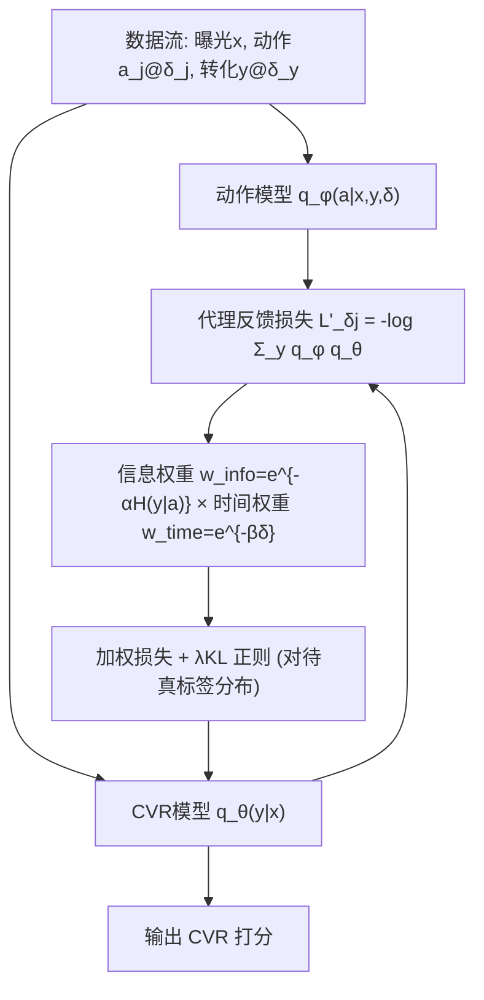
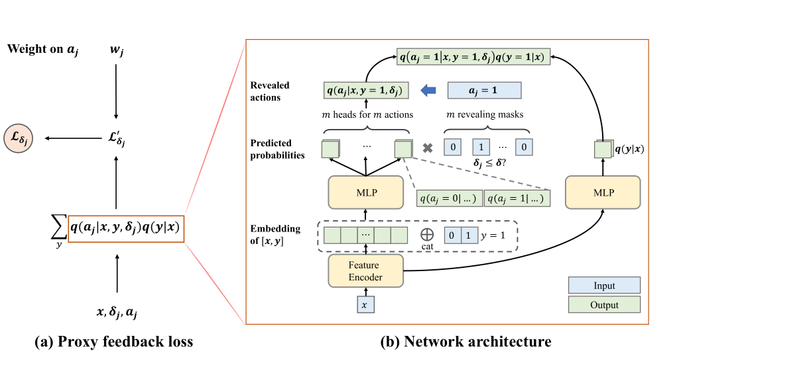

# Generalized Delayed Feedback Model with Post-Click Information in Recommender Systems (融合点击后信息的广义延迟反馈模型)

- **会议/期刊**: NeurIPS 2022
- **作者与机构**: Jia-Qi Yang, De-Chuan Zhan（南京大学 LAMDA 实验室）
- **推荐链路定位**: 精排（CVR 预估）
- **研究方向**: CTR/CVR 预估与特征交叉 / 去偏与工业系统
- **论文原文**: [https://arxiv.org/abs/2206.00407v2](https://arxiv.org/abs/2206.00407v2)
- **开源代码**: [https://github.com/ThyrixYang/gdfm_nips22](https://github.com/ThyrixYang/gdfm_nips22)

## TL;DR (1分钟核心速览)

CVR 标签延迟数天乃至 30 天才回传，使模型始终在学"过期分布"。本文不再只依赖早期转化，而把加购、收藏等**点击后行为**与早期转化统一为带揭示时间 $\delta$的随机后验信息，提出 GDFM：用动作模型$q_\phi(a|x,y,\delta)$与 CVR 模型$q_\theta(y|x)$的期望构成代理反馈损失，使样本在$\delta_j \ll \delta_y$ 时即可流式更新；再用条件熵与时间距离重加权并加 KL 正则。在 Criteo/Taobao 的小时级流式评测中，相对提升分别达 Pretrain→Oracle 差距的 74.9% 与 79.4%（AUC），显著超过 ES-DFM 与 MM-DFM。

## Background & Motivation (背景与核心矛盾)

- **主流范式**: DFM 系列用生存分析建模"转化时间 + 延迟分布"以最大化观测标签似然；FNW/ES-DFM 类重要性采样方法则在负样本到达即标注为负、转化发生后复制正样本并修正损失权重。
- **前人局限 ①**: DFM 需维护长时间跨度的离线样本池，无法流式更新；重要性采样方法则强行引入大量 fake negative，在 Taobao 上直接导致 NLL 崩坏（ES-DFM 为 -214%，FNW 为 -361%）。
- **前人局限 ②**: 现有分析普遍假设数据分布 $p(x,y)$静态、或动作分布$p(a|x)$可被精确估计；但真实场景$p_t(y|x)$ 每小时都在漂移，静态假设掩盖了延迟反馈的真正难点。
- **核心洞察 (Key Insight)**: 数据显示加购商品最终购买率约 12%，未加购则不足 2%，且图 3（右）显示 $p(a|y)$ 的时序曲线远比 CVR 曲线平稳——**后验行为分布近似时不变，可作为"便宜且及时"的监督信号**。

<figure class="paper-figure" markdown="span">
  <figcaption>图3：（左）在 Criteo 数据集中，条件熵（橙色）和时间间隔（蓝色）随时间的变化。（右）在 Taobao 数据集中，条件分布 p(a|y)（柱状）比转化率（折线）更稳定。</figcaption>
</figure>

- **本文切入点**: 显式解耦"时变 CVR 分布"与"时不变动作分布"，把延迟反馈的误差拆成 **采样差距（sample gap）** 与 **时间差距（temporal gap）** 两个可度量、可重加权的因子。

## Method (核心方法设计)

### 1. 整体框架 (Overall Architecture)

GDFM 定义联合分布 $p_t(x,y,a,\delta)=p_t(y|x)p(a|x,y,\delta)p(\delta)p_t(x)$：目标$p_t(y|x)$随时间变，动作分布$p(a|x,y,\delta)$与揭示时间分布$p(\delta)$视为平稳。训练分三条流：$(a,x,y)$齐备时更新动作模型$q_\phi$；$(x,y)$齐备时用真标签更新$q_\theta$；仅有$(a,x)$时（因$\delta_j \ll \delta_y$而最早到达）以边际化$y$的代理损失更新$q_\theta$，并由权重$w_j$与正则$\mathcal{L}_{reg}$控制其强度。推理仅需$q_\theta(y|x)$ 前向一次，无额外开销。

### 2. 关键设计拆解 (Key Designs)

1. **代理反馈损失（Proxy Feedback Loss）**：把"用行为推 CVR"写成对隐变量 $y$的边际似然，$\mathcal{L}'_{\delta_j}=-\mathbb{E}_{p_{t-\delta_j}}\log\sum_{y}q_\phi(a_j|x,y,\delta_j)q_\theta(y|x)$，并在 Lemma 3.1 中给出可辨识条件：以$(\mathbf{M}_x)_{ji}=p(a=a_j|x,y=y_i)$记行为-转化条件矩阵，当且仅当$\mathrm{rank}(\mathbf{M}_x)=n$时可由$p(a|x)$唯一反解$p(y|x)$。直觉是行为把标签信息"提前压缩"成低维观测，只要不共线即可还原。

<figure class="paper-figure" markdown="span">
  <figcaption>图1：(a) 第 j 个动作 a_j 上的代理反馈损失。(b) GDFM 的神经网络架构。</figcaption>
</figure>

2. **双重信息重加权（Entropy × Time）**：作者指出经随机变换 $p(y|x)\to p(a|x)$后分布距离会指数收缩，故估计难度随条件熵$H(y|a)$上升；于是$w_{info}(a_j)=e^{-\alpha H(y|a_j)}$近似刻画样本复杂度的倒数，$w_{time}(\delta_j)=e^{-\beta\delta_j}$刻画$p_t$与$p_{t-\delta_j}$的漂移，合成为$w_j=e^{-\alpha H(y|a_j)}e^{-\beta\delta_j}$ 并归一化到均值 1。这让"信息弱或过时"的行为自动降权，而非一刀切等待。

3. **训练目标与方差控制**：总损失 $\mathcal{L}_{\delta_j}=w_j\mathcal{L}'_{\delta_j}+\lambda\,\mathrm{KL}\big(q_\theta^{t-\delta_y}(y|x)\,\|\,q_\theta(y|x)\big)$，正则项把模型锚在最近一批真标签分布上，既抑制随机行为代理带来的高方差，又保证"即使某行为秩亏、信息不足，性能也不会差于 Vanilla"，这对生产环境的灰度上线尤为关键。负采样方面无需构造负样本（完全避开 fake negative），代价是训练开销随揭示时间档位$\delta_j$ 数量线性增长。

## Experimental Setup & Evaluation Protocol (实验设置与评估协议)

- **数据集与预处理**:

| 数据集 | #Users | #Items | #Interactions | 稀疏度/密度 | 特征/场景说明 |
| :--- | :---: | :---: | :---: | :---: | :--- |
| Criteo Conversion Logs | — | — | ~16M | — | 60 天展示广告日志，数值特征离散化后按类别特征处理 |
| Taobao User Behavior | ~1M | — | >70M | — | 9 天行为流，含 page-view / buy / cart / favorite；无用户特征，取最近 5 条行为 + ID 哈希分桶嵌入 |

- **数据划分与防穿越**: 非 Leave-One-Out，而是 **Pretrain + Streaming 两段切分**——先在预训练集上训好 CVR 与辅助模型模拟"稳定态"，再在流式集上**逐小时**评估并更新，严格只用该时刻已揭示的信息，天然防穿越。
- **排名评测协议**: 属于**逐点概率评测**而非排序，报告小时粒度 AUC / PR-AUC / NLL 的流式均值；结果以 Pretrain（0%）与 Oracle（100%）之间的相对提升归一化，消除绝对量纲差异。
- **对比基线与超参**: Pretrain / Vanilla / Oracle / FNW / ES-DFM / MM-DFM；所有方法共享同一网络结构，GDFM 取 $\alpha=2$、$\beta=1$、$\lambda=0.01$、lr$=10^{-3}$，5 个随机种子报告标准差。

## Key Experimental Results (实验关键数据)

### 1. 主实验对比 (Main Results)

| Method | Criteo AUC | Criteo PR-AUC | Criteo NLL | Taobao AUC | Taobao PR-AUC | Taobao NLL |
| :--- | :---: | :---: | :---: | :---: | :---: | :---: |
| Pretrain | 0.0%(0.815) | 0.0%(0.607) | 0.0%(0.414) | 0.0%(0.703) | 0.0%(0.054) | 0.0%(0.084) |
| Vanilla | 25.2% | 25.1% | 24.6% | 58.9% | 61.7% | 46.0% |
| FNW | 62.0% | 43.1% | 40.3% | 39.6% | -30.5% | -361% |
| ES-DFM | 71.4% | 63.3% | 66.2% | 62.6% | 19.6% | -214% |
| MM-DFM | 69.7% | 39.2% | 54.2% | 59.8% | 62.1% | -14.9% |
| **GDFM (Ours)** | **74.9%** | **68.1%** | **72.4%** | **79.4%** | **80.7%** | **49.6%** |
| Oracle | 100%(0.841) | 100%(0.642) | 100%(0.389) | 100%(0.724) | 100%(0.063) | 100%(0.083) |
| Improv. vs 最佳基线 | +3.5pt | +4.8pt | +6.2pt | +16.8pt | +18.6pt | +3.5pt |

### 2. 消融实验 (Ablation Study)

Criteo 上绝对指标（去掉对应系数即移除该组件）：

| 变体 | AUC | PR-AUC | NLL |
| :--- | :---: | :---: | :---: |
| w/o $\alpha$（去信息权重） | 0.8333 | 0.6244 | 0.3983 |
| w/o $\beta$（去时间权重） | 0.8343 | 0.6314 | 0.3964 |
| w/o $\lambda$（去 KL 正则） | 0.8339 | 0.6226 | 0.3988 |
| **GDFM (full)** | **0.8349** | **0.6311** | **0.3960** |

额外注入合成动作（与 $y$一致概率$p$）的鲁棒性实验：$p=0.5$（纯噪声）时 AUC 0.835 不降；$p=0.9$升至 0.839；$p=0.95$ 达 0.840，逼近 Oracle 0.841。

### 3. 关键实验发现 (Key Findings)

1. **信息权重是最大功臣**：去掉 $\alpha$使 Criteo AUC 从 0.8349 掉到 0.8333（降幅约为去掉$\beta$ 的 3 倍），说明"哪些行为值得用"比"行为有多新"更关键；这也解释了为何 ES-DFM 用固定权重在 Taobao NLL 上彻底失效。
2. **越早不等于越好**：图 4 显示 $w_{info}$随$\delta$递增、$w_{time}$随$\delta$ 递减，乘积在第 7 天左右达到峰值——存在一个"信息-时效"最优揭示窗，直接反驳了"越早的反馈越有用"这一常用工程直觉。
3. **安全性可量化**：$p=0.5$的纯噪声动作不带来性能退化，而$p\ge 0.8$ 时性能单调上升，说明 KL 正则确实提供了"行为再差也不伤主任务"的兜底，这对线上多行为接入的灰度策略有直接指导意义。

## Highlights & Limitations (亮点、对比与审稿批判)

- **与代表作对比**: 相比 DFM 需长期离线样本池、FNW 复制样本并做重要性加权、ES-DFM 依赖固定权重，GDFM 的差异在于（i）把动作分布显式建模为时不变并给出可辨识性条件，（ii）用条件熵而非启发式固定窗决定权重，（iii）以 KL 正则替代重要性采样，从源头规避 fake negative。
- **可迁移亮点**: $e^{-\alpha H(y|a)}$ 这套"用条件熵给辅助监督信号定价"的做法，可直接迁移到多任务精排中的辅助任务加权、以及短视频多行为（完播/点赞）融合；KL 锚定正则也适用于任何流式增量训练场景。
- **审稿级局限批判**: ① 训练成本随揭示时间档位数线性增长，与论文自述一致，在工业级多档位（10min/30min/1h/1d…）下会成为瓶颈；② 权重 $w_j$与$p(a,y)$由全量计数统计得到，未做样本级（$x$-dependent）细化，且$\alpha,\beta$需按数据集调参（作者亦承认 Criteo 上$\beta$ 影响较弱但未给自适应方案）；③ 仅在两个公开数据集上验证，缺乏线上 A/B 与收入指标。

## Rating (四维评分)

- **方法创新性 (Novelty)**: ⭐⭐⭐⭐ （把"延迟反馈"重构为时变/时不变分布解耦，并用条件熵给出可辨识性与样本复杂度的定量刻画，视角新颖且落在可执行算子上）
- **评估协议与实验扎实度 (Protocol & Experiments)**: ⭐⭐⭐⭐ （流式逐小时评测 + Pretrain/Oracle 归一化标尺 + 5 种子方差报告相当规范，但数据集仅两个、缺少线上验证）
- **写作与数学规范度 (Clarity & Rigor)**: ⭐⭐⭐⭐ （联合分布假设、三条损失分支与 Lemma 3.1 推导清晰，权重设计的经验依据亦有图 2 佐证；部分假设如 $p(\delta)$ 独立性的合理性论证略薄）
- **工业落地与复现价值 (Industrial & Practical Value)**: ⭐⭐⭐⭐ （代码已开源、推理零额外开销、KL 正则提供上线安全边际；扣分点在于训练开销随揭示档位线性增长）

