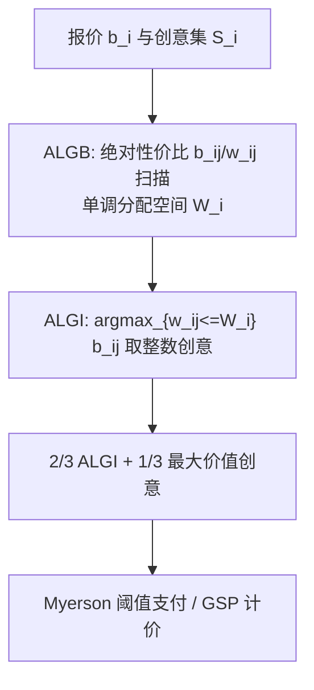
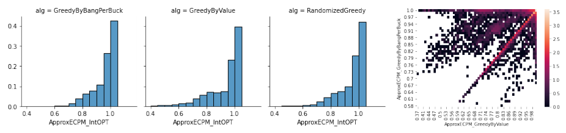

# Simple Mechanisms for Welfare Maximization in Rich Advertising Auctions (富媒体广告拍卖中社会福利最大化的简单机制)

- **会议/期刊**: NeurIPS 2022 (arXiv:2206.02948)
- **作者与机构**: Gagan Aggarwal, Kshipra Bhawalkar, Aranyak Mehta (Google Research), Divyarthi Mohan (Tel Aviv University), Alexandros Psomas (Purdue University)
- **推荐链路定位**: 精排 / 列表级分配（受限背包式广告位打包 + 计价）
- **研究方向**: CTR预估与特征交叉 / 多任务学习与列表级重排
- **论文原文**: [https://arxiv.org/abs/2206.02948v1](https://arxiv.org/abs/2206.02948v1)
- **开源代码**: 暂未开源

## TL;DR (1分钟核心速览)

富媒体广告位空间有限，同一广告主可提交多个尺寸 $w_{ij}$、点击率$\alpha_{ij}$各异的创意但只能展示其一，最优分配退化为多选择背包问题（NP-hard），VCG 不可算，而常规背包近似算法又不满足单调性、无法配 Myerson 支付。本文改用**绝对性价比**$b_{ij}/w_{ij}$单调分配空间再后处理取最优创意（ALGI），并以$2/3$概率与最大价值创意混合，得到多项式时间 **3-近似诚实机制**；配 GSP 计价时纯 PoA$\le 6$、Bayes-Nash PoA$\le 6/(1-1/e)$。11,000 条真实查询上平均达 VCG 的 0.9493，耗时仅为其约 1/9。

## Background & Motivation (背景与核心矛盾)

- **主流范式**: 赞助搜索把广告位抽象为多槽位单位需求拍卖，按 eCPM 排序后配 GSP/VCG 计价；广告主私有信息仅一维（每次点击价值 $v_i$）。
- **前人局限**: ①富媒体创意（图片/站内链接/视频）占据不同空间，且"每位广告主至多一个创意 + 总空间 $\le W$"构成多选择背包约束，整数最优分配 NP-hard，VCG 理论最优但不可计算；②广告主可策略性地上报**创意子集**$S_i\subseteq A_i$，问题变为多参数（$v_i$与$S_i$ 双维私有），Myerson 引理不能直接用；③经典"增量性价比"最优分数解、乃至其 2-近似整数化版本，均被反例证明**非单调**。
- **核心洞察 (Key Insight)**: 性价比排序下"期望点击数" $x_i(b,S)$不单调，但"分配到的空间"$W_i=\sum_j w_{ij}x_{ij}$是单调的。只要先把空间单调地划给广告主，再在空间内取最优创意，整体分配即对$b_i$与$S_i$ 单调，可套用 Myerson 支付。
- **本文切入点**: 用绝对性价比而非增量性价比排序，构造单调空间分配，并以随机混合补齐近似比。

## Method (核心方法设计)

### 1. 整体框架 (Overall Architecture)

输入为各广告主的报价 $b_i$与上报创意集$S_i$，平台据公开的$(\alpha_{ij},w_{ij})$计算每个创意的每点击价值$b_{ij}=b_i\alpha_{ij}$与性价比。先跑 ALGB 按绝对性价比扫描、逐步替换同一广告主的创意并扩张其空间配额$W_i$；再跑 ALGI 在$W_i$内取价值最高的可行创意得到整数分配；最终以$2/3$概率输出 ALGI、$1/3$ 概率输出全局最大价值创意，并据此计算 Myerson 阈值支付。GSP 变体则按"分配变化的最小阈值报价"计价。

### 2. 关键设计拆解 (Key Designs)

1. **ALGB：单调空间分配算子**：痛点在于增量性价比 $(b_{ij}-b_{ik})/(w_{ij}-w_{ik})$ 排序虽给出最优分数解，却因"删掉小创意反而拿到大创意"而破坏单调性。ALGB 改为按绝对性价比 $b_{ij}/w_{ij}$从高到低扫描，若当前创意$j$属于广告主$i$且$w_{ij}>w_{ik}$，则以$j$**替换**$i$已有创意并令$W_i=w_{ij}$，空间不足则分数填充后终止。关键性质：$W_i$对$b_i$与$S_i$ 均单调不减——加价只会让该广告主的创意更早被扫描到，不可能被挤掉。
2. **ALGI 与 3-近似随机化**：ALGB 的分配可能分数且对其他广告主次优，故后处理取 $j\in\arg\max_{w_{ij}\le W_i} b_{ij}$，得整数且仍单调的 ALGI。单独 ALGI 可任意差，于是以$2/3$概率跑 ALGI、$1/3$概率给最大价值创意$b_{\max}$，可证$\mathrm{SW}(x^{OPT})\le 2\,\mathrm{Val}(x^{ALGI})+b_{\max}$，即 3-近似且紧。下界方面：任何确定性单调规则近似比不优于$2-\varepsilon$，随机化不优于$12/11-\varepsilon$——单调性本身即是福利损失根源，尽管无约束时存在 FPTAS。
3. **支付、GSP 与 PoA**：诚实支付为 $p_i=b_i x_i(b,S)-\int_0^{b_i}x_i(z,b_{-i},S)\,dz$，阈值仅出现在性价比打平时，共$O(n|S|^2)$个，每个重算$O(n|S|)$，故支付可多项式时间精确计算。改用 GSP（$cpc_i=\inf\{b_i':x_i(b_i')<x_i(b_i)\}$）后机制非诚实，但在 no-overbidding 下以 IntOPT 为基准给出纯 PoA$6$、Bayes-Nash PoA$6/(1-1/e)\approx9.49$，核心引理为$\beta W\le 2\,\mathrm{SW}^{bpb}+2\,\mathrm{SW}^{max}$（$\beta$为第$\lfloor W/2\rfloor+1$单位空间对应创意的性价比），并证得机制是$( \tfrac{1}{2}(1-\tfrac{1}{e}),2)$ 半光滑。

## Experimental Setup & Evaluation Protocol (实验设置与评估协议)

- **数据与规模**: 某大型搜索引擎真实广告日志采样，约 11,000 条查询，每条**至少 6 个广告主**；所有创意空间 $w_{ij}$取整，总空间上限$W=500$（大于任何单个创意）。

| 数据集 | #Queries | 每查询广告主 | 空间上限 $W$ | 特征说明 |
| :--- | :---: | :---: | :---: | :--- |
| 搜索广告日志（工业采样） | ≈11,000 | $\ge 6$| 500 | 整数尺寸$w_{ij}$、预测点击率$\alpha_{ij}$、每点击报价$b_i$ |

- **数据划分与防穿越**: 无训练/测试划分，属**逐查询离线机制仿真**——每条查询独立求解分配与支付，直接与分数最优 OPT、整数最优 IntOPT 对拍。
- **排名/评估协议**: 以 eCPM 福利 $\sum_{ij}x_{ij}b_{ij}$ 的**比值（近似因子）** 为指标，属全量分配评估（无负采样）；随机化算法报告 100 次重复的均值与置信区间。
- **对比基线**: VCG（IntOPT + VCG 支付）、IncrementalBPB（分数最优）、GreedyByValue（跳过放不下的大创意持续填充）、GreedyByBangPerBuck、RandomizedGreedy（2/3 BPB + 1/3 Value）。支付按 Lemma 1 的 Myerson 公式实现。

## Key Experimental Results (实验关键数据)

### 1. 主实验对比 (Main Results)

| 方法 | 相对 VCG 的 eCPM 近似 | 单查询耗时 (ms) | 说明 |
| :--- | :---: | :---: | :--- |
| VCG (IntOPT + VCG) | 1.0000 | 0.0308 | 暴力枚举，福利最优但不可扩展 |
| GreedyByValue-Myerson | 0.9196 | **0.0016** | 最快，但福利最弱 |
| GreedyByBangPerBuck-Myerson | **0.9493** | 0.0033 | 福利最优启发式 |
| RandomizedGreedy-Myerson | 0.9393 ± 0.0001 | 0.0027 | 理论保证版本 |
| **Improv. (vs VCG)** | −5.1% 福利 | **11.4× 加速** | 支付计算已含在内 |

### 2. 消融/组件对比 (Ablation)

| 变体 | 最差 vs 分数 OPT | 最差 vs IntOPT | 平均 vs VCG |
| :--- | :---: | :---: | :---: |
| w/o 空间替换（GreedyByValue） | 0.40 | 0.40 | 0.9196 |
| w/o 后处理优化（纯 ALGB 分数解） | 非单调，不可配支付 | — | — |
| ALGI（GreedyByBangPerBuck） | 0.55 | 0.60 | **0.9493** |
| + 随机混合（RandomizedGreedy） | ≥0.55 | — | 0.9393 |
| IntOPT（上界参照） | 0.55 | 1.00 | 1.0 |

<figure class="paper-figure" markdown="span">
  <figcaption>图2：GreedyByValue、GreedyByBangPerBuck 和随机化 Greedy 相对于 IntOPT 的近似因子直方图。每个桶的高度表示该桶中查询所占比例。最后一幅图展示 GreedyByValue、GreedyByBangPerBuck 相对于 IntOPT 的近似因子相关性。热图中的颜色标度按桶内查询数量的对数表示。</figcaption>
</figure>

### 3. 关键实验发现 (Key Findings)

1. **最坏界极松、平均近乎无损**：理论保证仅 3-近似，但实测 ALGI 平均拿到 VCG 的 0.9493、平均近似因子达 0.97，且耗时 0.0033 ms 对比 VCG 的 0.0308 ms（约 9–11 倍加速），说明"为单调性付出的福利代价"在真实分布上远小于最坏情形。
2. **绝对性价比排序显著优于纯价值排序**：GreedyByBangPerBuck 最差情形对分数 OPT 为 0.55、对 IntOPT 为 0.60，而 GreedyByValue 分别只有 0.40/0.40；热力图显示两者在大量查询上近似因子相同（对角线质量集中），但 BPB 明显更常占优。
3. **随机混合反而轻微掉点**：RandomizedGreedy (0.9393) 低于纯 BPB (0.9493)，因为两个分量高度相关，$1/3$ 概率退回最大价值创意只引入了方差而无互补收益——实践中应直接用确定性 BPB 启发式，随机化仅服务于理论诚实性。

## Highlights & Limitations (亮点、对比与审稿批判)

- **与代表作对比 (vs. Prior Work)**: 相比 Deng et al. 仅处理两种固定尺寸、Cavallo et al. 停留在单参数且无近似保证、Ghiasi et al. 只做 LP 取整（4-近似）而无支付规则，本文首次同时给出**多参数（报价+创意集）下的诚实机制、紧的 3-近似、以及 GSP 的 PoA 界**；相对 VCG 的指数级枚举实现了多项式可算。
- **可迁移亮点**: ①"先单调分配容量资源、再在容量内做局部最优"是把非单调背包近似改造为可计价机制的通用配方，可迁移到预算约束投放、多目标混排配额分配；②把随机化当作"补足近似比"的工具而不改变单调性，可直接复用于任何需要 Myerson 支付的组合分配场景。
- **审稿级局限批判**: ①实验只报告离线 eCPM 比值，未做均衡/真实竞价行为的仿真，PoA 的 6 与 9.49 缺乏实证支撑；②3-近似是紧的但界偏松（实测 0.95），且算法对性价比打平的 tie-breaking 顺序敏感、支付计算需 $O(n|S|^2)$ 次重跑，创意库规模增大时在线开销会显著上升。

## Rating (四维评分)

- **方法创新性 (Novelty)**: ⭐⭐⭐⭐ （"空间单调而非点击单调"的观察直击多参数机制设计痛点，下界与紧例证完备）
- **评估协议与实验扎实度 (Protocol & Experiments)**: ⭐⭐⭐ （真实工业数据 + 与 IntOPT/分数 OPT 双向对拍扎实，但缺均衡仿真与在线 A/B）
- **写作与数学规范度 (Clarity & Rigor)**: ⭐⭐⭐⭐⭐ （定义—引理—定理链条清晰，反例与紧例构造极具说服力）
- **工业落地与复现价值 (Industrial & Practical Value)**: ⭐⭐⭐⭐ （算法仅需排序与后处理、毫秒级可部署，但无开源代码且支付实现细节依赖平台）

