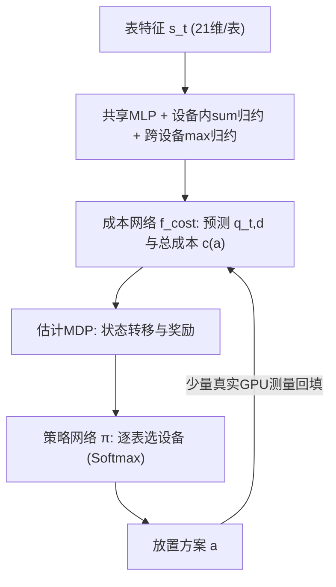

# DreamShard: Generalizable Embedding Table Placement for Recommender Systems (面向推荐系统的可泛化嵌入表放置)

- **会议/期刊**: NeurIPS 2022
- **作者与机构**: Daochen Zha, Louis Feng, Qiaoyu Tan, Zirui Liu, Kwei-Herng Lai, Bhargav Bhushanam, Yuandong Tian, Arun Kejariwal, Xia Hu（Rice University / Meta Platforms / Texas A&M）
- **推荐链路定位**: 训练底座（分布式嵌入表分片，服务于大规模召回/精排模型的 embedding lookup）
- **研究方向**: 去偏公平、可信隐私与工业架构 / 强化学习与动态探索推荐
- **论文原文**: [https://arxiv.org/abs/2210.02023v1](https://arxiv.org/abs/2210.02023v1)
- **开源代码**: [https://github.com/daochenzha/dreamshard](https://github.com/daochenzha/dreamshard)

## TL;DR (1分钟核心速览)

嵌入表在多 GPU 上的放置决定了推荐模型训练的通信/计算瓶颈，但现代实现（FBGEMM）会把多表**算子融合**，融合后的加速比随表组合在 1×–3× 间剧烈波动，且线上实验的表数与设备数频繁变化，要求策略零微调泛化。DreamShard 把逐表放置写成 MDP，用一个**成本网络**（sum 归约表表示、max 归约设备表示）预测融合后的前/反向计算与通信耗时，据此构造"估计 MDP"离线训练策略网络，无需真实 GPU 执行。在 DLRM 与 Meta 生产表上，测试集成本较最强基线最高降 19%（生产表 Prod-80(8) 41.9→35.2 ms），跨表数/跨设备数迁移性能损失 < 0.5 ms，百表推理 < 1 秒。

## Background & Motivation (背景与核心矛盾)

- **主流范式**: 嵌入表放置本质是 NP-hard 划分问题，工业界靠"按 size / dim / lookup 次数"的贪心均衡启发式（RecShard 类）或直接用 RL 控制器（Placeto/RNN 系列）在真实硬件上试错搜索。
- **前人局限一**: 通用计算图放置方法假设算子独立可加，无法刻画**算子融合**——融合表集合的加速比非恒定，导致"只均衡计算量"的 AutoShard 类方法忽略通信项而次优。
- **前人局限二**: RL 放置需在真实 GPU 上反复执行来取 reward，训练昂贵；且 RNN 控制器与固定维度输出无法直接迁移到表数/设备数不同的新任务，换任务即需重训。
- **核心洞察 (Key Insight)**: 成本可被一个以 21 维表特征为输入的神经网络**直接回归**，且只要成本估计"足够准而非完美准"，策略网络仍能产出强放置；因此可用估计 MDP 替代硬件闭环。
- **本文切入点**: 用 sum/max 归约把变长表集合压成定长表示，使成本网络与策略网络天然对表数、设备数不变，实现零微调泛化。

## Method (核心方法设计)

### 1. 整体框架 (Overall Architecture)

输入是若干嵌入表的 21 维特征（hash size、dimension、table size、pooling factor、访问分布等）与设备数 $D$。MDP 按"一次放一张表"推进：状态$\tilde{s}_t=\{s_t,\{q_{t,d}\}_{d=1}^{D}\}$记录各设备已放表特征$s_{t,d}$及其实测/预测的三项成本特征$q_{t,d}\in\mathbb{R}^3$（前向计算、反向计算、反向通信），动作为设备 ID，最终奖励为整体耗时的负值。成本网络$f_{\text{cost}}$拟合$(s_t)\to(\{q_{t,d}\},c(\mathbf{a}))$，训练时策略网络只在估计 MDP 内交互（无 GPU），仅周期性采样真实放置回填成本数据，二者交替迭代。

### 2. 关键设计拆解 (Key Designs)

1. **可泛化的成本网络（sum-max 归约）**：痛点是不定表数/设备数使 MLP 输入维度可变。做法是对每张表用共享 MLP 得 $\mathbf{h}_i=\mathrm{MLP}(\mathbf{e}_i)$，设备表示为表表示的元素级求和、整体表示为跨设备的逐元素取最大：
 $\mathbf{h}_d=\sum_{i\in\mathcal{P}_d}\mathrm{MLP}(\mathbf{e}_i),\qquad \mathbf{h}=\max_{d}\mathbf{h}_d$归约后维度恒为$d$，多头 MLP 直接复用；max 归约刻画"最慢设备决定总时延"的瓶颈语义，这与 sum 聚合设备内工作量共同构成对融合算子成本的物理近似（消融显示 sum-max 组合预测最准）。
2. **估计 MDP + 策略网络**：痛点是在真实 GPU 上取 reward 的采样成本使 RL 不可扩展。做法是把成本网络当成 world model，其预测的 $q_{t,d}$与$c(\mathbf{a})$直接构成$\tilde{s}_t$和$r_M=-c(\mathbf{a})$；策略对每台设备单独打分后 Softmax：
 $p(a_t=d)=\mathrm{Softmax}_d\big(\mathrm{MLP}([\mathbf{h}_d,\mathbf{q}_{t,d}])\big)$
 由于打分器共享，动作空间（设备数）变化时无需改结构。逐表放置的序列化形式使表数变化只需多跑几步，这是跨任务泛化的直接来源。
3. **训练目标与推理开销**：成本网络用 MSE 回归，策略用带熵正则（权重 0.001）的 policy gradient $\nabla J=\mathbb{E}\big[\sum_t \nabla\log\pi(a_t\mid\tilde{s}_t)(R-b)\big]$，无负采样概念。推理仅需两个网络的前向，百表规模 < 1 秒；成本网络在 100 个数据点后估计精度继续提升但策略已饱和，说明"够用的成本估计"即可。

## Experimental Setup & Evaluation Protocol (实验设置与评估协议)

- **数据集与预处理**: 学术数据集规模太小导致任何放置成本都极小，故只用两个工业级数据集：

| 数据集 | #Tables | #Devices | 表维度 | 说明 |
| :--- | :---: | :---: | :---: | :--- |
| DLRM (Meta 开源) | 856 | 4 / 8 | 固定 | 复现主战场，含生产级访存复用模式 |
| Prod (内部) | 与 DLRM 同量级 | 2 / 4 / 8 | 4–768 不等 | 维度异构，更难均衡通信 |

- **数据划分与防穿越 (Splitting Strategy)**: 非时间切分，而是**表级不相交划分**——856 张表随机分入训练池 $\mathcal{E}_{\text{train}}$与测试池$\mathcal{E}_{\text{test}}$（等量不重叠），每任务从池中采样$|\mathcal{E}_i|\in\{10,\dots,100\}$（DLRM）或$\{20,40,80\}$（Prod）张表；训练/测试各 50 个任务。测试任务的表在训练中从未出现，属严格 unseen-table 泛化协议。
- **排名评测协议 (Ranking Protocol)**: 非 ranking 指标，采用**端到端实测耗时 (ms)** 作唯一指标，50 任务取均值 ± 标准差，重复 5 次。
- **对比基线与超参设置**: 5 个工业人类专家启发式（size-based、dim-based、lookup-based、size-lookup-based、以及无策略随机）＋适配同款特征提取层的 RNN-based RL；统一 $N_{\text{collect}}=10$、$N_{\text{cost}}=300$、$N_{\text{batch}}=64$、$N_{\text{RL}}=10$、$N_{\text{episode}}=10$、10 轮外迭代。

## Key Experimental Results (实验关键数据)

### 1. 主实验对比 (Main Results)

测试任务耗时（ms，越低越好；括号为相对随机放置的降幅）：

| 任务 | Random | Size-based | Dim-based | Lookup-based | Size-lookup | RNN-based | DreamShard |
| :--- | :---: | :---: | :---: | :---: | :---: | :---: | :---: |
| DLRM-100 (4) | 94.5 | 81.2 (+13.1%) | 82.2 (+11.7%) | 94.5 (-2.9%) | 78.4 (+17.1%) | 94.8 (-0.3%) | **77.8 (+21.5%)** |
| DLRM-200 (8) | 50.7 | 38.9 (+32.4%) | 39.9 (+31.3%) | 68.7 (-25.0%) | 37.2 (+38.4%) | 70.4 (-28.0%) | **36.4 (+39.3%)** |
| DLRM-80 (8) | 25.2 | 25.6 (-1.6%) | 20.8 (+21.2%) | 16.7 (+50.9%) | 16.9 (+49.1%) | 53.4 (-52.8%) | **16.1 (+56.5%)** |
| Prod-40 (4) | 38.3 | 43.6 (-12.2%) | 33.5 (+14.3%) | 37.4 (+2.4%) | 40.1 (-4.5%) | 36.7 (+4.4%) | **30.4 (+26.0%)** |
| Prod-80 (8) | 47.7 | 53.9 (-11.5%) | 41.9 (+13.8%) | 46.1 (+3.5%) | 49.6 (-3.8%) | 62.5 (-23.7%) | **35.2 (+35.5%)** |

跨任务零微调迁移（表 2）：DLRM-20(4)→DLRM-100(4) 得 77.9 ms，与在目标任务重训的 77.8 ms 几乎持平；DLRM-100(4)→DLRM-20(4) 为 17.7 vs. 17.6 ms；设备数 4→2 与 2→4 双向迁移降幅均 < 0.3 ms。

### 2. 消融实验 (Ablation Study)

DLRM-50(4)，测试耗时（ms，越低越好）：

| 变体 | w/o dim | w/o hash | w/o pooling | w/o table size | w/o distribution | w/o cost 特征 | 策略换 RNN | DreamShard |
| :--- | :---: | :---: | :---: | :---: | :---: | :---: | :---: | :---: |
| Cost (ms) | 40.9 | 40.6 | **47.2** | 40.6 | 40.5 | **46.3** | 40.5 | **40.4** |

### 3. 关键实验发现 (Key Findings)

1. **成本特征（augmented state）是最大贡献项**：去掉三项实测/预测成本特征后耗时从 40.4 ms 劣化到 46.3 ms（+14.6%），远超任何单个表特征移除；说明策略真正依赖的是"算力/通信画像"而非原始表规格。
2. **难任务收益更大且基线会反噬**：表/设备越多，DreamShard 越占优（Prod-80(8) 相对最强基线 dim-based 提速 19%），而 lookup-based 在 DLRM-200(8) 反而比随机慢 25%、RNN-based 在 DLRM-80(8) 慢 52.8%——单目标贪心与无成本模型的 RL 在高维划分空间里双双失效。
3. **泛化来自架构而非记忆**：成本网络 MSE 在 100 个数据点后仍持续下降，但策略性能已饱和（图 7），说明 DreamShard 对成本估计误差鲁棒；表 2 中跨表数/跨设备数迁移仅损失 < 0.5 ms，验证 sum/max 归约带来的置换与规模不变性。

## Highlights & Limitations (亮点、对比与审稿批判)

- **与代表作对比 (vs. Prior Work)**: 相较 RecShard（按行分布做 CPU/GPU 分层内存的 MILP 求解）与 AutoShard（仅均衡计算量的 RL），DreamShard 同时建模计算+通信且用神经成本模型替代硬件闭环；相较 Placeto（图嵌入泛化设备放置），它无需图结构、且能处理数量可变的设备与算子融合。
- **可迁移亮点**: ① "sum 归约表、max 归约设备"这一变长集合聚合范式可直接搬到多卡/多机通信拓扑、异构 batch 分配等资源调度问题；② 用低成本代理模型替代真实硬件闭环的 estimated-MDP 训练范式，可显著降低任何 RL 系统调优的采样代价。
- **审稿级局限批判**: ① 仅支持同构 GPU 且单层内存，未覆盖 CPU DRAM + GPU HBM 分层与异构集群拓扑，与 RecShard 的现实场景相比偏理想化；② 主实验以合成 DLRM 为主，生产表 Prod 仅报告主结果、缺统计检验；且每次表池显著变化需重训/微调，成本估计网络的可解释性与跨硬件（A100/H100）迁移性未验证。

## Rating (四维评分)

- **方法创新性 (Novelty)**: ⭐⭐⭐⭐ （把"算子融合成本 + 变长集合泛化"转化为 sum/max 归约的成本网络与估计 MDP，思路干净且非平凡）
- **评估协议与实验扎实度 (Protocol & Experiments)**: ⭐⭐⭐⭐ （表级不相交划分的 unseen-table 协议严格、5 次重复±std、含跨任务迁移与成本网络精度曲线，但生产集证据偏少）
- **写作与数学规范度 (Clarity & Rigor)**: ⭐⭐⭐⭐ （MDP 定义与网络结构表述清晰，公式简洁；成本模型的理论误差界缺失，仅靠经验曲线论证）
- **工业落地与复现价值 (Industrial & Practical Value)**: ⭐⭐⭐⭐⭐ （代码开源、百表推理 < 1 秒、已在 Meta 生产模型验证，可直接嵌入训练调度链路）

