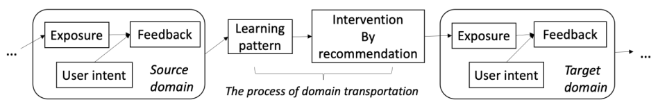
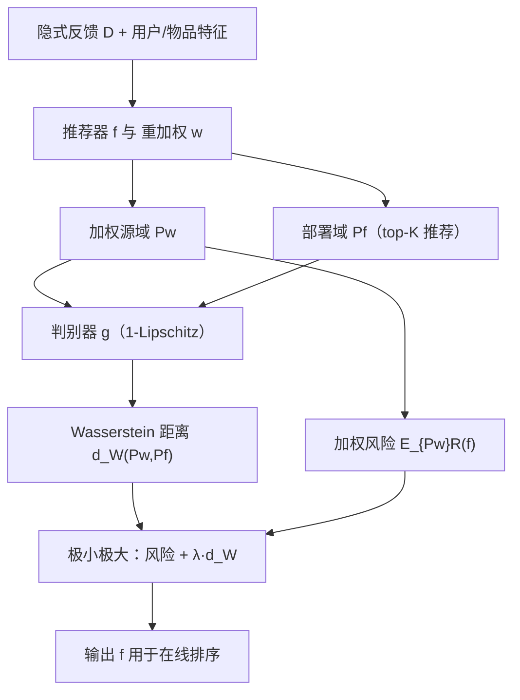
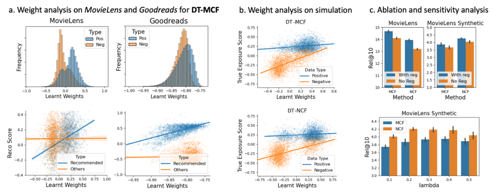

# From Intervention to Domain Transportation: A Novel Perspective to Optimize Recommendation (从干预到域传输：优化推荐的新视角)

- **会议/期刊**: ICLR 2022
- **作者与机构**: Da Xu (Walmart Labs), Yuting Ye (UC Berkeley), Chuanwei Ruan (Instacart)
- **推荐链路定位**: 端到端学习目标（覆盖召回/排序的风险估计层）
- **研究方向**: 去偏公平、可信隐私与工业架构 / 强化学习与动态探索推荐
- **论文原文**: [论文原文链接](https://arxiv.org/abs/2203.13956v1)
- **开源代码**: 暂未开源（原文说明代码附在论文补充材料中）

## TL;DR (1分钟核心速览)

现代确定性推荐系统几乎无探索，导致逆概率加权 (IPW) 与域适应 (DA) 因"源-目标域重叠不足"而失效（原文 Proposition 1 证明风险不可控且 DA 不可能）。本文把推荐重新表述为**域传输**：推荐既干预已观测数据，又干预其自身创造的**部署域**。提出 Wasserstein 传输约束风险最小化，并转化为 WGAN 式两层极小极大博弈。在 MovieLens-1M/LastFM/GoodReads 的 Leave-One-Out Full-Ranking 协议下，DT-Attn 相对 Attn 将 Rel@10 从 14.26 提升至 16.32（+14.4%），Hit@10 从 72.23 提升至 74.82（+3.6%）。

## Background & Motivation (背景与核心矛盾)

- **主流范式**: 推荐被视为带干预的因果推断问题，主流用 IPW 重加权或 DA 学习域不变表征，将 MNAR 反馈校正为无偏风险。
- **前人局限**: ① 这些工具依赖源/目标域的**重叠假设**（overlap），而现代系统多为确定性（曝光概率几乎为 0 或 1）；② 原文 Proposition 1 严格证明：重叠不足时，IW 的目标风险上界随 $d_1(P\|Q)$ 无界增大，DA（SGNS）不存在使联合风险小的假设，即 **IW 失效 / DA 不可能**。
- **核心洞察 (Key Insight)**: 推荐作为干预，**不仅影响已观测反馈，还影响将要被推荐的目标域**。重加权不应只作"测度变换工具"，更应主动"识别"一个能传输到部署域的训练域。
- **本文切入点**: 用域传输 (transportation) 而非域适应 (adaptation) 刻画学习-干预机制，再以 Wasserstein 距离约束之。

<figure class="paper-figure" markdown="span">
  <figcaption>图 1：强调领域传输的信息检索系统的一种实际工作机制。</figcaption>
</figure>

## Method (核心方法设计)

### 1. 整体框架 (Overall Architecture)

模型由三块网络构成：推荐器 $f$（MCF/NCF/Attn）、重加权网络$w$、1-Lipschitz 判别器$g$。输入隐式反馈$D$后，$w$与$f$联合产生**加权源域**$P_w$与**部署域**$P_f$，$g$尽量分离二者（放大差距），$f,w$同步压低加权风险与$d_W(P_w,P_f)$。分层时间尺度下极小极大损失收敛到 Nash 均衡，推理只用$f$，在线开销接近原推荐器。

### 2. 关键设计拆解 (Key Designs)

1. **传输约束风险最小化**：痛点在于 IW/DA 一旦无重叠就崩，需要**约束训练域与部署域之间的可达性**。核心目标是 $\min_{f\in\mathcal{F},w\in\mathcal{H}} \mathbb{E}_{P_w}R(f)\ \text{s.t.}\ d_W(P_w,P_f)\le\rho$，其中$P_w(u,i)\propto w_{ui}P(u,i)$，$P_f(u,i)\propto \text{reco}(u,i;f)P(u,i)$。直觉：$\rho=0$退化为只优化部署域（覆盖少、偏差大），$\rho$过大则过拟合历史反馈；**适中$\rho$ 是"探索-利用"的显式连续旋钮**。

2. **WGAN 式对偶实现**：$d_W$不能直算。由 Kantorovich-Rubinstein 对偶，可将传输正则化目标写成极小极大博弈$\min_{\theta_1,\theta_2}\max_{\theta_3}\sum w_{ui}\ell_{ui}(f)+\lambda\!\left(\sum w_{ui}g_{ui}-\sum \text{reco}(u,i;f)g_{ui}\right)$。$g$拉大两域差距、$f$与$w$同时压风险并压差距，等价于找到一个能把模式传输到"未来被推荐域"的假设。$\lambda\ge O(L)$ 时与完整重叠的 counterfactual risk minimization 一致。

3. **训练目标、负采样与推理**：本文**不额外引入负采样**（恰恰因为要处理无探索的确定性反馈）；top-K 推荐通过采样近似——每对 $(u',i')$随机采$m=100$个负例，仅判断$i'$是否进入 top-K，显著降低训练期全库排序开销。推理时仅$f$前向，无额外开销；采用两时间尺度 GDA（$\theta_{1,2}$步长$\eta\gamma$，$\theta_3$步长$\eta$）。

## Experimental Setup & Evaluation Protocol (实验设置与评估协议)

- **数据集与预处理**: 隐式反馈（$Y_{ui}\in\{0,1\}$），保留至少一次交互的用户/物品：

| 数据集 | #Users | #Items | #Interactions | 稀疏度/密度 | 特征/场景说明 |
| :--- | :---: | :---: | :---: | :---: | :--- |
| MovieLens-1M | 见附录 C.1 | 见附录 C.1 | 约 $10^6$ | 隐式 | 电影隐式反馈，主流 CF 基准 |
| LastFM | 见附录 C.1 | 见附录 C.1 | 见附录 C.1 | 隐式 | 音乐电台交互 |
| GoodReads | 见附录 C.1 | 见附录 C.1 | 见附录 C.1 | 隐式 | 图书交互 |

- **数据划分与防穿越 (Splitting Strategy)**: **Leave-One-Out**——倒数第二条交互作验证，最后一条作测试。
- **排名评测协议 (Ranking Protocol)**: **Full-Ranking（全库排序）**，主指标 Hit@10、NDCG@10，外加**Rel@10**（top-10 相关性之和，即 $\sum_{top10}R_{ui}$，更贴近部署风险$\mathbb{E}_{P_f}R(f)$，真实数据以测试$Y_{ui}$ 近似）。
- **对比基线与超参**: 基线分三类：Pop 热度、MCF/NCF/Attn 骨干、IPW-MF/ExpoCF/AC-MF 因果或缺失数据方法；$m=100$训练负采样；GDA 双时间尺度；$\lambda$ 做敏感性分析（Figure 2c）。

## Key Experimental Results (实验关键数据)

### 1. 主实验对比 (Main Results)

MovieLens-1M 真实数据（Hit/NDCG 已 ×100；括号内为标准差；**加粗为最优**）：

| Method | Rel@10 | Hit@10 | NDCG@10 |
| :--- | :---: | :---: | :---: |
| Pop | 9.05 (.02) | 43.67 (.10) | 22.73 (.03) |
| IPW-MF | 14.00 (.05) | 60.48 (.12) | 31.17 (.09) |
| ExpoCF | 14.04 (.08) | 60.21 (.14) | 30.98 (.10) |
| AC-MF | 14.05 (.07) | 61.19 (.11) | 31.72 (.11) |
| MCF | 14.02 (.03) | 60.27 (.15) | 30.91 (.11) |
| **DT-MCF** | **14.65** (.07) | **61.95** (.12) | **32.83** (.08) |
| NCF | 13.77 (.04) | 59.95 (.13) | 31.07 (.10) |
| **DT-NCF** | **13.98** (.06) | **61.17** (.15) | **32.27** (.07) |
| Attn | 14.26 (.10) | 72.23 (.19) | 42.48 (.10) |
| **DT-Attn** | **16.32** (.09) | **74.82** (.24) | **43.09** (.14) |

**Improv. (DT vs. 原骨干)**: DT-MCF 较 MCF 的 Rel@10/NDCG@10 分别 **+4.49% / +6.21%**；DT-Attn 较 Attn 的 Rel@10 **+14.45%**。LastFM 与 GoodReads 上同一骨干同样被一致抬高（如 GoodReads 的 DT-MCF NDCG@10 从 36.45 相比 NCF 亦领先）。

### 2. 消融实验 (Ablation Study)

原文以 Figure 2c 给出（无具体数值表，按图注与正文归纳）：

| 配置 | MovieLens-1M 真实数据 | MovieLens-1M 模拟数据 | 结论 |
| :--- | :---: | :---: | :--- |
| DT-MCF（完整） | 最优 | 最优 | 基线实现 |
| w/o 传输正则化 ($\lambda=0$) | 显著下降 | 显著下降 | 传输约束是必要组件 |
| $\lambda$变化（多档） | 相对平稳 | 相对平稳 | 对$\lambda$ 不敏感 |

### 3. 关键实验发现 (Key Findings)

1. **Deployment risk 提升远大于 Hit/NDCG**：DT-Attn 的 Rel@10 提升 **14.45%**（16.32 vs 14.26），而 Hit@10 仅 +3.59%、NDCG@10 仅 +1.44%——说明传输约束真正提升的是"被推荐域中的质量"，而非仅排序命中。
2. **重加权网络学到了有意义的结构**：Figure 2a 显示 $w_{ui}$在正例与被$P_f$推荐的 (u,i) 上更大，且与$f(u,i)$正相关；Figure 2b 显示在模拟数据上$w_{ui}$与曝光$P(O_{ui}=1)$正相关、负样本权重分布更分散——$w$被训练为平衡"正反馈域"与"$f$ 部署域"。
3. **因果校正的增益有限，域传输才是主要增益源**：IPW-MF（31.17）、ExpoCF（30.98）、AC-MF（31.72）相对 MCF（30.91）几乎持平；而 DT-MCF 直接跳到 32.83（NDCG@10），说明仅靠重加权校正估计偏差并不能打破重叠瓶颈，必须与传输约束联合才生效。

<figure class="paper-figure" markdown="span">
  <figcaption>图 2：(a) MovieLens 和 GoodReads 上的权重分析。上：正、负反馈数据上 wui 的分布。下：在 Pf（f 下推荐的 (u, i)）与其他情况下 wui 与 fui 的关系；(b) MovieLens 模拟数据上的权重分析：MCF（上）和 NCF（下）在正、负合成反馈数据上 wui 与 P(Oui = 1) 的关系；(c) MovieLens 及其合成数据上传输正则化的消融研究与 λ 的敏感性分析。</figcaption>
</figure>

## Highlights & Limitations (亮点、对比与审稿批判)

- **与代表作对比 (vs. Prior Work)**: IPW-MF (Saito et al., 2020)、ExpoCF (Liang et al., 2016)、AC-MF (Xu et al., 2020) 都停留在"用 $w$校正风险"的 change-of-measure 视角；本文把$w$升格为主动构造"传输到$P_f$ 的训练域"的机制，并证明 IW/DA 在确定性推荐下理论失效。与经典 WGAN 的差别在于：本文不假设生成过程，只把 1-Wasserstein 用做域约束的度量。
- **可迁移亮点**: ① "重加权 $w$作为域识别器 + 部署域$P_f$ 显式建模"可扩展到 retriever/reranker 的曝光偏差校正；② WGAN 对偶把 Wasserstein 约束变成判别器，避免显式最优传输计算，可直接插入任意编码器-打分器架构。
- **审稿级局限批判**: ① 训练期 $P_f$由 top-K 采样近似（$m=100$），有偏且对$m$敏感；② Rel@10 用测试$Y_{ui}$近似部署风险，并非无偏；③ 理论保证依赖 Lipschitz 假设，实践中$f,g$ 需梯度裁剪；④ 双时间尺度 GDA 调参成本高，与工业现有确定性排序系统的集成路径尚未给出。

## Rating (四维评分)

- **方法创新性 (Novelty)**: ⭐⭐⭐⭐ （从"干预"到"域传输"的视角切换是本文最核心的洞见，再由 Wasserstein + 极小极大博弈给出可解形式，理论与算法链路完整。）
- **评估协议与实验扎实度 (Protocol & Experiments)**: ⭐⭐⭐⭐ （三真实数据集 + 半合成模拟 + 真实系统线上 A/B/C 测试，Full-Ranking 与 8 个基线齐备，理论覆盖一致性/泛化/超额风险/bandit 一致性；但 λ 消融只有图、缺数值表。）
- **写作与数学规范度 (Clarity & Rigor)**: ⭐⭐⭐⭐ （IW 失效与 DA 不可能的命题陈述清晰，公式推导严谨，Kantorovich-Rubinstein 对偶的引入自然；缺点是公式与证明大量下沉至附录，正文密度偏高。）
- **工业落地与复现价值 (Industrial & Practical Value)**: ⭐⭐⭐⭐ （有真实系统 A/B/C 上线，WGAN 式判别器可作为轻量模块插入现有排序器；但 top-K 采样、双时间尺度 GDA、Lipschitz 约束的工程实现需实际调参。）

